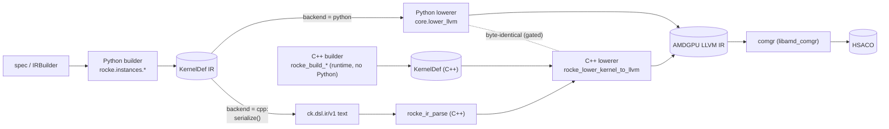
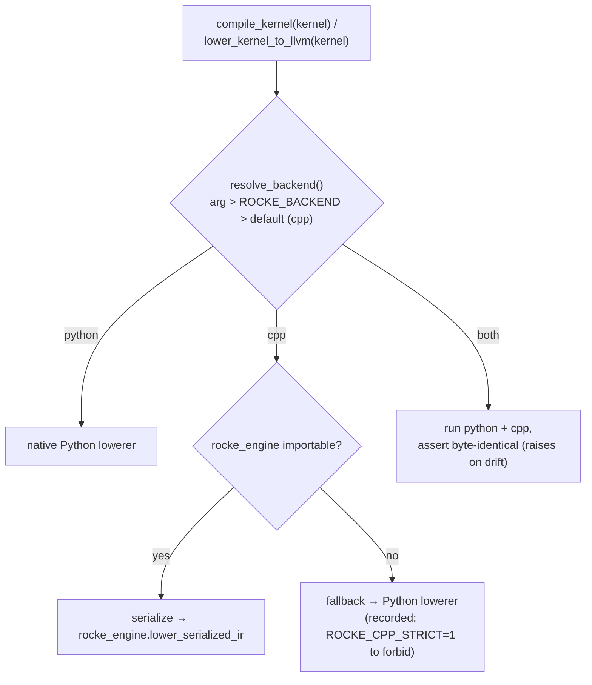
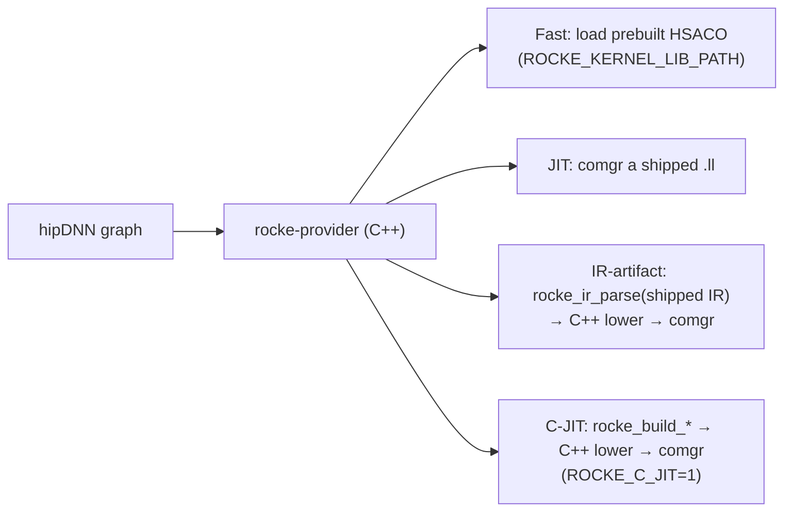

# Engines & Switching

rocke has **two engines**, each with a **front end** (the *builder*: spec → IR)
and a **back end** (the *lowerer*: IR → AMDGPU LLVM IR text). They are kept
byte-identical and are interchangeable. This page is the map: what the pieces are,
how to switch between them, and every interconnect.

| | Front end (builder: spec → IR) | Back end (lowerer: IR → `.ll`) |
|---|---|---|
| **Python** | `rocke.instances.*` (e.g. `build_universal_gemm`) via `IRBuilder` | `rocke.core.lower_llvm.lower_kernel_to_llvm` |
| **C++** | `Cpp` `rocke_build_*` | `Cpp` `rocke_lower_kernel_to_llvm` |

- **Python** is the authoring front end (the crown jewel) and the differential **oracle**.
- **C++** is a first-class runtime engine — it can build *and* lower with **no Python present** (what the hipDNN provider ships).
- Both back ends emit **byte-identical** LLVM IR for the same kernel; CI enforces it.

## Data flow & interconnects

**The seams (interconnect points):**
1. **`ROCKE_BACKEND` / `resolve_backend()`** — picks which back end lowers a *Python-authored* kernel (`rocke/core/backend.py`).
2. **The `rocke_engine` pybind module** — exposes the C++ engine to Python: the generic `lower_serialized_ir(ir_text, arch)`, the per-family `<fam>_lower_llvm` / `_serialize_ir` / `_verify`, and `build_id()` / `engine_version()`.
3. **The IR seam** — `serialize(KernelDef)` (Python) → `rocke_ir_parse` (C++): a Python-built kernel reaches the C++ lowerer as serialized `ck.dsl.ir/v1` text (the C++ engine can't take a Python object directly). This is the path the `cpp` backend uses for arbitrary kernels.
4. **The byte-identity gate** — `tools/check_byte_identity.py` / `run_diff`; `both` mode asserts it at runtime. Keeps the two back ends equal (see [`engine_parity.md`](../development/engine_parity.md)).
5. **The hipDNN provider** — the pure-C++ runtime that links the C++ engine (below).

## Switching the lowering back end (Python-authored kernels)

How to choose, in precedence order:
- **Per call:** `compile_kernel(kernel, backend="python"|"cpp"|"both")` (also `lower_kernel_to_llvm(..., backend=)`).
- **Per process:** `export ROCKE_BACKEND=cpp|python|both`.
- **Default:** `cpp` (the C++ engine), which **auto-falls back to the Python lowerer** if `rocke_engine` isn't built — set `ROCKE_CPP_STRICT=1` to turn that fallback into an error.
- `both` runs both and raises on any divergence — the in-process differential check.
- `python` selects the native lowerer (and is the differential oracle).

> Match the **LLVM flavor** to your `comgr`: `ROCKE_LLVM_FLAVOR=llvm22` for ROCm 7.2 (else it's auto-detected). See [`../development/setup_guide.md`](../development/setup_guide.md) and [`../reference/env_flags.md`](../reference/env_flags.md).

## The C++ runtime path (hipDNN provider)

At runtime the provider is pure C++ — **no Python**. It serves a kernel one of four ways:

- **Fast** — load a prebuilt HSACO bundle (offline-generated; any engine).
- **JIT-from-`.ll`** — `comgr`-compile a shipped `.ll`.
- **IR-artifact** — parse shipped serialized IR, then the C++ lowerer + `comgr` (no C++ builder needed).
- **C-JIT** — the C++ builder *and* lowerer at runtime (`ROCKE_C_JIT=1`); fully Python-free.

Provider flags (`ROCKE_C_JIT`, `ROCKE_KERNEL_LIB_PATH`, `HIPDNN_PLUGIN_PATH`, `ROCKE_ALLOW_ENGINE_MISMATCH`) are in [`../reference/env_flags.md`](../reference/env_flags.md); build details in `BUILD.md`.

## Python-only universal-GEMM levers

Some universal-GEMM `TraitSpec` levers are implemented by the Python builder only
(`rocke/core/backend.py` `_PYTHON_ONLY_GEMM_LEVERS`): the row-interleave LDS layout and
its slot schedules (`lds_row_interleave`, `rilv_pad`, `hb_*`, `sia_*`), the vector
epilogue (`rilv_vec_epilogue`, `rve_store_nt`, `rve_pad`), the DTL issue-economy and
instruction-economy levers (`dtl_rsrc_word3`, `dtl_soff0`, `kloop_unroll`,
`dtl_addr_spread`, `hb_dtl_delay`, `hb_tile_lgkm0`, `dtl_base_fold`, `das_*`,
`dtl_clamp_k`), the K start staggers (`stagger_u*`, `k_stagger*`, `k_stagger_rc`),
the MFMA issue orders (`mfma_serpentine`, `mfma_order`), the hand-ordered loop
(`asm_loop*`, `fr0_loop_order`), the wave-specialized ping-pong (`pingpong`, `pp_*`), `ilv_early_free` / `ilv_ef_spread` /
`ilv_split_wait`, `sk_xcd_local` and `dtl_tight_ragged_only`. The ring, AGPR /
interleave, persistent / stream-K and early-release levers are mirrored in the C++
builder.

- A kernel built with a Python-only lever is ordinary IR: it lowers through either
  engine via the IR seam (`cpp` / `both` backends, and the provider's Fast,
  JIT-from-`.ll` and IR-artifact modes), and the byte-identity gate covers that IR.
- The C++ *builder* (the C-JIT mode and the per-family `rocke_engine` builders) cannot
  build it: the spec converters (`universal_gemm_spec_to_dict` and the GEMM-wrapper
  converters) raise `NotImplementedError` instead of silently building another kernel.
- The gfx950 GEMM dispatcher's row-interleave bodies (`dispatch/gemm/common.py`,
  `rilv_*`) use these levers by default, so a Python-free C-JIT deployment does not
  have those dispatch picks; serve them as prebuilt HSACO or shipped IR.

## Python-only side channels and families

Some fused kernels are built by attaching a Python object to a spec (a side channel,
not a `TraitSpec` field) or by a Python-only family. Without the attachment the
universal-GEMM / attention emission is byte-identical. The C++ engine has no mirror
for any of them, so the C++ builder and the C-JIT mode cannot build these kernels;
their IR lowers through either engine like any other (see above).

| Side channel / family | Attached by | What it changes |
|---|---|---|
| `spec._prologue` | `instances/common/gemm_prologue.py` `attach_prologue` | operand prologue between the LDS read and the MFMA: f32 operands through the 16-bit DTL ring (`cvt`, and the bf16 `x3` / `x6` / `x4` / `x9` split recipes), unary opA / opB, the interleaved complex-f32 B embedding (`cplx_b`, 4M in one kernel), f32 output |
| `spec._batch2` | set on a batched universal-GEMM spec | a second batch mode (`stride_a2/b2/c2`, `L2`; grid z = the two modes) |
| `spec._mono` | `library/kernels/gfx950/gemm_rich_epilogue`; `library/kernels/gfx950/hiptensor_mono/persistent_contraction.py` | the row-interleave vector epilogue replaced by a rich epilogue (bias / activation / multi-D / fp8 output / fused reductions); or, for the persistent contraction monokernel, operand-pack producer tasks before the persistent tile loop (`pre_tasks`), a dependency wait before each tile (`wait_tile`), a permuted alpha / beta epilogue and a row-max reduction (`post_tile`); producer tasks that write A / B drop their readonly / noalias (`writes_operands`) |
| family `hiptensor_mono` (task queue) | `library/kernels/gfx950/hiptensor_mono/task_queue.py` | experimental, not dispatched: one persistent launch drains a ticket queue of every tile of every op of a plan; the ops' stand-alone kernels (universal GEMM, permutes) are inlined into it by copying their IR (`inline.py`), with an optional output-permute rewrite of the GEMM stores |
| family `tensor_network_mono` | `library/kernels/gfx950/tensor_network_mono` | experimental, not dispatched: a quantum-circuit tensor network (every gate an extent-2-mode contraction) in one persistent launch, phases of gates applied as f32 MFMA blocks on LDS tiles with a grid barrier between phases |
| `spec._gett` | `instances/common/tensor/gett.py` (family `tensor_gett`, dispatch `dispatch/families/tensor_gett.py`) | native GETT: per-mode strided operand loads, K-outer LDS stages, `ds_read_b64_tr_b16` fragments, permuted alpha / beta epilogue; on the GEMM dispatcher's MN-layout (CRR) bodies only the operand addressing and the epilogue (16-byte `v_permlane32_swap` stores), on its RCR bodies only the epilogue (the vector epilogue's hook) |
| `spec._score_identity` | `library/kernels/gfx950/attention_dense.py` | dense attention with the score map replaced by `scale * S` (back-to-back GEMM `E = scale * (Q K^T) V`) |

## Rule of thumb

- **Authoring / iterating** → Python front end, `backend=python` is easiest to debug; `both` to check the C++ engine agrees.
- **Shipping / serving** → the C++ engine (default `cpp`, or the provider's C-JIT / IR-artifact / Fast modes).
- **Adding or tuning a kernel** → change *both* engines and keep them byte-identical — see [`../development/engine_parity.md`](../development/engine_parity.md) and [`../development/engine_contributing.md`](../development/engine_contributing.md).
