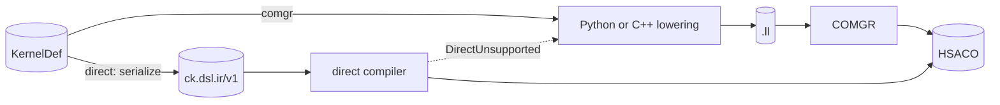

# The direct code-object compiler

The direct compiler turns serialized rocKE IR (`ck.dsl.ir/v1`) into a loadable
HSACO for gfx1151 and gfx950. It is the Rust library `rocke_codeobj_ffi`, built
from [`rust/rocke-codeobj`](../../rust/rocke-codeobj/). No LLVM component takes
part in a compile: no COMGR, Clang, LLD, assembler, subprocess, code-object
cache or precompiled image. The crate depends only on the Rust standard
library. COMGR stays the default code-object compiler, and it is the reference
the direct compiler is tested against.

This page describes what the compiler does, how to call it, what it refuses,
and how to debug and change it. It records no measurements: measured
comparisons with COMGR belong in a results document, under the compliance
policy in [`platform/AGENTS.md`](../../AGENTS.md).

## Where it sits



Two independent settings choose the path:

- `ROCKE_BACKEND` picks the engine that lowers a kernel to LLVM IR. It matters
  only on the COMGR path. The byte-identity rule between the two engines is
  about LLVM IR, so the direct compiler does not affect it.
- `ROCKE_CODEOBJ_BACKEND`, or the `code_object_backend=` argument, picks the
  code-object compiler: `comgr` (the default) or `direct`.

A kernel the direct compiler accepts never becomes LLVM IR. A kernel it refuses
as unsupported takes the COMGR path when it comes through `compile_kernel`.

## Targets

| Target | Wave | What it compiles |
|---|---|---|
| gfx1151 | 32 | The ops of every kernel family rocKE builds for gfx1151, WMMA included. |
| gfx950 | 64 | The ops of the kernel families rocKE builds for gfx950: MFMA (plain, scaled f8f6f4 and the BF16x3 emulation) with AGPR accumulators, LDS DMA, the transposing LDS reads, fp8 and bf8 conversions, packed f32 math, the cross-lane ops, and the scalar, vector, memory and control-flow ops of the other families. |

The library reports its targets (`rocke_codeobj_supported_targets_v1`, or
`direct_supported_targets()` in Python). Any other target is refused: the
Python entry points raise `DirectUnsupported` before calling the library, and
the C entry points fail with a `request` diagnostic.

A request names a processor. Python drops the features of an ISA name or a
target ID, so `amdgcn-amd-amdhsa--gfx950:sramecc+:xnack-` compiles for
`gfx950`. The gfx950 code object is built for xnack and sramecc `any`, so it
loads in either mode.

## Using it

### `compile_kernel`

```python
from rocke.helpers import compile_kernel

artifact = compile_kernel(kernel, arch="gfx950", code_object_backend="direct")
artifact.code_object_backend  # "direct", or "comgr" after a fallback
artifact.direct_fallback      # why the direct compiler refused, after a fallback
```

`ROCKE_CODEOBJ_BACKEND=direct` does the same for every call that passes no
`code_object_backend`.

- The kernel is serialized (`rocke.core.ir_serialize.serialize`) and compiled
  in process. `optimize_ir=True` runs rocKE's IR passes first, as on the COMGR
  path.
- `artifact.llvm_text` is empty. `artifact.timings` has `ir_serialize` and
  `codeobj_executable` (the compile inside the library); the COMGR stages are 0.
- When the direct compiler raises `DirectUnsupported` (a target it does not
  compile for, or an op it does not lower for the target), `compile_kernel`
  builds the kernel with COMGR instead and records the reason in
  `direct_fallback`. Every other rejection raises `CodeObjectError`: nothing
  else falls back.
- One kernel per code object. `compile_module` (several kernels in one code
  object) and the LLVM-IR entry points (`build_hsaco_from_llvm_ir`,
  `build_hsaco_from_llvm_modules`) are COMGR-only and refuse `direct`.

### `rocke.runtime`

[`runtime/code_object.py`](../../python/rocke/runtime/code_object.py):

- `build_direct_rocke_ir_hsaco(serialized_ir, *, isa=...)` compiles serialized
  IR and returns `(hsaco, timings, compiler_info, summary)`, where `summary` is
  the resource summary below. The default `isa` is gfx1151. It raises
  `DirectUnsupported` or `CodeObjectError`, and never falls back.
- `direct_supported_targets()` returns the library's targets
  (`["gfx1151", "gfx950"]`), and `supported_isas("direct")` returns them as ISA
  names. Neither queries a GPU.
- `loaded_compiler_info("direct")` and `compiler_identity("direct")` describe
  the loaded library. The identity includes the library's path, size and
  modification time, so a cache key built from it changes when the library is
  rebuilt.

[`runtime/direct_session.py`](../../python/rocke/runtime/direct_session.py):
a `DirectSession(worker_threads=0, *, isa=...)` owns the compiler's worker
threads, so consecutive compiles pay no thread start, and the state of a
streamed input:

```python
from rocke.runtime.direct_session import DirectSession

with DirectSession(isa="gfx950") as session:
    hsaco, timings, compiler, summary = session.compile(ir_text)
    for piece in pieces:  # one kernel's text, split anywhere
        session.feed(piece)
    hsaco, timings, compiler, summary = session.finish()
```

A session gives the same bytes as `build_direct_rocke_ir_hsaco` on the same
text. The wrapper serializes calls with a lock, so one session may be shared
between Python threads. Distinct sessions are independent. `close()`, or the
end of the `with` block, stops the session's threads. A target the library
does not compile for raises `DirectUnsupported` when the session is created.

Python finds the library through `ROCKE_CODEOBJ_DIRECT_LIB` (a file path) or,
when that is unset, the platform library search path (`rocke_codeobj_ffi`). A
failed search is not remembered, so a library built later in the same process
is found.

### C and C++

The ABI is declared in
[`cpp/include/rocke/code_object_ffi.h`](../../cpp/include/rocke/code_object_ffi.h):

| Entry point | What it does |
|---|---|
| `rocke_codeobj_ffi_abi_version` | The ABI version. Compare it with `ROCKE_CODEOBJ_FFI_ABI_VERSION` before the first compile. |
| `rocke_codeobj_supported_targets_v1` | The supported targets, comma-separated (`"gfx1151,gfx950"`). A static string: do not free it. |
| `rocke_codeobj_compile_rocke_ir_v2` | Compiles serialized IR for the request's target. |
| `rocke_codeobj_compile_rocke_ir_v1` | The same, for gfx1151. |
| `rocke_codeobj_session_create_v2`, `rocke_codeobj_session_create_v1` | Creates a session for a target (v1: gfx1151), with its worker threads. |
| `rocke_codeobj_session_compile_v1` | Compiles one input on a session. |
| `rocke_codeobj_session_feed_v1`, `rocke_codeobj_session_finish_v1` | Streams one kernel's text in pieces, then compiles it. |
| `rocke_codeobj_session_free_v1` | Stops and joins a session's threads. |
| `rocke_codeobj_compile_result_dispose_v1` | Releases a result. |
| `rocke_codeobj_compile_gfx1151_wmma_gemm_v1` | The fixed-pattern gfx1151 WMMA GEMM entry; see [`code_object_compiler.md`](./code_object_compiler.md). |

- Every struct carries `struct_size`, which the library checks against its own
  layout.
- A result owns its HSACO and diagnostics until it is disposed. Dispose every
  result a call initialized, on success or failure.
- A panic inside the library is caught at the boundary and returned as a
  failure (`internal: ...`).
- The library keeps no global state. Calls on one session must not overlap: an
  overlapping call fails without touching the session (`ROCKE_DIRECT_SESSION`).
  Different sessions, and the entry points without a session, may run
  concurrently.
- `feed` copies its bytes, and its pieces may split lines or UTF-8 sequences
  anywhere. The session parses completed lines on its threads while the
  producer is still writing. `finish` compiles what was fed since the last
  `finish`.

### Building the library

With CMake, `-DROCKE_BUILD_RUST_CODEOBJ=ON` runs `cargo build --release
--locked` into `<build>/rust-target` and registers the native CTests below.
`rocke_link_codeobj_ffi(<target>)` links an executable against the library; on
Windows it also copies the DLL next to the executable. To build it directly:

```text
cargo build --locked --release --manifest-path rust/rocke-codeobj/Cargo.toml --target-dir <build-dir>
```

The library is `<build-dir>/release/rocke_codeobj_ffi.dll` on Windows and
`<build-dir>/release/librocke_codeobj_ffi.so` on Linux.

## Results and diagnostics

A successful compile's diagnostics hold a one-line resource summary:

```text
instructions=N code_bytes=N vgprs=N sgprs=N lds_bytes=N phases_ms=parse:T,optimize:T,...
```

The phase list follows the compiler and may change. A failure's diagnostics
are `<kind>: <message>`:

| Kind | Meaning | In Python |
|---|---|---|
| `request` | An unknown or unsupported target, or a malformed request. | `CodeObjectError`. Python refuses an unsupported target itself, as `DirectUnsupported`. |
| `ROCKE_DIRECT_PARSE` | Text that is not `ck.dsl.ir/v1`, or an op name the parser does not know. | `CodeObjectError` |
| `ROCKE_DIRECT_MALFORMED` | IR that is not well formed: operand counts, types or attributes that an op does not take. | `CodeObjectError` |
| `ROCKE_DIRECT_INVALID` | IR that rocKE's LLVM lowering or COMGR refuses as well. | `CodeObjectError` |
| `ROCKE_DIRECT_UNSUPPORTED` | Valid IR that this compiler does not lower for the target. | `DirectUnsupported`: `compile_kernel` uses COMGR. |
| `ROCKE_DIRECT_REGISTERS` | No allocation fits, even with spilling. | `CodeObjectError` |
| `ROCKE_DIRECT_ENCODE` | An instruction the encoder cannot encode, such as a branch past its offset range. | `CodeObjectError` |
| `ROCKE_DIRECT_ELF` | The code-object writer failed. | `CodeObjectError` |
| `ROCKE_DIRECT_INTERNAL`, `internal` | A broken internal invariant, or a panic caught at the boundary. | `CodeObjectError` |
| `ROCKE_DIRECT_SESSION` | An overlapping call on one session. | `CodeObjectError` |

## What a compile does

Paths are under [`rust/rocke-codeobj/src`](../../rust/rocke-codeobj/src/).

| Stage | What it does | Code |
|---|---|---|
| Parse | Reads the text into the compiler's IR. Large inputs are cut into chunks parsed on several threads, a SIMD byte scanner (AVX-512 or AVX2 when the CPU has them) finds the line structure, and repeated constants are shared. A session parses a streamed input while it is being written. On gfx950, constants used before their definition move ahead of their uses, a vector select by a splatted mask becomes a scalar select, and nontemporal accesses get the `nt` bit. | `rir/parse.rs`, `rir/parse_par.rs`, `rir/scan.rs`, `rir/hashcons.rs`, `rir/stream.rs`, `target/gfx9/early_constants.rs`, `target/gfx9/mask_splat.rs`, `target/gfx9/cpol.rs` |
| Validate | Checks every op's operands, results, types and attributes, and the limits: region nesting, vector width, LDS per workgroup, workgroup size, uniformity. | `rir/validate.rs` |
| LDS layout | Places the kernel's LDS allocations; allocations whose lifetimes do not overlap share space. | `rir/analysis.rs` |
| Optimize | Simplification and constant folding, common-subexpression elimination (repeated LDS loads included), loop-invariant code motion, known-bits facts (a bounds test with the same answer in every workgroup, for example), unrolling the loops the IR marks `unroll = true`, and the `noalias` and `readonly` facts of kernel arguments. | `rir/opt.rs`, `rir/unroll.rs`, `rir/alias.rs` |
| Automatic unrolling | Unrolls small loops with a constant trip count that the IR leaves rolled, under a size bound. | `rir/unroll.rs` |
| Target IR passes | gfx950: adjacent `if` blocks of one condition fuse and their stores widen, and a repeated load takes the first load's result: within one straight-line run, and for memory of a `noalias readonly` argument also past barriers and from an enclosing region. gfx1151: long FMA accumulator chains issue round-robin. | `target/gfx9/widen.rs`, `target/gfx9/ro_loads.rs`, `rir/fma_chains.rs` |
| LDS swizzle | Remaps LDS addresses to avoid bank conflicts; wave32 only. | `rir/lds_swizzle.rs` |
| Uniformity | Classifies every value as wave-uniform (SGPRs) or per lane (VGPRs). | `rir/analysis.rs` |
| Instruction selection | Maps ops to machine instructions. On gfx950 it adds MFMA selection, LDS DMA with its M0 writes, the transposing LDS reads, the fp8 and bf8 conversions, uniform-address atomics issued once per wave, the cross-lane ops and the cache-policy bits. On gfx1151, a 64-bit division takes a 32-bit path when both operands fit. | `rir/isel.rs`, `target/gfx9/isel_hooks.rs`, `target/gfx9/mfma.rs`, `target/gfx9/lds_dma.rs`, `target/gfx9/lds_tr.rs`, `target/gfx9/fp8.rs`, `target/gfx9/atomics.rs`, `target/gfx9/lanes.rs`, `rir/div_bypass.rs` |
| Machine-code rewrites | Dead copies, the proven peephole rules (on gfx950, the rule families confirmed there) and VALU fusion. gfx1151: a row's guard is evaluated once per loop block. gfx950: an MFMA that starts from zero reads C as the constant 0, an LDS DMA address is read into an SGPR once, gfx950's own instructions (packed f32, `v_lshl_add_u64`), and gfx9's operand rules, with literals reused in loops; in kernels without MFMAs, a uniform compare repeated in a loop block reuses the first evaluation's lane mask. | `rir/post.rs`, `rir/peephole.rs`, `rir/uniform_masks.rs`, `target/gfx9/zero_acc.rs`, `target/gfx9/m0_hoist.rs`, `target/gfx9/rules.rs`, `target/gfx9/select.rs`, `target/gfx9/wide_add.rs`, `target/gfx9/pack.rs`, `target/gfx9/masks.rs`, `target/gfx9/legalize.rs` |
| Scheduling and allocation | Schedules each candidate window, allocates it, and takes the widest window that keeps the occupancy of load sinking alone. A wider window still is tried when a cost model predicts a faster schedule at the same occupancy or one wave less. The `noalias` facts relax memory order only when the relaxed schedule wins after allocation. When program order does not fit the registers, each WMMA moves up to its operands. gfx1151: an f16 conversion that several FMAs read folds into each of them when that costs no spills or waves. gfx950: MFMA accumulators move to AGPRs when no schedule fits the VGPRs; before spilling, a candidate schedule that fits with its accumulators in AGPRs (moved inside their loops where needed) joins the cost race; a kernel whose LDS or workgroup size already sets its occupancy also tries wider windows with its accumulators in AGPRs; a wider schedule at one wave fewer with AGPR accumulators is kept when the cost model prefers it; a window that fails is retried with its SGPR results sunk toward their readers; every kernel's registers leave room for one workgroup on a CU; and `agpr_alloc = [0, 0]` turns AGPRs off. | `rir/mod.rs`, `rir/regalloc.rs`, `rir/mma_order.rs`, `rir/fma_mix.rs`, `target/gfx9/sched.rs`, `target/gfx9/agpr.rs`, `target/gfx9/agpr_spill.rs`, `target/gfx9/bank_wide.rs`, `target/gfx9/trade.rs`, `target/gfx9/relief.rs` |
| Spilling | When nothing fits: VGPRs go to free AGPRs (gfx950), then to LDS slots that cost no occupancy, then to scratch; SGPRs go to VGPR lanes. On gfx950 the accumulators can also take the top of the AGPRs with the spill slots under them, and the cost model picks between that and the plain spill. Reloads move up their block, never across a write of EXEC. | `rir/spill.rs`, `rir/reload.rs`, `target/gfx9/spill.rs`, `target/gfx9/agpr_spill.rs` |
| After allocation | Pseudo expansion and `s_waitcnt`. gfx1151: VOPD dual issue, the WMMA hazards, clauses, `s_delay_alu`, the VGPR release and FMAC shrinking. gfx950: the 64-bit shift fix, and the wait states its hazard rules need as `s_nop`s, counted over every path into a block. | `rir/post.rs`, `rir/vopd.rs`, `target/gfx9/waitcnt.rs`, `target/gfx9/hazards.rs` |
| Encoding | Encodes each instruction from the generated tables. The encoder refuses operands the hardware does not read, such as an inline constant as a lane mask. | `rir/asm.rs`, `rir/isa.rs`, `target/gfx9/asm.rs` |
| Code object | Writes the ELF: the kernel descriptor (with the AGPR offset on gfx950), the MessagePack metadata note the HIP runtime reads, symbols, hash tables and headers. | `hsaco_writer.rs`, `elf.rs` |

The instruction descriptions are `rust/rocke-codeobj/isa/gfx11.isa` (with
`gfx11.overlay`) and `isa/gfx950.isa`.
[`tools/isa_tables.py`](../../tools/isa_tables.py) generates the Rust tables
from them (`rir/gen_isa.rs`, `rir/gen_burs.rs`, `rir/gen_opcodes.rs` and
`target/gfx9/gen_isa.rs`), and its `check` command fails when a generated file
is stale.

### Attempts and choices

A compile can run its middle stages more than once, and it keeps one result by
fixed rules:

- Automatic unrolling comes first. When it unrolled a loop and the result is not
  already at full occupancy without spills, the kernel is compiled again with
  those loops rolled. The unrolled code is kept only if it spills no more and
  keeps at least the same occupancy.
- When nothing fits the registers without spilling, the compile tries again
  without merging repeated LDS loads (merged loads live longer) and with each
  WMMA moved up to its operands. It spills only when that does not fit either.
- A result that fits only by packing register tuples first is compared with a
  compile without that packing, and the one with more occupancy is kept.

These choices depend only on the input. They are why two kernels of a similar
size can take very different compile times.

### Determinism

The output depends only on the IR text and the target. The thread counts
(`ROCKE_DIRECT_THREADS`, `ROCKE_DIRECT_PARSE_THREADS`, a session's
`worker_threads`), a whole input against a streamed one, and the parser's SIMD
level change no byte of it. A unit test compiles a spilling kernel on 1 and 4
threads, and the `rocke_native_direct_code_object_session` CTest compares the
plain, session and streamed paths. Nothing is cached: every call compiles from
the text.

## Numerics against COMGR

The direct compiler implements the IR's semantics without the extra freedoms
that LLVM's optimizer takes. Its outputs can differ from those of COMGR's code
on the same inputs in these ways:

- **Rounding.** Each rounding the IR states is kept. LLVM may fuse operations
  the IR keeps separate: for example, the last FMA of a chain and the f16
  conversion of its result become one `v_fma_mixlo_f16`, with one rounding
  instead of two. Such outputs can differ by 1 ULP.
- **NaN and signed zero.** Float `max` and `min` quiet a signaling NaN first,
  as LLVM's `maxnum` semantics require, and no rewrite assumes that there are no
  NaNs or no signed zeros. COMGR's code can skip the quieting, or fold a pattern
  that is exact only without NaNs or signed zeros.
- **Float atomics.** Values accumulated with float atomics depend on the order
  in which the hardware applies them, under either compiler, so they are not
  bitwise reproducible from run to run.

## Limits

- Only gfx1151 and gfx950.
- `tile.inline_asm`: only the empty `"=v,0"` barrier, and on gfx950 an LDS read
  (`ds_read_b32`, `ds_read_b64` or `ds_read_b128` with constraints `=v,v`),
  which one rocKE GEMM emits. Any other template is
  `ROCKE_DIRECT_UNSUPPORTED`.
- `tile.iglp_opt` is accepted and has no effect: scheduling groups are not
  implemented.
- `agpr_alloc`: only `[0, 0]`.
- An op name the parser does not know is `ROCKE_DIRECT_PARSE`, so
  `compile_kernel` raises instead of falling back. A new IR op needs at least
  its name and `OpKind` in `rir/ast.rs`, and a `ROCKE_DIRECT_UNSUPPORTED`
  refusal in instruction selection until it is lowered.
- No branch relaxation: a branch past the instruction's offset range fails with
  `ROCKE_DIRECT_ENCODE`.
- The LDS swizzle runs on wave32 only; its bank model is gfx1151's.
- One kernel per code object.
- No debug information: no DWARF and no line tables. `ROCKE_DEBUG_LOC` adds
  nothing to a direct code object, and profilers and `rocgdb` see no source
  lines.
- A kernel without arguments keeps its kernarg pointer, which COMGR's code
  objects drop. The descriptor matches the code, so the kernel runs the same.
- Malformed or extreme input is rejected, but not always with a diagnostic that
  names the cause: `scf.if` regions nested deeply enough that their saved EXEC
  masks use up the SGPRs, for example, end in `ROCKE_DIRECT_REGISTERS`.

## Debug controls

These variables are read from the environment of the process that compiles.
They are for diagnosis: none is a supported tuning interface, their names can
change between versions, and code objects compiled with a switch set are not
qualified.

| Variable | Values (default) | Effect |
|---|---|---|
| `ROCKE_DIRECT_DEBUG` | switch names, comma-separated (unset) | Turns compiler stages off, or on, to bisect a miscompile or a regression. The switches are below. |
| `ROCKE_DIRECT_THREADS` | integer (the machine's parallelism, at most 4) | Threads one compile may use when a large kernel spills. The output does not change. |
| `ROCKE_DIRECT_PARSE_THREADS` | integer (by input size) | Threads that parse one input. By default, 1 below 256 KiB of text, then one per 128 KiB, at most 4 and the machine's parallelism; in a session, 1 below 128 KiB, then one per 64 KiB, at most 3 and the session's threads. The output does not change. |
| `ROCKE_DIRECT_SCAN` | `scalar` \| `avx2` (the best level the CPU has) | A lower SIMD level for the parser's byte scanner. The output does not change. |

Switches for both targets:

| Switch | Effect |
|---|---|
| `nosimplify` | No optimizer simplification, and so no merging of LDS loads either. |
| `noldscse` | No merging of repeated LDS loads. |
| `nolicm` | No loop-invariant code motion. |
| `noalias` | Ignores the `noalias` facts: every pair of global accesses stays in order. |
| `nounroll` | No automatic unrolling. Loops the IR marks `unroll = true` still unroll. |
| `noldsreuse` | Every LDS allocation gets its own space. |
| `nohashcons` | Parses repeated constants as written. |
| `nopeephole`, `nopeephole_<family>` | Skips the proven peephole rules, or one family of them. |
| `nofuse` | No VALU fusion; on gfx1151 also no f16 conversion fold. |
| `nosched` | No window scheduling: load sinking alone or program order. |
| `nowiden` | Does not try the wide scheduling window. |
| `nommaorder` | Keeps program order when it does not fit the VGPRs. |
| `nocoalesce` | No copy coalescing in the register allocator. |
| `nohoist` | Leaves spill reloads right before their uses. |
| `verifyspill` | Checks every spill round against a full recomputation. Slow. |
| `burs` | Plans 32-bit integer address arithmetic with the prototype tree-pattern selector (`rir/burs.rs`). Off by default. |

gfx1151 only:

| Switch | Effect |
|---|---|
| `noswizzle` | No LDS swizzle. |
| `nointerleave` | Keeps long FMA accumulator chains in program order. |
| `nomix` | Keeps an f16 conversion that several FMAs read as its own instruction. |
| `nomasks` | Evaluates a row's guard at each use. |
| `nodivbypass` | Always runs the 64-bit expansion of a 64-bit division by a runtime value. |
| `novopd` | No VOPD dual issue. |
| `noclause` | No clauses. |
| `nodelay` | No `s_delay_alu`. |
| `noshrink` | No FMAC shrinking. |
| `waitall` | Waits for each global, LDS or scalar load right after issuing it. |

gfx950 only:

| Switch | Effect |
|---|---|
| `nozeroacc` | Keeps the copies of a zero accumulator. |
| `nom0hoist` | Reads an LDS DMA address's first lane at each load. |
| `noselect9` | Skips gfx950's own instruction rewrites (`target/gfx9/select.rs`). |
| `nowideadd` | Keeps the carry adds of a 64-bit address plus a zero-extended VGPR. |
| `nopack` | No packed f32. |
| `noliteralreuse` | Moves a literal into a register at each use. |
| `norelief` | Never retries a window with its SGPR results sunk. |
| `notight` | Takes load sinking alone, or program order, before a window that fits only by packing tuples first. |
| `nobankspill` | Spills without putting the accumulators in AGPRs first, and tries no schedule that fits with them there. |
| `nobankfits` | Before spilling, tries no candidate schedule that fits with the accumulators in AGPRs; the accumulators beside spill slots stay. |
| `nobankwide` | Tries no wider window with the accumulators in AGPRs. |
| `nomasks64` | Evaluates a uniform compare at each lane-mask reader. |
| `nostorewiden` | No fused `if` blocks and no widened stores. |
| `noroload` | No reuse of a repeated load. |
| `norocse` | Reuses a repeated load only within one straight-line run, for `noalias readonly` memory too. |
| `nolanecse` | No merging of identical cross-lane exchanges. |
| `nom0order` | Keeps M0 writes and LDS DMA loads as scheduling fences. |
| `litshare` | Keeps one register per literal and block. Off by default. |

## Changing the compiler

### Gates

From `rocke/platform`, with `PYTHONPATH=python` and the library built:

```text
cargo test --locked --manifest-path rust/rocke-codeobj/Cargo.toml
python tools/isa_tables.py check
python tools/isa_tables.py check --isa gfx950
python -m pytest tests/runtime/test_code_object.py tests/runtime/test_code_object_elf.py \
  tests/runtime/test_direct_gemm.py tests/runtime/test_direct_targets.py \
  tests/runtime/test_direct_session.py
ctest -R "rocke_native_(gemm|direct)_code_object"
```

The GPU case in `test_direct_gemm.py` runs only on a gfx1151 device, and the
fallback test in `test_direct_targets.py` needs COMGR.

### Comparing code objects

A change must leave byte-identical every code object it does not mean to
change. The crate's examples (`cargo run --release --example <name> -- ...`)
are the tools for that:

| Example | Use |
|---|---|
| `target_compile <gfx> <out-dir> [--max-vgprs N] <in.ir>...` | Compiles serialized IR for a target to `.hsaco` files with `.s` listings, one result line per input. `--max-vgprs` forces spilling. |
| `bench_corpus <dir>`, `bench950 <dir>` | Compile-time runs over a corpus (`index.json` and `<slug>.ir` files) for gfx1151 and gfx950. Both first check every object against the corpus's `<slug>.hsaco`, and exit non-zero on a difference. |
| `hazard_corpus <report.tsv> <disassembly>...` | Deletes the `s_nop`s of disassembled COMGR gfx950 code objects, puts its own back, and fails at any site where it waits less than COMGR. |
| `isa_xcheck [--target gfx950]` | Writes operand variants of every table-encoded instruction; `tools/isa_xcheck.py` assembles them with `llvm-mc` and compares the encodings. |
| `mir_dump`, `rir_compile`, `unroll_stats`, `lds_conflicts`, `mb_hsaco` | The machine IR after selection; the optimized IR, or one compile with its listing; unrolling statistics; a static LDS bank-conflict report; a microbenchmark packager. |

`llvm-mc` and the disassembler appear only in these offline checks, never in a
compile.

- Compile the same corpus of serialized IR with the old and the new library,
  and explain every object that changed.
- Every changed object needs an on-silicon numeric check against COMGR's object
  for the same IR, inputs and launch geometry: bitwise, or within an
  independent float64 reference where COMGR's own result is not bitwise
  reproducible. A compile, a load or a launch alone is not a correctness gate.
- A change to allocation, spilling or reload placement also compiles at forced
  VGPR budgets (`target_compile --max-vgprs`), with
  `ROCKE_DIRECT_DEBUG=verifyspill`, and with `ROCKE_DIRECT_THREADS=1`, each
  compared with the previous build under the same setting.

### Adding an op or a target

- **An op:** its name and `OpKind` in `rir/ast.rs`, its checks in
  `rir/validate.rs`, its lowering in `rir/isel.rs` or the target's hooks
  (`target/gfx9/isel_hooks.rs`), and any new instruction in the target's `.isa`
  description, followed by `python tools/isa_tables.py generate` (with
  `--isa gfx950` for gfx950). A target that does not lower the op must refuse it
  as `ROCKE_DIRECT_UNSUPPORTED`, so that `compile_kernel` falls back.
- **A target:** a `Target` variant (listed in `Target::ALL`) and its
  `TargetInfo` in `target/mod.rs` (wave size, register file, LDS and occupancy
  rules), its code-object target in `hsaco_writer.rs`, an instruction
  description and encoder, wait counts, hazard rules and resource rules. Then
  `Target::supported` and the `SUPPORTED_NAMES` string the C ABI returns.
