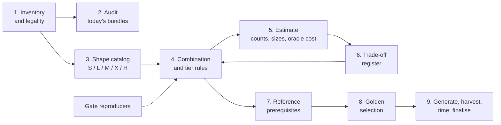

# Per-Op Test Plan Methodology

This document explains how to write a test plan for any hipDNN operation, and
how to turn that plan into bundles. It applies to every op family:
convolution, matmul, normalisation, attention, pointwise, reduction and so on.
[Convolution forward](convolution-fwd.md) is the worked example. The design and
rationale are in
[RFC 0021](../../../../projects/hipdnn/docs/rfcs/0021_PerOpTestPlans.md); this
guide is its operational form.

A per-op plan decides **which graphs exist and in which tier they run**. It does
not decide whether a given engine is fit to integrate. That is the job of the
engine integration gate (the "Gauntlet"), which runs a plan's graphs across
every kernel, adds fuzzing and the benchmark corpus, and reports outcomes per
engine. The two connect in both directions:

- plans supply the graphs and declared axes the gate consumes;
- the gate's failure reproducers come back into the plans as pinned
  regressions.

---

## 1. The problem

An op's input space is unbounded. Its integer parameters (batch, channels,
spatial sizes, filter, stride, padding, head dimension, sequence length, …)
have no upper limit, they vary per dimension and they combine
multiplicatively. The tensor values are floats. No sweep can enumerate this
space. Any sweep is a sample of it.

A plan chooses that sample on purpose and records the choice. Its goal is not
complete coverage. The goal is that:

- every kind of behaviour the op can have is exercised at least once, at a
  size where it matters;
- every case states what it expects; and
- every choice to leave something out is written down, with a reason and a
  trigger for revisiting it.

---

## 2. Principles

| # | Principle | What it means in practice |
|---|---|---|
| P1 | **Derive features from the API, not from existing tests or engines.** | Read the flatbuffer schema (`flatbuffers_sdk/schemas/*.fbs`), the frontend node's `pre_validate_node` / `infer_properties_node`, the graph-level data types and the pointwise modes. Each field and each validation rule is a feature. Existing tests show what someone once thought to test; engines show what one backend happens to support. Neither defines the op. |
| P2 | **The plan does not depend on any engine.** | Engines join through support claims. A feature that no engine supports today stays in the sweep as a probe. When an engine adds the feature, the run reports `unclaimed_support`, so new support is noticed without anyone editing the plan. |
| P3 | **Partition each axis into equivalence classes, then add boundaries and hazards.** | Pick one representative per behaviour class: 1, odd, small, power of two, large, not a multiple of the vector width. Add the edges: output size 1, padding ≥ filter, stride with a remainder, values near the dtype limit, NaN and Inf. Add hazard breakpoints: powers of 2 ± 1, dims that are not multiples of 4 or 8, int32 index overflow. Bugs cluster at these points. |
| P4 | **One feature at a time first, then all-pairs, then targeted products.** | A small shape that changes one feature from the defaults shows which feature broke. All-pairs (every value of every axis meets every value of every other axis at least once) catches most interaction faults. Complete products are run only where two features plausibly interact. Three-way faults are found by the benchmark corpus and by fuzzing in the integration gate, then pinned (P10). |
| P5 | **Size grows with the tier.** | Toy shapes prove that a feature works. Engines switch solvers, tiling and code paths at realistic sizes, so every feature is retested at medium size in nightly. Real-model shapes and stress shapes are added on top. |
| P6 | **Every product left out is a recorded decision.** | Each one goes in a trade-off table: the product, how many cases it would add, why it adds little, what covers the same risk instead, and when to add it back. Rejection probes are never trimmed as redundant. |
| P7 | **A case is only useful if something can judge it.** | Check that the reference executors and validators support every feature before writing its cases. If a reference silently computes the wrong thing, it judges correct output as a failure (or worse, wrong output as a pass). If no oracle exists, the case is unexercised, never green. |
| P8 | **Count distinct behaviours, not cases.** | 1,218 cases on 23 geometries is weak coverage. Measure distinct geometries, distinct feature values, and how many cases skip on every engine. |
| P9 | **Every case has a purpose and an expected outcome.** | A `claim` case expects the claiming engine to accept the graph and be correct. A `probe` exists to exercise a feature or a check, and is satisfied by either a typed decline or a correct accept; it never counts toward the published support matrix. A `regression` is a pinned bug reproducer. |
| P10 | **A feature is covered only when a case executed it.** | A case that every engine skipped proves nothing. Quick needs one *executed* case per feature × engine. Every escaped bug's reproducer becomes a concrete, checked-in case in the lowest tier that can afford it. |
| P11 | **Realism and coverage come from different sources.** | The benchmark corpus and model layers show what users actually run. Generated cases, hazard shapes and probes reach what users have not run yet. A plan needs both. |

---

## 3. Process



### Step 1: feature inventory and legality

Enumerate every feature of the op, grouped bottom-up:

| Group | Typical features |
|---|---|
| Tensor | for every tensor of the op: valid dtypes, layouts, packed vs strided, **kind** (device tensor, compile-time constant, runtime pass-by-value scalar), **declared alignment and base offset** (see below), 64-bit indexing |
| Op attributes | every field and every enum in the op's attributes, including the values no engine supports |
| Geometry | rank, every dimension, op parameters (stride, padding, dilation, groups, heads, axes, …), output-shape rules, inferred vs explicit outputs |
| Data types | mixed precision, compute / intermediate types, graph-level vs per-node types |
| Graph options | options that apply across ops: override-shape, virtual vs materialised intermediates, fused epilogues and chains, scalar operands |
| Awkward combinations | legal graphs that are hazardous in practice: inputs in different dtypes, tensors in different layouts, degenerate ratios |
| Values | input distributions (uniform, zero-excluded, all-zero, constant, large magnitude), special values (NaN, Inf, subnormal), accumulation length, determinism |
| Execution | workspace limits, plan reuse with new pointers, serialisation round trip |
| Invalid inputs | each validation rule as a rejection test: these are frontend unit tests, not sweep cases |

For each feature, record:

- the values to cover (P3);
- the earliest tier that covers it;
- whether the references can judge it (P7);
- the purpose of its cases (P9).

**Declare the legality constraints once per op.** They mirror the frontend
validation rules, and the generator uses them so it never emits an illegal
graph.

**Alignment is tested by placement, not by declaration.** The harness passes
allocator pointers, which are aligned to at least 256 bytes. An alignment case
that only *declares* a small alignment therefore passes without testing
anything. Each alignment case must place the base pointer at exactly the
declared alignment (aligned to N, not to 2N), with a non-zero offset, crossed
with a leading stride that is not a multiple of the vector width. One extra case
uses a pointer *less* aligned than declared and expects `BAD_PARAM` from the
backend.

### Step 2: audit today's bundles

Measure what really exists before planning changes:

- **Parse every `sweep.json`.** Map each tensor uid to its role through the
  `graph.template.json` names. Uid order is not fixed: a uid that looks like the
  input can be the output.
- **Derive the real parameters from the dims.** Compute N, C, K, G and the
  per-group ratios, rather than trusting case ids or notes.
- **Count** cases per tier, distinct geometries, which values appear per axis,
  layout × dtype cover, which engines claim each case, and cases that are
  unclaimed everywhere.
- **Write the result as a status per feature:** covered, partial, missing, or
  can't tell from the bundles.
- **Read the bundles at the integration branch tip**, not at a stale checkout.
  The bundles get re-tiered often.

### Step 3: shape catalog

| Set | Purpose | Rule |
|---|---|---|
| **S** small | prove each feature works | defaults plus one feature changed per shape; cheap enough for quick and PR |
| **L** medium | prove each feature still works at realistic size | the same features as S on a medium base size; the generator scales a shape down (halve batch, then channels) until it fits the nightly ceiling |
| **M** model | exercise the solver paths real workloads use | layers from named models with the source cited, plus graphs from the dnn-benchmarking corpus, normalised and deduplicated (`migration-scripts/import_graph.py` is the starting point) |
| **H** hazard | hit the breakpoints of P3 | powers of 2 ± 1, dims not divisible by 4 or 8, group counts, non-dense strides; the extreme cases go to X |
| **X** stress | find limits | very large batch, int32 index overflow, very long accumulation; full only |

Make the defaults non-degenerate. Every dimension that can be greater than 1
should be greater than 1, and no ratio should collapse to 1 by accident (see
L1 in §7).

### Step 4: combination and tier rules

| Rule | Content |
|---|---|
| Core axes | the axes every tier covers completely, usually rank × layout × dtype |
| Core cover | every tier holds every core combination at least once, for the plain op and for each fused topology; in quick, each cell must be executed by at least one engine (P10) |
| One feature at a time | S and L shapes each isolate one feature |
| All-pairs | by the end of nightly, every value of every declared axis meets every value of every other axis at least once. A seeded generator emits this set from the op's declared axes and legality constraints. |
| Full | complete products only where an interaction is plausible; everything else stays all-pairs |
| Probes | every unsupported feature, awkward combination and hazard has at least one probe; rejection probes appear in every tier and are never trimmed |
| Unsupported stays in | unclaimed probes cost about 1 ms each and report new support when it lands |
| Pinned regressions | each escaped bug's reproducer is a concrete case in the lowest tier that can afford it |
| Concrete graphs | every tier runs only checked-in graphs written by the generator, so results are stable from run to run. Random sampling (fuzzing) belongs to the integration gate. |

Per-tier size ceiling. The values below come from convolution; tune them per op:

| Tier | Cadence | Budget (whole suite, cumulative) | Ceiling per case | Shapes |
|---|---|---|---|---|
| quick | pre-commit | ~5 min | ≤ 20 MFLOP, ≤ 1 MB | S, smallest variants |
| PR | PR gate | ~30 min | ≤ 200 MFLOP, ≤ 16 MB | S, H, plus a few M |
| nightly | nightly | ≤ 60 min | ≤ 8 GFLOP, ≤ 64 MB | S, L, M, H |
| full | weekly | none | none | S, L, M, H, X |

### Step 5: estimate before generating

Write down the arithmetic for case counts and FLOP per case, for each tier,
before generating anything. An estimate shows the problem early: the first
convolution draft came to about 14,000 full-tier cases, about 10,000 of them
the same fused epilogue repeated over every geometry.

Report the counts by size class (small, medium, model, hazard, stress) as well
as in total. A tier whose cases are all small has a coverage gap even when its
count is high.

Estimate the oracle's cost as well as the engine's. The GPU reference uses one
thread per output element, and the CPU reference fallback is far slower; both
can dominate on M, X and some H shapes.

### Step 6: trade-off register

The plan includes a table with these columns:

| Product not run | Cases it would add | Why it adds little | Covered instead by | Add it back when |
|---|---|---|---|---|

Typical entries:

- epilogue × every geometry;
- an unsupported dtype or mode × every shape;
- memory-layout features × every geometry;
- every 3-way product (left to the corpus and to gate fuzzing).

The "add it back when" trigger is specific, for example "an engine claims the
dtype", or "a defect needs activation and geometry together".

Rejection probes never go in the register. They are not trimmed.

### Step 7: reference prerequisites

For every feature, check that each reference executor (CPU, GPU) and the
validator can judge it. Record each gap and the fix it needs. Typical gaps:

- a mode enum that one reference rejects and another ignores;
- asymmetric parameters that only one reference has tests for;
- low-precision types with no reference implementation;
- special values that need a matching-infinities validator;
- harness support the case needs: exact-alignment pointer placement, value-domain
  control (zero-excluded fills, NaN / Inf / subnormal injection), and
  repeat-and-compare for determinism.

A feature with no oracle stays in the plan, marked unexercised until the oracle
exists.

### Step 8: golden selection

Choose the op's golden cases using the criteria in §4, and generate them
according to its rules. List each golden case in the plan with the criterion
that selected it.

### Step 9: generate, harvest, time, finalise

1. **Generate** the bundles with a seeded script that encodes the declared axes,
   the legality constraints, the catalog and the rules. Do not hand-edit.
   Hand-captured bundles cannot scale and drift from the plan.
2. **Tag** every case with its purpose (`claim`, `probe`, `regression`).
3. **Time** a cold-cache run on the target architectures. Compile and solver
   search per unique shape dominate; execution rarely does.
4. **Fix** the case counts per tier from the timing.
5. **Harvest** claims (`--write-support-claims`) on every lane, then do a
   confirming run. Claims are written only for `claim` cases.
6. **Update** whatever is keyed to case ids: FFM pins in
   `test_categories_integration.yaml`, tolerance-override and skip globs in the
   engine TOMLs.
7. **Update** the plan's counts and known gaps in the same PR as the bundles.

---

## 4. Golden tests

A golden case is a sweep case whose expected output is computed once, by an
independent third party, and stored with DVC beside the bundle (RFC 0011,
`projects/hipdnn/docs/rfcs/0011_GoldenReferenceValidation.md`). In the default
`auto` verification mode a golden case is checked against the stored data
instead of a live reference. Separately, `hipdnn_golden_data_tests` re-runs
every golden case through the hipDNN CPU and GPU references and checks that
they agree with the stored data.

### 4.1 What golden tests are for

Most of a plan's cases are judged by a live reference executor. That gives
breadth cheaply, but the live references have weaknesses that golden data
addresses:

| Purpose | Problem without golden data | What golden data adds |
|---|---|---|
| **Check the references themselves** | A reference and an engine that share a bug agree, and the test passes. A reference that ignores a feature judges every engine wrong (L6). | A third party (for example PyTorch) gives a third, independent answer. When it agrees with both hipDNN references, the references are trustworthy for that kind of case. |
| **Be the oracle where no reference exists** | A feature or op that no hipDNN reference implements cannot be judged. Its cases are unexercised (P7). | Stored output from the third party judges the case until a reference catches up. RFC 0011 cites SDPA, which had no C++ reference kernel, as the motivating case. |
| **Pin semantics** | The spec of a parameter can be read two ways (clip bounds, padding convention, rounding mode). The engine and the reference can agree on the wrong reading. | The third party's documented semantics fix the meaning. A disagreement shows up as a failure against all three. |
| **Anchor numerics** | A live reference is recomputed on every run. A change to the reference, or run-to-run variance on the GPU, moves the expected value with it. | Stored data does not move. It is a stable regression anchor with a tolerance calibrated per case (`meta.json`), which can be tighter than the op's default. |

Golden tests are **not** a coverage tool. They are few, expensive to produce
and to store, and they exercise the same engine paths as an equivalent live
case. Breadth comes from the sweep; golden cases make the sweep's judges
trustworthy.

### 4.2 Which cases should be golden

Choose a case as golden when it meets at least one criterion. Most ops end up
with 6–20 golden cases.

| # | Criterion | Typical cases |
|---|---|---|
| G-A | **Baseline anchor.** One case per (rank × layout family × dtype) for the plain op and per fused topology, at a small shape. | the minimum set; usually 6–10 cases |
| G-B | **Oracle gap.** A feature that a hipDNN reference cannot judge yet (step 7). The golden case judges it until the reference is fixed, then stays as a cross-check. | `CONVOLUTION` mode for conv; low-precision types without a reference |
| G-C | **Semantics.** Every parameter whose meaning could be read two ways. | activation clip bounds, asymmetric padding, scale and bias operand order |
| G-D | **Numerical regime.** One case per distinct regime where the tolerance matters (RFC 0011's shape-selection policy). | a tiny output where relative error dominates; a typical production size; a long accumulation |
| G-E | **Escaped numerical bug.** A defect where the references and the engine disagreed, or where all three agreed on something wrong. | the pinned reproducer, made golden |
| G-F | **Production anchor.** A small number of model layers from the M set or the corpus, if they fit the size budget. | one ResNet-style layer, one attention head |

Do **not** make a case golden when:

- **The live references can judge it and it meets no criterion above.** It adds
  storage without adding a check.
- **It exceeds the size budget.** `verify_golden_bundles.py` fails a case above
  2 MiB and warns above 1 MiB. Large cases stay live; use a smaller shape in the
  same numerical regime.
- **Its inputs or outputs contain NaN or Inf.** The verifier rejects non-finite
  values in golden tensors, so special-value cases stay live with a matching
  validator (step 7).
- **The third party's semantics differ from hipDNN's and cannot be mapped.** A
  mismatch would freeze the wrong answer. Record the difference and use a
  hipDNN reference instead.

### 4.3 How golden data is generated

| Rule | Detail |
|---|---|
| Independent source | Use an architecture-independent third party (PyTorch on CPU is the default). A hipDNN reference must never generate golden data: that would make the check circular. |
| Precision strategy | Choose per op and record it in `meta.json` (`reference_strategy`). **Precision uplift** (compute in a higher precision, then cast) suits shallow ops and short reductions. **Matched precision** (same intermediate precision as the engine's accumulation contract) suits deep ops and multi-step chains, where uplift diverges at every stage and forces loose tolerances. |
| Determinism | Generation must be deterministic. Pin the third party's version (`requirements.txt`), seed the inputs, and keep the shape seed separate from the data seed. |
| Provenance | `meta.json` records `generator`, `reference_source` and its version, `reference_strategy` and the generation command. Backward ops also record `forward_source`, so forward and backward golden data come from the same computation. |
| Generator script | One script per op in `reference-data-scripts/`, writing the case's inputs and outputs from the same in-memory graph. Inputs are generated, not copied from a run. |
| Inputs | The same value domain as the live case. Avoid zeros or tiny magnitudes in outputs that a relative tolerance would amplify, unless the case tests exactly that regime (G-D). |
| Tolerance | Calibrate per case at generation time from the observed error of both hipDNN references against the stored data, with margin, and store it in `meta.json`. Never loosen it to make an engine pass. |
| Storage | `golden/{CaseId}/tensors.dvc` beside the sweep, on the `golden-data` DVC remote (bundle README). |

### 4.4 Confirmation and disagreement

Before a golden case is committed, `hipdnn_golden_data_tests --reference both`
must pass: the stored data, the CPU reference and the GPU reference all agree.

**Exception:** a G-B case exists because no hipDNN reference can judge it yet,
so it cannot be confirmed that way. Confirm it with a second independent
computation instead (for example NumPy alongside PyTorch). Add the hipDNN
confirmation when the reference fix lands.

When they don't agree:

| Disagreement | Likely cause | Action |
|---|---|---|
| Both references disagree with the third party, and agree with each other | a semantics mismatch, or a shared reference bug | check the parameter's spec; fix the reference or the mapping; never regenerate golden data from a hipDNN reference to make it agree |
| One reference disagrees | a bug in that reference | fix the reference; the golden case is the evidence |
| The references agree with the stored data, the engine does not | an engine bug | the golden case does its job; file the bug |
| Small differences that track the precision strategy | the wrong strategy | switch between uplift and matched precision, and recalibrate |

Agreement between implementations is not proof of correctness. Three
independent implementations agreeing is the strongest evidence the suite can
produce, which is why the third party has to be genuinely independent.

### 4.5 Tier placement and lifecycle

- **Placement follows runtime, not file size**, like any case. Put one or two
  anchors (G-A) in quick, the rest of G-A, G-B and G-C in PR, and G-D, G-E and
  G-F in PR or nightly.
- **Golden cases need `dvc pull`.** A run in `cpu` or `gpu` verification mode
  falls back to the live reference, so golden cases must never be the *only*
  coverage of a feature in a tier that some lanes run without data.
- **Regenerate** when the op's semantics change, when the third party's version
  is bumped, or when the precision strategy changes. Review the regenerated data
  the same way as code. A bundle whose golden output changes without a stated
  reason is a red flag.
- **Retire** a G-B case's oracle role, not the case itself, once the reference
  supports the feature: it becomes a cross-check.


## 5. Plan document template

```markdown
# <Op> Test Plan

Scope (graphs, bundles), out of scope, link to the index.

## 1. The operation
Formula, tensors and shape rules, parameters. Source files.

## 2. Feature inventory
Tables per group (§3 step 1): Id | Feature | Values to cover | Ref (prerequisite marker).
Declared legality constraints. Invalid inputs as a rejection list.

## 3. Shape catalog
Size-ceiling table per tier. S, L, M (with corpus source), H, X tables. Scaling rule for L.

## 4. Building the sweep
Rules table. 4.1 tier contents (feature group × tier). Estimated counts by size class.
4.2 Probes and pinned regressions. 4.3 Products deliberately not run (trade-off register).

## 5. Golden reference
Golden cases: Id | Case | Criterion (G-A … G-F) | Precision strategy | Tier.
Generator, confirmation, storage.

## 6. Pass criteria and reference prerequisites
Verification mode, tolerances and overrides, claims. Reference and harness gaps and fixes.
```

The working analysis stays out of the repo: the audit of today's bundles,
"today vs needed" and the work-item ordering. The plan states the target; the
analysis tracks progress towards it.

---

## 6. Review checklist

- [ ] Every feature traces to an API field or a validation rule.
- [ ] No section depends on an engine. Engines appear only through claims and
      engine TOMLs.
- [ ] Every tensor of the op has its dtype, layout, stride, kind and alignment
      axes filled in.
- [ ] Legality constraints are declared, and the generator respects them.
- [ ] Each feature has equivalence classes, boundary values and hazard points.
- [ ] No default collapses a dimension or ratio to 1 by accident.
- [ ] Alignment cases place pointers at exactly the declared alignment, with an
      offset.
- [ ] Every case has a purpose: claim, probe or regression.
- [ ] Every tier covers the core axes completely, and quick executes every cell.
- [ ] Every feature is tested at medium size by nightly.
- [ ] The corpus or model shapes are in the plan alongside generated cases.
- [ ] Every complete product is either justified or in the trade-off register.
- [ ] Rejection probes appear in every tier.
- [ ] Every feature the references cannot judge is listed with its fix.
- [ ] Counts, FLOP and oracle cost per tier are estimated and stay inside the
      budgets.
- [ ] Golden cases are chosen by the §4.2 criteria, each with its criterion
      recorded: at least the G-A baseline, and a G-B case for every oracle gap.
- [ ] Every golden case is generated by an independent third party, fits the
      size budget, has no non-finite values, and passes
      `hipdnn_golden_data_tests --reference both`.
- [ ] Every bundle case maps to a plan item, and every plan item maps to a case.

---

## 7. Lessons

| # | Lesson | Evidence | Rule it led to |
|---|---|---|---|
| L1 | **A degenerate default can hide a whole dimension.** | Every one of 1,218 conv cases had K = G. The dense conv computed **one output channel**, so channel and group indexing were never really exercised. Case ids and notes did not show it; only deriving K and G from the dims did. | Audit by deriving parameters from the dims (step 2); non-degenerate defaults (step 3). |
| L2 | **Bundles captured from old C++ tests inherit their blind spots.** | The conv bundles were captured from C++ graph tests whose shared case table (`ConvolutionCommon.hpp`) had the K = G pattern and toy sizes. | Derive features from the API (P1), not from existing tests. |
| L3 | **Case count says little about coverage.** | 1,218 cases covered only 23 distinct geometries; 216 of them were skip-only (fused leaky ReLU, declined by every engine). | Count distinct behaviours (P8); quick needs executed cells (P10). |
| L4 | **Toy sizes leave solver paths untested.** | The largest conv case was ~1 MFLOP and ~1 MB, with spatial ≤ 16 and channels ≤ 32. | Size grows with the tier, and an L set retests every feature (P5). |
| L5 | **A full product mostly repeats the same check.** | The first draft's full tier was ~14,000 cases. ~10,000 came from 13 activations × ~400 geometries: an element-wise epilogue does not depend on stride or padding. The trimmed version is ~2,000 and still covers every pair. | Targeted products plus a trade-off register (P4, P6). |
| L6 | **A reference can silently compute the wrong thing.** | The GPU conv reference has no `conv_mode` handling, so it would compute cross-correlation for a `CONVOLUTION` graph. Under the `auto` verification mode, the GPU reference runs before the CPU one. | Check reference prerequisites before writing cases (P7). |
| L7 | **An engine-specific plan hides features.** | Writing the conv plan around MIOpen's support left out `CONVOLUTION` mode, asymmetric padding and non-ReLU fusions, all of which the API exposes. | Engine-agnostic inventory; unsupported cases stay in as probes (P2). |
| L8 | **Re-tiering can leave a tier almost empty.** | After the tier remap, nightly held 2 and 1 cases for the two fused conv bundles, while full held 444 each. | Per-tier core cover rule; audit counts per tier, not only per bundle. |
| L9 | **Skips and tolerance overrides keyed by name can stop matching.** | The TOML skip `*ConvFwdBiasActiv*` matches only the C++ test names, never the bundle names. The fused 3D fp32 cases have no tolerance override, while the matching plain-conv cases do. | Step 9: update everything keyed to case ids when bundles change. |
| L10 | **Tolerances are coarse.** | One value per dtype is used as both atol and rtol (conv fp16 / bf16: 0.1). On short dot products that is loose; on long accumulations fp32 needs an override. | Accumulation length is a value-group feature; revisit tolerances once golden data exists. |
| L11 | **The local checkout drifts.** | The local develop was 105 commits behind and still had the old tier layout. | Audit at the integration branch tip (step 2). |
| L12 | **Execution is rarely the cost.** | Even a 6.6 GFLOP model layer runs in milliseconds; all 1,218 toy conv cases ran in ~30 s. The unknown cost is solver search and compile per unique shape, and the oracle. | Cold-cache timing and oracle cost decide the counts (steps 5 and 9). |
| L13 | **Maximally aligned pointers make alignment tests pass vacuously.** | The harness passes allocator pointers aligned to at least 256 bytes. No provider engine reads the declared alignment when it decides whether to accept a graph. A kernel that assumes 16-byte loads passes every test and then fails on a sliced tensor in production. | Alignment is tested by exact pointer placement with an offset (step 1). |
| L14 | **A declined probe and a probe that never ran look the same.** | When an engine declines an unclaimed graph, the test is simply skipped. | Every case carries a purpose (P9); the integration gate records declines with a typed reason. |
| L15 | **Input fills never hit the numeric shortcuts.** | Fills set ranges per op and dtype but cannot exclude zero or inject Inf or subnormals. | Value-domain probes are part of the inventory (step 1); the harness support is a prerequisite (step 7). |
| L16 | **Golden data cannot hold special values.** | The conv plan first proposed NaN / Inf cases as golden-only. `verify_golden_bundles.py` rejects non-finite values in golden tensors and caps each case at 2 MiB. | Golden selection excludes non-finite and oversized cases (§4.2); those stay live with a matching validator. |

Lessons L13–L15 and the ideas behind P3's hazard points, P9, P10, P11, the
tensor-kind and alignment-placement rules, all-pairs generation from declared
axes, and never trimming rejection probes come from the hipDNN Integration
Gauntlet study of cuDNN, PyTorch and AITER test practice.
