# GEMM with CK Tile

This example demonstrates matrix multiplication (GEMM) using the CK Tile programming model, focusing on tile-based parallelism and modular kernel design.

---

## Algorithm and Math

GEMM computes:
$$
C = A \times B
$$
where $A$ is $[M, K]$, $B$ is $[N, K]$, and $C$ is $[M, N]$.

- **BlockTile GEMM**: Each Block Tile computes a tile of $C$ by loading tiles of $A$ and $B$, performing blockwise matrix multiply-accumulation, and writing results back with the epilogue.

---

## Tile Programming Model

- **Configuration**: The Configuration of how the kernel going to be initialized with Block Tile Dimension, Warps Layout, Warp Tile Dimension, and other improvements.
- **Block Tile**: Each block tile allocates in the compute unit of AMD GPU grabbing the .
- **Pipeline**: Modular design allows swapping different memory/computation pipelines (e.g., basic, memory-bound, compute).
- **Block GEMM**: Block Level implementation on how to coordinate the warps iteration and memory layout in block tile.
- **Warp GEMM**: Each Warp's GEMM Calculation
- **Epilogue**: Transferring the Accumulated result from register to global memory.

---

## Features

- **Flexible Layouts**: Supports row/column-major and custom strides for $A$, $B$, $C$.
- **Split K**: Split the Block Tile also on K Dimension and add it back after the matrix multiply-accumulation. Have a higher performance when M and N is small and K is large.
- **Preshuffled GEMM**: In inference task, shuffle the GEMM of B (weight) matrix in the warp layout and bypass the shared memory to do the GEMM calculation. Best performance solution for GEMM.
- **Precision**: Supports fp16, bf16, fp8, bf8, int4 (for B Matrix).
- **Validation**: CPU/GPU validation and error tolerance options.

---

## Build & Run

```bash
mkdir build && cd build
# you can replace <arch> with the appropriate architecture (for example gfx90a or gfx942) or leave it blank
../script/cmake-ck-dev.sh  ../ <arch>
# The basic pipeline method on the gemm calculation
make tile_example_gemm_basic -j`nproc`
# The memory bound pipeline on the gemm calculation
make tile_example_gemm_universal -j`nproc`
# The weight preshuffle pipeline on the gemm calculation
make tile_example_gemm_weight_preshuffle -j`nproc`
# gfx125 only: weight preshuffle TDM pipeline with data cache prefetch controls
make tile_example_gemm_weight_preshuffle_tdm_data_cache_prefetch -j`nproc`
# gfx125 only: TDM pipelines with data cache prefetch controls (TdmEpilogue)
make tile_example_gemm_tdm_data_cache_prefetch -j`nproc`
# gfx125 only: the same, with C written through LDS one M iteration at a time
# (TdmEpilogueStagedForPipeline) instead of the whole tile
make tile_example_gemm_tdm_data_cache_prefetch_staged -j`nproc`
```
This will result in an executable `build/bin/tile_example_gemm_basic` & `build/bin/tile_example_gemm_universal`

### Fused GEMM + permute (gfx950)

`tile_example_gemm_permute` runs two ops of a model layer at the trace shape T=768, B=512, K=384,
D=256, H=8 (M = T*B = 393,216, N = H*D = 2,048):
`C[t*B+b, d*H+h] = A[t,b,:] x W[:,d,h]` (BF16, FP32 accumulation), followed by the pure data
movement `Y[h,b,t,d] = C[t,b,d,h]`. Run as two kernels, the GEMM writes C (about 1.61 GB) to
memory and a second kernel reads it back to write Y (also about 1.61 GB). Fused means both ops
run inside one kernel launch: each C tile is stored from the accumulators straight to its place
in Y, and C never reaches memory.

The example has two fused paths. They take the same inputs (`A[t,b,k]` and the original weight
`W[k,d,h]`, i.e. `[K, N]` row-major with `n = d*H+h`), write the same dense `Y`, and neither
writes an intermediate tensor. Each reorders the 1.5 MiB weight on every call, inside the timed
path.

- **Library kernel** (`gemm_permute.hpp`): a thin user of `ck_tile::GemmEPermuteKernel`
  (`include/ck_tile/ops/gemm/kernel/gemm_e_permute_kernel.hpp`) with the stock CompV3 pipeline,
  `CShuffleEpilogue` and `GemmSpatiallyLocalTilePartitioner`, unchanged.
- **A-stationary kernel** (`gemm_permute_astationary.hpp`): a hand-written gfx950 kernel built
  from CK-Tile parts, for this shape.

#### How it works

##### 1. Two kernels against one fused launch

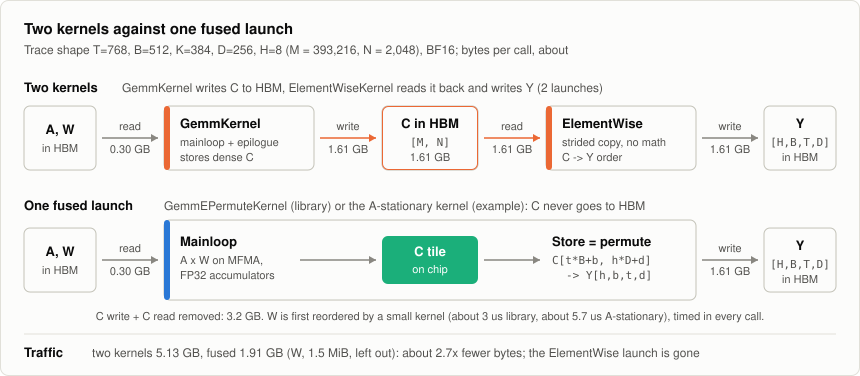

The two-kernel path is a `GemmKernel` that stores the dense C, then an `ElementWiseKernel` that
copies C into Y order. In the fused launch the epilogue does that copy: it writes each tile of
accumulators to its permuted address in Y.

##### 2. What fusing removes

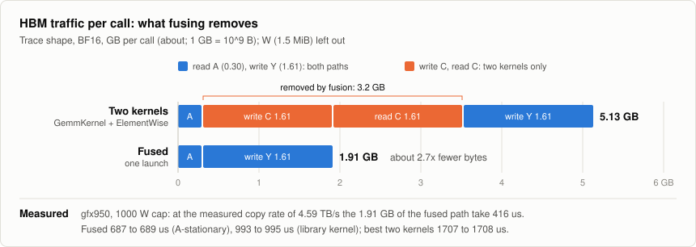

The C write and the C read, 3.2 GB together, disappear, and one launch with them. What is left is
reading A once and writing Y once, about 2.7x fewer bytes.

##### 3. Library kernel: the output seen through a 4-D view

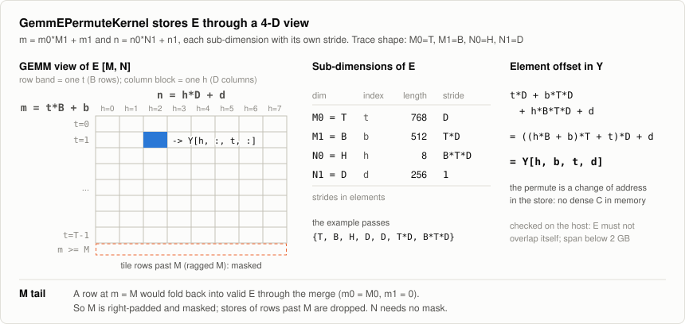

`GemmEPermuteDesc {M0, M1, N0, N1, stride_M0, stride_M1, stride_N0}` views E as
`[M0, M1, N0, N1]` with `m = m0*M1 + m1`, `n = n0*N1 + n1` and stride 1 on N1; for the trace
shape `M0=T, M1=B, N0=H, N1=D` with strides `(D, T*D, B*T*D)`. The kernel derives from
`UniversalGemmKernel`; on the device it replaces only `MakeCBlockWindows` (the host side adds the
descriptor and `IsSupportedArgument`), through a small hook in
`universal_gemm_kernel.hpp` that leaves the instructions of existing kernels byte-identical
(checked on gfx950 and gfx1250).
Rows past M are masked, because a row at `m = M` would otherwise fold back into valid E.

##### 4. Library kernel: weight reorder

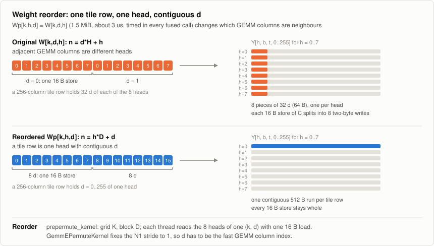

With `W[k,d,h]`, neighbouring GEMM columns belong to different heads, so they land far apart in
Y. `prepermute_weight` writes `Wp[k,h,d] = W[k,d,h]` (1.5 MiB, about 3 us), after which the GEMM
computes `C[t*B+b, h*D+d]` and one tile row holds one head with contiguous `d`.

##### 5. Library kernel: where one tile lands in Y

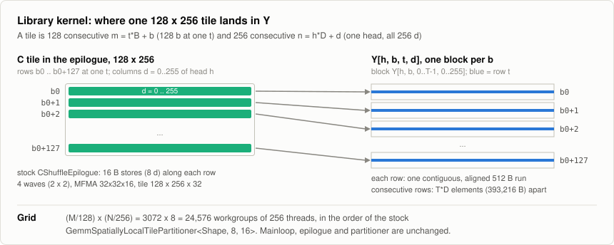

The tile is 128 x 256 x 32 (2 x 2 waves, 32x32x16 MFMA), 3072 x 8 = 24,576 workgroups. The stock
`CShuffleEpilogue` stores each tile row as one 512-byte run with 16-byte stores; consecutive rows
are `T*D` elements apart.

##### 6. A-stationary kernel: A in LDS once, weight into registers

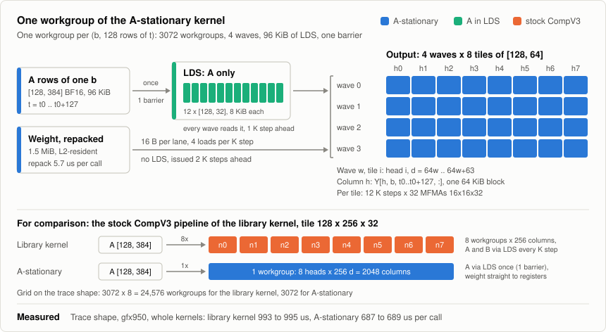

One workgroup per `(b, 128 rows of t)`, 3072 in all, loads its A tile (96 KiB) into LDS once,
behind the only workgroup barrier, and reuses it for all 2048 columns. The weight is repacked on
every call into the `ck_tile::shuffle_b_permuteN` layout (`repack_weight`, about 5.7 us), stays
in L2 and goes from global memory straight into the MFMA registers, 2 K steps ahead, never
through LDS.

##### 7. A-stationary kernel: direct store

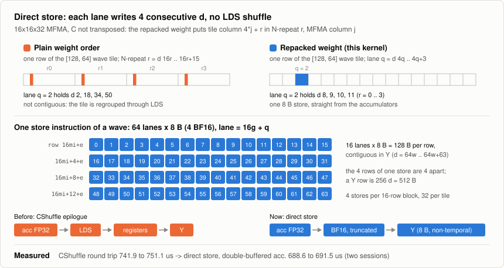

With the repacked weight, N-repeat `r` and MFMA column `j` of the 16x16x32 MFMA hold tile column
`4*j + r`, so each lane owns 4 consecutive `d` and stores them as one 8-byte write. The 16 lanes
of a row write 128 contiguous bytes of Y, with no LDS round trip.

##### 8. A-stationary kernel: store under the next tile's MFMAs

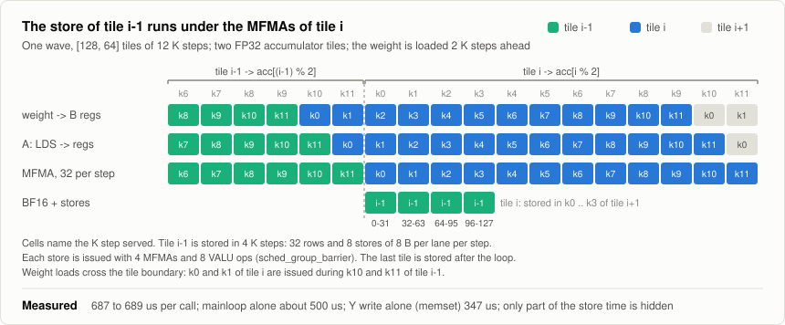

Two FP32 accumulator tiles alternate: tile i accumulates in one while tile i-1 is converted and
stored from the other, spread over the first 4 K steps of tile i. The kernel uses 224 VGPR,
224 AGPR and 96 KiB of LDS, one workgroup per compute unit.

#### Effect of each step

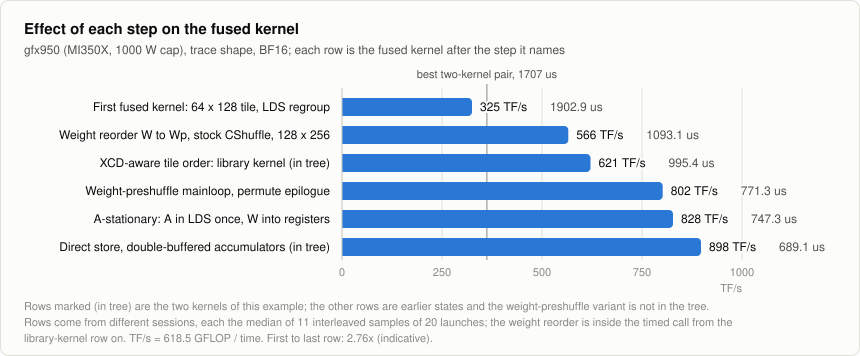

The first fused kernel (1902.9 us) was no faster than the best two-kernel pair; the library kernel
reaches 995.4 us and the A-stationary kernel 689.1 us, 2.76x over the first one. The values come
from different sessions, each the median of 11 interleaved samples, so the ratio is indicative.
The weight-preshuffle variant is not in the tree.

#### Build, run and results

```sh
cmake --build . --target tile_example_gemm_permute
./bin/tile_example_gemm_permute               # bit-exact checks at four small shapes
./bin/tile_example_gemm_permute --benchmark   # also check and time the trace shape
```

The driver compares every output bit of both fused paths and both unfused baselines with
`reference_gemm_gpu` followed by an independent permute, and checks guard regions around every
output. Inputs are multiples of 0.25 in [-2, 1.75], so FP32 sums are exact in any order. The
benchmark times each path with its weight reorder included on every call, as the median of 11
interleaved, rotated samples of 20 back-to-back launches, against two existing CK-Tile op pairs
launched back to back: the weight-preshuffle `GemmKernel`
(`WeightPreshufflePipelineAGmemBGmemCRegV2`, the fastest existing GEMM op for this shape) or the
CompV3 `GemmKernel` the library kernel builds on, each followed by `ElementWiseKernel` as a
strided copy. It also reports both GEMM ops alone.

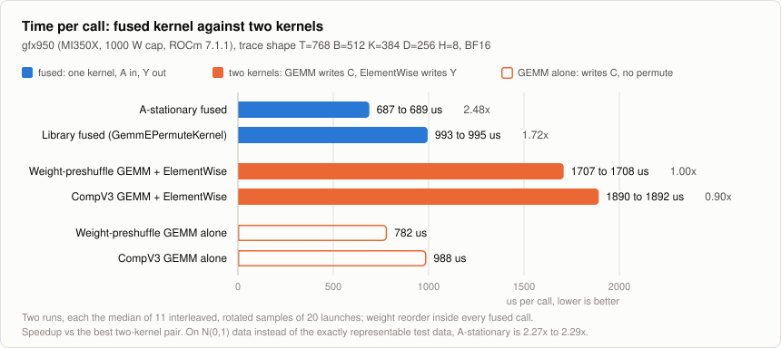

Two runs on MI350X (ROCm 7.1.1, 1000 W power cap); each value is the median of 11 samples and a
range spans the two runs. Speedup is over the best two-op pair:

| Path | Time (us) | Speedup |
|---|---:|---:|
| A-stationary fused | 687 to 689 | 2.48x |
| Library fused (`GemmEPermuteKernel`) | 993 to 995 | 1.72x |
| Weight-preshuffle `GemmKernel` + `ElementWiseKernel` | 1707 to 1708 | 1.00x |
| CompV3 `GemmKernel` + `ElementWiseKernel` | 1890 to 1892 | 0.90x |
| Weight-preshuffle `GemmKernel` alone | 782 | |
| CompV3 `GemmKernel` alone | 988 | |

On N(0,1) data instead of the exactly representable test data, the A-stationary speedup is 2.27x
to 2.29x.

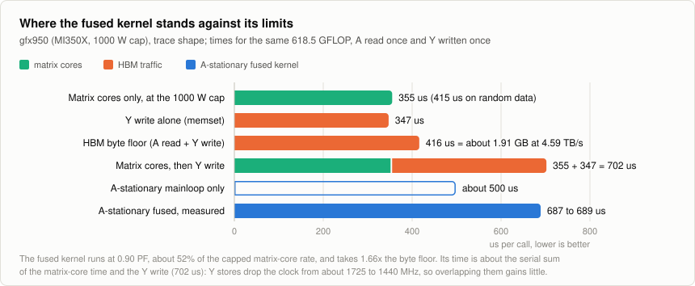

The A-stationary kernel runs at 0.90 PF, about 52% of the capped matrix-core rate, and takes
1.66x the HBM byte floor. Its time is about the serial sum of the matrix-core time (355 us) and
the Y write (347 us): turning the Y stores on lowers the clock from about 1725 to 1440 MHz, so
overlapping the two gains little. Against the kernel's own mainloop (about 500 us with the stores
off) the overlap of step 8 hides part of the 347 us Y write, but against the matrix cores alone
(355 us) it does not, because the stores slow the clock.

#### Limits

- `GemmEPermuteKernel` (v1): row-major E, no D tensors, one A and one B tensor, no split-K, no
  TDM epilogue. `IsSupportedArgument` rejects views that overlap themselves, non-positive
  strides, `N1` not a multiple of the vector size and an E span of 2 GB or more; gapped targets
  and ragged `M0`/`M1` are accepted.
- A-stationary kernel: gfx950 only (the driver exits on other arches), `K = 384`, `D = 256`,
  `H = 8` compiled in. Any T, and B up to 21,845 (the A window of a workgroup uses 32-bit
  offsets); A, weight and Y must be dense, non-overlapping and 16-byte aligned.
- BF16 outputs are converted by truncation, the CK default; torch rounds to nearest even.
- Tests: `test_ck_tile_gemm_e_permute` (XDL, gfx950) and `test_ck_tile_gemm_e_permute_wmma`
  (WMMA, gfx125) run 16 cases each, 5 on the device with a sentinel over the whole E span and 11
  argument checks; both pass. On gfx1250 only this WMMA test is run; there is no example timing
  for gfx1250. The `kPadN` tail branch has no test.

## example
```
args:
          -m    m dimension (default:1024)
          -n    n dimension (default:2048)
          -k    k dimension (default:64)
   -a_layout    Tensor A data layout (default: R)
   -b_layout    Tensor B data layout (default: C)
   -c_layout    Tensor C data layout (default: R)
   -stride_a    Tensor A stride (default:0)
   -stride_b    Tensor B stride (default:0)
   -stride_c    Tensor C stride (default:0)
          -v    0. No validation, 1. Validation on CPU, 2. Validation on GPU (default:2)
       -prec    data type. fp16/bf16/fp8/bf8 (default:fp16)
     -warmup    number of iterations before benchmark the kernel (default:50)
     -repeat    number of iterations to benchmark the kernel (default:100)
      -timer    gpu:gpu timer, cpu:cpu timer (default:gpu)
          -split_k    splitK value (default:1)
       -init    0:random, 1:linear, 2:constant(1) (default:0)
 -persistent    0:non-persistent, 1:persistent (default:0)
       -json    0: No Json, 1: Dump Results in Json format (default:0)
   -jsonfile    json file name to dump results (default:gemm.json)
```


## Source Structure

- **Executables**: `gemm_basic.cpp`, `universal_gemm.cpp` (different kinds of GEMM implementation)
- **Utils**: `gemm_utils.hpp` (helper functions)
- **Build**: `CMakeLists.txt`, `run_gemm_example.inc`
- **Scripts**: `script/` (build and run helpers)

---

## Related CK Tile Examples

- [01_fmha](../01_fmha/README.md): Fused multi-head attention (FMHA)
- [18_flatmm](../18_flatmm/README.md): Preshuffled GEMM alternative solution
- [16_batched_gemm](../16_batched_gemm/README.md): Batched GEMM with tiles

For distribution, see `include/ck_tile/tile_program/tile_distribution/`.

---
[Back to CK Tile Examples](../README.md)
