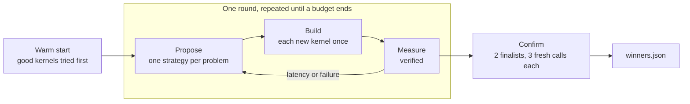
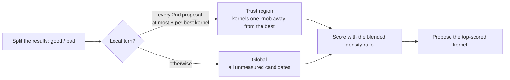

# CK Tile Engine GEMM Operations

## Overview

The CK Tile Engine GEMM module provides a comprehensive system for generating, building, and benchmarking GEMM (General Matrix Multiplication) kernels with various configurations. It supports multiple data types, layouts, and optimization strategies. The system has evolved from a monolithic build approach (where all kernels compile into a single executable) to a more flexible individual kernel compilation system, providing better build parallelism and targeted testing capabilities.

## Table of Contents

0. [Dispatcher Bridge Workflow](#dispatcher-bridge-workflow)
1. [Build System Architecture](#build-system-architecture)
2. [Build Instructions](#build-instructions)
3. [Running Benchmarks](#running-benchmarks)
4. [Configuration System](#configuration-system)
5. [Scripts and Tools](#scripts-and-tools)
6. [Command Line Options](#command-line-options)
7. [Understanding Kernel Names](#understanding-kernel-names)
8. [Troubleshooting](#troubleshooting)
9. [Performance Tips](#performance-tips)

## Dispatcher Bridge Workflow

The **Dispatcher bridge** is the recommended path for sweeping and benchmarking
GEMM kernels. Instead of building monolithic or per-kernel executables through
CMake, Tile Engine expands a sweep config into shared `GemmKernelConfig` objects
and hands them to the Dispatcher, which codegens and compiles each into its own
`.so`. The kernel name produced by the bridge is byte-for-byte identical to the
codegen `KERNEL_NAME`, so the bridge runs exactly the same kernels the native
Tile Engine does — it only swaps the harness.

### Scripts

| Script | Role |
|---|---|
| `gemm_full_benchmark.py` | Driver: compile (Phase 1) → load problems (Phase 2) → benchmark across all visible GPUs (Phase 3). |
| `run_one_gemm_kernel.py` | Disposable worker: loads one `.so` in an isolated subprocess and times it. A GPU fault kills only the worker. |
| `gemm_search.py` | Adaptive search mode of the driver (`--search-config`), see [Adaptive kernel search](#adaptive-kernel-search---search-config). |

To measure only the kernels a trained model picks, and to score the picks
against a full sweep, see
[dispatcher/heuristics/HEURISTIC_BENCHMARKING.md](../../../dispatcher/heuristics/HEURISTIC_BENCHMARKING.md).

### Folder layout

The bridged GEMM paths follow the same op-root convention as the `fmha/` and
`grouped_conv/` bridges — driver + worker at the op root, and a flat `configs/`
for regular GEMM:

```
gemm/
├── gemm_full_benchmark.py          # bridge driver: gemm_universal, multi_d, multi_abd, preshuffle
├── run_one_gemm_kernel.py          # disposable per-kernel worker for the above
├── <op>_full_benchmark.py          # per-op bridge drivers: batched_gemm, batched_contraction,
├── run_one_<op>_kernel.py          #   grouped_gemm, gemm_multi_d, mx_gemm, streamk_gemm
├── configs/                        # gemm_universal sweep configs (flat)
├── gemm_vector_fallback.py         # vector-width fallback shared by the bridge drivers
├── gemm_validation_utils.py        # arch/warp-tile tables (also read by the dispatcher)
├── gemm_instance_builder.py        # shared generator for the native (legacy) builds
├── gemm_benchmark.{py,hpp}, gemm_common.hpp, gemm_profiler.hpp  # native harness
├── gemm_universal/  gemm_multi_d/  gemm_multi_abd/  gemm_preshuffle/  grouped_gemm/ ...
│                                   # per-variant configs/ + native CMake builds
└── README.md
```

`configs/` ships example sweep configs:

- `default_ci_config.json` — small CI-sized sweep (the driver's default when no
  config is passed).
- `default_config.json` — full sweep.
- `user_provided_config.json` — scratch space for custom sweeps.
- `example_problems.json` — example M/N/K problem set (used when `--problems`
  is omitted).
- `search_settings_gfx1250_tdm.json` - example search settings for the gfx1250
  full default config with `--pipelines`, see
  [gfx1250 / MI450](#gfx1250--mi450-tdm-pipelines).

> The JSON used by **nightly** tests is intended to drop into the same
> `configs/` directory and be selected with a positional config — no driver
> changes needed.

The other variants keep their own per-variant `configs/` directories; the driver
selects them with `--variant`. For `gemm_preshuffle` on gfx1250, the default is
[`default_config_gfx1250.json`](gemm_preshuffle/configs/default_config_gfx1250.json),
covering [five pipelines](gemm_preshuffle/README.md) for fp16/bf16/fp8/bf8. An explicit
positional config always takes precedence.

### Running

```bash
cd tile_engine/ops/gemm

# Default: gemm_universal variant, its CI sweep + example problems,
# auto-detect and use all visible GPUs.
python gemm_full_benchmark.py

# Full sweep, fp16/rcr, restricted to 4 GPUs, custom output:
python gemm_full_benchmark.py --variant gemm_universal \
    configs/default_config.json \
    --dtype fp16 --layout rcr --devices 4 --csv gemm_results.csv

# Specific GPU ids and a custom problem file:
python gemm_full_benchmark.py --devices 0,2,5 \
    --problems configs/example_problems.json

# Correctness mode: check every kernel against an fp32 numpy reference.
python gemm_full_benchmark.py --verify --max-kernels 8
```

### Liveness vs correctness (`--verify`)

By default a measurement is reported `OK` purely on **liveness** — the kernel
ran and produced a non-zero output (`ZERO` otherwise). It is *not* a correctness
check: a numerically wrong but non-zero result still reads `OK`. Pass `--verify`
to have each worker compare its output against an fp32 numpy reference
(`A @ B`) using the global relative metric `max|out - ref| / max|ref|`. With
`--verify`, results read `VERIFY` (within `--verify-tol`, default `2e-2`) or
`MISMATCH` (counted as a failure), and the `max_rel` / `verified` columns are
populated in the CSV. This gives self-contained per-kernel confidence; the
broader numeric parity against native Tile Engine remains a separate task.

### Measurement options

All of these are off by default; without them the driver builds, pairs,
measures and reports exactly as described above.

- `--build-timeout SECONDS` — one limit for each kernel's codegen, compile and
  link step, instead of the bridge's defaults (300 s each, 1200 s to compile a
  fixed-vector-width kernel). The limits are wall-clock, so a large `--workers`
  build on a busy host can hit them; a kernel whose step times out is reported
  as a build failure (`Timeout: <step> exceeded N s`) and is absent from the
  results.
- `--failures-csv PATH` — one row per failed measurement, with `kind` one of
  `error` (the worker reported a failure, e.g. the kernel refused the problem),
  `missing` (the worker died before reporting), `worker-exit` (it exited with an
  error after reporting every kernel), `timeout`, `batch-error`, `mismatch` (with
  `--verify`) or `bad-output`; one `unsupported` row per kernel the worker
  reported as not supporting the problem (counted as skipped, not failed); and
  one `build-failed` row per kernel that did not build, with the failed step and
  the first error line. The main CSV holds every kernel that ran, including
  those that failed `--verify` (`verified` is `False`); this file is what tells
  "could not run" apart from "never tried".
- `--repeat-top K` with `--repeat-count N` (default 5) — after the sweep, re-time
  the K fastest kernels of each problem N more times, each launch in its own
  subprocess, into `--repeat-csv` (default `<csv>.repeats.csv`). The fastest of
  many single timings is biased towards a lucky timing; selecting and reporting
  on the median of the repeats removes that bias. Kernels that failed `--verify`
  or wrote no non-zero output are not re-timed.
- `--pipelines NAME[,NAME...]` - restrict the selected configs to these bridged
  pipelines, before `--max-kernels` and `--pairs`, in plain runs, `--list-pairs`
  and search. Config selection is unchanged: omitted positional configs still
  use the variant's usual default (typically the small CI config). Pass a full
  config explicitly when the CI config lacks the pipelines you need. Names
  are case-sensitive; surrounding whitespace is ignored. Empty, duplicate or
  unknown names are errors. Known pipelines can be absent for a particular
  arch, dtype, layout or problem; no surviving configs is an error. Explicit
  `--pairs` names outside the filtered space are rejected, while `"*"` means
  all eligible kernels within that space. Explicit selections are recorded
  under `"pipelines"` in `--list-pairs` and in a search's `run.json`; omitting
  the flag keeps every pipeline from the selected configs.
- `--list-pairs PATH` — dry run: expand and pair as a real run would, write every
  `(problem, kernel)` pair it would measure together with each kernel's
  configuration, and exit without building. Use it to see the size of a sweep
  before running it, or as the candidate list for choosing kernels another way.
- `--pairs PATH` — measure only the listed pairs. The file maps `"MxNxK"` to a
  list of kernel names, or to `"*"`; a `--list-pairs` file is accepted. Expansion
  still uses the full config and problems files, so the fixed-vector-width
  kernels are the same as in a full run, but only what the list needs is built.
  A listed problem or kernel the run does not have is an error. A listed kernel
  is measured only if a full run would pair it with that problem when every
  kernel builds; a listed pair that cannot be measured (not built, or not paired
  by the vector-width and tile rules) is printed and, with `--failures-csv`,
  recorded as `not-measured`. A `"*"` problem is measured exactly as a full run
  measures it, including the fixed-vector-width kernels a full run falls back to
  when a native kernel fails to build, so `"*"` entries for the problems an
  interrupted sweep did not reach complete it.

The files a run writes (`--csv`, `--failures-csv`, `--repeat-csv`) and the
`--pairs` file must all be different files; the driver refuses to start
otherwise.

### Adaptive kernel search (`--search-config`)

A plain run builds and measures every eligible `(problem, kernel)` pair. A
search run measures a chosen subset: one strategy per problem proposes kernels,
each proposed kernel is built once and shared by all problems, every
measurement is verified, and each result steers the next proposal. At the end
the best kernels of each problem are re-measured and only confirmed winners are
exported.



Coordinator: `tile_engine/ops/common/adaptive_search.py`. Strategies:
`dispatcher/python/ck_search`, a vendored copy of the ROCKE search core (see its
`VENDOR.md`). `gemm_universal` only.

#### Quick start

Recommended: `tpe`, `seed_policy` `shared`, warm-started from the heuristic's
top 5 kernels per problem.

```bash
H=../../../dispatcher/heuristics
RUN="configs/default_config.json --variant gemm_universal --arch gfx950 \
    --dtype fp16 --layout rcr --problems problems.json"
# the candidates, then the heuristic model's top 5 per problem (a --pairs file)
python gemm_full_benchmark.py $RUN --list-pairs candidates.json
python $H/select_kernels.py --candidates candidates.json \
    --model_dir $H/models/gemm_universal_fp16_gfx950 --top_k 5 --out_pairs picks.json
cat > search.json <<'EOF'
{"schema_version": 1, "strategy": "tpe", "seed": 0, "seed_policy": "shared",
 "trials_per_problem": 100, "batch_per_problem": 8, "new_builds_per_run": 1200,
 "warm_start": {"pairs_file": "picks.json", "top_k": 5}}
EOF
python gemm_full_benchmark.py $RUN --devices 0, \
    --search-config search.json --search-output-dir runs/search-001

# winners.json is a --pairs file: re-check the winners with a plain run
python gemm_full_benchmark.py $RUN --pairs runs/search-001/winners.json \
    --verify --devices 0, --csv recheck.csv
```

The warm start needs a heuristic model for the run's dtype and arch
(`dispatcher/heuristics/models`: gfx950 `gemm_universal` fp16 and fp8). Any
`--pairs` file of good kernels works too, such as an earlier `winners.json`;
with no model, use `warm_start.cover`. Without a warm start the result depends
on the seed:

| Setting | Mean | p10 | Min | Runs >= 99% | Builds (8 problems) |
|---|---|---|---|---|---|
| `tpe`, `shared`, no warm start | 88% | 68% | 59-62% | 14-17% | 341-358 |
| `tpe`, `shared`, warm start top 5 | 98.9-99.2% | 97.5-98.2% | 95% | 62-72% | 356-357 |

Speed of the confirmed winner relative to the best kernel, geometric mean over
the problems. Oracle replay of the real driver and coordinator against an
exhaustive sweep: fp16 `rcr`, 8 problems x 5520 candidates, MI350X (gfx950) CPX
partitions, 100 and 60 seeds under two timing-noise models (hence the ranges).

- The heuristic's top 5 alone reach 79% of the best: the warm start points the
  search at good regions, it does not hand it the answer.
- Best kernel after 50 / 75 / 100 trials: about 94% / 98.5% / 99.5% with the
  warm start, 81% / 86% / 89% without.
- The runs built about 45 kernels per problem (356 of the 1200 allowed). Scale
  `new_builds_per_run` with the number of problems so that it does not bind: a
  cap of 150 builds for the 8 problems cut the result from 99.4% to 91%.

#### Strategies

| `strategy` | Proposes |
|---|---|
| `tpe` | kernels that look like the fast results and unlike the slow ones (recommended) |
| `coupled_tpe` | as `tpe`, with a joint density and local moves around the best kernel (opt-in) |
| `gp` | by expected improvement under a Gaussian-process model |
| `de` | by differential evolution (SHADE) |
| `hill` | by hill climbing from the first warm start |
| `portfolio` | from `hill`, `gp` and `de`, sharing the trials among them as a bandit |
| `random`, `exhaustive` | baselines; they take no warm start |

#### How TPE chooses the next kernel

TPE (tree-structured Parzen estimator) works per problem, in four steps:

1. **Startup** (first 10 trials): the warm starts, then the prior's top picks
   (if a prior is given), then stratified samples of the candidates.
2. **Split**: sort the verified results by latency. The fastest 25% are *good*;
   the rest, the failed kernels and the kernels still in flight are *bad*.
3. **Model**: fit a density over the kernel parameters (pipeline, tile, warp,
   ...) to each group: `l(x)` for good, `g(x)` for bad.
4. **Propose** the unmeasured candidate with the highest `log l(x) - log g(x)`.

Three variants differ in the density and in the candidates that step 4 scores:

| | `tpe` | `tpe` with `"tpe_candidate_pool": "listed"` | `coupled_tpe` |
|---|---|---|---|
| Density | one per parameter, multiplied | same | per parameter, blended with a joint density over whole kernels |
| Candidates scored | 48 drawn from `l(x)`, neighbors of the 2 best, the prior's top 8 | every candidate of the problem | every candidate (a drawn pool above 1536), or the neighbors of the best kernel |
| Weight of a good result | equal | equal | higher for faster kernels |
| Kernels in flight | bad in every parameter | same | bad in the joint density only |
| Local search | no | no | trust region around the best kernel |
| Status | default | opt-in | opt-in |

**Listed pool.** Sampled TPE can propose only what its 48 draws contain.
`"tpe_candidate_pool": "listed"` scores every candidate instead; ties break in
a reproducible random order, and still only the proposed kernels are built.
Scoring time grows with the catalog, and a wrong model is followed more
closely. Measured on an MI355X (gfx950), 144 kernels, 6 fp16 `rcr` shapes, 20
seeds, 32 trials (mean excess latency over the catalog's best kernel, lower is
better):

| | sampled | listed |
|---|---|---|
| 5 warm starts (from another shape) | 4.060% | 2.996% (22 wins, 96 ties, 2 losses) |
| no warm start | 3.193% | 3.481% |

Use it only with a warm start. It did not help at 16 trials, and `gp` was
better at 64: this supports an opt-in experiment, not a default change.

**Coupled TPE.** Kernel parameters are coupled: a tile size that is fast in one
pipeline can be slow in another. A density per parameter cannot see that.
Suppose two kernels measured fast:

| | `tile_m` 64 | `tile_m` 256 |
|---|---|---|
| `compv4` | never measured | **A: fast** |
| `mem` | **B: fast** | never measured |

`tpe` multiplies `l(pipeline)` by `l(tile_m)`: all four cells score the same,
so it also proposes the two mixtures that no result supports. A joint density
is high only near A and B. `coupled_tpe` blends both models:

```
score(x) = (1 - a) * [log l(x) - log g(x)] per parameter
         +      a  * [log l(x) - log g(x)] joint * sqrt(d)

a = n / (n + 8)     n = verified results of the problem, d = parameters that vary
```

With few results the per-parameter model leads, because it needs less data;
the joint model takes over as results arrive (`a` = 0.5 at 8 results, 0.8 at
32). The joint density has one component per measured kernel: a Gaussian over
log-scaled levels for ordered parameters (tile 64, 128, 256 are equally
spaced) and an Aitchison-Aitken kernel for unordered ones (pipeline,
scheduler). Both sharpen as results accumulate. What else changes:

- **Faster counts more.** A good result weighs 0.25 to 1.25, linear in its
  log-latency gap to the best bad result.
- **A batch spreads without side effects.** A kernel in flight repels only its
  neighbors. In `tpe`, one pending `compv4` kernel lowers every `compv4`
  kernel for the rest of the batch.
- **Shorter startup.** With 2 or more warm starts and no prior, the model
  starts after `max(6, warm starts + 1)` trials instead of 10.
- **Trust region.** Every second proposal is a local move:



The trust region holds the unmeasured kernels one knob away from the best
kernel so far (one level up or down for an ordered parameter, any other value
for an unordered one), plus combinations of up to 4 single-knob moves that
already measured within 2% of the best. The model ranks them. A new best
kernel gets a fresh budget of 8, and local turns are more frequent before 10
results. A global turn scores every unmeasured candidate when the problem has
at most 1536; above that, a pool drawn from the good density that grows from
96, plus the neighbors of the 3 best and the prior's top 16.

`coupled_tpe` takes `warm_start`, `use_prior` and `build_aware`, and can be a
portfolio member. Its constants (`gamma` 0.25, `kappa` 8, `tr_budget` 8,
`combo_tol` 0.02, `max_catalog` 1536) are defaults in
`ck_search/coupled_tpe.py`; the settings file does not expose them. No GPU
measurement is recorded for it yet: evaluate it with the `coupled_tpe` arm of
`compare_search.py` before use.

Background: TPE, [Bergstra et al. (2011)](https://papers.nips.cc/paper/4443-algorithms-for-hyper-parameter-optimization)
and [Watanabe (2026), sections 3.3.3 and 4.1.2](https://arxiv.org/html/2304.11127v5);
joint kernel densities, [Falkner et al. (2018)](https://proceedings.mlr.press/v80/falkner18a.html)
and [Song et al. (2022)](https://proceedings.mlr.press/v162/song22b.html);
trust region, [Wan et al. (2021)](https://arxiv.org/abs/2102.07188).

#### Settings

| Key | Default | Meaning |
|---|---|---|
| `schema_version` | required | `1` |
| `strategy` | required | see "Strategies" |
| `trials_per_problem` | required | measured trials per problem; failures and warm starts count |
| `new_builds_per_run` | required | distinct kernels the run may build (failed builds count); at least `trials_per_problem` |
| `seed`, `seed_policy` | `0`, `shared` | `per_problem` gives problem `i` the seed `seed + i` |
| `batch_per_problem` | `4` | proposals per problem per round |
| `max_stall_rounds` | `8` | rounds in a row without a new result before the run stops |
| `deadline_s` | none | no trial is admitted after it; the round in flight and the confirmation still finish |
| `build_timeout_s` | `180` (native kernels) | limit per codegen, compile and link step; a timed-out kernel is a `compile_error`. When set, it applies to every kernel. When not set, a round with a fixed-vector-width kernel keeps a full run's limits (300 s per step, 1200 s to compile) |
| `warm_start.pairs_file`, `top_k` | none, `5` | a `--pairs` file: the first `top_k` kernels of each problem are tried first |
| `warm_start.cover` | none | a candidate field such as `"pipeline"`: one kernel per value is tried first, after the `pairs_file` picks. Needs no `pairs_file`. The picks count as trials and builds, so cover a field with few values. Not for `random` or `exhaustive`. `run.json` lists them (`warm_cover`) |
| `warm_start.ranked_csv`, `use_prior` | none, `false` | `select_kernels.py --out_ranked` predictions as a prior (`tpe`, `gp`, `coupled_tpe`, `portfolio`); give both or neither |
| `tpe_candidate_pool` | `sampled` | `listed` scores every candidate (`tpe` only) |
| `confirm.finalists`, `confirm.fresh_calls` | `2`, `3` | the winner is the lowest median among the finalists whose fresh calls all verified |
| `host_cache.dir`, `max_entry_gib`, `max_total_gib` | temp dir, `4`, a quarter of its free space | cache of verification inputs and references; `max_total_gib` `0` turns it off |
| `measurement_policy` | `full` | the only value |

Unknown keys are an error. Relative warm-start and `host_cache.dir` paths are
read from the settings file's directory.

`build_timeout_s`: of the 5520 gfx950 fp16 `rcr` native kernels, the median
compile takes 30 s and every kernel outside warp tile `4x64x16` builds within
111 s. The 180 s default costs the 2.2% of kernels that need 180-300 s (all
`4x64x16`). Raise `build_timeout_s` when those kernels matter or the host
compiles slowly.

#### Budget and stopping

- Each round, every active problem proposes up to `batch_per_problem` kernels.
- A kernel already built or planned costs no build, so problems that share
  kernels leave room for the others.
- At the build cap a proposal that needs a new build is told `invalid` without
  a trial. Its slot goes to the problem's best untried kernel that is already
  built (`refilled` in the round line).
- A kernel whose build failed is told `compile_error` again without a trial.
- A problem with fewer candidates than `trials_per_problem` is measured
  exhaustively.
- The run stops when the trial budgets are spent, at the deadline, after
  `max_stall_rounds` rounds without a result, or at the build cap once no
  problem has an untried built kernel.

#### Driver options and results

- `--search-config` and `--search-output-dir` go together. `--list-pairs`,
  `--repeat-top`, `--failures-csv` and `--build-timeout` are rejected; `--csv`
  is not written.
- Every measurement is verified and runs one kernel per worker, whatever
  `--verify` and `--batch-size` say, so a failure names one kernel.
  `--verify-tol`, `--kernel-timeout`, `--workers` and `--devices` apply as
  usual.
- The candidates of a problem are its `--list-pairs` pairs. `--pipelines`,
  `--pairs` and `--max-kernels` narrow them. `--pairs` also limits the
  problems; it is not a warm start.
- Discovery spreads over the devices. Problem `i` is confirmed on device
  `i mod n`, so its finalists are compared on the same GPU.
- Only a verified row with a finite positive latency counts. Nothing falls
  back to an unconfirmed result.

| Status | Cause |
|---|---|
| `numeric_fail` | verification failed |
| `invalid_measurement` | blank `verified`, bad latency or unreadable worker output |
| `run_error` | worker error, crash or wrong kernel identity |
| `timeout` | the call passed its timeout |
| `compile_error` | the build failed or timed out |
| `invalid` | the kernel needs a build past the cap |
| `host_memory` | the problem's host data does not fit in RAM; no kernel is blamed, the problem stops |

A kernel the worker never reached is retried once.

#### Host side: cache, timeout, memory

A verified call needs random inputs and an fp32 numpy reference on the host.
A search computes them once per problem (the *preparation*, outside every
call's timeout) and stores them in the host cache; its calls only load and
compare. Verification results are the same with or without the cache.

| Topic | Rule |
|---|---|
| Gain | a call took 0.34 s instead of 0.62 s (8 fp16 `rcr` shapes) and 5.75 s instead of 17.2 s (4 large bf16 `crr` shapes) on an MI350X, cache on `/dev/shm` |
| Entry size | `4*M*N` bytes plus `(M+N)*K` encoded elements: 1.7 GiB for bf16 256x768x874159 |
| Not stored | an entry over `max_entry_gib`, past `max_total_gib` in all, or one that would leave the filesystem under 10% free. Its problem then computes on every call |
| Location | a tmpfs (`/dev/shm`) or a local disk. NFS locks are slow (`Host cache: NOTE`). A tmpfs holds the entries in RAM |
| Call timeout | `--kernel-timeout + ceil(2*M*N*K / 5e10 + (M+N)*K * r)` s, with `r` = 75 ns (fp16, bf16, fp32) or 400 ns (fp8, bf8); the largest among the round's problems |
| Memory guard | before a problem's first call. To compute: `(M+N)*K*(e+4) + 16*M*N + 1 GiB` (`e` = bytes per encoded element: 1 for fp8 and bf8, 2 for fp16 and bf16, else 4). To read an entry: `12*M*N + 1 GiB`. Compared with `MemAvailable` (or the cgroup limit) less 10% of the total. A problem that does not fit is skipped as `host_memory`; the run goes on and ends `partial` |
| CPUs | inside a CPU allocation smaller than the node, set `OPENBLAS_NUM_THREADS` to about the CPUs per device, or raise `--kernel-timeout` |
| Locks | a preparation waits while another search run on the host builds or prepares (`ck_search_host.lock`); search runs of one checkout build one at a time (`ck_search_build.lock`). A plain run takes no lock: do not start one in the same checkout as a search |

#### Outputs and exit status

The output directory must not hold an earlier run.

| File | Content |
|---|---|
| `winners.json` | `{"MxNxK": [kernel]}`, confirmed winners only (a `--pairs` file) |
| `summary.json` | status (`complete`, `partial`, `no_winner`), stop reason, confirmed medians, unresolved problems with reasons, best discovery results, counts, budget |
| `run.json` | settings, build context, source hashes, candidates per problem, strategy, seed |
| `trials.jsonl` | one event per trial, build, result, confirmation call, re-queue and error |
| `rounds/NNNN-measure.csv`, `-confirm.csv`, `-build.json` | the results CSV of each call (requests and failures in the `.json` next to it); the kernels and full errors of each build |
| `artifacts/<kernel>.so` | the run's copy of each built kernel; only these copies are loaded |

| Exit | Meaning |
|---|---|
| `0` | every problem has a confirmed winner |
| `1` | a problem has no winner, or the run stopped on an error; finalists measured before the error are still confirmed |
| `2` | invalid options, settings or output directory |
| `130` | interrupted (Ctrl-C or SIGTERM): nothing is confirmed, `winners.json` is empty, `summary.json` holds each problem's best discovery result. A run cannot be resumed |

#### gfx1250 / MI450: TDM pipelines

In the gfx1250 default config the bridged TDM/async pipelines are 2.7-3.2% of
the `rcr` space, so a search rarely tries them. Restrict it with `--pipelines`:

```bash
RUN="gemm_universal/configs/default_config_gfx1250.json \
    --pipelines comp_async,comp_tdm,comp_tdm_v2,comp_tdm_pc --variant gemm_universal \
    --arch gfx1250 --dtype bf16 --layout rcr --problems problems.json"
python gemm_full_benchmark.py $RUN --devices 0, --workers 16 \
    --search-config configs/search_settings_gfx1250_tdm.json \
    --search-output-dir runs/gfx1250-bf16-rcr-001
```

`configs/search_settings_gfx1250_tdm.json`: `tpe`, `shared`, 100 trials per
problem, 1200 builds, `build_timeout_s` 300 and `warm_start.cover`
`"pipeline"`, which tries every pipeline on every problem first (gfx1250 has
no heuristic model; an earlier `winners.json` can be the `pairs_file` next to
`cover`). The pipelines: `comp_async` (`rcr` only, fully padded), `comp_tdm`,
`comp_tdm_v2` and `comp_tdm_pc` (`tdm` epilogue, unpadded), tile_k 64 to 256,
warp tile 16x16. Kernels per layout, each paired with every aligned problem of
`example_problems.json`:

| Pipeline selection | dtype | `rcr` | `rrr` | `crr` | `ccr` |
|---|---|---|---|---|---|
| all four | fp16, bf16 | 1207 | 595 | 583 | 595 |
| | fp8, bf8 | 1618 | 1234 | 1234 | 1234 |
| without `comp_tdm_pc` | fp16, bf16 | 1071 | 459 | 459 | 459 |
| | fp8, bf8 | 1248 | 864 | 864 | 864 |

- The candidates depend on the shape: an odd K pairs with no `comp_async`
  kernel, and a misaligned problem adds fixed-vector-width variants of its
  own. Check with `--list-pairs`.
- `build_timeout_s` 300 is a placeholder; TDM compile times are not measured
  yet. Build about 20 kernels per pipeline in a plain run (script below) and
  set it to 1.6x the slowest one that built. With misaligned problems, include
  one in that run or leave the key out.
- 100 trials is not exhaustive. The reference is a plain `--verify` run of the
  same config, `--pipelines` and problems.
- Pass `--arch gfx1250` and `--devices N,`. The fp8/bf8 host format (OCP on
  gfx1250) follows `--arch`.
- Rank kernels on production hardware only. Emulation or binary translation
  can report false `timeout` and `numeric_fail` results, and the search learns
  from them.
- With the ROCm 10.2 compiler, `comp_tdm_pc` kernels can hang in their named
  barriers, each for a full `--kernel-timeout`: leave it out of `--pipelines`
  there, in the search and in the reference run.
- On a host that may hang or reboot, run one problem per run and copy each
  output directory off the node when it ends.
- Not covered: `comp_tdm_v3` (no dispatcher bridge yet), `preshuffle_tdm`, and
  the MX, Stream-K, batched, grouped and quant TDM kernels.

<details>
<summary>Calibration run: 20 kernels per pipeline and problem</summary>

`--max-kernels 20` is a global limit, not a per-pipeline sample:

```bash
python gemm_full_benchmark.py $RUN --list-pairs calibration-candidates.json
python - <<'PY'
import json, random
from collections import defaultdict

data = json.load(open("calibration-candidates.json"))
rng, picks = random.Random(0), {}
for problem, names in data["pairs"].items():
    groups = defaultdict(list)
    for name in names:
        groups[data["kernels"][name]["pipeline"]].append(name)
    picks[problem] = [n for g in groups.values() for n in rng.sample(g, min(20, len(g)))]
json.dump(picks, open("calibration-pairs.json", "w"), indent=2)
PY
python gemm_full_benchmark.py $RUN --pairs calibration-pairs.json \
    --devices 0, --workers 16 --verify --build-timeout 1200
```

</details>

#### Opt-in techniques

Each one leaves the defaults unchanged; measure it on the target workload and
device before enabling it. Besides the two TPE variants above:

| Technique | Enable | Effect |
|---|---|---|
| Broad prior | selector `--ranked_top_k 0`; `warm_start.ranked_csv` with `use_prior: true` | the prior covers every ranked candidate, not only the selector's top K |
| Diverse warm starts | selector `--family_cap 1` | at most one warm pick per family (tile/warp geometry, pipeline, scheduler, epilogue, persistence), backfilled by rank |
| Build-aware proposals | `"build_aware": {"rank_fraction": 0.1, "explore_probability": 0.2}` | among the top 10% of the scored candidates, prefer one that is already built or planned; with probability 0.2 keep the plain winner. `tpe`, `gp`, `coupled_tpe` |
| TPE in the portfolio | `"strategy": "portfolio"`, `"portfolio_members": ["hill", "gp", "de", "tpe"]` | the default members are `hill`, `gp`, `de` |
| Race confirmation | `"confirm": {"mode": "race", ...}` | confirmation stops once the finalists separate |

Race confirmation:

```json
{"confirm": {"mode": "race", "finalists": 2, "min_calls": 3,
             "fresh_calls": 9, "alpha": 0.05, "margin": 0.01}}
```

- `fresh_calls` is the maximum per finalist; `min_calls` is at least 3. The
  calls interleave and rotate the finalists on one device, and each is
  verified.
- After `min_calls`, paired t tests on log time compare the surviving
  finalists with Holm correction. Each look spends at most
  `alpha / (fresh_calls - min_calls + 1)`.
- Finalists that do not separate use the full budget. The lowest verified
  median is exported with `selection: "budget_exhausted"` and `tied_kernels`:
  a tie, not a proof that the kernels are equal.

`summary.json` then also records the portfolio allocations, the
`build_preferred` selections, the phase wall times (`phase_s`) and the race
record (`confirmation`). `run.json` hashes the warm-start and prior files.

#### Comparing techniques (`compare_search.py`)

```bash
H=../../../dispatcher/heuristics
SEL="python $H/select_kernels.py --candidates candidates.json \
    --model_dir $H/models/gemm_universal_fp16_gfx950 --top_k 5"
$SEL --out_pairs picks.json --out_ranked ranked_all.csv --ranked_top_k 0
$SEL --out_pairs diverse.json --family_cap 1
python compare_search.py prepare --baseline search.json \
    --ranked-csv ranked_all.csv --diverse-pairs diverse.json \
    --seeds 0 1 2 3 4 --output comparison
# run every case of comparison/manifest.json on the GPU host (loop below), then:
python compare_search.py summarize comparison/manifest.json > comparison/results.csv
```

- `prepare` writes configs and a manifest; it starts no GPU job. The baseline
  must be the quick start's `search.json`: `tpe`, warm pairs, no prior, fixed
  confirmation.
- Each seed has 11 arms, shuffled: `baseline`, `listed_tpe`, `coupled_tpe`,
  `broad_prior`, `diverse_warm`, `confirmation_control`, `race`, `build_aware`,
  `portfolio_control`, `portfolio_tpe`, `combined`. All keep the same
  discovery and build budgets and warm-start count.
- `control_relative_quality` is the geometric mean of
  `control_confirmed_ms / arm_confirmed_ms`. Above 1 means faster than the
  arm's control (`race`: `confirmation_control`; `portfolio_tpe`:
  `portfolio_control`; others: `baseline`), not better than an exhaustive
  reference.
- `summarize` refuses changed settings, inputs, domains or source versions.
  Failed and missing runs stay in the CSV; an incomplete matrix exits nonzero.
- Sequential runs drift. Before drawing conclusions, re-measure the union of
  the finalists (longer, independent, interleaved) with the GPU partition,
  clocks, dtype, layout and cache policy held fixed.

<details>
<summary>Loop over the manifest</summary>

Keep the driver arguments identical for every case. Do not pass a shortlist as
`--pairs`: that restricts the candidates instead of warm-starting.

```python
import json, subprocess, sys

common = [sys.executable, "gemm_full_benchmark.py", "configs/default_config.json",
          "--variant", "gemm_universal", "--arch", "gfx950", "--dtype", "fp16",
          "--layout", "rcr", "--problems", "problems.json", "--devices", "0,"]
for case in json.load(open("comparison/manifest.json"))["runs"]:
    rc = subprocess.run(common + ["--search-config", case["config"],
                                  "--search-output-dir", case["output_dir"]]).returncode
    if rc not in (0, 1):  # 1 = partial or no winner: it stays in the summary
        raise SystemExit(f"{case['arm']} seed {case['seed']} failed: {rc}")
```

</details>

#### Troubleshooting

| Symptom | Action |
|---|---|
| `no_winner` or `partial` | read `unresolved` in `summary.json` and the failing calls in `trials.jsonl` |
| nearly every candidate gets built | the problems choose different kernels: lower `new_builds_per_run` or keep `seed_policy` `shared` |
| `host_memory` | use a host with more memory, fewer devices, or a cache with room for the entry |
| `Host cache: WARNING: stores nothing` | point `host_cache.dir` at `/dev/shm` or a local disk with more than 10% free |
| many `compile_error` on `4x64x16` kernels | raise `build_timeout_s` |

### Multi-GPU parallelism

Phase 3 fans the `(kernel × problem)` work out across **every visible GPU** in
parallel. One worker thread per device pulls batches from a shared queue and
spawns a disposable subprocess pinned with `HIP_VISIBLE_DEVICES`, so an N-GPU box
benchmarks roughly N× faster while keeping per-batch fault isolation. Devices are
auto-detected (`HIP_VISIBLE_DEVICES`, then `rocm-smi`/`amd-smi`); override with
`--devices`. This supersedes the serial-GPU design inherited from grouped_conv.

### Supported surface

| Axis | Supported |
|---|---|
| dtype | `fp16`, `bf16`, `fp32`, `fp8`, `bf8` (per-arch; `gemm_preshuffle` excludes `fp32`, `gemm_multi_d`/`gemm_multi_abd` are `fp16` only) |
| layout | `rcr`, `rrr`, `crr`, `ccr` (row-major C only — ck_tile rejects column-major C at build); `gemm_multi_abd` takes the 4-char `rcrr`; `gemm_preshuffle` is `rcr` only |

### Variant scope

`gemm_full_benchmark.py` + `run_one_gemm_kernel.py` form **one shared,
variant-aware driver**, not a per-variant copy. `--variant` selects both the
`configs/` directory and the codegen variant:

| `--variant` | Configs | Codegen variant |
|---|---|---|
| `gemm_universal` (default) | `configs/` | `standard` |
| `gemm_multi_d` | `gemm_multi_d/configs/` | `multi_d` |
| `gemm_multi_abd` | `gemm_multi_abd/configs/` | `multi_abd` |
| `gemm_preshuffle` | `gemm_preshuffle/configs/` | `preshuffle` |

Grouped GEMM, batched GEMM, batched contraction, mx_gemm, stream-K and
gemm_bquant have their own `<op>_full_benchmark.py` drivers (gemm_bquant's lives
in `block_scale_gemm/gemm_bquant/`). `gemm_multi_d` also has a dedicated
`gemm_multi_d_full_benchmark.py`. `--variant grouped_gemm` is rejected; use
`grouped_gemm_full_benchmark.py`.

### Native (legacy) Tile Engine builds

The per-variant native builds — `CMakeLists.txt` + `*_instance_builder.py` +
`*_benchmark*.{py,cpp,hpp}` producing `benchmark_<op>_*` executables — are
**still present and still used**: the nightly `DISPATCHER_PERF` CI lane
(`groovy/vars/ck.groovy`) builds `benchmark_<op>_all` with
`-DBUILD_CK_TILE_ENGINE=ON` and runs each op's `*_benchmark.py`. This includes
`gemm_universal/`. They will be removed once that lane runs on the bridge
drivers. The sections below document that native path.

## Build System Architecture

### Individual Kernel Compilation (New Approach)

The new tile engine benchmark system compiles each kernel configuration into a separate executable. This provides:
- Better build parallelism
- Faster incremental builds
- More targeted testing
- Easier debugging of specific configurations

Each benchmark executable follows the naming pattern:
```
benchmark_gemm_universal_<dtype>_<layout>_<config>_<tile_sizes>
```

### Monolithic Build (Legacy Approach)

The original system compiles all kernels into a single executable (`benchmark_gemm_universal_[Datatype]_[Layout]`), which can then be filtered at runtime using command-line arguments.

## Build Instructions

### Prerequisites
- ROCm installation
- CMake 3.16 or higher
- C++17 compatible compiler

### Basic Build

```bash
# In the root of composable kernel, create build directory
mkdir build && cd build

# Configure with specific datatypes and layouts
# Replace [Arch] with your GPU architecture (e.g., gfx90a, gfx942)
# Replace [Datatype1;Datatype2;...] with datatypes (fp8, bf8, int8, fp16, bf16, fp32, fp64)
# Replace [Layout1;Layout2;...] with layouts (rcr, rrr, crr, ccr)
../script/cmake-ck-dev.sh ../ [Arch] -DBUILD_CK_TILE_ENGINE=ON -DGEMM_UNIVERSAL_DATATYPE="[Datatype1;Datatype2]" -DGEMM_UNIVERSAL_LAYOUT="[Layout1;Layout2]"

# Build specific benchmarks
make benchmark_gemm_universal_[Datatype1]_[Layout1] -j
```

### Configuration Options

The build system supports several configuration options:

#### Using Custom Config Files
```bash
# Method 1: CMake variable (config file must be in configs/ directory)
cmake -DGEMM_UNIVERSAL_CONFIG_FILE=my_custom_config.json ...

# Method 2: Environment variable (takes precedence over CMake variable)
export GEMM_UNIVERSAL_CONFIG_FILE=my_custom_config.json
cmake ...
```

#### Config File Priority Order
1. **Environment variable** `GEMM_UNIVERSAL_CONFIG_FILE` (highest priority)
2. **CMake variable** `GEMM_UNIVERSAL_CONFIG_FILE`
3. **Default config** (default_config.json for all layouts)

**Note**: All custom config files must be placed in the `tile_engine/ops/gemm/configs/` directory.

### Example Build Commands

```bash
# Build for gfx942 with fp8 and fp16 datatypes, rcr layout
mkdir build && cd build
../script/cmake-ck-dev.sh ../ gfx942 -DBUILD_CK_TILE_ENGINE=ON -DGEMM_UNIVERSAL_DATATYPE="fp8;fp16" -DGEMM_UNIVERSAL_LAYOUT="rcr;ccr;rrr;crr"
make benchmark_gemm_universal_fp8_rcr -j
make benchmark_gemm_universal_fp16_rcr -j
```

### Building Individual Kernels

```bash
# Build a specific kernel configuration
make benchmark_gemm_universal_fp8_rcr_compv4_default_intrawave_False_False_False_False_256x256x32_1x4x1_32x32x32

# Build all fp16 benchmarks in parallel
make -j$(nproc) $(make help | grep benchmark_gemm_universal_fp16 | awk '{print $2}')
```

### Rebuilding After Configuration Changes

If you modify the configuration file, you must rebuild:
```bash
rm -rf tile_engine/ && make benchmark_gemm_universal_[Datatype]_[Layout] -j
```

## Running Benchmarks

### Individual Kernel Execution

```bash
cd /path/to/build/directory
./bin/benchmark_gemm_universal_fp16_rcr_compv3_default_intrawave_False_False_False_False_256x128x32_4x1x1_32x32x16 \
    -m=512 -n=512 -k=512 -verify=1
```

### Monolithic Executable (Legacy)

```bash
# Run specific pipeline/scheduler/epilogue combination
./bin/benchmark_gemm_universal_[Datatype]_[Layout] -pipeline=compv3 -scheduler=intrawave -epilogue=default
```

## Configuration System

### Configuration Files

The system uses JSON configuration files to specify kernel parameters:

- `configs/default_config.json` - Default configurations for various datatypes
- `configs/user_provided_config.json` - User-customizable configurations

### Configuration Structure

```json
{
    "tile_config": {
        "tile_m": {"values": [256, 128]},
        "tile_n": {"values": [256, 128]},
        "tile_k": {"values": [64, 32]},
        "warp_m": {"values": [2, 4]},
        "warp_n": {"values": [2, 1]},
        "warp_k": {"values": [1]},
        "warp_tile_m": {"values": [32, 16]},
        "warp_tile_n": {"values": [32, 16]},
        "warp_tile_k": {"values": [16, 32]}
    },
    "trait_config": {
        "pipeline": {"values": ["compv3", "compv4", "mem"]},
        "scheduler": {"values": ["intrawave", "interwave"]},
        "epilogue": {"values": ["default", "cshuffle"]},
        "pad_m": {"values": [false]},
        "pad_n": {"values": [false]},
        "pad_k": {"values": [false]},
        "persistent": {"values": [false]}
    }
}
```

## Scripts and Tools

### Python Scripts

#### gemm_instance_builder.py
**Purpose**: Shared kernel instance generator used by the non-bridged variants
(`gemm_multi_d`, `gemm_preshuffle`, `grouped_gemm`). Creates C++ kernel
implementations based on configuration files.

> The regular-GEMM subclass `gemm_universal/gemm_universal_instance_builder.py`
> has been removed; regular GEMM now goes through the Dispatcher bridge.

**Key Features**:
- Generates individual kernel header files for separate compilation
- Supports multiple data types (fp16, fp8, bf16, fp32, fp64)
- Validates tile configurations for correctness
- Creates CMake integration files

#### gemm_validation_utils.py
**Purpose**: Provides comprehensive validation functions for kernel configurations.

**Key Functions**:
- `is_tile_config_valid()` - Validates tile dimensions and alignments
- `is_trait_combination_valid()` - Checks if pipeline/epilogue/scheduler combinations are supported
- `validate_gemm_warp_tile_combination()` - GPU-specific warp tile validation
- `validate_lds_capacity()` - Ensures configurations fit in LDS memory

**Validation Checks**:
- Dimension alignment (tile dimensions must be divisible by warp dimensions)
- LDS capacity constraints
- GPU-specific warp tile support
- Unsupported trait combinations

## Command Line Options

All benchmark executables support the following options:

### Matrix Dimensions
- `-m=<value>` - M dimension (default: 3840)
- `-n=<value>` - N dimension (default: 4096)
- `-k=<value>` - K dimension (default: 2048)

### Strides
- `-stride_a=<value>` - Stride for matrix A (default: 0, auto-calculated)
- `-stride_b=<value>` - Stride for matrix B (default: 0, auto-calculated)
- `-stride_c=<value>` - Stride for matrix C (default: 0, auto-calculated)

### Verification
- `-verify=<0|1|2>` - Verification mode
  - 0: No verification (default)
  - 1: CPU verification
  - 2: GPU verification

### Performance Testing
- `-warmup=<value>` - Warmup iterations (default: 50)
- `-repeat=<value>` - Benchmark iterations (default: 100)
- `-timer=<true|false>` - Use GPU timer (default: true)
- `-flush_cache=<true|false>` - Flush cache between runs (default: true)
- `-rotating_count=<value>` - Cache rotation count (default: 1000)

### Initialization
- `-init=<0|1|2>` - Tensor initialization method
  - 0: Random values [-1, 1] (default)
  - 1: Linear sequence (i % 17)
  - 2: Constant value (1.0)

### Output Options
- `-log=<true|false>` - Enable verbose logging (default: false)
- `-metric=<0|1|2>` - Performance metric
  - 0: Latency in ms (default)
  - 1: TFLOPS
  - 2: Bandwidth in GB/s
- `-json_output=<true|false>` - JSON format output (default: false)
- `-csv_filename=<filename>` - Save results to CSV
- `-csv_format=<simple|comprehensive>` - CSV format (default: comprehensive)

### Advanced Options
- `-split_k=<value>` - Split-K factor (default: 1)
- `-structured_sparsity=<true|false>` - Enable structured sparsity (default: false)
- `-pipeline=<compv3|compv4|mem>` - Pipeline type (default: compv3)
- `-scheduler=<intrawave|interwave>` - Scheduler type (default: intrawave)
- `-epilogue=<cshuffle|default>` - Epilogue type (default: cshuffle)
- `-pad_m=<true|false>` - Pad M dimension (default: false)
- `-pad_n=<true|false>` - Pad N dimension (default: false)
- `-pad_k=<true|false>` - Pad K dimension (default: false)
- `-persistent=<true|false>` - Use persistent kernel (default: false)

## Understanding Kernel Names

The kernel naming convention encodes the configuration:

```
benchmark_gemm_universal_fp16_rcr_compv3_default_intrawave_False_False_False_False_256x128x32_4x1x1_32x32x16
               		 ^^^^  ^^^ ^^^^^^ ^^^^^^^ ^^^^^^^^^ ^^^^^^^^^^^^^^^^^^^^^^^ ^^^^^^^^^ ^^^^^^^ ^^^^^^^^^
               		 |     |   |      |       |         |                       |         |       |
               		 |     |   |      |       |         Padding & flags         |         |       Warp tile
               		 |     |   |      |       Scheduler                         |         Thread tile
               		 |     |   |      Epilogue                                  Block tile
               		 |     |   Pipeline
               		 |     Layout (Row-Column-Row)
               		 Data type
```

### Components:
- **Data type**: fp16, fp32, bf16, fp8, bf8, int8
- **Layout**: rcr (Row-Column-Row), rrr, crr, ccr
- **Pipeline**: mem, compv3, compv4
- **Epilogue**: default, cshuffle
- **Scheduler**: intrawave, interwave
- **Flags**: pad_m, pad_n, pad_k, persistent (4 boolean flags)
- **Tile sizes**: BlockTile x ThreadTile x WarpTile

## Troubleshooting

### Common Issues

1. **Kernel not found**
   - Ensure the specific benchmark executable is built
   - Check the build directory bin/ folder

2. **Verification failures**
   - Try GPU verification (-verify=2) which may be more accurate
   - Check data type compatibility
   - Verify stride calculations

3. **Build failures**
   - Check GPU architecture compatibility
   - Ensure ROCm is properly installed
   - Verify configuration file syntax

4. **Performance variations**
   - Increase warmup iterations
   - Disable CPU frequency scaling
   - Use GPU timer for accurate measurements

### Debug Options

Enable verbose logging:
```bash
./bin/benchmark_gemm_... -log=true -verify=1
```

## Performance Tips

1. **Optimal Problem Sizes**: Use sizes that are multiples of tile dimensions
2. **Warmup**: Use at least 50-100 warmup iterations
3. **GPU Timer**: Always use `-timer=true` for accurate measurements
4. **Cache Management**: Enable cache flushing for consistent results
5. **Thread Affinity**: Set CPU affinity to reduce variation

## Integration Examples

### Python Integration

```python
import subprocess
import json

# Run benchmark with JSON output
result = subprocess.run([
    './bin/benchmark_gemm_universal_fp16_rcr_...', 
    '-m=1024', '-n=1024', '-k=1024',
    '-json_output=true'
], capture_output=True, text=True)

# Parse results
data = json.loads(result.stdout)
print(f"Performance: {data['tflops']} TFLOPS")
```

### Batch Testing Script

```bash
#!/bin/bash
SIZES="512 1024 2048 4096"
for size in $SIZES; do
    echo "Testing ${size}x${size}x${size}"
    ./bin/benchmark_gemm_... -m=$size -n=$size -k=$size \
        -verify=2 -csv_filename=results.csv
done
```

## Contributing

When adding new features or configurations:
1. Update validation logic in `gemm_validation_utils.py`
2. Update configuration examples
3. Document new command-line options

For more information about the Composable Kernel project, visit the main repository documentation.
