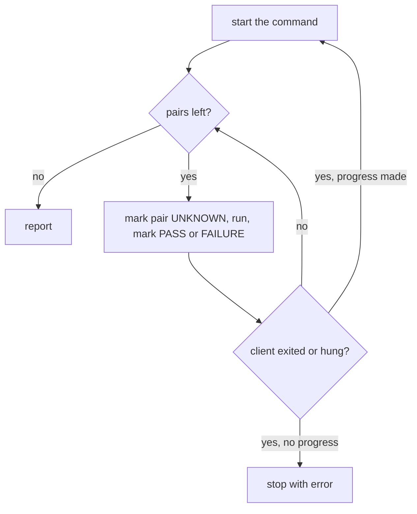

# Benchmark database

## What it is and why

The client runs every solution on every problem size. A kernel that crashes, faults the GPU or hangs used to kill the client and lose the progress of the whole run.

With `--benchmark-db <path>` (or `benchmark-db=<path>` in `ClientParameters.ini`) the client records each (init config, solution) pair in a SQLite file. Running the client again with the same database resumes: pairs that already have a result are not launched again, and a kernel that killed the client is not launched again either. The option is off by default (empty path). A Python supervisor, `tensilelite.ClientSupervisor`, can run a client to completion across crashes and hangs (see Supervision).

The contract:

- The `UNKNOWN` marker of a pair is committed durably before the pair is launched, so a crash or a node reset leaves it `UNKNOWN`.
- `PASS` or `FAILURE` is committed after the pair is validated.
- A pair left `UNKNOWN` is faulty and is never launched again.
- A faulty kernel is launched once: with `indirect-failures` on (the default), the remaining pairs of its solution are marked `INDIRECTLY_FAILED`, and with `indirect-verification-failures` on (the default), after a verification failure, except right after a session that died, `INDIRECT_VERIFICATION_FAILURE`; marked pairs are not launched.

| Value | Status | Meaning |
|-------|--------|---------|
| 0 | `NOT_BENCHMARKED` | Not started, or its problem did not finish. |
| 1 | `UNKNOWN` | Started and never finished: the client died while running it. |
| 2 | `PASS` | Finished with validation `PASSED` or `NO_CHECK`, or with no verdict. A pair whose solution the client declines to run (for example a rejected check or a skipped granularity) reports no verdict and is recorded as `PASS` with an empty validation. |
| 3 | `FAILURE` | Finished with a verdict other than `PASSED` or `NO_CHECK`. |
| 4 | `INDIRECTLY_FAILED` | Never launched: its solution left another pair `UNKNOWN` in a session that died. |
| 5 | `INDIRECT_VERIFICATION_FAILURE` | Never launched: its solution failed verification (verdict `FAILED`) on another pair, except right after a session that died. |
| 6 | `NOT_SELECTED` | Never launched: the solution iterator did not select it for its problem, for example by performance prediction. It is neither a failure nor a pass. |

### Schema at a glance

`schemaSql` in `client/src/BenchmarkDatabase.cpp` is the source of truth for the columns.

| Table | Purpose |
|-------|---------|
| `meta` | CSV options: `performance_metric`, `csv_export_extra_cols`, `csv_merge_same_problems`. |
| `solutions` | Complete solution spec, with `spec_format` `msgpack` or `yaml`. |
| `client_configs` | The client configuration as text, a single row. |
| `init_configs` | One row per problem. |
| `problem_values` | Per-problem values reported by the client. |
| `sessions` | One row per client launch. `end_time` stays NULL if the client died. |
| `runs` | One row per pair: status, session, times, validation, `caused_by_problem_id`. |
| `run_values` | Per-pair values as the text the results CSV uses. |
| `iterations` | Time and enqueue count of each sync. |

Invariants:

- `PRAGMA user_version` is 1. A file with tables and another or no version is rejected with a mismatch and left unmodified.
- `runs.status` has `CHECK` 0 to 6, and `caused_by_problem_id` is non-NULL exactly for statuses 4 and 5.
- `run_values` and `iterations` have a composite foreign key to `runs(problem_id, solution_id)`.
- `runs(solution_id, status)` is indexed.
- Solution specs are the deterministic msgpack encoding of the solution, or YAML when the build has no msgpack writer. If the serialization traits change (the set or order of written fields), opening an old database fails with `solution N spec differs` and the run needs a new database.

## Options

| Option | Default | Meaning |
|--------|---------|---------|
| `benchmark-db` | empty (off) | Path of the SQLite file. It is created and populated when it does not exist. |
| `indirect-failures` | `true` | Mark the remaining pairs of a solution that crashed, faulted or hung as `INDIRECTLY_FAILED`. |
| `indirect-verification-failures` | `true` | Mark the remaining pairs of a solution that failed verification as `INDIRECT_VERIFICATION_FAILURE`. |

The two indirect options need `benchmark-db`. Turning one off resets the pairs previously marked with its status to `NOT_BENCHMARKED` when the next session starts, so they are retried.

`benchmark-db`, `indirect-failures`, `indirect-verification-failures`, `help` and `config-file` are not part of the client configuration stored in the database, so changing them does not make a database mismatch. Every other option is part of it, including output-only ones such as `results-file`, `log-file`, `log-level`, `print-*`, `dump-tensors` and `library-update-*`, and must be unchanged on resume.

`init-seed=0` seeds the data with the current time, so a rerun draws different data; `sessions.init_seed` records the seed each session used.

### Restrictions

The client rejects these combinations with a diagnostic and exit status 1, before the database file is created:

| Combination | Message |
|-------------|---------|
| `num-benchmarks` greater than 1 | `benchmark-db cannot be combined with num-benchmarks greater than 1` |
| `fused-a2a` other than disabled | `benchmark-db cannot be combined with fused-a2a` |
| `selection-only` | `benchmark-db cannot be combined with selection-only` |
| More than one `icache-flush-args` value | `benchmark-db supports a single icache-flush-args value` |
| `best-solution` | `benchmark-db needs the all-solutions run, not best-solution` |
| A client without a solution writer | `benchmark-db needs a client built with the msgpack or YAML solution writer` |
| An option value that the config-file syntax cannot hold | `benchmark-db cannot record this configuration: ...` |

## Resume and rerun

On start the client opens the database, populating a new one or checking an existing one, and begins a session. Then, for each problem and solution:

1. A pair that is not `NOT_BENCHMARKED` is not launched. The client reports validation `SKIPPED_BY_DB` for it.
2. For a pending pair it commits `UNKNOWN`, runs the pair, then commits `PASS` or `FAILURE` together with the reported values and iterations.
3. After a verdict `FAILED`, the remaining pairs of the solution become `INDIRECT_VERIFICATION_FAILURE`.
4. A problem with no pending pair is skipped with `Skipping problem <n>: no pending runs in the benchmark database`.

With `indirect-failures` on, at the start of a session after one that died (its `end_time` is NULL), the pairs of every solution that has an `UNKNOWN` pair become `INDIRECTLY_FAILED`, with the first such problem as the cause. A complete database makes a rerun launch nothing.

### Pairs the iterator does not select

With `prediction-threshold` of 1.0 or less and a GPU with a performance model, the solution iterator ranks the solutions valid for a problem and runs only the best ones. When a problem finishes normally, every pair of that problem still `NOT_BENCHMARKED` becomes `NOT_SELECTED` in one transaction, with the session id recorded. Nothing else is set: no validation, times or cause.

- A problem that does not finish (a crash, an early exit, a lost device) marks nothing, so its remaining pairs stay `NOT_BENCHMARKED`. The resumed run computes the selection again, which is deterministic, and runs the selected pairs it has not finished.
- `NOT_SELECTED` is not pending. A resumed run neither launches nor changes such a pair, even when its selection differs, and a problem with only `NOT_SELECTED` pairs left is skipped.
- Solutions that are not valid for a problem (the iterator's check fails) are never ranked, so their pairs end `NOT_SELECTED`.
- When the prediction is unavailable (the GPU has no performance model) or `prediction-threshold` is above 1.0, every solution runs, in index order, and no pair becomes `NOT_SELECTED`, whatever the threshold. With 1.0 every valid solution is selected and the solutions run in the order of their prediction.
- `indirect-failures` and `indirect-verification-failures` only mark and reset `NOT_BENCHMARKED` pairs and their own statuses, so they never change a `NOT_SELECTED` pair.
- The legacy results CSV has an empty cell for a solution that was not visited, and so does the cell of a `NOT_SELECTED` pair.

Independently of `indirect-failures`, a verification failure in the first session after one that died is recorded but does not propagate to the other pairs of its solution, because it may be a false failure after a GPU fault.

The client compares an existing database with the run: solutions (count, name, spec format, spec), the client configuration and the init configs. A difference stops it with exit status 1 before a session starts:

```
benchmark database mismatch: client configuration differs at '<option>'
benchmark database mismatch: solution <index> is named '<name in database>' in the database but '<name in this run>' in this run
benchmark database mismatch: solution <index> spec differs
benchmark database mismatch: solution count differs: database has <n>, run has <m>
```

The client configuration contains absolute paths, so a configuration that names other paths is a mismatch. To start over, delete the `.db`, `-wal` and `-shm` files.

## Supervision

`superviseClient(command, cwd, dbPath, watchdog, stopOnCleanExit, probe=None)` in `tensilelite.ClientSupervisor` runs one client configuration to completion and returns `SupervisionResult(restarts, outcome, message)`. `outcome` is a `SupervisionOutcome`: `COMPLETED`, `STOPPED_AFTER_SESSION` (a session of this call confirmed that the database matches the configuration) or `STOPPED_BEFORE_SESSION`. `message` says why it stopped and is empty on completion.

The supervised command is any wrapper script or the client itself, and runs in its own process group. The client's `benchmark-db` must be `dbPath`, which the supervisor reads itself: give an absolute path, or one relative to the supervisor's working directory, not `cwd`.



The supervisor decides from the database, not the exit code, which is the validation failure count of a finished client. The run is complete when no pair is `NOT_BENCHMARKED`; `NOT_SELECTED` pairs are not pending, so a client that marked them and exited cleanly is done, and one that exited cleanly with `NOT_BENCHMARKED` pairs left stops with an error. A restart requires progress: a pair launched by, or newly marked (as `INDIRECTLY_FAILED`, `INDIRECT_VERIFICATION_FAILURE` or `NOT_SELECTED`) by, the new session. The `NOT_BENCHMARKED` count is not used because a disabled indirect option raises it. Restarts are therefore bounded by the number of pairs. With `stopOnCleanExit`, a client that stopped early with a cleanly ended session is not resumed (for a client that exits on its first error).

`Watchdog(timeoutSeconds, pollSeconds=2, graceSeconds=5, reapSeconds=30)` polls the database. When a pair of a session started by this launch has been `UNKNOWN` longer than `timeoutSeconds`, it sends SIGTERM to the process group, waits `graceSeconds` and sends SIGKILL. A `timeoutSeconds` of 0 disables it. Warnings:

```
client failed (<how>); restarting to resume, <m> pairs left
problem <p>, solution <i> <name> has been running for <t>s, over the <limit>s limit; killing the client
```

`<how>` is `exit code <n>`, `killed by signal <n> (<NAME>)` or `killed by the watchdog`. A wrapper script that reports a client killed by a signal as 128 + n is decoded as a signal only when the session did not end.

The supervisor reads the database for each decision. A missing database, or one without tables, is the empty state. An unreadable one is read up to 3 times, 1 second apart, then supervision stops with `could not read the benchmark database <db> after 3 attempts: ...; not judging the client without it`. The watchdog poll skips a failed read.

Helpers:

- `reportDatabaseResults(dbPath, csvPath)` writes the CSV, prints the summary and returns 1 if any pair is not clean, otherwise 0. A pair is not clean when it is `UNKNOWN`, `FAILURE`, `INDIRECTLY_FAILED`, `INDIRECT_VERIFICATION_FAILURE` or `NOT_BENCHMARKED`; `NOT_SELECTED` is not a failure. If the database cannot be read it prints a warning, removes the stale CSV and returns 1.
- `removeStaleResults(csvPath)` deletes a CSV of an earlier run.
- `removeDatabase(dbPath)` deletes the `.db`, `-wal` and `-shm` files.

## Crash handling

- The session is a scope: `BenchmarkSession` begins it and the client ends it with `end()` once all problems are done, which sets `sessions.end_time`. An exception unwinding through the scope leaves the session open; a normal exit from the scope, such as the `exit-on-error` early return, ends it.
- `PairRecorder` commits `UNKNOWN` when it is created, before the first launch of the pair, and writes the verdict in `finish()`.
- A crash, hang, GPU fault or kill leaves the pair `UNKNOWN` and the session open. With `indirect-failures` on, the next session marks the remaining pairs of that solution `INDIRECTLY_FAILED`.
- A lost device (a sticky error after a failed pair, reported as `Device unusable (<error>), aborting.`) does the same: the pair stays `UNKNOWN`, the session stays open (the client unwinds with an exception) and the client exits with the clamped error count (at least 1).
- With `exit-on-error`, an early exit after a failure records the failed pair, ends the session and exits with the clamped error count (at least 1).
- A database failure raised during the session (in `beginSession`, `beginRun`, `endRun`, or `end()` on the normal path: an inconsistency or a failing SQLite call) prints `benchmark database error: ...` and exits with 1. The session stays open, except that a failing `beginSession` leaves no session. If `end()` fails in the destructor on the `exit-on-error` early return, the client prints `failed to end the benchmark session: ...`, leaves the session open and keeps the clamped error count. Errors raised while opening the database, such as a mismatch, exit with 1 before any session exists.
- On Linux the client in `benchmark-db` mode asks the kernel to SIGKILL it when its parent dies, so GPU work does not outlive the process that launched it. A client whose parent exits while the client is arranging the death signal exits with 1 and `benchmark-db client started after its parent exited` (a parent that died before the client started is not detected); if the request itself fails it exits with 1 and `benchmark-db cannot arrange to die with its parent: ...`.

When the client completes all problems, its exit status is the number of validation failures, capped at 255, as without a database.

The supervisor handles a crash, hang, GPU fault, lost device and database error alike: the pair stays `UNKNOWN`, the session stays open and the client exits non-zero, so it restarts the command.

After an abnormal exit (death by signal, watchdog kill, a non-zero exit without a cleanly ended session, or an unreadable database after the launch) the supervisor runs the GPU warm-up probe on the device of the `GpuProbe(command, device)` passed to `superviseClient` before the next launch:

- It makes up to 3 attempts of at most 120 seconds, logging `# gpu warm-up on device <d>, attempt <i>/3: passed` or a warning with the reason.
- A probe that does not exit after SIGKILL stops the supervision at once, with `probe process <pid> did not exit after SIGKILL ...`, without another attempt.
- If all fail, supervision stops with `gpu warm-up failed on device <d> after 3 attempts; not benchmarking on a possibly unhealthy gpu`. The warm-up stays pending process-wide and carries over to the next `superviseClient` call.
- `findGpuProbe(clientExecutable, device)` looks for `tensilelite-gpu-probe` next to the client executable, then in the default build directory (`DEFAULT_CLIENT_PATH`). If it is missing, it warns once and returns `None`, and clients run without warm-up.

## Shutdown

- SIGTERM and SIGHUP make the supervisor kill the process group of the supervised command (SIGTERM, `graceSeconds`, SIGKILL) and raise `SupervisorTerminated`, a `SystemExit` with code 128 plus the signal. Ctrl-C kills the group the same way and re-raises. The handlers are installed only while supervising and only in the main thread. A signal that was already ignored when supervision starts, such as SIGHUP under `nohup`, stays ignored. The database stays resumable.
- If the supervisor is SIGKILLed, on Linux `PR_SET_PDEATHSIG(SIGKILL)` kills the chain: the supervised command and the probe are started with it, and the client in `benchmark-db` mode sets it on itself, as described in Crash handling.
- After SIGKILL the supervisor waits at most `Watchdog.reapSeconds` (30 by default) for the group leader. If it does not exit, supervision stops with `client process <pid> did not exit after SIGKILL ...; not relaunching onto a GPU it may still hold`.

## Durability

Each commit uses `synchronous=FULL` (one fsync). WAL is required: on a filesystem without it the client fails with `cannot enable write-ahead logging`. The `-wal` and `-shm` files must be copied together with the `.db` and never deleted alone.

Useful queries (`sqlite3 -readonly <path>`):

```sql
SELECT status, COUNT(*) FROM runs GROUP BY status;

SELECT c.problem_index, s.library_index, r.session_id
FROM runs r JOIN init_configs c ON c.id = r.problem_id JOIN solutions s ON s.id = r.solution_id
WHERE r.status = 1 ORDER BY c.problem_index, s.library_index;

SELECT c.problem_index, s.library_index, r.status, cc.problem_index AS caused_by
FROM runs r JOIN init_configs c ON c.id = r.problem_id JOIN solutions s ON s.id = r.solution_id
LEFT JOIN init_configs cc ON cc.id = r.caused_by_problem_id
WHERE r.status IN (4, 5) ORDER BY s.library_index, c.problem_index;
```

## Results and CSV

`tensilelite.BenchmarkDatabase` reads the database from Python. `formatSummary(summarize("run.db"))` formats the state of a run:

```
benchmark database: 18 pairs: 14 PASS, 0 FAILURE, 1 UNKNOWN, 0 NOT_BENCHMARKED, 3 INDIRECTLY_FAILED, 0 INDIRECT_VERIFICATION_FAILURE, 0 NOT_SELECTED
pairs left UNKNOWN (the client died while running them):
  problem 0, solution 4 <solution name>
pairs not launched because their solution crashed, faulted or hung on another problem:
  solution 4 <solution name>: 3 pairs, caused by problem 0
sessions that died: 1
```

Sections list the `UNKNOWN` pairs, the `FAILED` pairs, the `INDIRECTLY_FAILED` and `INDIRECT_VERIFICATION_FAILURE` pairs per solution and causing problem, the tainted failures (failed right after a session that died) and the sessions that died. `NOT_SELECTED` pairs are only counted, at the end of the first line: they are neither failures nor passes. A section with no pairs is omitted.

```python
from contextlib import closing
from tensilelite.BenchmarkDatabase import RunStatus, getPairs, openDatabase

with closing(openDatabase("run.db")) as connection:
    for pair in getPairs(connection, [RunStatus.UNKNOWN]):
        print(pair.problemIndex, pair.libraryIndex, pair.sessionId)
```

Main functions: `openDatabase`, `getPairs`, `getSessions`, `countPairsByStatus`, `summarize`, `formatSummary`, `writeResultsCsv`.

`writeResultsCsv` writes the results CSV from the database. The CSV has the layout and values of the client's own results CSV, and is byte-identical to it for a run that finished in a single session with every pair passed. It writes a temporary file and replaces the CSV atomically, from a single read snapshot. A pair that is not `PASS` has the cell `-1`, except a `NOT_SELECTED` pair, whose cell is empty as in the client's CSV because the client never visited it. A stored value that cannot be read raises `BenchmarkDatabaseError`; `reportDatabaseResults` handles it by printing a warning and writing no CSV. With `csv-export-extra-cols`, the best-of columns (winner, best time, bandwidth) consider only `PASS` pairs here, whereas the client also folds in a pair that failed verification after its timing was reported, so those columns can differ for runs with verification failures.

The client adds a CSV column the first time it visits a solution, writes the header after the first problem and every row with the columns known after its problem. `writeResultsCsv` reproduces that: a `NOT_SELECTED` pair is not visited and creates no column, so with prediction a solution first selected by a later problem has a cell without a header, and the rows before it are shorter. With `csv-merge-same-problems` every row has all columns, the late ones empty where unvisited. Solutions with the same name share one column. The one inexact part is the order of the columns that the same problem adds for the first time: the reader uses the library index order, which is the client's order without prediction, while a prediction run visits the solutions in the order of its ranking, which the database does not store.

### CSV parity test

The gtest `BenchmarkCsvParity*` (`tests/BenchmarkCsvParity_test.cpp`) and `Tests/unit/test_benchmark_csv_parity.py` share the fixtures in `tests/data/benchmark_db`: scenarios `default`, `merge`, `extra_cols`, `cu_efficiency`, `prediction` (pairs the iterator did not select), `late_columns` and `late_columns_merge` (solutions first visited by a later problem), each with a golden `<name>.csv` and a dump `<name>.db.txt`. The gtest checks that the client's CSV and database for a scripted run equal the fixtures, and the Python test checks that `writeResultsCsv` writes the golden CSV from the dump, both byte for byte. The one deliberate deviation concerns pairs that were never reached: the gtest replays them as `SKIPPED_BY_DB` (cell `-1`), while a real client leaves the cell empty and the Python reader writes `-1`. A `NOT_SELECTED` pair is not reported in the gtest. To change a fixture, copy the text the gtest prints on a mismatch over the file and check the Python test.

## GPU warm-up probe

`tensilelite-gpu-probe [--device-idx N]` is a standalone tool built with the client and installed in the tests component under `libexec/hipblaslt/tensilelite` when `HIPBLASLT_INSTALL_TENSILELITE_TEST_ARTIFACTS` is enabled. It is independent of the client libraries. After a GPU memory fault the first process that does real GPU work can compute wrong results. The probe does that work on the chosen device (default 0): it allocates two 128 MiB buffers, runs a copy kernel, reads the result back and verifies it, so the next client starts on a healthy device. `ClientSupervisor` runs it after abnormal client exits (see Crash handling).

| Exit status | Meaning |
|-------------|---------|
| 0 | Verified; prints `gpu probe passed on device <N> (128 MiB copy verified)`. |
| 1 | HIP error or mismatch; prints `gpu probe failed on device <N>: <reason>` on stderr. |
| 2 | Usage error; prints `usage: <program> [--device-idx N]` on stderr. |

The gtests `GpuProbeArgs*` and `GpuProbeExitCode*` check its argument parsing and exit codes without a GPU (the exit-code tests need only the HIP runtime library).

## Build requirements

SQLite is required. CMake looks for the ROCm sysdeps config package in `${ROCM_PATH}/lib/rocm_sysdeps` first, then the system `libsqlite3`; configure fails if neither is found. With `msgpack-cxx` or `msgpackc-cxx` the host stores specs as msgpack, otherwise as YAML; the configure output has a status line for it. A client built against a host with neither writer rejects `--benchmark-db`.

## Known limitations

- Under the supervisor, the watchdog kills a hang inside a pair, which stays `UNKNOWN`. A hang outside a pair, such as the CPU reference computation or the data initialization, is never detected. Without the supervisor the client blocks until it is killed externally.
- A failure right after a GPU fault may be a false failure even after a passing warm-up probe.
- With `indirect-failures` off, a faulty kernel can cost one crash per problem.
- The client configuration contains absolute paths, and each rerun repeats the client setup.
- `INVALID` (an exception while launching) is a direct failure and does not propagate.
- Independently of `indirect-failures`, verification propagation is skipped in the first session after one that died.
- The crash marking runs at the start of a session, before the selection of the unfinished problems is known. A crashed solution's `NOT_BENCHMARKED` pairs of those problems become `INDIRECTLY_FAILED` even if the prediction would not have selected them, and they are not retried.
- The schema version was not bumped. A version 1 database that an earlier build of this unreleased schema created (status `CHECK` 0 to 5) must be deleted, otherwise the first `NOT_SELECTED` marking fails with a `CHECK` error.
- The death-signal protection needs Linux.
- The combinations in the Restrictions table are unsupported.
- The watchdog kills the whole process group, so the cleanup of a wrapper script (for example a clock reset) does not run.
- After a SIGKILL of the supervisor the client is killed by the death signal asynchronously, so a new run can start while the old client is still releasing the GPU.
- The bounded reap only follows the group leader, and a signal between starting the client and entering the cleanup scope is not covered.
