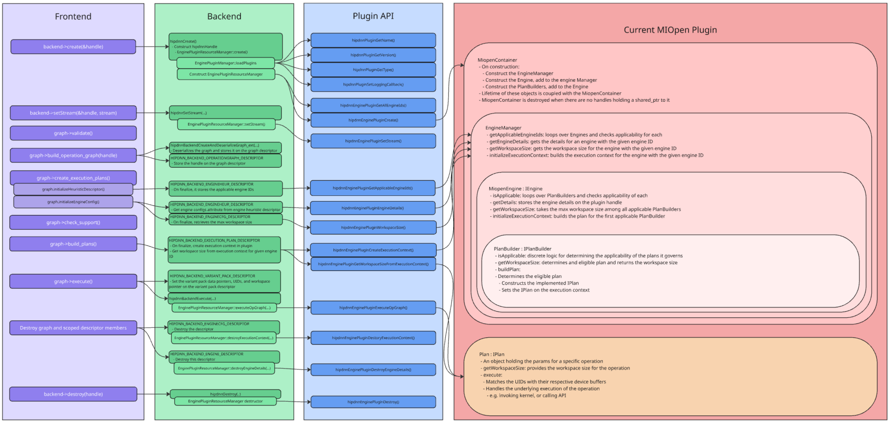

# hipDNN - Plugin SDK Design Document

- Contributors: Mitch Ousdahl, Sam Reeder, Adam Dickin
- Original Implementation: Adam Dickin

- **Status**: Implemented
- **Status notes**: `plugin_sdk` was created in #3142 and the helper framework shipped in #4086. The plugin supplies its own container type and implements the `IEngine`, `IPlanBuilder`, and `IPlan` interfaces directly. `samples/example_engine_plugin` (#5297) is the example plugin.
- **Last verified**: 2026-10-15 against `develop` (2501d0b28cc)

## Table of Contents
1. [Executive Summary](#1-executive-summary)
2. [Problem Statement](#2-problem-statement)
3. [Current System Overview](#3-current-system-overview)
4. [Design](#4-design)
5. [Key Design Decisions](#5-key-design-decisions)
6. [Risks](#6-risks)
7. [Execution Plan](#7-execution-plan)
8. [Testing Plan](#8-testing-plan)
9. [Related Features](#9-related-features)
10. [Glossary](#10-glossary)

## 1. Executive Summary
hipDNN represents a system for the validation and execution of complex graphs of tensor operations that can be expressed as a directed acyclic graph (DAG). Rather than directly include engines that can capably execute those graphs directly in hipDNN code, hipDNN has implemented a plugin mechanism wherein engine authors can fulfill a simple C-compatible API with the goal of generating a dynamic plugin library. This allows the system the capability for flexibility without recompilation, allows for future growth, and allows for a robust ecosystem of engine providers.

This proposal describes two pieces of work.

The first is to split the **Plugin SDK** from our existing **SDK**, with the eventual goal of making the original SDK a **Data SDK** that describes the data contract between the frontend and backend of hipDNN. The **Plugin SDK** will be solely to aid authors of plugins.

The second part of the proposal is for the design of an optional framework that will assist a hipDNN plugin developer to quickly and reliably create an engine plugin for hipDNN.

A basic shared-library C-compatible API for plugins is defined in two headers: `PluginApi.h`, the base API for all plugins, and `EnginePluginApi.h`, the engine plugin API. While plugin developers are free to implement their plugins using solely this API, a set of helpful classes can provide some basic structure that will allow developers to:
- bootstrap a new engine plugin quickly
- provide mechanical guidance and guardrails
- create a comfortable object-oriented abstraction

## 2. Problem Statement
The C-compatible engine plugin API is certainly suggestive of certain concepts and patterns, such as Engines, Workspaces, Engine Configs, and Execution Contexts, but it can be somewhat opaque in how those plugin entry points relate to one another. What is the recommended life-cycle of an engine? Or an execution plan?

While the design isn't meant to be prescriptive, it should work either as a direct implementation aid (using the classes directly) or a documentation aid (these classes suggest how an engine plugin is used by hipDNN).


## 3. Current System Overview
The hipDNN framework consists of a frontend (C++ Graph API), a backend (core runtime), and a plugin system. The backend prepares and dispatches execution to dynamically loaded plugins via a C-API interface.

The following diagram demonstrates how frontend calls pass through the backend and ultimately get handled by an engine plugin.  The call-stack demonstrated isn't exhaustive, it's mostly to illustrate the entry / exit points for each layer.  The MIOpen plugin is overlayed to demonstrate how a plugin might implement the plugin interface.  The plugin SDK is an engine-agnostic version of this design.



### 3.1 Object Lifetimes
The plugin keeps one container for each loaded plugin library. Each plugin handle holds a `shared_ptr` to the container. A global `weak_ptr` lets later plugin handles share the same container. When the last handle is destroyed, the container is released. [SharedContainerManager.hpp](../../plugin_sdk/include/hipdnn_plugin_sdk/SharedContainerManager.hpp) implements this pattern. See [4.2 Plugin Container](#42-plugin-container) for the specifics.

Because the container is shared, multiple threads can access the container, the engine manager, the engines, and the plan builders at the same time.

The backend also manages the lifecycle of two types of objects (with corresponding create / destroy calls in the plugin).
    - Plugin handle - This gets created when the plugin is intialized.  It is an opaque pointer, so plugin authors would typically use it for storing things like device state, and any further implementation handles (such as MIOpen's handles in the example of the MIOpen plugin)
    - Execution Context - This gets created when a plan gets finalized.  It is another opaque pointer, allowing plugin authors to store state relevant to plans.

### 3.2 Multi-Threading
Shared library files aren't reloaded by `dlopen` calls from different threads, which means that multiple threads can be accessing the objects described in section 4 at the same time.  Given that, plugin containers, engine managers, and plan builders should either be stateless or use thread-safe objects with locking around any stored state.


### MIOpen Provider Plugin Architecture

The MIOpen Provider Plugin serves as the kernel provider. It employs a modular C++ architecture, largely decoupled from the API layer.

*   **Dependency Injection Container (`MiopenContainer`):**
    This is the root object that manages the lifecycle and dependencies of all other components. It initializes the `EngineManager` and ensures that all necessary services are correctly injected.

*   **Engine Manager (`EngineManager`):**
    The central registry for execution engines. It orchestrates the selection of the appropriate engine for a given operation graph by querying its registered engines.

*   **Plan Builders (`IPlanBuilder`):**
    Each engine is associated with a set of Plan Builders. These components are responsible for:
    *   **Applicability:** Inspecting an operation graph to determine if the engine can execute it.
    *   **Resource Estimation:** Calculating the required workspace size.
    *   **Plan Construction:** Creating an executable `IPlan` object if the graph is supported.

*   **Plans (`IPlan`):**
    An `IPlan` represents a strategy for executing a specific operation graph. It encapsulates all the necessary logic and state to run the routine, abstracting the details from the higher-level engine management.

*   **C-API Interface:**
    A thin translation layer that exposes these internal C++ components to the backend via the required engine plugin C-API.

### Execution Flow

When the backend requests a graph execution, the flow within the plugin is as follows:

1.  **Ingestion:** The C-API bridge receives the raw graph handle and forwards it to the `MiopenContainer`.
2.  **Selection:** The `EngineManager` iterates through registered engines to find a candidate.
3.  **Compilation:** The selected Engine's `PlanBuilder` validates the graph and constructs an `IPlan`.
4.  **Execution:** The `IPlan` executes the operation, marshaling pointers from the backend's `VariantPack` to the underlying device kernels.

This architecture separates the plugin interface from the engine implementation details. The Plugin SDK provides these components in an engine-agnostic, reusable form, so developers can focus on the implementations of the underlying kernels and libraries.

## 4. Design

The SDK has two parts: an include file that implements the C API, and a hierarchy of classes and interfaces behind it.

### 4.1 Entry-Point Implementation: `EnginePluginImpl.inl`

`hipdnn_plugin_sdk/EnginePluginImpl.inl` implements all engine plugin C API entry points and connects them to the plugin's [container](#42-plugin-container). It is optional. A plugin that does not include it must implement the entry points itself.

To use it, the plugin defines these macros in one source file, then includes the `.inl` file:

| Macro | Value |
|-------|-------|
| `HIPDNN_PLUGIN_NAME` | String literal for the plugin name |
| `HIPDNN_PLUGIN_VERSION` | String literal for the plugin version |
| `HIPDNN_PLUGIN_CONTAINER_TYPE` | The plugin container class |
| `HIPDNN_PLUGIN_HANDLE_TYPE` | The handle type. It inherits from `HipdnnEnginePluginHandle`. |
| `HIPDNN_PLUGIN_CONTEXT_TYPE` | The execution context type. It inherits from `HipdnnEnginePluginExecutionContext` and `ExecutionContextBase<THandle, TSettings>`. |

```cpp
#define HIPDNN_PLUGIN_NAME "miopen_provider_plugin"
#define HIPDNN_PLUGIN_VERSION MIOPEN_PROVIDER_VERSION_STRING
#define HIPDNN_PLUGIN_CONTAINER_TYPE miopen_plugin::MiopenContainer
#define HIPDNN_PLUGIN_HANDLE_TYPE HipdnnMiopenHandle
#define HIPDNN_PLUGIN_CONTEXT_TYPE HipdnnMiopenContext

#include <hipdnn_plugin_sdk/EnginePluginImpl.inl>
```

The MIOpen plugin puts the macros in `MiopenPluginDefines.hpp` and includes both files from `dnn-providers/miopen-provider/MiopenPluginPublic.cpp`. `EnginePluginTypeTraits.hpp` checks the required types at compile time.

The entry points marshal data between the C interface and the C++ classes. They copy vectors to contiguous memory, wrap flatbuffer graphs, manage the container lifecycle, and convert C++ exceptions to status codes.

### 4.2 Plugin Container

Each plugin supplies its own container class (for example `MiopenContainer`). The container owns the plugin's `EngineManager`.

- **Lifecycle:** `EnginePluginImpl.inl` keeps one container in a static `SharedContainerManager<HIPDNN_PLUGIN_CONTAINER_TYPE>`. `hipdnnEnginePluginCreate()` stores a `shared_ptr` to the container in the handle's `container` member. A `weak_ptr` lets later calls to `hipdnnEnginePluginCreate()` share the same container. When the last handle is destroyed, the `weak_ptr` makes sure that the memory is not held unnecessarily.

- **Methods:** The container must provide:
    - `EngineManager<...>& getEngineManager()`
    - `static uint32_t copyEngineIds(int64_t*, uint32_t, uint32_t&)`
    - Optional: `static hipdnnPluginStatus_t getEngineName(int64_t, const char**)`

- The `.inl` handles the execution context workspace size and execute calls directly. It calls `plan()` on the execution context and does not go through the `EngineManager`.

### 4.3 Class: `EngineManager`

`hipdnn_plugin_sdk::EngineManager<THandle, TSettings, TContext>` (`EngineManager.hpp`) is the collection of all engines in the plugin. The plugin container owns it, and it shares a lifespan with the container.

- **Methods:**
    - `void addEngine(engine, name)` - Adds an engine. If an engine with the same ID exists, the manager keeps the first engine and logs an error.
    - `vector<int64_t> getAllEngineIds()` - Returns a list of all engines managed by this `EngineManager`
    - `vector<int64_t> getApplicableEngineIds(handle, graph)` - Returns a list of all engines that can handle the supplied graph
    - `void getEngineDetails(handle, graph, engineId, engineDetailsOut)` - Pass-through to the engine indicated by `engineId`. Writes into a `hipdnnPluginConstData_t&`.
    - `size_t getMaxWorkspaceSize(handle, graph, engineConfig)` - Pass-through to the engine indicated by the engine ID in `engineConfig`
    - `void initializeExecutionContext(handle, graph, engineConfig, executionContext)` - Pass-through to the engine indicated by the engine ID in `engineConfig`

- **Members:**
    - A container of several `IEngine` instances.

### 4.4 Interface: `IEngine`

Engines implement `hipdnn_plugin_sdk::IEngine<THandle, TSettings, TContext>` (`interfaces/IEngine.hpp`). An engine can handle one or more graphs of operations.

For example, a `BatchNormEngine` might be able to handle single-op and simple fused graphs that contain batchnorm operations.

*Note:* You probably don't want to have an massive amount of engines in your plugin.  The plugin is responsible for choosing its solution given a graph, and without sampling.  The plan should be finalized and ready to go by execution time, which is when device pointers are available.

- **Lifecycle:**
    - The engines typically have the same lifecycle as the `EngineManager` that contains them.
    - The `engine_details` returned by `getDetails()` has explicit create/destroy entry-points in the plugin.
    - The execution context initialized by `initializeExecutionContext()` also has explicit create/destroy entry-points in the plugin.
    - Since engine details and the execution context are "owned" by the plugin consumer, the entry points in `EnginePluginImpl.inl` manage their cleanup during their destroy API calls.

- **Methods:**
    - `int64_t id()` - Returns the engine ID.
    - `bool isApplicable(handle, graph)` - Returns true if this engine can handle the supplied graph. Typically it would do this by checking all its plan builders.
        - *Note:* only a single plan builder can be provided per engine. If multiple plan-builders have overlapping graph support, then it's up to the plugin implementor to decide on how to handle this selection. Two possible options could be splitting these plan builders up into multiple different engines, or having a priority selection system.
    - `void getDetails(handle, graph, detailsOut)` - Writes details about this engine into a `hipdnnPluginConstData_t&`
    - `size_t getMaxWorkspaceSize(handle, graph, engineConfig)` - Pass-through to the plan builders that are applicable, taking the Max of all workspaces queried (typically only one should be applicable for a given graph).
    - `void initializeExecutionContext(handle, graph, engineConfig, executionContext)` - Pass-through to the appropriate plan builder. The built plan is set on the execution context.
        - *Note:* It's expected that only one plan builder will ever be applicable, and it's up to the plugin author to either split things up into more engines, or have some mechanism for choosing between plan builders if multiple plan builders are applicable.

- Plugin authors split their engines into groupings that have the same behavioral notes and support similar engine configurations.

- **Members:** The engine decides how to store its plan builders.

### 4.5 Interface: `IPlanBuilder`

Plan builders implement `hipdnn_plugin_sdk::IPlanBuilder<THandle, TSettings, TContext>` (`interfaces/IPlanBuilder.hpp`). A plan builder can handle a specific graph of operations.

In the above example, a single plan builder can handle a single batchnorm forward operation, while another might be able to handle batchnorm + activation.

- **Methods:**
    - `bool isApplicable(handle, graph)` - Returns true if this plan builder can handle this graph
    - `size_t getMaxWorkspaceSize(handle, graph, executionSettings)` - Returns the maximum workspace required for the supplied graph
    - `void initializeExecutionSettings(handle, graph, engineConfig, executionSettings)` - Fills the execution settings from the engine config
    - `void buildPlan(handle, graph, engineConfig, executionContext)` - Creates an `IPlan` instance and attaches it to the execution context
    - `vector<KnobT> getCustomKnobs(handle, graph)` - Returns the custom knobs that this plan builder supports

### 4.6 Interface: `IPlan`

Plans implement `hipdnn_plugin_sdk::IPlan<THandle>` (`interfaces/IPlan.hpp`). A plan is ready to execute. It takes device data and executes the desired operations on it.

- **Lifecycle:** The plans typically share a lifespan with the execution context they are attached to. `ExecutionContextBase<THandle, TSettings>` holds the plan and the execution settings. Since the plan is immutable after the point of creation, `EnginePluginImpl.inl` can safely handle its lifecycle and execution.

- **Methods:**
    - `size_t getWorkspaceSize(handle)` - Returns the workspace required for this plan
    - `void execute(handle, deviceBuffers, numDeviceBuffers, workspace)` - Executes the plan as built by the `IPlanBuilder` that created it

- **Members:** Since a plan gets attached to an execution context, it can have internal state.

### 4.7 Threading and Lifecycle Notes

Above of the plugin there are a few objects that have lifecycles managed by the backend / frontend.  They are usually opaque data tied to handles / descriptors which means that it's up to the plugin authors how they are used, but below are some examples of how they might be used in a plugin.

- **Plugin Handle:** Created with explicit create / destroy methods, this is an opaque pointer to an object ultimately defined by the plugin author.  It can be used to tie information from invocations of a plugin to other resources.  In the MIOpen plugin, for example, the handle (`HipdnnMiopenHandle`) holds a `shared_ptr` to the plugin container (`MiopenContainer`) and the stream passed into setStream calls.  This handle is usually created when a plugin is loaded during initialization.
    - *Note:* Care should be taken since that the handle that's used during plugin creation may not be the same as the one used during plan execution.  What this means, for example, is that a plugin may be instantiated and a plan created on one thread, for example, and then executed on a completely separate thread under the context of a different plugin handle.  So it would be unhelpful, for example, to store cache artifacts for plan exeuction on a plugin handle.

- **Engine Details:** Created when the framework requests engine details from the plugin.  The lifespan is controlled by the consuming application.

- **Execution Context:** Created when the framework creates an execution plan.  A typically use for this object is to attach an IPlan for it.  An execution plan represents a "finalized" plan, and is meant to be immutable and can be re-used with different device buffers.  The lifespan is controlled by the consuming application.

For threading purposes, be mindful that any object might be accessed from multiple threads.  For example, an execution context might be created and then passed to multiple threads with their own device buffers.  Just be mindful when adding members to classes like engines, engine managers, plugin containers, etc. that you'll have to potentially protect any mutable state from unsafe thread access.  The easiest way to manage this is to keep these objects as stateless as possible, but that's a guideline, not a prohibition.

Future considerations will be adding the ability to have thread-safe containers and objects that would allow a plugin creator to easily implement thread-safe caches and other utilities.

### 4.8 Error Handling
Error handling will make use of C++ exceptions primarily, with the understanding that they will be transitioned into error codes at the C API interface.

## 5. Key Design Decisions
- Opt-in glue code via an included `.inl` file and macros
- A single-instanced container
- Stateless classes for thread safety
- Use of wrappers and glue code to hide the details of the C API and provide a cleaner C++ interface for plugin writing

## 6. Risks
- **Plugin API Breaking Changes**: If the C-API interface needs to evolve during implementation, existing plugins may require updates, creating compatibility issues.  We have a future RFC incoming around how to safely handle versioning and ABI breaks.
- **Thread Safety Complexity**: While the design aims for stateless classes, ensuring thread safety across multiple plugin invocations and shared containers introduces potential race conditions and debugging challenges
- **Performance Overhead**: The additional abstraction layers (container → manager → engine → plan builder → plan) may introduce latency compared to direct C-API implementations
- **Adoption Risk**: Plugin developers may choose to bypass the SDK framework and implement directly against the C-API, reducing the value of this abstraction layer
- **Memory Management**: Shared/weak pointer lifecycle management across plugin boundaries and multiple threads could lead to memory leaks or premature destruction
- **Testing Coverage**: The complexity of multi-threaded, multi-plugin scenarios makes comprehensive testing challenging, potentially missing edge cases
- **Migration Complexity**: Moving existing MIOpen plugin to the new architecture risks introducing regressions while maintaining backward compatibility
- **Ecosystem Fragmentation**: Having both SDK and Plugin SDK may confuse developers about which components to use for different scenarios.  We will mitigate this by renaming the sdk to data_sdk in an upcoming effort.

## 7. Execution Plan

- Create blank `plugin_sdk`
    - Wait for TheRock submodule bump (TheRock is the CI/build infrastructure for ROCm libraries)
    - Update TheRock to add the the plugin_sdk component
    - Update rocm-libraries to use the new TheRock CI hash to have the merged changes from step #1
    - Changes in rocm-libraries to use the new artifacts
- Migrate `sdk/plugin` code to `plugin_sdk`
    - Establish `hipdnn_plugin_sdk` namespace
    - Modify consuming `CMakeLists.txt` to add required `plugin_sdk` dependencies and remove unnecessary `sdk` transitive dependencies
    - Modify consuming code to use the utilities from the new namespaces and the new include location
- Write new plugin helpers
- Migrate existing MIOpen plugin to consume the new plugin helpers
- Migrate existing MIOpen unit tests
- Write an example engine plugin (`samples/example_engine_plugin`) that consumes the new plugin helpers

## 8. Testing Plan
- Execute existing MIOpen plugin unit tests
- Execute existing MIOpen plugin integration tests
- Execute new plugin helper unit tests
- Multi-threaded testing to verify thread safety of stateless components
- Performance benchmarking to measure overhead of abstraction layers
- Memory leak detection using valgrind or similar tools

## 9. Related Features

- Behavioral notes are in the engine details (`behavior_notes` in `engine_details.fbs`, and `hipdnn_plugin_sdk/BehaviorNote.h`).
    - These tags identify engine characteristics used for filtering.
    - Plugin authors control the behavioral notes on their engines.
- Engine settings are knobs (`KnobFactory.hpp`, `IPlanBuilder::getCustomKnobs()`). They let the user control the behavior of the engine.
    - Plugin authors control the available settings and value ranges.
- Execution context serialization is in `EnginePluginApi.h` (`hipdnnEnginePluginSerializeExecutionContext`, `hipdnnEnginePluginCreateExecutionContextFromSerialized`).

## 10. Glossary

- **DAG (Directed Acyclic Graph)**: A graph structure representing tensor operations where edges indicate data flow and no cycles exist
- **Engine**: A component capable of executing one or more types of operation graphs
- **Engine Config**: Configuration parameters that specify how an engine should execute a particular graph
- **Execution Context**: Runtime state and resources needed to execute a specific plan
- **Execution Plan**: A compiled, ready-to-execute representation of an operation graph for a specific engine
- **Plan Builder**: A component responsible for determining if an engine can handle a graph and constructing execution plans
- **Plugin**: A dynamically loaded library that provides engine implementations via the hipDNN plugin API
- **TheRock**: The CI/build infrastructure system for ROCm libraries
- **Workspace**: Temporary memory buffer required by an engine to execute operations
