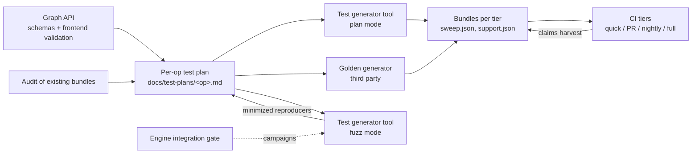

# RFC 0021: Per-Op Test Plans

- Contributors: Adam Dickin

## Table of Contents

1. [Executive Summary](#1-executive-summary)
2. [Problem Statement](#2-problem-statement)
3. [Scope](#3-scope)
4. [Design Overview](#4-design-overview)
5. [Principles](#5-principles)
6. [Feature Inventory](#6-feature-inventory)
7. [Shape Catalog and Size Ladder](#7-shape-catalog-and-size-ladder)
8. [Sweep Construction and Tiers](#8-sweep-construction-and-tiers)
9. [Case Purpose](#9-case-purpose)
10. [Trade-off Register](#10-trade-off-register)
11. [Oracles and Reference Prerequisites](#11-oracles-and-reference-prerequisites)
12. [Golden Tests](#12-golden-tests)
13. [Authoring Process and Plan Template](#13-authoring-process-and-plan-template)
14. [Test Generator and Fuzzing Tool](#14-test-generator-and-fuzzing-tool)
15. [Required Infrastructure](#15-required-infrastructure)
16. [Rollout](#16-rollout)
17. [Alternatives Considered](#17-alternatives-considered)
18. [Risks](#18-risks)
19. [Open Questions and Future Work](#19-open-questions-and-future-work)
20. [Glossary](#20-glossary)

## 1. Executive Summary

The integration suite (`dnn-providers/integration-tests`) tests each op with
template-sweep bundles ([RFC 0011](0011_GoldenReferenceValidation.md)). It
records engine support as claims ([RFC 0015](0015_EngineSupportClaims.md)). It
has no rule for **which cases a bundle holds**. Today, bundles hold cases
captured from older C++ tests, then re-tiered. No case has a stated reason.
Nothing records what we left out.

This RFC adds a **per-op test plan**: one reviewed document for each op family,
in `dnn-providers/integration-tests/docs/test-plans/`. All plans follow one
method:

- Derive features from the graph API. Do not use engines or old tests.
- Take shapes from size sets (small, medium, model, stress) and hazard
  breakpoints. Each tier has a size ceiling.
- Combine features one at a time, then all-pairs, then in targeted products.
- Give each case a purpose: `claim`, `probe` or `regression`.
- Record each product that we do not run in a trade-off register.
- Select a small golden set with fixed criteria. An independent third party
  generates it.
- Write the bundles from the plan with one **test generator tool**. The same
  tool makes tensor values and fuzzes (§14).

The first plan, convolution forward
([`convolution-fwd.md`](../../../../dnn-providers/integration-tests/docs/test-plans/convolution-fwd.md),
ALMIOPEN-2895), is the worked example. Its audit motivates most of this RFC.

## 2. Problem Statement

The input space of an op is unbounded. Integer parameters have no limit, differ
for each dimension and multiply when combined. Tensor values are floats. Each
test set is a sample of that space. Today nobody chooses the sample. It is
inherited.

An audit of the convolution-forward bundles on `develop` (`562a252cbab`) found:

| Finding | Evidence | Consequence |
|---|---|---|
| **A degenerate default hid a dimension** | All 1,218 cases have output channels equal to groups (K = G). A dense conv then computes **one output channel**. The C++ case table (`src/common/ConvolutionCommon.hpp`) has the same pattern. | Channel and group indexing was never exercised. Only deriving K and G from the tensor dims showed it. |
| **Case count overstated coverage** | 1,218 cases cover 23 distinct geometries. 216 are skip-only (fused leaky ReLU, which every engine rejects). | The count suggests broad coverage. |
| **Toy sizes only** | The largest case is ~1 MFLOP and ~1 MB: spatial ≤ 16, channels ≤ 32, filters 1 or 3. | Engines choose solvers by size. Production paths are never selected. |
| **Engine-shaped coverage** | Every case is cross-correlation, symmetric padding and ReLU-family fusion. MIOpen accepts exactly these. | `CONVOLUTION` mode, asymmetric padding and non-ReLU fusions are untested. |
| **An oracle can be silently wrong** | The GPU conv reference ignores `conv_mode`. `auto` tries it before the CPU reference. | A correct `CONVOLUTION` result would fail. |
| **Re-tiering left gaps** | Nightly holds 2 and 1 cases for the two fused conv bundles. Full holds 444 each. | Nightly adds almost nothing for fused conv. |
| **Name-keyed config drifted** | The TOML skip `*ConvFwdBiasActiv*` matches C++ test names, never bundle names. Fused 3D fp32 has no tolerance override. | Skips and overrides stop applying with no error. |
| **No golden data** | No conv case has golden data. | Nothing independent checks the references. |

These problems are not specific to convolution. Without a plan, the bundles of
each op depend on the tests that the op happened to have.

## 3. Scope

### 3.1 In scope

- The **method** of every per-op plan (§5–§13).
- The **plan document**: location, template, and the rule that bundles and plan
  stay in sync.
- **Golden selection** (§12), building on RFC 0011.
- The **test generator and fuzzing tool** (§14).
- The **infrastructure** that the method needs (§15) and its rollout (§16).

### 3.2 Out of scope

| Item | Where it belongs |
|---|---|
| Gating a new engine integration: per-case outcome reporting, running every kernel of an engine, fuzzing campaigns (engines, duration, schedule), the days-long gauntlet tier, review of agent-authored integrations | A separate engine-integration-gate proposal. It uses the plans' graphs and axes and the tool of §14. It returns bug reproducers as pinned regressions (§9). |
| Bundle format, verification modes, DVC layout | RFC 0011 |
| Claim schema, enforcement, harvesting | RFC 0015 |
| Fuzzing of the descriptor loader and matcher | RFC 0017, RFC 0018 |
| Kernel-internal testing | The project that owns the kernel |
| Release-train testing | Release readiness |

## 4. Design Overview



- **One plan for each op family**, for example `convolution-fwd.md`, `matmul.md`
  or `sdpa-fwd.md`, in `dnn-providers/integration-tests/docs/test-plans/`. An
  index (`README.md`) lists the plans and their bundles.
- **The plan is the source of truth.** The generator reads the declared axes,
  legality rules, shape catalog and tier rules, and writes the bundles. Nobody
  edits bundles by hand.
- **Traceability in both directions.** Each bundle case maps to a plan item.
  Each plan item maps to at least one case. A PR that adds, moves or deletes
  cases updates the plan in the same PR.
- **Working analysis stays out of the repo.** The audit, the gap list and the
  work order are tracking material. The plan states the target.

## 5. Principles

| # | Principle | Practice |
|---|---|---|
| P1 | **Derive features from the API.** | Each field of the op schema (`flatbuffers_sdk/schemas/*.fbs`) is a feature. So is each rule in `pre_validate_node` and `infer_properties_node` of the frontend node. Tests and engine capabilities do not define the op. |
| P2 | **The plan does not depend on an engine.** | Engines join through claims. A feature that no engine supports stays as a probe. When support arrives, the run reports `UNCLAIMED_SUPPORT` (RFC 0015). The plan needs no edit. |
| P3 | **Divide each axis into classes. Then add boundaries and hazards.** | Classes: 1, odd, small, power of two, large, not a multiple of the vector width. Boundaries: output size 1, padding ≥ filter, remainders, values near the dtype limit. Hazards: powers of 2 ± 1, dims not divisible by 4 or 8, int32 index overflow. |
| P4 | **One feature at a time. Then all-pairs. Then targeted products.** | One-feature shapes show the cause of a failure. All-pairs finds most interaction faults. Run a complete product only where an interaction is plausible. The corpus and fuzz mode (§14) find three-way faults. Pin them. |
| P5 | **Size grows with the tier.** | Nightly tests each feature again at medium size. |
| P6 | **Each product that we do not run is a recorded decision.** | Use the trade-off register (§10). Never trim rejection probes. |
| P7 | **A case needs an oracle that models it.** | See §11. A case with no oracle is "not run", never green. |
| P8 | **Count distinct behaviors, not cases.** | Report distinct geometries, feature values and skip-only cases. |
| P9 | **Each case has a purpose.** | `claim`, `probe` or `regression` (§9). |
| P10 | **Covered means executed.** | A case that every engine skipped proves nothing. Quick needs one executed case for each feature × engine. |
| P11 | **Realism and coverage have different sources.** | Model layers and the benchmark corpus show what users run. Generated cases, hazards and probes reach what users have not run. |

## 6. Feature Inventory

A plan lists every feature of the op, in these groups:

| Group | Features |
|---|---|
| Tensor | For each tensor: dtype, layout, packed or strided, **kind** (device tensor, compile-time constant, or runtime pass-by-value scalar per [RFC 0016](0016_RuntimePassByValueTensors.md)), **declared alignment and base offset**, 64-bit indexing |
| Op attributes | Each field and enum, including values that no engine supports |
| Geometry | Rank, each dimension, op parameters, output-shape rules, inferred or explicit outputs |
| Data types | Mixed precision, compute and intermediate types, graph-level or per-node types |
| Graph options | Override-shape ([RFC 0008](0008_OverridableTensorShapesDesign.md)), fused epilogues and chains, virtual or stored intermediates |
| Awkward combinations | Legal but hazardous graphs: inputs of different dtypes, tensors in different layouts, degenerate ratios |
| Values | The value domains of §14.3. Accumulation length. Determinism. |
| Execution | Workspace limits, plan reuse with new pointers, serialization round trip ([RFC 0009](0009_CompiledPlanSerialization.md)) |
| Invalid inputs | One frontend **unit test** for each validation rule. These are not sweep cases. |

For each feature, the plan records the values to cover, the earliest tier, the
oracle readiness (§11) and the purpose of its cases (§9).

**Legality is declared once for each op.** It copies the frontend validation.
The generator never writes an illegal graph.

**Alignment is tested by placement.** The harness passes allocator pointers,
which are aligned to at least 256 bytes. A case that only *declares* a small
alignment tests nothing. An alignment case puts the base pointer at exactly the
declared alignment (N, not 2N), with a non-zero offset. It crosses this with a
leading stride that is not a multiple of the vector width. One case uses a
pointer *less* aligned than declared and expects `BAD_PARAM`.

## 7. Shape Catalog and Size Ladder

| Set | Purpose | Rule |
|---|---|---|
| **S** small | The feature works. | Defaults, with one feature changed. |
| **L** medium | The feature works at realistic size. | The features of S on a medium base. The generator halves batch, then channels, until the case fits the ceiling. |
| **M** model | Production solver paths. | Layers from named models (cite the source), plus the dnn-benchmarking corpus, normalized and deduplicated. |
| **H** hazard | Breakpoints. | Powers of 2 ± 1, dims not divisible by 4 or 8, group counts, non-dense strides. |
| **X** stress | Limits. | Huge batch, int32 overflow, very long accumulation. |

**Defaults are non-degenerate.** Each dimension or ratio that can exceed 1 does
so in the default shape.

**Per-tier ceilings.** These values come from convolution forward. Each plan
tunes them.

| Tier | Ceiling for each case (fp32, x + w + y) | Sets |
|---|---|---|
| quick | ≤ 20 MFLOP, ≤ 1 MB | S |
| PR | ≤ 200 MFLOP, ≤ 16 MB | S, H, a few M |
| nightly | ≤ 8 GFLOP, ≤ 64 MB | S, L, M, H |
| full | none | all, including X |

## 8. Sweep Construction and Tiers

| Rule | Content |
|---|---|
| Core axes | Every tier covers them completely. Typically rank × layout × dtype. |
| Core cover | Every tier holds every core combination for the plain op and each fused topology. In quick, at least one engine executes each cell. |
| One at a time | S and L shapes isolate one feature. |
| All-pairs | By the end of nightly, each value of each axis meets each value of each other axis. A seeded generator makes this from the declared axes and legality. |
| Full | Complete products only where an interaction is plausible. |
| Probes | Each unsupported feature, awkward combination and hazard has a probe. Each tier has rejection probes. |
| Regressions | The reproducer of each escaped bug is a concrete case in the lowest tier that can afford it. |
| Concrete graphs | Each tier runs checked-in graphs only. Random sampling is fuzz mode (§14). |

The tiers use the existing CTest labels and cascade. Each tier runs everything
below it. `full_*` runs only in full.

| Tier | Bundle dir | Cadence | Budget (whole suite, cumulative) |
|---|---|---|---|
| quick | `quick/` | pre-commit | ~5 min |
| PR | `standard/` | PR gate | ~30 min |
| nightly | `comprehensive/` | nightly | ≤ 60 min |
| full | `full/` | weekly | none |

**Estimate before you generate.** A plan states the case count, FLOP per case
and oracle cost for each tier and size class. The first draft for convolution
forward had ~14,000 full-tier cases. About 10,000 of them repeated one fused
epilogue over every geometry. The trimmed plan has ~3,800 cumulative cases and
still covers every pair. A cold-cache timing run fixes the final counts. Solver
search and compile time for each unique shape cost more than execution.

## 9. Case Purpose

Each generated case has a `purpose` in its sweep metadata:

| Purpose | Expected outcome | Claims |
|---|---|---|
| `claim` | The claiming engine accepts and is correct. | `--write-support-claims` writes them (RFC 0015). |
| `probe` | A typed rejection, or a correct accept. | Never written. The published support matrix excludes probes. |
| `regression` | Same as the original bug case. | Same as the original case. |

Today, a rejected probe and a probe that never ran both show as SKIP. The engine
integration gate will record rejections with a typed reason. This RFC requires
only the tag. With it, the support matrix can exclude probes, and reviewers can
tell probes from claims.

## 10. Trade-off Register

Each plan has a register:

| Product not run | Cases | Covered instead by | Add it back when |
|---|---|---|---|

The register of convolution forward, as an example:

| Product not run | Cases | Covered instead by | Add it back when |
|---|---|---|---|
| Each activation × geometry × layout × dtype × both fusions | ~10,000 | Activation × core (complete), and activation × each S/L shape | A defect needs one activation and one geometry together |
| Extra dtypes × each shape × layout | ~1,660 | Dtype × core, and dtype paired with each S shape | An engine claims the dtype |
| Mixed layout, strides, alignment × each shape × dtype | ~580 | × core, and paired with each S shape | A layout bug depends on geometry |
| `CONVOLUTION` × each shape × layout × dtype | ~380 | Mode × core, and paired with each S shape | An engine supports it |

Rejection probes are never in the register.

## 11. Oracles and Reference Prerequisites

Verification follows RFC 0011. In `auto` mode, the order is golden data, GPU
reference, CPU reference. Before you write cases for a feature, confirm that
each oracle **models** it. List each gap with its fix. Typical gaps:

| Gap | Example |
|---|---|
| A mode that one reference rejects and another ignores | Conv `conv_mode`: the CPU reference rejects `CONVOLUTION`. The GPU reference always computes cross-correlation. |
| Asymmetric parameters tested in one reference only | Conv asymmetric padding |
| Types with no reference | fp8 and int8 conv |
| Special values | NaN and Inf need a validator that matches infinities. |
| Harness support | Exact-alignment placement, value-domain control, repeat-and-compare (§14.3) |

A feature with no oracle stays in the plan and is marked "not run". A golden case
can cover it (§12, criterion G-B).

## 12. Golden Tests

### 12.1 Purpose

Golden data does four jobs that a live reference cannot:

- **Check the references.** A shared bug makes an engine and a reference agree.
  A third party gives an independent answer.
- **Be the oracle where none exists.** The stored output checks a feature until
  a reference catches up.
- **Pin semantics.** The documented semantics of the third party fix the meaning
  of a parameter.
- **Anchor numerics.** Stored data does not move when reference code changes.
  Each case has a calibrated tolerance.

Golden tests are **not** a coverage tool. They make the judges of the sweep
trustworthy.

### 12.2 Selection criteria

A golden case meets at least one criterion. Most ops need 6–20 golden cases.

| # | Criterion |
|---|---|
| G-A | **Baseline anchor**: one small case for each rank × layout family × dtype, for the plain op and each fused topology |
| G-B | **Oracle gap**: a feature that no hipDNN reference can check yet |
| G-C | **Semantics**: a parameter with two possible meanings |
| G-D | **Numerical regime**: a tiny output, a typical size, a long accumulation |
| G-E | **Escaped numerical bug**: the pinned reproducer |
| G-F | **Production anchor**: a few model layers that fit the size budget |

A case is not golden if it meets no criterion and a live reference can check it.
A case is not golden if it exceeds 2 MiB or contains NaN or Inf.
`verify_golden_bundles.py` rejects both. A case is not golden if the third-party
semantics cannot map to hipDNN semantics.

### 12.3 Generation

- **Source.** An architecture-independent third party. PyTorch on CPU is the
  default. A hipDNN reference never generates golden data.
- **Precision strategy.** Set it for each op in `meta.json`. Use precision
  uplift for shallow ops and fp32. Use matched precision (the accumulation
  contract of the engine) for deep ops and low-precision types (RFC 0011).
- **Provenance.** Pin the third-party version. Seed the inputs. Record
  `forward_source` for backward ops in `meta.json`.
- **Tolerance.** Calibrate it for each case from the observed error of both
  references, plus a margin. Never loosen it to make an engine pass.
- **Storage.** `golden/{CaseId}/tensors.dvc` on the `golden-data` remote.

### 12.4 Confirmation

`hipdnn_golden_data_tests --reference both` must pass before you commit a golden
case. A reference that cannot check a G-B case cannot confirm it. Use a second
independent computation (for example NumPy beside PyTorch) until the reference
is fixed. Never regenerate golden data from a hipDNN reference to resolve a
disagreement.

### 12.5 Placement and lifecycle

- Put one or two G-A anchors in quick. Put the rest in PR or nightly.
- A golden case is never the only coverage of a feature in a tier that some
  lanes run without `dvc pull`.
- Regenerate golden data when semantics, third-party version or strategy
  change. Review it like code.

## 13. Authoring Process and Plan Template

### 13.1 Process

1. **Inventory and legality** from the API (§6).
2. **Audit** the bundles at the tip of the integration branch:
   - map uids to roles through the template;
   - derive the real parameters from the dims;
   - count distinct behaviors, skip-only cases and per-tier cover.
3. **Shape catalog** (§7).
4. **Combination and tier rules** (§8).
5. **Estimate** counts, FLOP and oracle cost for each tier.
6. **Trade-off register** (§10).
7. **Oracle prerequisites** (§11).
8. **Golden selection** (§12).
9. **Generate, time, harvest and finalize:**
   - generate the bundles and tag each case purpose;
   - time a cold-cache run and fix the counts;
   - harvest claims;
   - update everything that uses case ids (FFM pins, TOML globs);
   - update the plan in the same PR.

### 13.2 Template

```markdown
# <Op> Test Plan
Scope, bundles, out of scope.
## 1. The operation        formula, tensors, shape rules, parameters, sources
## 2. Feature inventory    per group: Id | Feature | Values | Oracle ready?; legality; rejection list
## 3. Shape catalog        ceilings; S, L, M, H, X
## 4. Building the sweep   rules; tier contents; counts by size class; probes and regressions; trade-off register
## 5. Golden reference     Id | Case | Criterion | Precision strategy | Tier; generator; confirmation
## 6. Pass criteria        verification, tolerances, claims; oracle and harness gaps
```

### 13.3 Review checklist

- [ ] Each feature traces to an API field or validation rule. No section depends
      on an engine.
- [ ] Each tensor has dtype, layout, stride, kind and alignment axes. Legality
      is declared and the generator obeys it.
- [ ] Each axis has classes, boundaries and hazards. No default is degenerate.
- [ ] Each case has a purpose. Quick executes each core cell. Nightly retests
      each feature at medium size.
- [ ] Each complete product is justified or in the register. Each tier has
      rejection probes.
- [ ] Each oracle gap is listed with its fix.
- [ ] Counts, FLOP and oracle cost fit the tier budgets.
- [ ] Golden cases follow §12.2 and are confirmed.
- [ ] Bundle cases and plan items map in both directions.

## 14. Test Generator and Fuzzing Tool

### 14.1 Purpose

One tool (working name `testgen`) reads one declaration of axes and legality for
each op. It has two modes:

| Mode | Output | Where it runs |
|---|---|---|
| **Plan** | Deterministic bundles for the tiers (all-pairs, seeded rotation). We check in the output. | When a plan changes |
| **Fuzz** | Random legal graphs and tensors, run at once against engines and oracles | A developer machine, a scheduled non-gating job, the engine integration gate |

The modes share the legality rules, so fuzz mode never writes an illegal graph.
A failing fuzz case becomes a plan case with no translation.

### 14.2 Inputs

- **Axes and legality** of the op (where they live: §19, question 1).
- **Shape catalog** of the plan (§7). Fuzz mode takes sizes from its ranges. A
  size budget limits each case.
- **Seed.** The default is fixed. `RANDOM` picks a new seed and prints it. This
  follows the `HIPDNN_GLOBAL_TEST_SEED` convention (`Seeds.hpp`).

### 14.3 Tensor generation

The test SDK has `Tensor::fillWithRandomValues(min, max, seed)`, `fillWithValue`
and `GraphTensorBundle::randomizeTensor`. The per-op tensor bundles fix the value
range in code. For example, the conv bundles fill x and w with uniform values in
[0, 1], and pass one seed to every tensor. The tool adds these **value domains**
(I3, I4):

| Value domain | What it finds |
|---|---|
| Uniform, range set for each op and dtype | The default case |
| Zero-excluded | Hidden zero assumptions in division and normalization |
| All-zero, constant | Shortcut paths, bias-only paths |
| Large magnitude, near the dtype limit | Overflow, saturation |
| Subnormal | Flush-to-zero behavior |
| NaN and Inf injection (the case sets rate and position) | Special-value propagation. Needs a validator that matches infinities. |
| Index-unique ramp (each element is distinct) | Wrong indexing that random values can hide |
| Same sign, long accumulation | Worst-case rounding error |

Rules:

- The domain is an attribute of each tensor in the case, in the sweep metadata.
- The seed of each tensor comes from the case seed and the tensor uid. A new
  tensor does not change the values of the other tensors.
- Placement (base alignment and offset, §6) is part of the case.
- Value fill runs in the C++ test SDK. The generator writes only the domain name
  and its parameters.

### 14.4 Fuzz mode

Each iteration draws axis values from the legal space, builds the graph and
tensors, runs the graph on the selected engines, and checks the result with the
oracle chain (§11). It also checks these invariants: no crash, no hang, and the
same result when the run repeats or the plan is reused with new pointers.

Each iteration has one typed outcome: `pass`, `mismatch`, `crash`, `timeout` or
`reject` (with the reason). A `reject` is not a failure. It does not count as
executed (P10).

| Sampling strategy | Use |
|---|---|
| Uniform over the legal space | Broad search |
| Boundary-biased: draw the boundaries and hazards of P3 more often | Faults at limits |
| Corpus mutation: change one axis of a real model layer (set M) | Three-way faults near real use |

A run has a count budget or a time budget, and prints its seed. A fault in a
feature that an oracle does not model (§11) is reported as "unverified".

### 14.5 Failure handling

1. Record the seed and the full case description (JSON).
2. **Minimize.** Reset one axis to its default, or halve one dimension. Keep the
   change if the failure remains. Repeat until no change keeps the failure.
3. Write the result as a concrete sweep case with purpose `regression` (§9), in
   the lowest tier that can afford it.
4. If two oracles disagree, report an oracle bug. Consider a G-B golden case.

The case description is the permanent record. A seed reproduces a case only for
the same tool version.

### 14.6 Boundaries

- Fuzz mode is not a CI tier. The tiers run checked-in graphs only (§8).
- The engine integration gate decides campaign policy. This RFC defines the tool.
- The tool does not fuzz the descriptor loader or matcher (RFC 0017, RFC 0018).
  It shares only the seed convention.

## 15. Required Infrastructure

| # | Capability | Status | Needed for |
|---|---|---|---|
| I1 | **Sweep generator** (plan mode, §14). Reads declared axes, legality, shape sets and tier rules. Writes `sweep.json` for each tier, with all-pairs and seeded rotation. | Missing. The conv sweeps came from C++ tests (`generator: capture-bundles`) or were written by hand (`generator: manual`). | §8 |
| I2 | **`purpose` field** in sweep case metadata. Support-matrix generation excludes probes. | Missing | §9 |
| I3 | **Exact-alignment and offset placement** in the harness | Missing. Pointers are allocator-aligned. | §6 |
| I4 | **Value-domain control** for each tensor, with seeds derived for each tensor (§14.3) | Missing. The tensor bundles fix ranges in code. | §6, §14 |
| I5 | **Repeat-and-compare** on bundles | Exists only inside providers | §6 |
| I6 | **Oracle fixes** for each plan (for example conv `conv_mode`) | Per op | §11 |
| I7 | **Golden generator for each op** in `reference-data-scripts/`, writing `meta.json` with criterion and strategy | Batchnorm and SDPA only | §12 |
| I8 | **Corpus intake** for M shapes | `migration-scripts/import_graph.py` is the start. | §7 |
| I9 | **Cold-cache timing** for each unique shape and arch | Ad hoc | §8 |
| I10 | **Fuzz mode** (§14.4, §14.5): sampling, invariant checks, minimizer, reproducer writer | Missing | §14 |

Templates can also need new placeholders. Today, conv `conv_mode`,
`compute_data_type` and pointwise `operation` are hard-coded. These changes are
per op. The plan tracks them.

## 16. Rollout

| Phase | Content | Exit |
|---|---|---|
| 1 | This RFC. The methodology guide and index under `docs/test-plans/`. The reviewed convolution-forward plan (ALMIOPEN-2895). | Plan merged |
| 2 | I1, I2. Regenerate the conv-forward bundles from the plan. Harvest claims. Fix FFM pins and TOML globs. | Conv tiers green on supported engines. Each case traces to the plan. |
| 3 | I3–I7, as the conv plan needs them. The conv golden set. | Conv reference gaps closed or recorded |
| 4 | I10. Fuzz mode for conv forward, on a developer machine and in a scheduled non-gating job. | Fuzz finds a seeded fault. The minimizer writes a reproducer that runs as a `regression` case. |
| 5 | Plans for the other op families, in epic order (attention, normalization, then the rest). Each plan regenerates its bundles. | Each op family has a plan |

Each phase lands on its own. Bundles without a plan keep working until the plan
of their op replaces them.

## 17. Alternatives Considered

| Alternative | Why rejected |
|---|---|
| **Keep curating bundles by hand** | It caused the K = G degeneracy, toy sizes and blind spots of §2. It does not scale to a full plan. |
| **Plans keyed to engine support** | They stay green easily but hide API features (§2) and need a rewrite when support changes. P2 and claims replace them. |
| **Full cross-products** | The conv-forward product is ~14,000 cases. Most repeat one check (§10). All-pairs, targeted products and a register replace them. |
| **Random sampling in the CI tiers** | Random cases make CI results change from run to run. Fuzz mode (§14) runs outside the tiers. Its reproducers become pinned cases. |
| **Golden data for every case** | It costs storage, has a 2 MiB limit for each case, cannot hold non-finite values, and adds nothing where a trusted live reference exists. Criteria (§12.2) replace it. |
| **Separate tools for bundles and fuzzing** | Two copies of the legality rules would drift. A fuzz failure would need translation into a plan case. One tool with two modes (§14) replaces them. |

## 18. Risks

| Risk | Mitigation |
|---|---|
| Plan and bundles drift | The generator writes the bundles. The same-PR rule. Reviewers check traceability in both directions. |
| Case counts exceed the budgets | Estimate first (§8). A cold-cache timing run fixes the counts. Per-tier ceilings. |
| Probes fill the suite with skips | A probe costs ~1 ms. The `purpose` tag keeps probes out of the support matrix. P10 requires executed cover. |
| A missed oracle gap gives wrong verdicts | Review step of §11. Golden G-B cases. Three-way confirmation. |
| Pairwise misses a three-way fault | Corpus shapes. Fuzz mode. Pinned regressions. |
| Case-id changes break name-keyed config | Step 9 of §13.1 updates FFM pins and TOML globs in the same PR. |
| The methodology guide and this RFC diverge | The guide (`docs/test-plans/methodology.md`) is the working form of §5–§13. Principle changes need an RFC amendment. |
| Fuzz mode reports false failures from a weak oracle | Check each minimized reproducer against both references. Report faults in unmodeled features as "unverified" (§14.4). |
| A seed stops reproducing a case after a tool change | The JSON case description is the permanent record (§14.5). |

## 19. Open Questions and Future Work

1. **Where axes and legality live.** A per-op Python module in
   `reference-data-scripts/`, or a data file beside the plan?
2. **Precision strategy for fp16 and bf16 conv golden cases.** The plan proposes
   matched precision. Confirm it against the accumulation contracts of all
   claiming engines.
3. **Source of tolerance calibration.** Per-case `meta.json` (RFC 0011 level 2),
   or dynamic tolerances?
4. **Full tier and unclaimed dtypes.** Should full-tier products run only on
   claimed dtypes, to cut skip-only cases?
5. **The engine integration gate.** Its proposal, and the interface it takes from
   the plans.
6. **Tool language split.** Plan mode can be Python, like
   `reference-data-scripts/`. Value fill must run in the C++ harness. Does the
   Python side drive a fuzz run through process calls, or do the two sides share
   only the case-description format?
7. **Fuzz job placement.** Which machine and schedule run the non-gating job?
   Where do its reports go?

## 20. Glossary

- **Plan.** A per-op document under `docs/test-plans/` that defines the test
  sweep of the op.
- **Feature.** A schema field, enum value, validation rule or harness property
  that can change behavior.
- **Core axes.** The axes that each tier covers completely. Typically rank ×
  layout × dtype.
- **All-pairs.** A set of cases in which each value of each axis meets each value
  of each other axis at least once.
- **Probe, claim, regression.** The purposes of a case (§9).
- **S, L, M, H, X.** Small, medium, model, hazard and stress shape sets (§7).
- **Trade-off register.** The table in a plan of products that we do not run on
  purpose.
- **Oracle.** Anything that produces the expected output: golden data, the GPU
  reference or the CPU reference.
- **G-A … G-F.** Golden selection criteria (§12.2).
- **Test generator tool.** The tool of §14, with plan mode and fuzz mode.
- **Value domain.** The class of values that fills a tensor (§14.3).
