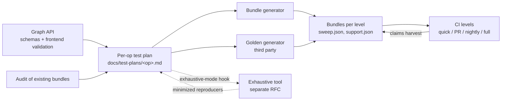

# RFC 0022: Per-Op Test Plans

- Contributors: Adam Dickin
- **Status**: Planned
- **Status notes**: Proposed. No per-op plan, bundle generator or `purpose` field exists yet.
- **Last verified**: 2026-10-26 against `develop` (`3f9cd39c31c`)

## Table of Contents

1. [Executive Summary](#1-executive-summary)
2. [Problem Statement](#2-problem-statement)
3. [Scope](#3-scope)
4. [Design Overview](#4-design-overview)
5. [Principles](#5-principles)
6. [Feature Inventory](#6-feature-inventory)
7. [Shape Catalog and Size Ladder](#7-shape-catalog-and-size-ladder)
8. [Sweep Construction, Levels and Lanes](#8-sweep-construction-levels-and-lanes)
9. [Case Purpose](#9-case-purpose)
10. [Trade-off Register](#10-trade-off-register)
11. [Oracles and Reference Prerequisites](#11-oracles-and-reference-prerequisites)
12. [Golden Tests](#12-golden-tests)
13. [Authoring Process and Plan Template](#13-authoring-process-and-plan-template)
14. [Exhaustive Mode and the Separate Tool](#14-exhaustive-mode-and-the-separate-tool)
15. [Required Infrastructure](#15-required-infrastructure)
16. [Rollout](#16-rollout)
17. [Alternatives Considered](#17-alternatives-considered)
18. [Risks](#18-risks)
19. [Open Questions and Future Work](#19-open-questions-and-future-work)
20. [Glossary](#20-glossary)

## 1. Executive Summary

The integration suite (`dnn-providers/integration-tests`) tests each op with
template-sweep bundles ([RFC 0011](0011_BundleTestFramework.md)). It
records engine support as claims ([RFC 0015](0015_EngineSupportClaims.md)). It
has no rule for **which cases a bundle holds**. Today, bundles hold cases
captured from older C++ tests, then re-tiered. No case has a stated reason.
Nothing records what we left out.

This RFC adds a **per-op test plan**: one reviewed document for each op family,
in `dnn-providers/integration-tests/docs/test-plans/`. The plan tests the op. It
does not depend on an engine. We apply the plan to each engine through claims.
All plans follow one method:

- Derive features from the graph API. Do not use engines or old tests.
- Take shapes from size sets (small, medium, model, stress) and hazard
  breakpoints. Each level has a size ceiling.
- Combine features one at a time, then all-pairs, then in targeted products.
- Give each case a purpose: `claim`, `probe` or `regression`.
- Record each product that we do not run in a trade-off register.
- Put each case in one of four levels (quick, PR, nightly, full). Each level
  answers one question ([§8](#8-sweep-construction-levels-and-lanes)).
- Select a small golden set with fixed criteria. An independent third party
  generates it.
- Write the bundles from the plan with a generator, so that bundles and plan
  cannot drift.
- Require a plan and its bundles for every new op before the op lands ([§16.2](#162-new-ops)).

Exhaustive testing is **not** part of this RFC. It is a separate tool with its
own RFC. Each plan only declares the hook that the tool reads ([§14](#14-exhaustive-mode-and-the-separate-tool)).

## 2. Problem Statement

The input space of an op is unbounded. Integer parameters have no limit, differ
for each dimension and multiply when combined. Tensor values are floats. Each
test set is a sample of that space. Today nobody chooses the sample. It is
inherited.

An audit of the convolution-forward bundles on `develop` (`562a252cbab`) found:

| Finding | Evidence | Consequence |
|---|---|---|
| **A degenerate default hid a dimension** | All 1,218 cases have output channels equal to groups (K = G). A dense conv then computes **one output channel**. The C++ case table (`src/common/ConvolutionCommon.hpp`) has the same pattern. | Channel and group indexing was never exercised. Only deriving K and G from the tensor dims showed it. |
| **Case count overstated coverage** | 1,218 cases cover 23 distinct geometries. 216 are skip-only (fused leaky ReLU, which every engine rejects). | The count suggests broad coverage. |
| **Toy sizes only** | The largest case is ~1 MFLOP and ~1 MB: spatial ≤ 16, channels ≤ 32, filters 1 or 3. | Engines choose solvers by size. Production paths are never selected. |
| **Engine-shaped coverage** | Every case is cross-correlation, symmetric padding and ReLU-family fusion. MIOpen accepts exactly these. | `CONVOLUTION` mode, asymmetric padding and non-ReLU fusions are untested. |
| **An oracle can be silently wrong** | The GPU conv reference ignores `conv_mode`. `auto` tries it before the CPU reference. | A correct `CONVOLUTION` result would fail. |
| **Re-tiering left gaps** | Nightly holds 2 and 1 cases for the two fused conv bundles. Full holds 444 each. | Nightly adds almost nothing for fused conv. |
| **Name-keyed config drifted** | The TOML skip `*ConvFwdBiasActiv*` matches C++ test names, never bundle names. Fused 3D fp32 has no tolerance override. | Skips and overrides stop applying with no error. |
| **No golden data** | No conv case has golden data. | Nothing independent checks the references. |

These problems are not specific to convolution. Without a plan, the bundles of
each op depend on the tests that the op happened to have.

## 3. Scope

### 3.1 In scope

- The **method** of every per-op plan ([§5](#5-principles)–[§13](#13-authoring-process-and-plan-template)).
- The **plan document**: location, template, and the rule that bundles and plan
  stay in sync.
- The **four levels**, the question that each answers, and the **mapping** from
  a plan to bundles, claims, TOML, tier YAML and CTest lanes ([§8](#8-sweep-construction-levels-and-lanes)).
- **Golden policy and selection** ([§12](#12-golden-tests)), building on [RFC 0011](0011_BundleTestFramework.md).
- The **hook** that each plan declares for the exhaustive tool ([§14](#14-exhaustive-mode-and-the-separate-tool)).
- The **infrastructure** that the method needs ([§15](#15-required-infrastructure)), its rollout and the
  documents to update ([§16](#16-rollout)).
- The **test-plan requirement for new ops** ([§16.2](#162-new-ops)).

### 3.2 Out of scope

| Item | Where it belongs |
|---|---|
| Exhaustive test generation, fuzzing, invalid-graph generation, engine-knob sweeps | A separate tool, with its own RFC. [§14](#14-exhaustive-mode-and-the-separate-tool) states only the interface. |
| Gating a new engine integration: per-case outcome reporting, running every kernel of an engine, the days-long gauntlet tier, review of agent-authored integrations | A separate engine-integration-gate proposal |
| Writing the per-op plans and bundles | One PR for each op ([§16](#16-rollout)) |
| Everything else that adding an op needs (schema, references, engine support) | The work that adds the op. [§16.2](#162-new-ops) states only the test requirement. |
| Bundle format, verification modes, DVC layout | [RFC 0011](0011_BundleTestFramework.md) |
| Claim schema, enforcement, harvesting | [RFC 0015](0015_EngineSupportClaims.md) |
| Fuzzing of the descriptor loader and matcher | [RFC 0017](0017_UniversalKernelDescriptor.md), [RFC 0018](0018_UniversalMatchDescriptor.md) |
| Kernel-internal testing | The project that owns the kernel |
| Release-train testing | Release readiness |

## 4. Design Overview



- **One plan for each op family**, for example `sdpa-fwd.md`,
  `convolution-fwd.md` or `matmul.md`, in
  `dnn-providers/integration-tests/docs/test-plans/`. An index (`README.md`)
  lists the plans and their bundles.
- **The plan is engine-independent.** It tests the op. It has no engine matrix.
  Claims (`support.json`) and per-engine TOML apply the plan to each engine
  ([§8.4](#84-from-plan-to-engine)).
- **The plan is the source of truth.** The generator reads the declared axes,
  legality rules, shape catalog and level rules, and writes the bundles. Nobody
  edits bundles by hand.
- **Traceability in both directions.** Each bundle case maps to a plan item.
  Each plan item maps to at least one case. A PR that adds, moves or deletes
  cases updates the plan in the same PR.
- **Working analysis stays out of the repo.** The audit, the gap list and the
  work order are tracking material. The plan states the target.

## 5. Principles

| # | Principle | Practice |
|---|---|---|
| P1 | **Derive features from the API.** | Each field of the op schema (`flatbuffers_sdk/schemas/*.fbs`) is a feature. So is each rule in `pre_validate_node` and `infer_properties_node` of the frontend node. Tests and engine capabilities do not define the op. |
| P2 | **The plan does not depend on an engine.** | The plan tests the op. Engines join through claims. A feature that no engine supports stays as a probe. When support arrives, the run reports `UNCLAIMED_SUPPORT` ([RFC 0015](0015_EngineSupportClaims.md)). The plan needs no edit. |
| P3 | **Divide each axis into classes. Then add boundaries and hazards.** | Classes: 1, odd, small, power of two, large, not a multiple of the vector width. Boundaries: output size 1, padding ≥ filter, remainders, values near the dtype limit. Hazards: powers of 2 ± 1, dims not divisible by 4 or 8, int32 index overflow. |
| P4 | **One feature at a time. Then all-pairs. Then targeted products.** | One-feature shapes show the cause of a failure. All-pairs finds most interaction faults. Run a complete product only where an interaction is plausible. The corpus and the exhaustive tool ([§14](#14-exhaustive-mode-and-the-separate-tool)) find three-way faults. Pin them. |
| P5 | **Size grows with the level.** | Nightly tests each feature again at medium size. |
| P6 | **Each product that we do not run is a recorded decision.** | Use the trade-off register ([§10](#10-trade-off-register)). Never trim rejection probes. |
| P7 | **A case needs an oracle that models it.** | See [§11](#11-oracles-and-reference-prerequisites). A case with no oracle is "not run", never green. |
| P8 | **Count distinct behaviors, not cases.** | Report distinct geometries, feature values and skip-only cases. |
| P9 | **Each case has a purpose.** | `claim`, `probe` or `regression` ([§9](#9-case-purpose)). |
| P10 | **Covered means executed.** | A case that every engine skipped proves nothing. Quick needs one executed case for each feature × engine. |
| P11 | **Realism and coverage have different sources.** | Model layers and the benchmark corpus show what users run. Generated cases, hazards and probes reach what users have not run. |

## 6. Feature Inventory

A plan lists every feature of the op, in these groups:

| Group | Features |
|---|---|
| Tensor | For each tensor: dtype, layout, packed or strided, **kind** (device tensor, compile-time constant, or runtime pass-by-value scalar per [RFC 0016](0016_RuntimePassByValueTensors.md)), **declared alignment and base offset**, 64-bit indexing |
| Op attributes | Each field and enum, including values that no engine supports |
| Geometry | Rank, each dimension, op parameters, output-shape rules, inferred or explicit outputs |
| Data types | Mixed precision, compute and intermediate types, graph-level or per-node types |
| Graph options | Override-shape ([RFC 0008](0008_OverridableTensorShapesDesign.md)), fused epilogues and chains, virtual or stored intermediates |
| Awkward combinations | Legal but hazardous graphs: inputs of different dtypes, tensors in different layouts, degenerate ratios |
| Values | Uniform, zero-excluded, all-zero, constant and large-magnitude fills. NaN, Inf, subnormals. Accumulation length. Determinism. |
| Execution | Workspace limits, plan reuse with new pointers, serialization round trip ([RFC 0009](0009_CompiledPlanSerialization.md)) |
| Invalid inputs | One frontend **unit test** for each validation rule. These are not sweep cases. |

For each feature, the plan records the values to cover, the earliest level, the
oracle readiness ([§11](#11-oracles-and-reference-prerequisites)) and the purpose of its cases ([§9](#9-case-purpose)).

**Legality is declared once for each op.** It copies the frontend validation.
The generator never writes an illegal graph.

**Alignment is tested by placement.** The harness passes allocator pointers,
which are aligned to at least 256 bytes. A case that only *declares* a small
alignment tests nothing. An alignment case puts the base pointer at exactly the
declared alignment (N, not 2N), with a non-zero offset. It crosses this with a
leading stride that is not a multiple of the vector width. One case uses a
pointer *less* aligned than declared and expects `BAD_PARAM`.

## 7. Shape Catalog and Size Ladder

| Set | Purpose | Rule |
|---|---|---|
| **S** small | The feature works. | Defaults, with one feature changed. |
| **L** medium | The feature works at realistic size. | The features of S on a medium base. The generator halves batch, then channels, until the case fits the ceiling. |
| **M** model | Production solver paths. | Layers from named models (cite the source), plus the dnn-benchmarking corpus, normalized and deduplicated. |
| **H** hazard | Breakpoints. | Powers of 2 ± 1, dims not divisible by 4 or 8, group counts, non-dense strides. |
| **X** stress | Limits. | Huge batch, int32 overflow, very long accumulation. |

**Defaults are non-degenerate.** Each dimension or ratio that can exceed 1 does
so in the default shape.

**Per-level ceilings.** Each plan tunes these starting values.

| Level | Ceiling for each case (fp32, x + w + y) | Sets |
|---|---|---|
| quick | ≤ 20 MFLOP, ≤ 1 MB | S |
| PR | ≤ 200 MFLOP, ≤ 16 MB | S, H, a few M |
| nightly | ≤ 8 GFLOP, ≤ 64 MB | S, L, M, H |
| full | none | all, including X |

## 8. Sweep Construction, Levels and Lanes

### 8.1 Sweep rules

| Rule | Content |
|---|---|
| Core axes | Every level covers them completely. Typically rank × layout × dtype. |
| Core cover | Every level holds every core combination for the plain op and each fused topology. In quick, at least one engine executes each cell. |
| One at a time | S and L shapes isolate one feature. |
| All-pairs | By the end of nightly, each value of each axis meets each value of each other axis. A seeded generator makes this from the declared axes and legality. |
| Full | Complete products only where an interaction is plausible. |
| Probes | Each unsupported feature, awkward combination and hazard has a probe. Each level has rejection probes. |
| Regressions | The reproducer of each escaped bug is a concrete case in the lowest level that can afford it. |
| Concrete graphs | Each level runs checked-in graphs only. Random sampling belongs to the exhaustive tool ([§14](#14-exhaustive-mode-and-the-separate-tool)). |

### 8.2 The four levels

Each level answers one question. The levels cascade: each level runs everything
below it. `full_*` runs only in full.

| Level | Question it answers | Bundle dir | CTest label (other labels) | Cadence | Budget (whole suite, cumulative) |
|---|---|---|---|---|---|
| quick | What must we test to catch gross breakage fast? | `quick/` | `quick` (`pre-commit`, `smoke`) | pre-commit | ~5 min |
| PR | What must we test on every PR? | `standard/` | `standard` (`pr`, `precheckin`) | PR gate | ~30 min |
| nightly | What should we test each day, with wider coverage for each engine? | `comprehensive/` | `comprehensive` (`nightly`, `extended`) | nightly | ≤ 60 min |
| full | Which wider sweeps must exist in the full suite? | `full/` | `full` (`all`) | weekly | none |

**Estimate before you generate.** A plan states the case count, FLOP per case
and oracle cost for each level and size class. A full product can be very large.
For convolution forward, it is ~14,000 cases. About 10,000 of them repeat one
fused epilogue over every geometry. A cold-cache timing run fixes the final
counts. Solver search and compile time for each unique shape cost more than
execution.

### 8.3 Mapping a plan to files

| Plan item | File or setting | Who writes it |
|---|---|---|
| Op topology | `{level}/{Op}/{Topology}/graph.template.json` | The bundle generator |
| Cases: axes, shapes, level, purpose | `sweep.json` (cases and per-case metadata) in the directory of the level | The bundle generator |
| Golden cases | `golden/{CaseId}/tensors.dvc` ([RFC 0011](0011_BundleTestFramework.md)) | The golden generator |
| Claims: which engine supports which case | `support.json`, or `{Name}.support.json` for a single graph ([RFC 0015](0015_EngineSupportClaims.md)) | Harvested with `--write-support-claims`. Never hand-written. |
| Tolerances, validator overrides, skips for an engine | `dnn-providers/<provider>/config/<ENGINE_NAME>.toml` | The provider, for each engine |
| Which suites each lane runs | Level YAML (`test_categories_integration.yaml`) in each provider. Its categories become CTest labels. | The provider |
| Cascade of levels | Each YAML category lists the patterns of the lower levels. CTest labels do not inherit. | The provider |

### 8.4 From plan to engine

The plan never names an engine. The same bundles run on every provider lane.
The claim of each engine decides which cases run for that engine. TOML records
the engine tolerances and known limits. Therefore, one plan covers any number of
engines, and a new engine needs no plan edit.

## 9. Case Purpose

Each generated case has a `purpose` in its sweep metadata:

| Purpose | Expected outcome | Claims |
|---|---|---|
| `claim` | The claiming engine accepts and is correct. | `--write-support-claims` writes them ([RFC 0015](0015_EngineSupportClaims.md)). |
| `probe` | A typed rejection, or a correct accept. | Never written. The published support matrix excludes probes. |
| `regression` | Same as the original bug case. | Same as the original case. |

Today, a rejected probe and a probe that never ran both show as SKIP. The engine
integration gate will record rejections with a typed reason. This RFC requires
only the tag. With it, the support matrix can exclude probes, and reviewers can
tell probes from claims.

## 10. Trade-off Register

Each plan has a register:

| Product not run | Cases | Covered instead by | Add it back when |
|---|---|---|---|

Rejection probes are never in the register.

## 11. Oracles and Reference Prerequisites

Verification follows [RFC 0011](0011_BundleTestFramework.md). In `auto` mode, the order is golden data, GPU
reference, CPU reference. Before you write cases for a feature, confirm that
each oracle **models** it. List each gap with its fix. Typical gaps:

| Gap | Example |
|---|---|
| A mode that one reference rejects and another ignores | Conv `conv_mode`: the CPU reference rejects `CONVOLUTION`. The GPU reference always computes cross-correlation. |
| Asymmetric parameters tested in one reference only | Conv asymmetric padding |
| Types with no reference | fp8 and int8 conv |
| Special values | NaN and Inf need a validator that matches infinities. |
| Harness support | Exact-alignment placement, value-domain control, repeat-and-compare ([§15](#15-required-infrastructure)) |

A feature with no oracle stays in the plan and is marked "not run". A golden case
can cover it ([§12](#12-golden-tests), criterion G-B).

## 12. Golden Tests

### 12.1 Purpose

Golden data does four jobs that a live reference cannot:

- **Check the references.** A shared bug makes an engine and a reference agree.
  A third party gives an independent answer.
- **Be the oracle where none exists.** The stored output checks a feature until
  a reference catches up.
- **Pin semantics.** The documented semantics of the third party fix the meaning
  of a parameter.
- **Anchor numerics.** Stored data does not move when reference code changes.
  Each case has a calibrated tolerance.

Golden tests are **not** a coverage tool. They make the judges of the sweep
trustworthy.

### 12.2 Policy and selection criteria

**The policy is a baseline, not an exhaustive set.** Each op gets the baseline
third-party check (G-A, with PyTorch or a similar third party). The other
criteria add a case only where that criterion applies. Exhaustive golden
coverage is not a goal. The separate exhaustive tool ([§14](#14-exhaustive-mode-and-the-separate-tool)) covers the wide
space.

A golden case meets at least one criterion. Most ops need 6–20 golden cases.

| # | Criterion |
|---|---|
| G-A | **Baseline anchor**: one small case for each rank × layout family × dtype, for the plain op and each fused topology |
| G-B | **Oracle gap**: a feature that no hipDNN reference can check yet |
| G-C | **Semantics**: a parameter with two possible meanings |
| G-D | **Numerical regime**: a tiny output, a typical size, a long accumulation |
| G-E | **Escaped numerical bug**: the pinned reproducer |
| G-F | **Production anchor**: a few model layers that fit the size budget |

A case is not golden if it meets no criterion and a live reference can check it.
A case is not golden if it exceeds 2 MiB or contains NaN or Inf.
`verify_golden_bundles.py` rejects both. A case is not golden if the third-party
semantics cannot map to hipDNN semantics.

### 12.3 Generation

- **Source.** An architecture-independent third party. PyTorch on CPU is the
  default. A hipDNN reference never generates golden data.
- **Precision strategy.** Set it for each op in `meta.json`. Use precision
  uplift for shallow ops and fp32. Use matched precision (the accumulation
  contract of the engine) for deep ops and low-precision types ([RFC 0011](0011_BundleTestFramework.md)).
- **Provenance.** Pin the third-party version. Seed the inputs. Record
  `forward_source` for backward ops in `meta.json`.
- **Tolerance.** Calibrate it for each case from the observed error of both
  references, plus a margin. Never loosen it to make an engine pass.
- **Storage.** `golden/{CaseId}/tensors.dvc` on the `golden-data` remote.

### 12.4 Confirmation

`hipdnn_golden_data_tests --reference both` must pass before you commit a golden
case. A reference that cannot check a G-B case cannot confirm it. Use a second
independent computation (for example NumPy beside PyTorch) until the reference
is fixed. Never regenerate golden data from a hipDNN reference to resolve a
disagreement.

### 12.5 Placement and lifecycle

- Put one or two G-A anchors in quick. Put the rest in PR or nightly.
- A golden case is never the only coverage of a feature in a level that some
  lanes run without `dvc pull`.
- Regenerate golden data when semantics, third-party version or strategy
  change. Review it like code.

## 13. Authoring Process and Plan Template

### 13.1 Process

1. **Inventory and legality** from the API ([§6](#6-feature-inventory)).
2. **Audit** the bundles at the tip of the integration branch:
   - map uids to roles through the template;
   - derive the real parameters from the dims;
   - count distinct behaviors, skip-only cases and per-level cover.
3. **Shape catalog** ([§7](#7-shape-catalog-and-size-ladder)).
4. **Combination and level rules** ([§8](#8-sweep-construction-levels-and-lanes)).
5. **Estimate** counts, FLOP and oracle cost for each level.
6. **Trade-off register** ([§10](#10-trade-off-register)).
7. **Oracle prerequisites** ([§11](#11-oracles-and-reference-prerequisites)).
8. **Golden selection** ([§12](#12-golden-tests)).
9. **Exhaustive-mode hook** ([§14](#14-exhaustive-mode-and-the-separate-tool)).
10. **Generate, time, harvest and finalize:**
    - generate the bundles and tag each case purpose;
    - time a cold-cache run and fix the counts;
    - harvest claims;
    - update everything that uses case ids (FFM pins, TOML globs);
    - update the plan in the same PR.

### 13.2 Template

```markdown
# <Op> Test Plan
Scope, bundles, out of scope.
## 1. The operation        formula, tensors, shape rules, parameters, sources
## 2. Feature inventory    per group: Id | Feature | Values | Oracle ready?; legality; rejection list
## 3. Shape catalog        ceilings; S, L, M, H, X
## 4. Building the sweep   rules; level contents; counts by size class; probes and regressions; trade-off register
## 5. Golden reference     Id | Case | Criterion | Precision strategy | Level; generator; confirmation
## 6. Pass criteria        verification, tolerances, claims; oracle and harness gaps
## 7. Exhaustive mode      states that the op has one; axes, legality, shape ranges, value domains for the exhaustive tool
```

A plan has no engine matrix ([§8.4](#84-from-plan-to-engine)).

### 13.3 Review checklist

- [ ] Each feature traces to an API field or validation rule. No section depends
      on an engine.
- [ ] Each tensor has dtype, layout, stride, kind and alignment axes. Legality
      is declared and the generator obeys it.
- [ ] Each axis has classes, boundaries and hazards. No default is degenerate.
- [ ] Each case has a purpose. Quick executes each core cell. Nightly retests
      each feature at medium size.
- [ ] Each complete product is justified or in the register. Each level has
      rejection probes.
- [ ] Each oracle gap is listed with its fix.
- [ ] Counts, FLOP and oracle cost fit the level budgets.
- [ ] Golden cases follow [§12.2](#122-policy-and-selection-criteria) and are confirmed.
- [ ] The exhaustive-mode section is present.
- [ ] Bundle cases and plan items map in both directions.

## 14. Exhaustive Mode and the Separate Tool

**This RFC does not design exhaustive testing.** Exhaustive test generation,
fuzzing, invalid-graph generation and engine-knob sweeps belong to a separate
tool. That tool has its own RFC. Work on it starts after the attention and
convolution plans exist ([§16](#16-rollout)).

This RFC defines only the **hook**. Each plan has an exhaustive-mode section
([§13.2](#132-template)). It states that the op has an exhaustive mode, and it declares:

- the axes and legality rules (the same declarations that the bundle generator
  reads);
- the shape ranges and a size budget;
- the value domains that matter for the op.

The tool reads these declarations. It must not need a second copy of the
legality rules.

In return, the tool gives the plans two things:

- minimized reproducers, as concrete sweep cases with purpose `regression` ([§9](#9-case-purpose));
- oracle bugs, as input to golden selection (G-B, [§12.2](#122-policy-and-selection-criteria)).

Boundaries:

- Exhaustive runs are not a CI level. The levels run checked-in graphs only
  ([§8](#8-sweep-construction-levels-and-lanes)).
- The tool design, its campaign policy and its schedule are in the companion
  RFC, not here.
- Fuzzing of the descriptor loader and matcher is in [RFC 0017](0017_UniversalKernelDescriptor.md) and [RFC 0018](0018_UniversalMatchDescriptor.md).

## 15. Required Infrastructure

| # | Capability | Status | Needed for |
|---|---|---|---|
| I1 | **Bundle generator.** Reads declared axes, legality, shape sets and level rules. Writes `sweep.json` for each level, with all-pairs and seeded rotation. | Missing. The conv sweeps came from C++ tests (`generator: capture-bundles`) or were written by hand (`generator: manual`). | [§8](#8-sweep-construction-levels-and-lanes) |
| I2 | **`purpose` field** in sweep case metadata. Support-matrix generation excludes probes. | Missing | [§9](#9-case-purpose) |
| I3 | **Exact-alignment and offset placement** in the harness | Missing. Pointers are allocator-aligned. | [§6](#6-feature-inventory) |
| I4 | **Value-domain control** for each tensor: zero-excluded, all-zero, constant, large magnitude, subnormal, NaN and Inf injection. A seed derived for each tensor. | Missing. The tensor bundles fix ranges in code. For example, conv x and w are uniform in [0, 1], with one seed for every tensor. | [§6](#6-feature-inventory) |
| I5 | **Repeat-and-compare** on bundles (determinism, plan reuse) | Exists only inside providers | [§6](#6-feature-inventory) |
| I6 | **Oracle fixes** for each plan (for example conv `conv_mode`) | Per op | [§11](#11-oracles-and-reference-prerequisites) |
| I7 | **Golden generator for each op** in `reference-data-scripts/`, writing `meta.json` with criterion and strategy | Batchnorm and SDPA only | [§12](#12-golden-tests) |
| I8 | **Corpus intake** for M shapes | `migration-scripts/import_graph.py` is the start. | [§7](#7-shape-catalog-and-size-ladder) |
| I9 | **Cold-cache timing** for each unique shape and arch | Ad hoc | [§8](#8-sweep-construction-levels-and-lanes) |

Templates can also need new placeholders. Today, conv `conv_mode`,
`compute_data_type` and pointwise `operation` are hard-coded. These changes are
per op. The plan tracks them.

## 16. Rollout

The priority order is attention, then convolution, then normalization (layer,
batch and RMS). Other ops follow as bandwidth allows.

| Phase | Content | Exit |
|---|---|---|
| 1 | This RFC. The methodology guide and index under `docs/test-plans/`. Documents updated ([§16.1](#161-documents-and-tickets-to-update)). | RFC merged |
| 2 | I1 and I2. | Generator writes bundles with `purpose` |
| 3 | The attention plan, then the convolution plan, each in its own PR. Each plan regenerates its bundles, harvests claims, and fixes FFM pins and TOML globs. I3–I7 land as these plans need them. | Attention and convolution have plans. This is the minimum before exhaustive-tool work starts. |
| 4 | Normalization plans: layer, batch, RMS. | Each has a plan |
| 5 | Other op families, as bandwidth allows. | Each op family has a plan |

The exhaustive tool and its RFC run as a separate effort. It starts after
phase 3.

Each phase lands on its own. Bundles without a plan keep working until the plan
of their op replaces them. After phase 2, every new op follows [§16.2](#162-new-ops).

### 16.1 Documents and tickets to update

When this RFC merges, update these documents:

| Document | Change |
|---|---|
| `projects/hipdnn/docs/testing/TESTING_STRATEGY.md` | Link this RFC and the plan index. Describe the four levels and their questions ([§8.2](#82-the-four-levels)). |
| `projects/hipdnn/docs/testing/KNOWN_TESTING_GAPS.md` | Link each known gap to the plan that closes it, when that plan exists. |
| `dnn-providers/integration-tests/README.md` and `docs/README.md` | Link the plan index and the plan-to-file mapping ([§8.3](#83-mapping-a-plan-to-files)). |
| `dnn-providers/integration-tests/docs/test-plans/README.md` | The index. Each plan and its RFC link from here. State the new-op rule ([§16.2](#162-new-ops)). |
| `dnn-providers/integration-tests/docs/adding-tests.md` | State that a new op needs a plan and its bundles before it lands ([§16.2](#162-new-ops)). |

The existing per-op stories under epic ALMIOPEN-2892 must reference this RFC.

### 16.2 New ops

A new op cannot land without a test plan and the bundles built from it. The
change that adds an op to the graph API also adds, before it merges:

- a reviewed plan, `docs/test-plans/<op>.md`, that follows [§5](#5-principles)–[§13](#13-authoring-process-and-plan-template) and the
  checklist of [§13.3](#133-review-checklist);
- the bundles that the generator writes from that plan, for every level, with a
  purpose on each case;
- the G-A golden cases ([§12.2](#122-policy-and-selection-criteria));
- the oracle gaps of the op, each with its fix ([§11](#11-oracles-and-reference-prerequisites)).

The plan does not depend on an engine (P2). An op can land before any engine
supports it. Its unsupported features stay as probes, and claims arrive with
engine support.

This RFC states only the test requirement. It does not define the rest of the
work to add an op. The rule applies once the bundle generator exists (phase 2),
because nobody writes bundles by hand ([§4](#4-design-overview)).

## 17. Alternatives Considered

| Alternative | Why rejected |
|---|---|
| **Keep curating bundles by hand** | It caused the K = G degeneracy, toy sizes and blind spots of [§2](#2-problem-statement). It does not scale to a full plan. |
| **Plans keyed to engine support** | They stay green easily but hide API features ([§2](#2-problem-statement)) and need a rewrite when support changes. P2 and claims replace them. |
| **Full cross-products** | The conv-forward product is ~14,000 cases. Most repeat one check ([§10](#10-trade-off-register)). All-pairs, targeted products and a register replace them. |
| **Random sampling in the CI levels** | Random cases make CI results change from run to run. The exhaustive tool ([§14](#14-exhaustive-mode-and-the-separate-tool)) runs outside the levels. Its reproducers become pinned cases. |
| **Golden data for every case** | It costs storage, has a 2 MiB limit for each case, cannot hold non-finite values, and adds nothing where a trusted live reference exists. A baseline policy and criteria ([§12.2](#122-policy-and-selection-criteria)) replace it. |

## 18. Risks

| Risk | Mitigation |
|---|---|
| Plan and bundles drift | The generator writes the bundles. The same-PR rule. Reviewers check traceability in both directions. |
| Case counts exceed the budgets | Estimate first ([§8.2](#82-the-four-levels)). A cold-cache timing run fixes the counts. Per-level ceilings. |
| Probes fill the suite with skips | A probe costs ~1 ms. The `purpose` tag keeps probes out of the support matrix. P10 requires executed cover. |
| A missed oracle gap gives wrong verdicts | Review step of [§11](#11-oracles-and-reference-prerequisites). Golden G-B cases. Three-way confirmation. |
| Pairwise misses a three-way fault | Corpus shapes. The exhaustive tool ([§14](#14-exhaustive-mode-and-the-separate-tool)). Pinned regressions. |
| Case-id changes break name-keyed config | Step 10 of [§13.1](#131-process) updates FFM pins and TOML globs in the same PR. |
| The methodology guide and this RFC diverge | The guide (`docs/test-plans/methodology.md`) is the working form of [§5](#5-principles)–[§13](#13-authoring-process-and-plan-template). Principle changes need an RFC amendment. |
| The exhaustive tool needs declarations that plans do not provide | Each plan has an exhaustive-mode section ([§13.2](#132-template)). The companion RFC can ask for more fields. |

## 19. Open Questions and Future Work

1. **Where axes and legality live.** A per-op Python module in
   `reference-data-scripts/`, or a data file beside the plan? The bundle
   generator and the exhaustive tool both read them.
2. **Precision strategy for fp16 and bf16 golden cases.** We propose matched
   precision. Confirm it against the accumulation contracts of all claiming
   engines.
3. **Source of tolerance calibration.** Per-case `meta.json` ([RFC 0011](0011_BundleTestFramework.md) level 2),
   or dynamic tolerances?
4. **Full level and unclaimed dtypes.** Should full-level products run only on
   claimed dtypes, to cut skip-only cases?
5. **The engine integration gate.** Its proposal, and the interface it takes from
   the plans.
6. **TheRock bump lane.** The suite must run a wide set of cases on each TheRock
   bump, each PR and each nightly. Which level runs on a TheRock bump? [§8.2](#82-the-four-levels) does
   not yet say.
7. **Companion exhaustive-tool RFC.** Its owner, its timing, and the fields that
   it needs in the exhaustive-mode section.

## 20. Glossary

- **Plan.** A per-op document under `docs/test-plans/` that defines the test
  sweep of the op. It does not depend on an engine.
- **Level.** One of quick, PR, nightly or full ([§8.2](#82-the-four-levels)). Also called a tier. Each
  level answers one question.
- **Feature.** A schema field, enum value, validation rule or harness property
  that can change behavior.
- **Core axes.** The axes that each level covers completely. Typically rank ×
  layout × dtype.
- **All-pairs.** A set of cases in which each value of each axis meets each value
  of each other axis at least once.
- **Probe, claim, regression.** The purposes of a case ([§9](#9-case-purpose)).
- **S, L, M, H, X.** Small, medium, model, hazard and stress shape sets ([§7](#7-shape-catalog-and-size-ladder)).
- **Trade-off register.** The table in a plan of products that we do not run on
  purpose.
- **Oracle.** Anything that produces the expected output: golden data, the GPU
  reference or the CPU reference.
- **G-A … G-F.** Golden selection criteria ([§12.2](#122-policy-and-selection-criteria)).
- **Bundle generator.** The tool that writes bundles from a plan (I1).
- **Exhaustive mode.** The section of a plan that declares the hook for the
  separate exhaustive tool ([§14](#14-exhaustive-mode-and-the-separate-tool)).
