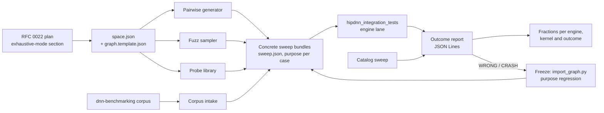

# RFC 0023: Integration Gauntlet (Exhaustive Integration Test Generation)

- Contributors: Adam Dickin
- **Status**: Planned
- **Status notes**: Proposed. Nothing is merged. The first slice (outcome report §9, fuzz mode §7,
  spaces for SDPA forward and RMSNorm forward) is being built separately.
- **Last verified**: 2026-10-26 against `develop` (`3f9cd39c31c`)

## Table of Contents

1. [Executive Summary](#1-executive-summary)
2. [Problem Statement](#2-problem-statement)
3. [Scope](#3-scope)
4. [Design Overview](#4-design-overview)
5. [Space Declarations](#5-space-declarations)
6. [Pairwise Generator](#6-pairwise-generator)
7. [Gauntlet Fuzz Mode](#7-gauntlet-fuzz-mode)
8. [Rejection Probes](#8-rejection-probes)
9. [Outcome Model and Report](#9-outcome-model-and-report)
10. [Catalog Sweep](#10-catalog-sweep)
11. [Declared Alignment](#11-declared-alignment)
12. [Input Value Domains](#12-input-value-domains)
13. [Corpus Intake](#13-corpus-intake)
14. [Oracle Cost and Coverage](#14-oracle-cost-and-coverage)
15. [Tiers](#15-tiers)
16. [Gating an Engine Integration](#16-gating-an-engine-integration)
17. [Story Breakdown and Ticket Reconciliation](#17-story-breakdown-and-ticket-reconciliation)
18. [Alternatives Considered](#18-alternatives-considered)
19. [Risks](#19-risks)
20. [Open Questions](#20-open-questions)
21. [Glossary](#21-glossary)

## 1. Executive Summary

The per-op bundles of [RFC 0022](0022_PerOpTestPlans.md) run in CI. They are sized to fit CI. This
RFC adds the **Integration Gauntlet**: a large, generated, slow gate that runs outside CI. Every new
engine integration must survive it, including integrations that an agent wrote.

The gauntlet passes only when every engine, on every graph it is given, does one of two things: it
**declines the graph with a typed reason**, or it **accepts the graph and produces a correct
result**. It must never accept a graph it cannot handle.

The design has five parts:

- **Space declarations.** Each op declares its axes, legality rules and value domains once, in a
  `space.json` beside a `graph.template.json`. The RFC 0022 plan points at it.
- **Generators.** A seeded pairwise generator writes concrete bundles for the CI levels. A fuzz
  sampler draws random legal samples for the gauntlet. Both read the same declaration.
- **Concrete graphs only.** Every generator writes ordinary template-sweep bundles
  ([RFC 0011](0011_BundleTestFramework.md)). The harness runs only concrete graphs. A fuzz sample
  is a sweep case that was written a moment ago.
- **One outcome per case.** The harness writes one record per case: `PASS`, `DECLINED` (with the
  engine's reason), `WRONG`, `CRASH`, `UNCLAIMED_PASS` or `UNEXERCISED`. Reports give fractions,
  never "green".
- **Catalog and alignment.** A catalog sweep runs every kernel of a descriptor engine, not just the
  one the heuristic picks. Declared-alignment probes place each pointer at exactly the declared
  alignment, and engines read the declared alignment when they accept a graph.

## 2. Problem Statement

The integration suite (`dnn-providers/integration-tests`) runs concrete, checked-in graphs on one
engine at a time, against an oracle. It enforces support claims ([RFC 0015](0015_EngineSupportClaims.md)).
Seven gaps keep it from gating a new engine:

| # | Gap | Evidence | Section |
|---|---|---|---|
| G1 | **No catalog mode.** A plan builds the heuristic's choice only. A descriptor engine can match 10 to 1000 kernels to one graph. Only the top one is ever run. | The harness calls `build_plans()` with its default policy, `HEURISTICS_CHOICE` (`Graph.hpp`) | [§10](#10-catalog-sweep) |
| G2 | **No sweep generator.** Sweeps are captured from C++ tests or written by hand. | `generator: capture-bundles` in sweep metadata; RFC 0022 §2 | [§5](#5-space-declarations), [§6](#6-pairwise-generator) |
| G3 | **Declines are not recorded.** A decline on an unclaimed graph is a `GTEST_SKIP`. A probe that was declined cleanly looks the same as one that never ran. | `IntegrationBundleVerificationHarness::engineDidNotRun()` returns `skipped(...)` | [§9](#9-outcome-model-and-report) |
| G4 | **No corpus intake.** dnn-benchmarking graphs need normalization and deduplication. | `migration-scripts/import_graph.py` handles one graph at a time | [§13](#13-corpus-intake) |
| G5 | **Oracle cost and coverage.** The GPU reference runs one thread per output element. Some ops have no reference. | `gpu-ref/kernels/*` | [§14](#14-oracle-cost-and-coverage) |
| G6 | **No fuzz mode or one-step replay.** Seeds exist for input data only. The only replay is `--gtest_filter`. | `InputFillRecipes` global seed | [§7](#7-gauntlet-fuzz-mode) |
| G7 | **Engines ignore declared alignment.** The backend checks the pointer against the declared alignment at execute. No engine reads the declared alignment when it accepts a graph. | `EnginePluginResourceManager.cpp` execute-time check | [§11](#11-declared-alignment) |

## 3. Scope

### 3.1 In scope

- The space declaration format, and how an RFC 0022 plan declares its exhaustive mode with it.
- The pairwise generator, the fuzz sampler, the rejection-probe library and the corpus intake, as
  producers of concrete bundles.
- The outcome model, the per-case outcome report and fraction-based reporting.
- The catalog sweep and kernel-identity recording.
- Declared-alignment testing and the engine contract for declared alignment.
- Input value-domain control.
- The oracle cost model.
- The tier model (Enablement, Hazard, Gauntlet) and its mapping to the RFC 0022 levels.
- The follow-on story breakdown, and the reconciliation with ALMIOPEN-2470 and ALMIOPEN-2827.

### 3.2 Out of scope

| Item | Where it belongs |
|---|---|
| Running the gauntlet or fuzz mode as PR or nightly CI signal | Not planned. The gauntlet runs on demand. |
| Coverage-guided or mutation fuzzing (libFuzzer, AFL) | Not planned. This is randomized differential testing against an oracle. |
| Writing the space declaration of every op | One story per op, after the op's RFC 0022 plan exists |
| Kernel-internal testing | The team that owns the kernel |
| Fuzzing the descriptor loader and matcher | [RFC 0017](0017_UniversalKernelDescriptor.md), [RFC 0018](0018_UniversalMatchDescriptor.md) |
| Which cases each CI level holds | [RFC 0022](0022_PerOpTestPlans.md) |
| A service that schedules gauntlet runs onto idle machines | Not planned |

## 4. Design Overview



Three rules hold everywhere:

1. **One declaration per op.** The generators, the sampler and the probes read the same
   `space.json`. Nothing keeps a second copy of the legality rules (RFC 0022 §14).
2. **The harness runs concrete graphs only.** A generator writes a bundle; the harness runs it. A
   fuzz sample, a pairwise case and a corpus graph reach the engine by the same path as a quick
   bundle, with the same oracles, tolerances and claim rules.
3. **Every case has an expected outcome and a recorded outcome.** The case carries a `purpose`
   (RFC 0022 §9). The run records what happened. A report compares the two.

## 5. Space Declarations

### 5.1 Location: with the tool, pointing at a sweep template

Spaces ship with the fuzz tool, one file per op (more when an op has distinct regions):

```
dnn-providers/integration-tests/gauntlet/
  run_gauntlet_fuzz.py
  spaces/
    SdpaFwd.space.json
    SdpaFwd.Gfx950Dense.space.json
    RMSNorm.space.json
```

A space does not carry a graph. It names an existing template-sweep topology by path:

```json
"template": "../../integration-test-bundles/quick/SdpaFwd/Default/graph.template.json"
```

One template therefore serves three producers: captured or hand-written sweep rows, generated rows
(pairwise, §6), and fuzz samples (§7). Every producer emits rows in `sweep.json`'s own case format
(`{id, values, metadata}`), so a fuzz sample, a pairwise row and a captured row are the same kind of
object. Bringing a fuzz finding into the suite is appending one row to the `sweep.json` beside the
referenced template. No template is copied, so a space cannot drift from the topology CI runs; a
moved or deleted template is a load error that names the space.

Spaces live outside `integration-test-bundles/`, so bundle discovery and the bundle scripts never
see them and the CI levels never run them. The RFC 0022 plan of the op names its spaces in its
exhaustive-mode section.

### 5.2 Format

```json
{
  "version": 1,
  "operation": "SdpaFwd",
  "template": "../../integration-test-bundles/quick/SdpaFwd/Default/graph.template.json",
  "axes": {
    "dtype":  {"values": ["bfloat16", "half"]},
    "layout": {"values": ["bshd", "bhsd"]},
    "b":      {"values": [1, 2, 3, 4]},
    "hkv":    {"values": [1, 2, 4, 8]},
    "group":  {"values": [1, 2, 4, 8]},
    "sq":     {"range": [1, 2048], "boundaries": [1, 63, 64, 65, 127, 128, 129, 512]},
    "skv":    {"range": [1, 2048], "boundaries": [1, 64, 128, 512, 1024]},
    "d":      {"values": [64, 128, 192]},
    "causal": {"values": [false, true]}
  },
  "derive": {
    "hq":       "hkv * group",
    "dims_q":   "[b, hq, sq, d]",
    "dims_kv":  "[b, hkv, skv, d]",
    "stride_q": "[sq*hq*d, d, hq*d, 1] if layout == 'bshd' else [hq*sq*d, sq*d, d, 1]",
    "stride_kv": "[skv*hkv*d, d, hkv*d, 1] if layout == 'bshd' else [hkv*skv*d, skv*d, d, 1]"
  },
  "constraints": [
    {"rule": "not causal or sq <= skv", "reason": "bottom-right causal mask needs sq <= skv"},
    {"rule": "b*hq*sq*skv*d <= 2**31", "reason": "GPU reference cost ceiling (section 14)"}
  ],
  "case": {
    "values": {
      "io_data_type": "${dtype}",
      "tensors": [
        {"uid": 0, "dims": "${dims_kv}", "strides": "${stride_kv}", "data_type": "${dtype}"},
        {"uid": 1, "dims": "${dims_q}",  "strides": "${stride_q}",  "data_type": "${dtype}"},
        {"uid": 2, "dims": "${dims_q}",  "strides": "${stride_q}",  "data_type": "${dtype}"},
        {"uid": 3, "dims": "${dims_kv}", "strides": "${stride_kv}", "data_type": "${dtype}"}
      ],
      "attributes": {
        "attributes__attn_scale_value": "${1.0 / d ** 0.5}",
        "attributes__diagonal_alignment": "${'BOTTOM_RIGHT' if causal else 'TOP_LEFT'}",
        "attributes__right_bound": "${0 if causal else None}"
      }
    },
    "metadata": {"purpose": "probe"}
  }
}
```

The driver adds the rest of the case metadata itself: `format_version`, `generator`
(`gauntlet-fuzz`), `seed` (the data seed, in `[0, 2^32)`) and `notes` (space, shape seed and axis
values). The case `id` is `s<shape seed>`.

| Field | Meaning |
|---|---|
| `axes` | Each axis is either a `values` list, or an integer `range` `[lo, hi]` with optional `boundaries`. A sampler draws a boundary value with probability ½ and a uniform value otherwise, so powers of two, ±1 and degenerate values appear often. |
| `derive` | Values computed from axes, in declaration order. A derived value can use earlier derived values. |
| `constraints` | Legality rules. A sample that breaks one is discarded and redrawn. Each rule has a reason. The rules copy the frontend validation of the op (RFC 0022 §6) and the cost ceilings of §14. |
| `case` | The sweep case to write. A string `"${expr}"` is replaced by the value of `expr`, keeping its JSON type. Strings that do not start with `${` and end with `}` are copied. |

Expressions are a small, safe subset of Python: literals (numbers, strings, `True`, `False`,
`None`), lists, arithmetic (`+ - * / // % **`), comparisons, `and`/`or`/`not`, `x if c else y`,
indexing, and the functions `min`, `max`, `len`, `abs`. Names are axes and derived values. Anything
else (calls to other functions, attribute access, comprehensions, lambdas) is a load error. One
evaluator (Python, standard library only) serves every generator.

### 5.3 What a plan declares

The exhaustive-mode section of an RFC 0022 plan lists the op's spaces and, for each, the axes that
are core, the shape ranges, and the value domains that matter. The space file is the machine form of
that section. A plan review checks that the space and the plan agree.

## 6. Pairwise Generator

Not yet built.

The pairwise generator reads a space and writes a sweep in which every value of every axis meets
every value of every other axis at least once (all-pairs). It uses a seeded greedy construction
(IPOG): add axes one at a time, extend existing rows, then add rows for uncovered pairs. Each row is
checked against the constraints; a pair that no legal row can cover is reported as infeasible, not
dropped silently.

- **Output.** A `sweep.json` per RFC 0022 level directory, with `metadata.generator =
  "gauntlet-pairwise"`, the seed, and `purpose` per case.
- **Determinism.** Same space, same seed, same rows. The seed is stored in the sweep, so CI never
  sees a random graph.
- **Seeded rotation.** Nightly may use a new seed each week. The rows of each seed are checked in.
- **Range axes.** Pairwise covers the boundary values of a range axis plus one interior value.

The generator is the I1 bundle generator of RFC 0022 §15, built on this declaration.

## 7. Gauntlet Fuzz Mode

### 7.1 What it does

A **fuzz run** draws random legal samples from one or more spaces, writes each sample as a case of a
concrete sweep, runs the sweep through the integration binary on one engine lane, and records an
outcome for each sample. It is the gauntlet's open-ended stream: it reaches three-way interactions
that pairwise does not cover.

The driver is `dnn-providers/integration-tests/gauntlet/run_gauntlet_fuzz.py` (Python 3, standard
library only). It does not change what the binary runs; it only writes bundles and reads outcomes.

### 7.2 Control

Environment variables control a run, so it scales without code or bundle changes. Each has a
command-line flag that overrides it.

| Variable | Flag | Meaning | Default |
|---|---|---|---|
| `HIPDNN_FUZZ_SAMPLES` | `--samples` | Samples per space | 32 |
| `HIPDNN_FUZZ_SEED` | `--seed` | Shape seed of the first sample | random, printed |
| `HIPDNN_FUZZ_DATA_SEED` | `--data-seed` | Input-data seed for every sample | derived from each shape seed |
| `HIPDNN_FUZZ_FILTER` | `--filter` | Regex on `<Op>/<Space>` | all spaces |
| `HIPDNN_FUZZ_TIME_BUDGET` | `--time-budget` | Wall-clock limit, e.g. `30m`, `4h` | none |
| `HIPDNN_FUZZ_CASE_TIMEOUT` | `--case-timeout` | Longest one case may run before it counts as a hang | `10m` |

The binary, test article, engine and test config are flags (`--binary`, `--test-article`,
`--test-engine`, `--test-config`), the same values a CTest lane passes.

### 7.3 Seeds and replay

- Sample *i* of a run has shape seed `S + i`, where `S` is the run's seed. One sample is fully
  determined by its shape seed: the sampler seeds a fresh generator with it.
- The data seed is separate. By default it is derived from the shape seed; `--data-seed` fixes it.
  It becomes the case's `metadata.seed`, which the harness already uses for input fills. A failing
  geometry can run again with new data, and the reverse (as in cuDNN's `random_config.py`).
- The case id is `s<shape seed>`. The driver prints the replay command for every `WRONG` and
  `CRASH`:

  ```
  run_gauntlet_fuzz.py --filter '^SdpaFwd/Dense$' --seed 913377 --samples 1 --data-seed 4021 ...
  ```

  That command writes the same graph with the same data and runs it alone.

### 7.4 Every sample gets an outcome

The driver writes the samples of a batch under `<work>/bundles/` (the `--golden-data-dir` root) and
runs the binary with `--outcome-report` (§9). The harness writes a `started` record before it runs
a case and a `finished` record when it ends.

| What happened | Driver records |
|---|---|
| A `finished` record | Its outcome |
| The binary died with a case `started` and not `finished` | `CRASH` for that case; the rest of the batch runs again |
| A case ran longer than the case timeout | The driver kills the binary; `CRASH` (hang) for that case; the rest runs again |
| A written case is absent from `--gtest_list_tests` (the harness skipped it at load) | `UNEXERCISED` with the load message |
| The binary died before any case started | The batch is split in halves and rerun until the case that kills registration is isolated; it is `UNEXERCISED` (load crash) |

A crash costs one case, not the run. `SIGINT` stops after the current batch and still writes the
report.

### 7.5 Freezing a finding

For each `WRONG` or `CRASH` sample the driver writes `<work>/failures/<case>/`, outside the bundle
root so later batches never load it:

- `<case>.json`, the expanded concrete graph, with UIDs already in canonical (by-name) order, so an
  import does not renumber tensors and change their per-tensor input seeds;
- `<case>.meta.json`, its metadata (`format_version`, `seed`, `purpose: regression`,
  `reference_source` naming the space and shape seed);
- `replay.txt`, the replay command and whether inputs were filled on the host or the device
  (`HIPDNN_TEST_HOST_INPUT_FILL=1` forces the host fill).

`migration-scripts/import_graph.py --graph failures/<case>/<case>.json --bundle-dir
integration-test-bundles --tier <level>` adds it to a checked-in sweep, with duplicate detection.
The path from finding to regression case is mechanical.

### 7.6 Report

At the end the driver prints, per engine and space, the count of each outcome and the decline
reasons, and writes `summary.json`. The exit status is non-zero when any sample is `WRONG` or
`CRASH`. `UNEXERCISED` samples are listed with their reasons; they never count as green.

### 7.7 Not yet built

- A CTest lane label (`gauntlet`) per provider engine. It must stay out of every level that the
  external YAML catch-alls select. Until then the driver is the entry point.
- Shrinking a failing sample to a smaller reproducer.

## 8. Rejection Probes

Not yet built.

A **probe** is a legal graph whose expected outcome is "decline with a typed reason, or accept and be
correct" (RFC 0022 §9). Probes test the integration contract: an engine that accepts a graph it
cannot run is the failure the gauntlet exists to catch.

| Probe class | Example |
|---|---|
| Unsupported attribute | SDPA dropout, paging, ALiBi on an engine that has none |
| Awkward combination | Conv with X and W in different dtypes |
| Declared alignment below the kernel's need | A tensor that declares 2-byte alignment (§11) |
| Strided or non-dense | Leading stride not a multiple of the vector width |
| Hazard shape | int32 index overflow; dims not divisible by 4 |

Illegal graphs, which the frontend rejects, are frontend unit tests (RFC 0022 §6), not probes.

**Typed reason.** Today a decline is "not in the ranked list" or a late `EngineNotApplicableError`
message. The outcome report records the message. A follow-on story adds a reason code to the
plugin's decline (an enum in the plugin SDK: `UNSUPPORTED_DTYPE`, `UNSUPPORTED_LAYOUT`,
`UNSUPPORTED_ATTRIBUTE`, `ALIGNMENT`, `SHAPE_LIMIT`, `NO_KERNEL`, `OTHER`), so reports can group
declines without parsing text.

Probes are never trimmed from a level (RFC 0022 P6). They are cheap: a decline costs one query.

## 9. Outcome Model and Report

### 9.1 Outcomes

Each case on each engine gets exactly one outcome:

| Outcome | Meaning | Gate |
|---|---|---|
| `PASS` | Accepted and verified against an oracle | pass |
| `DECLINED` | The engine resolved the support query and is absent from the ranked list | pass for a probe; FAIL for a claim (the run already fails it as `CLAIM_BROKEN`, RFC 0015) |
| `WRONG` | Accepted, ran, and the output did not match the oracle | FAIL |
| `CRASH` | In the ranked list, then failed to build or execute (including a late `NOT_SUPPORTED`), hung, or killed the process | FAIL |
| `UNCLAIMED_PASS` | `PASS` on a claim-bearing graph whose sidecar does not claim this cell | report (the claim is too narrow) |
| `UNEXERCISED` | Nothing verified it: a skip rule, no oracle, an oracle or harness error | report; never green |

### 9.2 Derivation

The outcome is derived from facts the harness already decides once per test
(`VerificationOutcome`, `SupportVerdict`), plus one new field: the **stage** at which a failed or
skipped test stopped.

| Harness facts | Outcome |
|---|---|
| status `PASSED`, depth ≥ required, no other gtest failure, verdict `UNCLAIMED_SUPPORT` | `UNCLAIMED_PASS` |
| status `PASSED`, depth ≥ required, no other gtest failure | `PASS` |
| the support query resolved and the engine under test is absent (status `SKIPPED`, or `FAILED` with stage `claim` and verdict `CLAIM_BROKEN`) | `DECLINED` |
| status `FAILED`, origin `COMPARISON` | `WRONG` |
| status `FAILED`, origin `ENGINE`, stage `build` or `execute` | `CRASH` |
| stage `graph` (`from_binary` failed: the frontend rejected the graph) | `UNEXERCISED` |
| support query unresolved (`QUERY_ERRORED`), origin `ORACLE` or `HARNESS`, a skip rule, unverifiable, a pass with another gtest failure | `UNEXERCISED` |
| `started` with no `finished` | `CRASH` (driver, §7.4) |

Two rules keep the classes honest:

- **Acceptance is the ranked list.** An engine that is in the ranked list and then returns
  `NOT_SUPPORTED` while building plans has accepted the graph and failed it: `CRASH`. Applicability
  must be decided up front. The harness's existing path for a late `EngineNotApplicableError` stays
  a decline.
- **Unknown is not declined.** When the support query does not resolve, nobody knows whether the
  engine declined. That is `UNEXERCISED`, never `DECLINED`.

### 9.3 Report format

`hipdnn_integration_tests --outcome-report <file>` (or `HIPDNN_TEST_OUTCOME_REPORT`) appends JSON
Lines. Each bundle test writes a `started` record before it runs and a `finished` record when it
ends. Records are flushed one at a time, so a crash keeps every earlier line.

```json
{"event":"started","test":"gauntlet_SdpaFwd_Dense.s913377","bundle":".../sweep.json#s913377"}
{"event":"finished","test":"gauntlet_SdpaFwd_Dense.s913377","bundle":".../sweep.json#s913377",
 "engine":"ASM_SDPA_ENGINE","arch":"gfx950","platform":"linux","purpose":"probe",
 "outcome":"DECLINED","depth":"not-reached","origin":"none","verifier":"none",
 "reason":"Engine ASM_SDPA_ENGINE does not support this graph (1 output tensor(s), 0 ranked engine(s))"}
```

`purpose` comes from the case metadata (`claim`, `probe`, `regression`; absent when not set). The
loader rejects any other value. This is the tag half of RFC 0022's I2; excluding probes from the
support-matrix render is the other half and is not built.

### 9.4 Fractions, not green

A report states, per engine and per space or bundle:

> *N of M cases passed; D declined (by reason); W wrong; C crashed; U unexercised (by reason).*

When kernel identity is recorded (§10.3) the report adds *K distinct kernels dispatched*. A run whose
cases are all `DECLINED` or `UNEXERCISED` says so; it is not a pass of the engine.

## 10. Catalog Sweep

Not yet built.

### 10.1 What exists

The catalog enumeration API already exists for descriptor engines (RFC 0019 §13.2):
`HIPDNN_ATTR_ENGINE_CANDIDATES_EXT` pages the matched catalog of one engine for one graph, and
`hipdnn_frontend::detail::getEngineCandidates()` decodes it into `EngineCandidatePage`. Each
`EngineCandidate` has a stable `id` (the kernel identity), its `kernelFeatures`, and an
`EngineVariant` whose complete knob tuple selects exactly that kernel through
`Graph::add_engine_variants()`. Engines that cannot enumerate return an error, not an empty page.

### 10.2 Sweep mode

A sweep mode of the integration binary, for one graph:

1. Build the graph once, fill inputs once with the case seed, run the oracle once.
2. For the engine under test, page through the whole catalog.
3. For each candidate: enroll its variant, build the plan, fill outputs with NaN, execute, compare
   with the graph's tolerances, and write one outcome record with the candidate `id` and knobs.
4. Write a reconciliation line: `entries = passed + failed + declined`. A candidate is never
   skipped.

Statuses map onto §9: a candidate that fails to build or execute is `CRASH`; a numeric mismatch is
`WRONG`. Runtime-compilation engines compile every candidate, so the sweep shards by candidate
offset (`--catalog-shard i/n`). Isolation rules from ALMIOPEN-2827 hold: one graph object, NaN-filled
outputs before every candidate, no shared reference device buffer, the graph's registered outputs
only.

Engines without enumeration (MIOpen, hipBLASLt) get a one-entry catalog: their default
configuration. Running every MIOpen solver needs a provider API for "run solution by ID"; that is a
separate story.

### 10.3 Kernel identity in every run

The outcome record gains `kernel` (candidate `id`) and `knobs` when the engine can say which
candidate a plan built. For a descriptor engine the harness enumerates the catalog and matches the
built plan's knob tuple. Until the plan's knob choices can be read back, `kernel` is absent.

## 11. Declared Alignment

### 11.1 The contract

`TensorAttributes::set_alignment(n)` declares the byte alignment of a tensor's pointer (default 16).
The graph carries it. The backend already enforces it at execute: a pointer less aligned than
declared is `BAD_PARAM` (`EnginePluginResourceManager.cpp`, `executeOpGraph`). A non-default
alignment also raises the minimum plugin API version, so older plugins are not offered the graph.

The missing half: no engine reads the declared alignment when it decides to accept a graph. A
kernel that assumes 16-byte vector loads accepts a graph that declares 2-byte alignment, and the
harness cannot see it because every buffer it allocates is aligned to at least 256 bytes.

### 11.2 Engine fix

Not yet built.

Each engine reads each tensor's declared alignment in its applicability check. When the declared
alignment is below what the kernel needs, it declines with reason `ALIGNMENT`, or selects a variant
that handles it. For a descriptor engine this is a matcher criterion on `$tensor.alignment`
([RFC 0018](0018_UniversalMatchDescriptor.md)); for a hand-written engine it is one check per input.

### 11.3 Harness placement

Not yet built.

A case can ask for exact placement (`metadata.placement: "exact"`). The harness then offsets each
device pointer so that it is aligned to the declared alignment *N* but not to *2N*. The tests:

- probes for each declared value (element size, 4, 8, 16, 32 and above), each with its pointer at
  exactly that alignment;
- the same, crossed with a leading stride that is not a multiple of the vector width;
- one case with a pointer less aligned than declared, which must return `BAD_PARAM`.

## 12. Input Value Domains

Not yet built.

`InputFillRecipes` sets a range per op and dtype. It cannot exclude zero, and it never injects
non-finite or subnormal values. A space can declare value domains per tensor:

| Domain | Use |
|---|---|
| `uniform(lo, hi)` | Today's fill |
| `nonzero(lo, hi)` | Divisions, normalization |
| `zeros`, `constant(v)` | Degenerate reductions |
| `large(scale)` | Overflow and accumulation |
| `subnormal`, `special(nan, inf)` | Kernels that take numerical shortcuts |

Non-finite cases need a validator that matches NaN and infinity positions; that is RFC 0022 I4.

## 13. Corpus Intake

Not yet built.

The dnn-benchmarking headline, microbench and model bundles become gauntlet input:

1. Unpack each graph and normalize it: canonical UIDs by tensor name, canonical JSON
   (`bundle_utils.canonical_uid_map_by_name`, `canon`).
2. Deduplicate by skeleton hash plus exact expansion (`import_graph.py` already does both for one
   graph). A batch mode imports a tarball.
3. Write them to `gauntlet/corpus/<Op>/`, never to the CI levels. dnn-benchmarking says it is too
   early to gate CI on it.
4. Each graph carries `purpose: probe` and its source in `reference_source`.

A corpus graph that exceeds the oracle ceiling (§14) is recorded `UNEXERCISED`, not dropped.

## 14. Oracle Cost and Coverage

The GPU reference runs one thread per output element and walks the full reduction in that thread. Its
cost grows as outputs × reduction length. Rough ceilings, per case, at which the reference stays
under one minute on an MI300-class GPU (to be measured; [§20](#20-open-questions)):

| Op | Cost driver | Starting ceiling |
|---|---|---|
| SDPA forward | `b·hq·sq·skv·d` | 2^31 |
| Convolution | `n·k·p·q·c·r·s / g` | 2^33 |
| Matmul | `m·n·k` | 2^33 |
| Normalization | `elements` | 2^30 |

Rules:

- A space states its ceiling as a constraint, so a generator never writes a case the oracle cannot
  afford.
- Gauntlet huge-shape and int32-overflow cases above the ceiling run at `enforcement_level:
  buildable` (RFC 0015) or against golden data. They never pass without an oracle.
- An op with no reference is `UNEXERCISED` at `full` until a reference or golden data exists; its
  gauntlet runs at `buildable`.

## 15. Tiers

| Gauntlet tier | When | Content | RFC 0022 level |
|---|---|---|---|
| **Enablement** | Pre-commit and PR | Pairwise layers 1–4 at small shapes; one executed case per feature × engine; all rejection probes | quick, PR |
| **Hazard** | Nightly and release | Adds hazard shapes (except extremes), more pairwise seeds, deeper probes | nightly, full |
| **Gauntlet** | A new integration, or on demand | Every kernel of the catalog × the levels above × huge and int32-overflow shapes × the corpus × fuzz samples | not a level; days |

Enablement and Hazard are concrete, checked-in bundles produced by the generators. The Gauntlet tier
runs outside CI.

## 16. Gating an Engine Integration

A new engine (or a large change to one, including one an agent wrote) is gated as follows:

1. Its claims and bundles pass every CI level.
2. The gauntlet runs on each claimed arch: the catalog sweep over every space's pairwise set, the
   probe library, and a fuzz run of at least the agreed sample count per space.
3. The report shows **zero `WRONG` and zero `CRASH`**, every `DECLINED` has a reason, and every
   `UNEXERCISED` has a reason a reviewer accepted.
4. The reviewer checks the PR for weakened tolerances, removed probes, narrowed spaces and inputs that
   never reach the route under test (the AITER `validate-kernel-pr` idea). Tolerances live in
   provider TOML and space files, so the diff shows any change.

## 17. Story Breakdown and Ticket Reconciliation

### 17.1 Stories

| # | Story | Depends on | Gap |
|---|---|---|---|
| S1 | Outcome report (`--outcome-report`, six outcomes, `purpose` metadata) | — | G3 |
| S2 | Space declaration format and expression evaluator | — | G2 |
| S3 | Fuzz driver: sampling, seeds, batches, crash recovery, freeze output, summary | S1, S2 | G6 |
| S4 | First fuzz spaces: SDPA forward, RMSNorm forward | S3 | G6 |
| S5 | Pairwise generator writing level sweeps | S2 | G2 |
| S6 | Typed decline reasons in the plugin SDK | S1 | G3 |
| S7 | Rejection-probe library per op | S2, S6 | G3 |
| S8 | Catalog sweep mode | S1 | G1 |
| S9 | Kernel identity in outcome records | S8 | G1 |
| S10 | MIOpen "run solution by ID" provider API | S8 | G1 |
| S11 | Exact-alignment placement in the harness | — | G7 |
| S12 | Engines honor declared alignment (one story per engine) | S11 | G7 |
| S13 | Input value-domain control | S2 | — |
| S14 | Corpus batch intake | — | G4 |
| S15 | Oracle cost measurement and per-op ceilings | — | G5 |
| S16 | Gauntlet CTest lane label per provider, excluded from every CI level | S3 | G6 |
| S17 | Spaces for convolution and the remaining ops | S2, RFC 0022 plans | G2 |

S1–S4 are the first implementation PR, which follows this RFC.

### 17.2 ALMIOPEN-2470 (fuzz mode)

Re-parent under this RFC's epic. Its stories map to S2 (format and seed contract), S3 (generator,
loop, decline classification, artifacts), S4 (first op family), S16 (category and check targets) and
documentation. Its design changes in two ways: sampling happens in a driver that writes concrete
sweeps rather than inside the binary, and failure artifacts go through `import_graph.py`.

### 17.3 ALMIOPEN-2827 (knob catalog sweep)

Re-parent as S8. Its new public catalog attribute (`HIPDNN_ATTR_ENGINE_KNOB_CATALOG_EXT`) is not
needed: the candidate enumeration of RFC 0019 §13.2 already returns the matched catalog with a
kernel identity and an enrollable knob tuple per entry. The sweep mode, its statuses, its isolation
rules and its reconciliation line carry over.

## 18. Alternatives Considered

| Alternative | Why rejected |
|---|---|
| **Sample inside the binary** (register N sampled cases at discovery) | A crash ends the process and loses every later sample. The pairwise generator, which writes checked-in sweeps, would need the same evaluator in C++ and Python. Sampling in a driver keeps one evaluator and leaves the binary running concrete graphs only. |
| **One looping test per fuzz bundle** | Samples are not filterable, a crash ends the loop, and the per-case claim, tolerance and oracle logic would need a second home. |
| **Full cross products** | Too large (RFC 0022 §10). Pairwise plus fuzz plus targeted products covers two-way faults and samples the rest. |
| **A new public knob-catalog API** (ALMIOPEN-2827 as written) | The candidate enumeration API already exists and carries kernel identity. |
| **Negative claims** ("engine X must decline graph Y") | Couples tests to engine limits. A probe's `DECLINED` with a reason is recorded without a contract. |
| **Expression language in C++** | Only the generators evaluate expressions, and they are Python like the rest of the bundle tooling. |

## 19. Risks

| Risk | Mitigation |
|---|---|
| Fuzz noise: declines dominate and hide defects | Outcomes separate `DECLINED` from `WRONG`/`CRASH`; the gate counts only the latter. Spaces bias toward claimed regions with boundary values. |
| Oracle wrong for a sampled feature | Oracle prerequisites per op (RFC 0022 §11); a `WRONG` is triaged against a second oracle before it is filed. |
| Tolerance edges on random data | Same tolerances as the CI levels; a tolerance-only `WRONG` is reported with max error so triage can tell it apart. |
| A space drifts from frontend validation | Illegal samples fail in graph build; the driver counts them as `UNEXERCISED` with the frontend message, which flags the drift. |
| Gauntlet runs leak into CI | Spaces live outside the bundle tree (§5.1); no CTest lane runs the driver until S16, which must prove exclusion. |
| Long runs lose results | Outcome lines are flushed per case; crash recovery reruns the remainder. |

## 20. Open Questions

1. **Oracle ceilings.** The §14 numbers are estimates; S15 measures them per arch.
2. **Default sample count** for the engine-integration gate (§16).
3. **Decline reason codes.** Is the §8 enum enough, and does it belong in the plugin ABI or in the
   decline message format?
4. **Kernel identity for non-descriptor engines.** Should MIOpen report its solver ID through the
   same `kernel` field?
5. **Where fuzz findings are triaged.** One Jira component per provider, or a shared gauntlet board?

## 21. Glossary

- **Gauntlet.** The on-demand exhaustive gate of this RFC.
- **Space.** A `space.json` plus `graph.template.json`: an op's axes, derived values, legality and case template.
- **Sample.** One legal point of a space, written as a concrete sweep case.
- **Shape seed, data seed.** The seed that picks a sample's graph; the seed that fills its inputs.
- **Probe, claim, regression.** Case purposes (RFC 0022 §9).
- **Outcome.** One of `PASS`, `DECLINED`, `WRONG`, `CRASH`, `UNCLAIMED_PASS`, `UNEXERCISED` (§9).
- **Catalog.** The kernels a descriptor engine matches to a graph (RFC 0019).
- **Freeze.** Turning a fuzz finding into a checked-in regression case.
