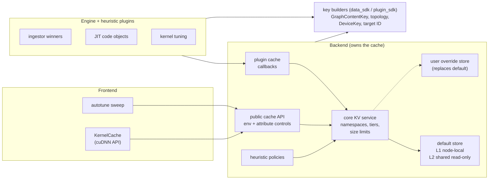
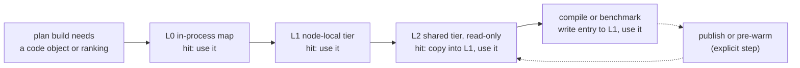

# RFC 0026: hipDNN cache service

- Contributors: Brock Hargreaves, Adam Dickin, Chris Miserva
- **Status**: Planned
- **Status notes**: Proposed. No cache service, plugin cache callback set, or cuDNN-compatible kernel cache exists. The per-consumer caches described in §3 are on `develop` today. Tracking: ALMIOPEN-1870 (epic), ALMIOPEN-3470 (this RFC).
- **Last verified**: 2026-11-25 against `develop` (`73045008a15`)
- **Related**: [RFC 0009: Execution plan serialization](./0009_CompiledPlanSerialization.md), [RFC 0012: cuDNN shim](./0012_CuDNN_Shim.md), [RFC 0013: Autotuning](./0013_Autotune.md), RFC 0023: Runtime kernel compilation (draft, [#14574](https://github.com/ROCm/rocm-libraries/pull/14574))

## Table of Contents

1. [Summary](#1-summary)
2. [Motivation](#2-motivation)
3. [Current state](#3-current-state)
4. [Requirements](#4-requirements)
5. [Consumers and data classes](#5-consumers-and-data-classes)
6. [Architecture](#6-architecture)
7. [Keys](#7-keys)
8. [Storage layer](#8-storage-layer)
9. [Shared and distributed filesystems](#9-shared-and-distributed-filesystems)
10. [Interaction with comgr and MIOpen caches](#10-interaction-with-comgr-and-miopen-caches)
11. [Public API](#11-public-api)
12. [Failure handling and observability](#12-failure-handling-and-observability)
13. [Migration](#13-migration)
14. [Known failure modes and how they are closed](#14-known-failure-modes-and-how-they-are-closed)
15. [Risks](#15-risks)
16. [Test plan](#16-test-plan)
17. [Open questions](#17-open-questions)
18. [Appendix A: Measurements](#appendix-a-measurements)
19. [Appendix B: MIOpen caching history](#appendix-b-miopen-caching-history)
20. [Appendix C: cuDNN cache surface](#appendix-c-cudnn-cache-surface)
21. [Appendix D: Prior art](#appendix-d-prior-art)

## 1. Summary

hipDNN gets one cache, owned by the backend and offered as a service, the way logging is. The backend stores opaque values under opaque keys, in namespaces that belong to its consumers: autotuning, graph-level heuristics, and each engine plugin (kernel benchmarking results, kernel tuning, JIT-compiled code objects). Plugins reach the service through a callback set and never open cache files themselves. A user can replace the default store with their own.

The default store has three tiers: an in-process memo, a node-local writable tier, and a shared tier that is read-only at runtime and filled by an explicit publish or pre-warm step. Every tier below the in-process memo is a store behind one interface with a written contract (§8.3, §8.4): whole-entry reads, safe concurrent writes, no locks held between calls, read-only operation, never fatal. The core frames and verifies every entry itself, so the storage technology can change without touching consumers, plugins or the public API.

The storage technology is not chosen yet (OQ-1). The current candidate stores one immutable file per entry, written with an atomic rename and read without `mmap` (§8.8). It takes no file locks on shared storage, which is what would let the cache work on network and distributed filesystems, where MIOpen's and comgr's caches either fail or turn themselves off (§9, Appendix B).

The public API matches cuDNN where cuDNN has an equivalent: the dynamic-shape flag, the application-owned `KernelCache` with JSON serialization, and the default kernel cache controls. cuDNN has no cache-directory control in its library (Appendix C), so the persistent tiers, their locations and their limits are hipDNN extensions.

## 2. Motivation

- **Every consumer built its own cache.** Autotune rankings, ingestor winners and JIT modules each have their own path, key, format, locking and switches (§3). ALMIOPEN-2465 gave them a shared root, but the stores are still separate.
- **The caches cannot be shared across jobs and nodes.** Cluster jobs land on different nodes, home directories are on NFS, Lustre or GPFS, and node-local `/tmp` is usually wiped between jobs. MIOpen moves its default caches to `$TMP` on recognised network filesystems, and comgr turns its default cache off (§9). The cost of starting cold is large: in [rocm-libraries#876](https://github.com/ROCm/rocm-libraries/issues/876), 32× MI250X under SLURM took 545 min per 5k steps cold against 110 min warm, every job. hipDNN's own JIT compiles cost about 180 ms per `hip_mlops` kernel variant without a cache and 19 ms with one (Appendix A).
- **The failure modes are known.** MIOpen has six years of cache defects on shared storage: corrupted SQLite files, lock timeouts, cross-node locking that was merged and then reverted (Appendix B). comgr crashed with `SIGBUS` on NFS and now disables its cache there. cuDNN shipped false cache hits. A new design should close each of these by construction.
- **Shared storage is where the complexity is.** On one node's local disk a cache is simple: an atomic rename or a local lock is enough, and almost any format works. The hard requirements come from network and distributed filesystems, where nodes see each other's writes late, locks do not work reliably across nodes, `mmap` can fault when another node replaces a file, and metadata operations are slow. Half of the failures in §14 happen only on shared storage, and every cache surveyed in Appendix D that writes to shared storage has open bugs there. Most of this design exists for that case (§9).
- **cuDNN parity.** hipDNN defines the cuDNN kernel-cache enums but does not implement them, and the cuDNN shim ignores `set_kernel_cache` and `set_dynamic_shape_enabled` (§3.4).

## 3. Current state

### 3.1 Persistent caches on `develop`

| Cache | Owner | Location | Key | Concurrency | Controls |
|---|---|---|---|---|---|
| Autotune exact-match rankings | Backend (`heuristics/config/AutotuneRankingStore.hpp`); written by `Graph::autotuneExhaustiveSweep()` through `hipdnnBackendWriteEngineRankingResults_ext`; read by the `SelectionHeuristic::Config` policy | `<root>/autotune-rankings/<data_sdk version>/<key hex>.jsonl` | `GraphContentKey` hash plus a hash of serialized `DeviceProperties`, which includes `device_id`, the HIP ordinal (`heuristics/DeviceProperties.cpp:29`) | `LineStore`: in-process mutex plus `fcntl`/`LockFileEx` whole-file lock; append-only | `HIPDNN_CACHE_DIR`, `HIPDNN_DISABLE_CACHE`, `HIPDNN_DISABLE_EXACT_ENGINE_CACHE` |
| Ingestor winner cache | plugin_sdk (`ingestor/WinnerCacheFile.hpp`, `KernelIngestorStateManager.hpp`), opened by the plugin itself | `<root>/ingestor-winners/<version>/<engine>/<uhd id>/<revision>-<model hash>/<arch>/winners.jsonl` | `GraphContentKey` plus `DeviceKey` (arch with features, warp size, CU count, memory size, bus width and clock, LDS; no ordinal, `ingestor/DeviceKey.hpp`) | `LineStore`, as above | Same root and kill switch |

The shared root comes from `data_sdk/.../utilities/CacheRoot.hpp`: `HIPDNN_DISABLE_CACHE` first, then `HIPDNN_CACHE_DIR`, then `~/.cache/hipdnn/` on Linux or `%USERPROFILE%\.hipdnn\cache\` on Windows. It is re-read on every call and never throws. `HIPDNN_HEUR_CONFIG_PATH` is a separate user-supplied rules file, re-parsed on every `policyFinalize`.

Problems with these stores:

- Both version directories change on every git commit, so every rebuild starts empty and old directories are never removed (`docs/Environment.md`, `HIPDNN_CACHE_DIR`).
- The autotune key contains the HIP ordinal, so a ranking measured on GPU 0 misses on GPU 1 of the same node.
- A winner-cache lookup that misses creates an empty shard file. Its shard is always opened read-write, so a read-only cache directory always misses and a winner cache cannot ship with an engine (`docs/Environment.md`).
- `LineStore` keeps one never-closed file descriptor per shard touched, and locks on every read.
- Neither store checks what filesystem the root is on.

### 3.2 In-memory caches

hip-kernel-provider keeps loaded modules in process-wide maps that are never evicted: `SdpaModuleCache` (key: arch, TOC key, function; no device ordinal), `HipMlopsModuleCache` (key: kernel file and compile options; no device ordinal; tracked as ALMIOPEN-2550, `compilation/Kernel.hpp:22`), and one `KpackModuleCache` per ingestor pack (key includes the device ordinal and SHA-256). The ingestor also keeps LRU caches of catalogs, verdicts and winners per state manager. The backend memoizes per-descriptor results (serialized graph, engine details, workspace size, serialized plan bytes). These stay in memory; this RFC does not persist them, but they are the in-process tier the service sits behind.

### 3.3 Runtime compilation

`hip_mlops` (BatchNorm, LayerNorm, RMSNorm, Resample) compiles embedded HIP source with hipRTC at plan build and caches the loaded module in memory only. hipRTC compiles through comgr, whose own disk cache is the only persistence today (§10). Shapes such as `INNER_SIZE` and `STRIDE` are compiled in as `-D` defines, so each shape is a separate compile.

### 3.4 cuDNN kernel-cache surface

| Item | State |
|---|---|
| `HIPDNN_BACKEND_KERNEL_CACHE_DESCRIPTOR` (12) | Enum only. `DescriptorFactory` returns `NOT_SUPPORTED`. |
| `HIPDNN_ATTR_EXECUTION_PLAN_KERNEL_CACHE` (306) | Enum only. Get and set return `NOT_SUPPORTED` (`ExecutionPlanDescriptor.cpp:163,221`). |
| `HIPDNN_ATTR_KERNEL_CACHE_IS_ENGINECFG_KERNEL_CACHED` (1100) | Enum only |
| `HIPDNN_ATTR_OPERATIONGRAPH_IS_DYNAMIC_SHAPE_ENABLED` (603) | Enum only; `GraphDescriptor` does not handle it |
| Kernel-cache `OPERATION_GRAPH`, `JSON_REPRESENTATION`, `REVISION`, `ENTRY_COUNT` | Missing |
| Native frontend `set_dynamic_shape_enabled`, `KernelCache`, `set_kernel_cache` | Missing |
| cuDNN shim | `set_dynamic_shape_enabled` and `set_kernel_cache` log and ignore (`detail/graph_wrapper.h:539-552`); `KernelCache` is an empty placeholder and a non-null cache makes `ExecutionPlanBuilder::build()` return `NOT_SUPPORTED` (`detail/frontend_types.h:101-105`) |
| `Graph::key()` | Missing (ALMIOPEN-2523) |

## 4. Requirements

The requirements come from ALMIOPEN-1870. Each has a check.

| ID | Requirement | Check |
|---|---|---|
| R1 | One key-value cache service in the backend, used by every consumer in §5 | Each consumer stores and restores through the service; no consumer opens a cache file |
| R2 | Plugins use the service through a callback set and do not choose paths, open files or evict | Grep of plugins and plugin_sdk finds no cache file I/O; a plugin works unchanged with a replaced store |
| R3 | A user can replace the default store | A test store receives every get and put |
| R4 | Per-consumer key schemes, with shared key builders | Each consumer's key is specified (§7.3) and covered by key-completeness tests (§16) |
| R5 | Versioned: entries from an incompatible build are never used | Changing any versioned key component is a miss |
| R6 | Device specific without being ordinal specific (§7.2) | Same SKU at a different ordinal hits; a different SKU or target ID misses |
| R7 | Safe for multiple processes, users and nodes, on Linux and Windows, including network and distributed filesystems | Store contract suite (§16.1) on each supported medium; core tests (§16.2) |
| R8 | Size measured and bounded; rotating entries evicted; pinned entries kept within a reserved budget | Size and eviction tests |
| R9 | Never fatal: a missing, unwritable, corrupt or foreign cache degrades to no persistence and is logged | Fault-injection tests |
| R10 | No locking across nodes and no lock held between calls | Contract rule C5; design review |
| R11 | Storage technology chosen with evidence; no raw text files; SQLite not assumed | OQ-1 decision recorded with contract-suite and benchmark results |
| R12 | cuDNN-compatible API where cuDNN has an equivalent; everything else as hipDNN extensions | §11 parity table |
| R13 | Each known MIOpen, comgr and cuDNN cache failure mode is covered or explicitly out of scope | §14 |
| R14 | Invalidation documented per consumer | §7.3 |
| R15 | Results can be shared across jobs and nodes and shipped pre-filled | Publish and pre-warm tests (§8.6) |
| R16 | The storage technology can be replaced without changing consumers, plugins, the plugin ABI or the public API | Contract suite and core tests pass against at least two store implementations, one of them the in-memory reference store |

## 5. Consumers and data classes

### 5.1 Consumers

| Consumer | Runs in | Stores | Namespace owner |
|---|---|---|---|
| Autotune | Frontend runs the sweep; backend stores | Engine ranking per graph and device | Backend |
| Graph-level heuristics | Backend policies and heuristic plugins | Reads autotune rankings; heuristic results | Backend, heuristic plugins |
| Kernel benchmarking inside an engine | Engine plugins (ingestor) | Kernel ranking per graph and device | Engine plugin |
| Kernel tuning | Engine plugins | Tuned parameters per kernel and problem | Engine plugin |
| Kernel compilation | Engine plugins (`hip_mlops`, RFC 0023 engines) | Code objects | Engine plugin |
| cuDNN `KernelCache` | Application, frontend, backend | Code objects for dynamic-shape graphs | Application (§11.1) |
| Serialized plans | Application | Plan bytes ([RFC 0009](./0009_CompiledPlanSerialization.md)) | Application; not stored by the service |

### 5.2 Data classes

| Class | Examples | Size | Write pattern | Persisted |
|---|---|---|---|---|
| Small records | Autotune rankings, winners, tuning parameters, heuristic results | Bytes to a few KB (not yet measured, OQ-9) | Replaceable; last writer wins | Yes |
| Immutable blobs | Code objects | About 6 KB per `hip_mlops` kernel (Appendix A); larger for fused kernels (not yet measured) | Write once; the same key always has equivalent bytes | Yes |
| Process handles | Loaded modules, catalogs, device properties | – | – | No. They stay in each consumer's in-memory map, keyed by device. |

## 6. Architecture

Not yet built.

- **Backend.** Owns the service: configuration, entry framing, tiers, the default store and the override hook. It is the only component that the frontend, the heuristic policies and every plugin all reach.
- **Frontend.** Never touches cache files. It forwards autotune results and the cuDNN `KernelCache` object to the backend, as autotune already does today.
- **Plugins.** Receive a cache callback set from the backend, the same way they receive the logging callback (`hipdnnPluginSetLoggingCallback`, `plugin_sdk/.../PluginApi.h:146`). A plugin that does not export the setter does not use the cache. A backend that does not provide callbacks leaves plugin caching off; neither case is an error.
- **Stores.** Every tier below the in-process memo is a store behind one interface (§8.3). The default store and a user override store are interchangeable implementations of it.
- **data_sdk / plugin_sdk.** Shared code only: key builders, entry framing, the store interface. No global state. `CacheRoot.hpp` stays as the root resolver for file-based stores; `LineStore.hpp` is retired with its consumers (§13).

## 7. Keys

Not yet built.

### 7.1 Key builders

The core never interprets keys. Consumers combine shared builders:

| Builder | Exists | Contents |
|---|---|---|
| `GraphContentKey` | Yes (`flatbuffers_sdk`) | Hash of graph content; `(cache_ignore)` fields skipped; tensor UIDs folded to position |
| Topology key | No | `GraphContentKey` without dims and strides, for dynamic-shape graphs. cuDNN's `graph.key()` does the same when dynamic shapes are on (ALMIOPEN-2523). |
| `DeviceKey` | Yes (`plugin_sdk/ingestor/DeviceKey.hpp`) | GPU SKU and configuration; no ordinal. To add: compute partition mode (PyTorch's ROCm key includes `xcc_count`, Appendix D) |
| Target ID | No | Full `gcnArchName` including feature flags |
| Compiler fingerprint | No | Hash of the comgr and hipRTC libraries and the device-library bitcode, not only version strings; standard library identity (§10.1) |
| Version stamps | Partly | hipDNN version, plugin and engine revision, model hash, per-namespace schema version |

The core frames every value with its full key material and compares it on read (§8.2). A hash collision or foreign data is then a miss, never a wrong hit. NVIDIA's frontend compiled-plan cache and comgr's cache both do this.

Rules for every key, taken from failures in other projects (Appendix D):

- Each field is framed with its length, and the key starts with a versioned tag for the namespace's key schema, so two different field lists cannot produce the same bytes.
- Each namespace keeps one registry of the options and environment variables that can change a result. A test fails if a consumer reads an option that the registry does not classify as either part of the key or irrelevant.
- The cache's own path and process-local values (pointers, pids, ordinals) never enter a key.
- Attributes that vary between nodes of the same SKU, such as interconnect topology, never enter a key. Ranks that compute different keys for the same work miss each other's entries; in JAX this hung a job.
- If the toolchain cannot be identified, code-object namespaces run memory-only (L0) instead of persisting entries that could be wrong after an upgrade. MIGraphX does the same.

### 7.2 Device identity

| Data | Device part of the key |
|---|---|
| Code objects | Target ID and compiler fingerprint. Never the ordinal. |
| Rankings, winners, tuning | `DeviceKey` (SKU and configuration). Never the ordinal. |
| In-memory handles | The ordinal, because a loaded module belongs to one device (ALMIOPEN-2550) |

The autotune store moves from `DeviceProperties` (which includes `device_id`) to `DeviceKey`.

### 7.3 Per-consumer keys and invalidation

| Namespace | Key | Invalidated by |
|---|---|---|
| `autotune` | `GraphContentKey`, `DeviceKey`, set of engine IDs and engine revisions in the sweep | Any key component changing. A narrower sweep never replaces a wider one (existing rule). |
| `heuristics/<policy>` | Defined by the policy | Policy schema version |
| `<plugin>/winners` | `GraphContentKey`, `DeviceKey`, slot, engine name, revision, model hash | Engine revision or model change; the existing coverage check rejects a record that misses kernels |
| `<plugin>/tuning` | Defined by the plugin | Plugin schema version |
| `<plugin>/code` | Target ID, compiler fingerprint, canonicalized (sorted) options, hash of the full source and every header, symbol | Any key component changing |
| `kernel-cache` (§11.1) | Topology key, engine config, target ID, compiler fingerprint | Same |

Whether a global hipDNN version and git hash is also part of every key is OQ-4.

## 8. Storage layer

Not yet built.

The storage technology is not chosen yet (OQ-1). This section separates what the core does, which does not depend on that choice, from what a store does, and states the contract every store must meet. §8.8 describes the current candidate.

### 8.1 Layers

| Layer | Owns | Changes if the storage technology changes |
|---|---|---|
| Consumers and plugins | Namespaces, keys, values, entry flags | No |
| Core service | Entry framing and verification (§8.2), tiers and promotion (§8.5), publish (§8.6), size accounting and eviction policy (§8.7), shared-storage policy (§9.2), logging and counters (§12) | No |
| Store interface (§8.3) and contract (§8.4) | Operations, capability flags, required behaviour | No |
| Store implementations | How bytes are kept: files, a database, a remote service | Yes; only this layer |

L1, each L2 source, and a user override store (§11.3) are all instances of the store interface. A store never sees full keys and never interprets values.

### 8.2 Entry framing

The core wraps every value before it reaches a store: format version, namespace, schema version, flags (pinned or rotating; immutable or replaceable; negative), key length, key bytes, value length, value bytes, checksum. The store keeps the framed bytes under a digest of the namespace and key.

On read, the core checks format version, lengths, checksum and full key. Any mismatch is a miss, and if the store is writable the core removes the bad entry so the next write replaces it. Every store therefore gets the same protection against hash collisions, foreign data and corruption. The checksum and digest algorithms are OQ-2.

A negative entry records a stable result, such as "this configuration is unsupported on this target and toolchain", so later processes skip the work. It is never written for a transient failure such as out of memory or a timeout. llama.cpp's OpenCL cache keeps rejected programs this way (Appendix D).

If a consumer needs a file path, for example to load a code object, it writes the verified bytes to a private location. It never uses a file from a store directly. PyTorch ran another graph's code because it loaded unverified side files from its cache directory (Appendix D).

### 8.3 Store interface

| Operation | Behaviour |
|---|---|
| `get(namespace, digest)` | Framed bytes, a miss, or an error |
| `put(namespace, digest, bytes, flags)` | Stores the bytes; returns success or an error |
| `remove(namespace, digest)` | Removes the entry if present |
| `enumerate(namespace)` | Lists digests, for publish, size accounting and pruning |
| `usage()` | Bytes and entry count, split by flags |
| `prune(target)` | Removes rotating entries until usage is under the target; not offered by read-only stores |
| `capabilities()` | The flags below |

| Capability | Meaning |
|---|---|
| `writable` | `put`, `remove` and `prune` are allowed |
| `persistent` | Entries outlive the process |
| `shared_read_safe` | Safe to read while processes on other nodes write the same medium |
| `shared_write_safe` | Safe for processes on different nodes to write concurrently |

Whether the interface is internal C++ only or a C ABI shared with the override store is OQ-16.

### 8.4 Store contract

Every store implementation must meet these rules. The contract suite (§16.1) checks each one.

| ID | Rule |
|---|---|
| C1 | `get` returns the complete bytes of one earlier `put` for that key, or a miss. Never partial bytes. |
| C2 | Concurrent `put` of the same key from several processes, and from several nodes if the store is `shared_write_safe`, leaves one of the written values. No corruption and no error to any writer. |
| C3 | `get` creates nothing and works when the store's medium is read-only. |
| C4 | Failures come back as error codes. Nothing throws across the interface, and no failure ends the process (for example through `SIGBUS`). |
| C5 | No lock is held between calls. Any lock taken inside a call is bounded in time and never waits on another node. |
| C6 | Capability flags are accurate for the medium the store is on. A store that cannot tell whether its medium is shared reports the more restrictive flags. A writable store that gets `EROFS` or `EACCES` reports itself read-only from then on. |
| C7 | A writable store reports usage and supports `prune`. |
| C8 | The store's own format is versioned. On an incompatible format the store reports misses, not errors. |

R7, R9 and R10 follow from the core using only stores that meet C1–C8, together with the shared-storage policy (§9.2).

### 8.5 Tiers

A lookup moves one tier to the right on each miss. The dotted path is the explicit publish or pre-warm step, not part of a lookup.

| Tier | Store | Required capabilities | Eviction |
|---|---|---|---|
| L0 | None: process memory in the core, per namespace | – | Process lifetime, or namespace limit |
| L1 | One writable store, normally node-local | `writable`, `persistent` | The core asks the store to `prune` when usage passes the cap; pinned entries kept within a reserved budget |
| L2 | One or more read-only stores: shared directory, shipped package, site store | `persistent`, `shared_read_safe` | None at runtime; an admin tool prunes it |

On an L2 hit the core copies the entry into L1 with `put`. L0 allows one compile per key at a time in the process. A user override store (§11.3) replaces L1 and L2 together.

### 8.6 Publish and pre-warm

Publishing copies entries from one store to another through the interface: `enumerate` and `get` on the source, `put` on the destination. Entries are immutable or last-writer-wins and are keyed by digest, so publishing is idempotent and needs nothing beyond C2. The same tool fills a store for packaging, to ship pre-filled entries for supported targets. Writing L2 directly at runtime needs a `shared_write_safe` store and is OQ-5.

A published package carries a header with a format version and compatibility stamps (target IDs, toolchain fingerprint, hipDNN version range) and a checksum per entry. Import is staged in a temporary location and marked complete only after every entry verifies, so an interrupted import leaves nothing half-visible, and importing the same package twice changes nothing. The publish tool can also record which entries a run actually used and publish only those. PyTorch's Triton cache bundles and mega-cache work this way (Appendix D).

### 8.7 Eviction

Only L1 evicts at runtime. The core decides when and what may go; the store carries out the removal.

- Caps apply to both bytes and entry count. On GPFS and Lustre the inode limit can be reached before the byte limit (PyTorch #196993).
- Rotating entries go first, oldest first; pinned entries stay within a reserved budget.
- An entry larger than the cap is not stored.
- Usage is tracked incrementally, not by scanning the store on every write (JAX #42080).
- Pruning tolerates entries that disappear during the prune or were left behind by another process.
- The default cap must hold a normal working set. With a 32 MB driver cache and 54 MB of kernels, llama.cpp users got no hits at all (#29513).

Defaults are OQ-6.

### 8.8 Candidate default store: per-entry files

This is the current candidate for L1 and L2, pending OQ-1. Nothing outside this subsection depends on it.

- **Layout.** `<root>/<namespace>/<schema version>/<aa>/<bb>/<hex digest>`. Two levels of hex directories keep directories small on parallel filesystems.
- **Write.** Create `<final name>.<host>.<pid>.<thread>.<random>.tmp` in the destination directory with `O_EXCL`, write the framed bytes, flush them to stable storage, and rename over the final name; on Windows, use a replacing move. The temp file is removed on every error path. No lock is taken. Rename replaces the whole file at once, which gives C1 and C2. Once the rename succeeds, `put` reports success, and a failure in any later cleanup is only logged (Triton #11512). For immutable entries, publishing with `renameat2(RENAME_NOREPLACE)` or `link()` would leave an existing good entry in place; whether that is worth the platform-specific code is part of OQ-1.
- **Read.** Open, `read()` the whole file, close. Never `mmap`: comgr's `SIGBUS` crash on NFS came from reading cache entries through `mmap` while another node replaced them (LCOMPILER-2307). On Windows, readers open with delete sharing so a concurrent replace succeeds. A read never creates a file (C3).
- **Prune.** Removes the oldest rotating files by modification time. L1 is node-local, so a local lock around pruning is allowed (C5); a lost race costs only an `ENOENT`.
- **Capabilities.** Always `shared_read_safe`. The store checks its root with `sys::fs::is_local` and reports a remote root as not `shared_write_safe` unless configured otherwise (OQ-7). Used as a writable store, it also probes the root at start-up (create, rename and remove a temp file) instead of relying only on the filesystem table, and becomes read-only after `EROFS` or `EACCES` (C6). A symlinked root and a missing `TMPDIR` must work or give misses; llama.cpp broke on symlinked cache directories (#29759) and aborted without `TMPDIR`.

Other candidates for OQ-1, not yet evaluated against the contract:

| Candidate | Notes |
|---|---|
| SQLite | Relies on filesystem locking for cross-process safety. WAL mode does not work over a network filesystem ([SQLite documentation](https://www.sqlite.org/wal.html)), and MIOpen's SQLite cache failed on NFS and Lustre (Appendix B). At most a node-local L1 store. |
| Single-file embedded key-value store | Not evaluated. Must meet C1–C8, Windows support and the dependency rules in R11. |
| Remote or site store | Fits as a read-only L2 store or as a user override store (§11.3). |

## 9. Shared and distributed filesystems

Not yet built.

A cache that only ever lived on a node-local disk would need little of this RFC: one writable directory, atomic rename, a local lock for pruning, and almost any format. Most of the complexity comes from network and distributed filesystems (NFS, Lustre, GPFS, BeeGFS and others), because on them:

- a write on one node becomes visible on another late or, without care, partially, depending on the filesystem's consistency model;
- file locks either do not cross nodes or do so slowly, and fail in ways that leave locks held (MIOpen's #1612 was reverted after SWDEV-573666);
- a file read through `mmap` can fault with `SIGBUS` when another node replaces it (comgr, LCOMPILER-2307);
- metadata operations (`open`, `stat`, directory scans) cost far more than on a local disk, and inodes can run out before bytes do;
- SQLite in WAL mode does not work at all.

The parts of this design that exist mainly for shared storage are contract rules C1, C2, C3, C5 and C6, the capability flags, the read-only L2 tier and the explicit publish step, the policy below, the fallback logging, and the multi-node tests. A design for node-local caches only could drop them, but then results could not be shared across nodes or jobs, which is the cost measured in [rocm-libraries#876](https://github.com/ROCm/rocm-libraries/issues/876). No project surveyed in Appendix D has a multi-node write path to shared storage that works.

### 9.1 What goes wrong today

| Component | Behaviour on a network or distributed filesystem |
|---|---|
| comgr | The default cache directory is disabled if it is not local. The check uses LLVM's `sys::fs::is_local`, which recognises NFS, SMB and CIFS, and since [llvm/llvm-project#242009](https://github.com/llvm/llvm-project/pull/242009) also DVS, Lustre, GPFS, CephFS, AFS and BeeGFS. The message is only printed with verbose logging. An explicit `AMD_COMGR_CACHE_DIR` is used as given. |
| MIOpen | The default kernel cache and user databases move to `$TMP` on NFS, SMB, SMB2, CIFS, Coda, OCFS2, AFS, Lustre and Ceph; GPFS and BeeGFS are not recognised. Explicit `MIOPEN_CUSTOM_CACHE_DIR` and `MIOPEN_USER_DB_PATH` are used as given; a warning is proposed in [#15406](https://github.com/ROCm/rocm-libraries/pull/15406). |
| hipDNN | No check |

### 9.2 Policy

- The core asks each store for its capabilities and places tiers accordingly.
- L1 must be writable. If the L1 store's medium is shared and the store is not `shared_write_safe` (for the file store, a root that `is_local` reports as remote), the core moves L1 to a node-local location and logs the decision once at warning level. Which location, and whether an explicit remote `HIPDNN_CACHE_DIR` is honoured with a warning, are OQ-7.
- Every L2 store must be `shared_read_safe`. The core rejects one that is not, and logs it.
- Every fallback is logged once at warning level. comgr and MIOpen fall back silently today.

## 10. Interaction with comgr and MIOpen caches

Not yet built.

### 10.1 comgr

hipRTC compiles through comgr, and comgr's cache works well when enabled: on today's nightly a `hip_mlops` compile drops from about 180 ms to 19 ms on a hit (Appendix A). Its limits are why the code-object namespace exists:

- It is disabled by default on remote filesystems, and nothing reports it.
- It has one directory, no read-only tier and no way to ship pre-filled entries.
- Its key includes the order of `-D` options. hipDNN builds them from an `unordered_map` (`compilation/KernelCompileOptions.hpp`), so hipDNN must sort them.
- By default the compile uses the host's C++ standard library headers. `AMD_COMGR_USE_EMBEDDED_LIBCXX=force` on its own does not change that; only `force` together with `-nostdinc++` uses comgr's embedded libc++ (Appendix A). The environment variable is process-wide, so hipDNN should not set it. Either the `hip_mlops` kernels stop including standard headers, as MIOpen did in [#13437](https://github.com/ROCm/rocm-libraries/pull/13437), or the code-object key includes the standard library identity (OQ-8).

With a hipDNN code-object namespace, a hit skips hipRTC entirely, so comgr's cache only matters on a miss. Whether hipDNN should also steer comgr's directory is OQ-10.

### 10.2 MIOpen

MIOpen keeps its own kernel cache, find-db and perf-db, configured only through environment variables (Appendix B). They stay out of scope. The MIOpen provider does not use the service for MIOpen's data; documentation explains how to place MIOpen's caches next to hipDNN's (OQ-10).

## 11. Public API

Not yet built. Names in this section are proposals.

### 11.1 cuDNN parity

| cuDNN | hipDNN |
|---|---|
| `graph.set_dynamic_shape_enabled(bool)` | Native frontend and Python; backend handles `HIPDNN_ATTR_OPERATIONGRAPH_IS_DYNAMIC_SHAPE_ENABLED`; the shim forwards instead of ignoring |
| `cudnn_frontend::KernelCache` with `build()`, `to_json()`, `from_json()`, `revision()`, `size()` | `hipdnn_frontend::KernelCache` with the same members and semantics; internally synchronized |
| `graph.set_kernel_cache(cache)` | Native frontend and Python; the shim forwards |
| `CUDNN_BACKEND_KERNEL_CACHE_DESCRIPTOR` with `OPERATION_GRAPH`, `IS_ENGINECFG_KERNEL_CACHED`, `JSON_REPRESENTATION`, `REVISION`, `ENTRY_COUNT` | `HIPDNN_BACKEND_KERNEL_CACHE_DESCRIPTOR` with `HIPDNN_ATTR_KERNEL_CACHE_*` equivalents (1100 exists; the rest are new) |
| `CUDNN_ATTR_EXECUTION_PLAN_KERNEL_CACHE` | `HIPDNN_ATTR_EXECUTION_PLAN_KERNEL_CACHE` (306, exists) |
| Default kernel cache: one per device, in memory, LRU | Same, as the `kernel-cache` namespace's L0 |
| `CUDNN_ENABLE_DEFAULT_KERNEL_CACHE`, `CUDNN_KERNEL_CACHE_SIZE_MB` | `HIPDNN_ENABLE_DEFAULT_KERNEL_CACHE`, `HIPDNN_KERNEL_CACHE_SIZE_MB`, with the same values and defaults |

The serialized form behind `JSON_REPRESENTATION` is hipDNN's own; cuDNN does not specify its contents. It carries version, target and compiler stamps, and entries that do not match are dropped on load. Whether the default kernel cache and application-owned caches are also backed by L1 and L2 is OQ-3.

Without dynamic shapes, cuDNN's default cache still caches some operations whose key encodes problem structure (Appendix C). The equivalent for hipDNN is the `<plugin>/code` namespace.

### 11.2 hipDNN extensions

| Control | State |
|---|---|
| `HIPDNN_CACHE_DIR` (L1 root for the file store) | Exists |
| `HIPDNN_DISABLE_CACHE` (all persistence off) | Exists |
| L2 sources (for the file store, one or more read-only directories) | New; name is OQ-11 |
| L1 size cap and pinned budget | New; names and defaults are OQ-6 |
| API to set the root and limits (ALMIOPEN-2465) | New; handle attribute or process-wide call is OQ-12 |
| `HIPDNN_DISABLE_EXACT_ENGINE_CACHE` | Exists; becomes a per-namespace switch |
| Publish, pre-warm and prune tool | New |
| Choice of built-in store, if more than one ships | New; OQ-17 |

### 11.3 Override store

The user registers a store that implements the store interface (§8.3) and meets the contract (§8.4), with a version field. It receives namespace, digest and framed bytes; framing and verification stay in the core. When registered it replaces L1 and L2; L0 stays.

### 11.4 Plugin callback set

`hipdnnPluginSetCacheCallbacks(const hipdnnPluginCacheCallbacks_t*)`, exported by a plugin that wants the cache. The struct carries a version, a context pointer, and `get`, `put` and `remove` that take a namespace suffix, key bytes, value bytes and flags. The backend prefixes the plugin's name to the namespace, so plugins cannot collide. Buffer ownership for `get` follows the plugin SDK's existing size-query pattern. The exact ABI is OQ-13.

## 12. Failure handling and observability

Not yet built.

- Every failure is a miss: a missing or unwritable store, a full disk, a permission error, a store error, a corrupt, truncated or foreign entry, a format or schema version mismatch. Nothing in the cache path throws to the caller.
- Each kind of failure is logged once per process per tier, with the path and the reason.
- Tier placement is logged once at info level, including any fallback from §9.2.
- Per-namespace counters for hits, misses, writes, evictions and failures, for logs and tests. NVIDIA's frontend compiled-plan cache exposes a similar `stats()`.
- A trace switch that logs every hit, miss and write with namespace and digest.
- On a miss, a debug log lists the hash of each key component, so logs from two processes show which component differed (PyTorch Inductor's `debug_lines`).
- A counter of compiles and benchmarks that bypassed the cache, so a consumer that never reaches it is visible. llama.cpp's flash-attention kernels bypassed its cache and paid 2–4 s on every launch.
- A verification mode for CI: compute the value anyway and compare it with the cached entry. A difference means the key is incomplete. JAX and MIGraphX both have one.
- A user key salt mixed into every key, to separate caches without changing directories.
- A per-namespace minimum cost below which entries are not persisted, so cheap results do not fill the cap.

## 13. Migration

Not yet built. Proposed order:

1. Core service, entry framing, store interface, contract suite with an in-memory reference store, the default store chosen in OQ-1, and the key builders.
2. Autotune rankings: backend-internal, so no plugin ABI is needed. The device key changes to `DeviceKey`.
3. Plugin callback set; ingestor winners move onto it. `WinnerCacheFile.hpp` and `LineStore.hpp` are removed once no consumer uses them.
4. `HIPDNN_HEUR_CONFIG_PATH`: default location under the cache root (ALMIOPEN-2465).
5. `hip_mlops` code objects, after OQ-8 is settled.
6. cuDNN kernel-cache API, with dynamic shapes and the topology key. Its first real consumers are RFC 0023 engines.

Old `autotune-rankings/` and `ingestor-winners/` directories are not migrated; their entries are already invalidated by every rebuild (§3.1). Documentation tells users they can delete them.

## 14. Known failure modes and how they are closed

| Failure | Source | How this design closes it |
|---|---|---|
| Shared text database corrupted or lost by concurrent multi-node writers | MIOpen [#114](https://github.com/ROCm/MIOpen/issues/114); whole-file rewrite through a fixed temp name | No shared mutable files: entries are written whole and replaced at once (C1, C2). File store: unique temp names and rename. |
| Lock timeouts that throw (`Db lock has failed to lock`) | MIOpen [#124](https://github.com/ROCm/MIOpen/issues/124), SWDEV-573666 | No lock held between calls or waiting on another node (C5) |
| SQLite `database disk image is malformed` and `locking protocol` on NFS and Lustre | MIOpen [#1878](https://github.com/ROCm/MIOpen/issues/1878), [#2214](https://github.com/ROCm/MIOpen/issues/2214); [SQLite WAL documentation](https://www.sqlite.org/wal.html): WAL does not work over a network filesystem | A store on shared media must meet C1, C2 and C6 there; SQLite in WAL mode cannot (§8.8) |
| Kernel cache on NFS makes Find time out | ROCM-33335 | L2 lookups are single-entry `get`s on a `shared_read_safe` store; the file store keeps no database on shared storage |
| Cross-node locking merged and reverted | MIOpen [#1612](https://github.com/ROCm/rocm-libraries/pull/1612), [#3538](https://github.com/ROCm/rocm-libraries/pull/3538), [#5401](https://github.com/ROCm/rocm-libraries/pull/5401) | Not needed: C2 holds without locks |
| Freshness tracked with a per-machine clock (`steady_clock` in `.time` files) | MIOpen `RamDb` | No freshness inference; entries are immutable or last-writer-wins and verified on read (§8.2) |
| Tuning lost between jobs on clusters | [rocm-libraries#876](https://github.com/ROCm/rocm-libraries/issues/876) | L2 tier and publish step (§8.5, §8.6) |
| Silent fallback when the cache is on network storage | MIOpen [#2092](https://github.com/ROCm/MIOpen/pull/2092); comgr verbose-only message | Logged at warning level (§9.2, §12) |
| Cache errors throw | MIOpen user database and lock paths | C4 and R9 |
| Incomplete keys give wrong results | MIOpen invoker cache (ALMIOPEN-3310, [#16024](https://github.com/ROCm/rocm-libraries/issues/16024)); cuDNN false hits for LayerNorm and RMSNorm backward (9.22 release notes) | Key specified per namespace; full key framed and compared (§8.2); key-completeness tests |
| Unbounded growth | MIOpen, hipDNN `LineStore` | Core size accounting and L1 `prune` (C7, §8.7) |
| `SIGBUS` reading cache entries through `mmap` on NFS | comgr, LCOMPILER-2307 | C4; the file store reads with `read()`, never `mmap` |
| Corrupt entry never repaired | comgr before the current nightly (Appendix A) | The core removes a bad entry from a writable store; the next write replaces it (§8.2) |
| Option order changes the key | comgr (Appendix A) | Options canonicalized |
| Host C++ headers in the compile | comgr default (Appendix A) | Hermetic kernels or standard library identity in the key (OQ-8) |
| Default kernel cache data corruption causing segfaults | cuDNN 9.22–9.24 (fixed 9.25.1) | Checksum and full-key check in the core before use (§8.2) |
| Read creates files; read-only directory always misses | hipDNN winner cache | C3; L2 is read-only by design |
| Key contains the device ordinal | hipDNN autotune store | `DeviceKey` |
| File descriptor per shard never closed | hipDNN `LineStore` | Nothing held between calls (C5); the file store opens, reads and closes |
| Temp-file name collision on NFS loads another graph's code | PyTorch [#201688](https://github.com/pytorch/pytorch/issues/201688) | Unique temp names created with `O_EXCL` (§8.8); consumers never load unverified side files (§8.2) |
| Zero-byte or truncated entries served as hits, or kept forever | llama.cpp [#30633](https://github.com/ggml-org/llama.cpp/issues/30633); JAX [#42197](https://github.com/jax-ml/jax/issues/42197) | Framing checks length and checksum; bad entries are removed (§8.2) |
| Cleanup failure after a successful write crashes one rank and hangs the job | Triton [#11512](https://github.com/triton-lang/triton/issues/11512) | After the rename, `put` succeeds; later cleanup failures are only logged (§8.8) |
| Inode exhaustion on GPFS and Lustre | PyTorch [#196993](https://github.com/pytorch/pytorch/issues/196993) | Entry-count cap (§8.7) |
| Cap smaller than the working set: no hits | llama.cpp [#29513](https://github.com/ggml-org/llama.cpp/issues/29513) | Default sized to the working set; oversize entries skipped (§8.7) |
| Directory scan on every write | JAX [#42080](https://github.com/jax-ml/jax/issues/42080) | Incremental usage tracking (§8.7) |
| Ranks compute different keys for the same work and hang | JAX [#40940](https://github.com/jax-ml/jax/issues/40940) | Node-varying attributes excluded from keys (§7.1) |

## 15. Risks

- **Plugin ABI.** The callback set becomes part of the plugin contract and needs versioning. Mitigation: optional symbol, versioned struct, absent means disabled.
- **Metadata cost on parallel filesystems (file store).** Every L2 miss is an `open()` on shared storage. Mitigation: L0 remembers misses for the process; directory sharding.
- **Code loaded from shared storage.** Code objects run on the GPU, so whoever can write a store can run code in every process that reads it; JAX documents the same for its cache. The checksum in §8.2 detects corruption; it is not authentication. Mitigation: L2 read-only at runtime; default L1 directories per user with an ownership check; the rules are OQ-14.
- **Windows (file store).** Replacing a file that another process has open fails unless readers open with delete sharing. Mitigation: readers open with delete sharing and close immediately; covered by tests.
- **Shared-tier growth.** L2 is never pruned at runtime. Mitigation: the admin tool and documentation.
- **Multi-node validation needs hardware.** The development machines are single-node. Mitigation: a multi-node NFS and Lustre run before the status moves past `Planned`; MIOpen #1612 used a 4-node NFS cluster.
- **Contract gaps.** A store can pass the contract suite and still misbehave on a medium the suite did not cover. Mitigation: run the suite on each supported medium (local disk, NFS, Lustre, Windows) before a store reports `shared_read_safe` or `shared_write_safe` there.

## 16. Test plan

### 16.1 Store contract suite

Runs against every store implementation: the in-memory reference store, the chosen default store, and each OQ-1 candidate, on each medium the store claims (local disk, NFS, Lustre, Windows, and at least four nodes for `shared_write_safe`).

- **C1:** readers during repeated replacement of the same key see whole values or misses.
- **C2:** many processes, and many nodes where claimed, writing the same keys; one written value remains and no writer sees an error.
- **C3:** `get` on a read-only medium and on a missing root creates nothing.
- **C4:** injected I/O errors, full disk and permission denied come back as errors; the process survives.
- **C5:** a stalled peer never blocks a call beyond its bound.
- **C6:** capability flags match the medium.
- **C7:** usage reporting and `prune`.
- **C8:** an incompatible format reports misses.

### 16.2 Core

- **Framing:** round trip; truncation; bit flips; wrong format version, key or checksum; a forced digest collision. Every case is a miss, and the entry is removed from a writable store.
- **Key completeness:** for each namespace, changing each key component one at a time is a miss, and changing only the ordinal (same SKU) is a hit.
- **Tiers:** an L2 hit is promoted to L1; an override store replaces L1 and L2; publishing twice changes nothing.
- **Fault injection:** a test store that fails each operation in turn; each failure degrades to a miss and logs once.
- **Eviction:** cap respected; pinned budget respected.
- **Verification mode:** CI runs every namespace with verification on (§12); any difference between a cached and a recomputed value fails the run.
- **Key hygiene:** the cache root path, pid and ordinal do not change a key; an unclassified option read by a consumer fails.

### 16.3 Default store

Tests specific to the chosen implementation. For the file store: replacement with open readers on Windows, cleanup of abandoned temp files, detection of remote roots, a symlinked root, a missing `TMPDIR`, `EROFS` and `EACCES` after start-up, and a crash between write and rename.

### 16.4 cuDNN parity

`revision()` increments on insert and not on lookup; `size()`; JSON round trip into a new cache; foreign or stale JSON entries dropped; behaviour of `set_dynamic_shape_enabled` and `set_kernel_cache` compared with cudnn-frontend.

## 17. Open questions

| ID | Question | Notes |
|---|---|---|
| OQ-1 | Default store implementation (§8.8). Decide by running the contract suite (§16.1) and benchmarks on each candidate. | Only per-entry files has a written design. Evidence so far favours it: SQLite WAL does not work over network filesystems, MIOpen's text rewrite and SQLite stores failed on shared storage, comgr's per-entry files work apart from `mmap`. |
| OQ-2 | Checksum and digest algorithms for entry framing (§8.2) | data_sdk already has FNV-1a; a stronger checksum may be needed for code objects |
| OQ-3 | Are the default kernel cache and application-owned `KernelCache` objects backed by L1 and L2, or memory-only as in cuDNN? | |
| OQ-4 | Does every key include the hipDNN version and git hash (ALMIOPEN-1870 asks for it), or only the per-consumer components in §7.3? | A global stamp empties every cache on each rebuild and blocks shipped pre-filled entries. Uncommitted builds and the `unknown` hash fallback need handling either way. |
| OQ-5 | May a job write L2 directly at runtime (opt-in), or only through the publish tool? | |
| OQ-6 | L1 size cap, pinned budget, and their defaults | cuDNN's default kernel cache is 100 MB per device; NVIDIA's frontend compiled-plan cache is 4 GiB; comgr defaults to 75% of the disk and 30 GB |
| OQ-7 | Where L1 goes when its store is on shared storage and not `shared_write_safe`, and whether an explicit remote `HIPDNN_CACHE_DIR` is honoured with a warning | MIOpen uses `$TMP`; comgr disables; NVIDIA's frontend advises job-local directories |
| OQ-8 | Make `hip_mlops` kernels independent of the host's C++ headers, or put the standard library identity in the key? | |
| OQ-9 | Data sizes per consumer, typical and worst case | Only `hip_mlops` code objects are measured (Appendix A) |
| OQ-10 | Should hipDNN document or steer the comgr and MIOpen cache directories so they sit with hipDNN's tiers? | Both are configured only through process-wide environment variables |
| OQ-11 | Name of the L2 control, and whether it accepts several sources | |
| OQ-12 | Is the configuration API a handle attribute, a process-wide call, or both? | ALMIOPEN-2465 asks for an API entry point next to the environment variables |
| OQ-13 | Exact plugin callback ABI and buffer ownership | Follow the logging callback and the SDK's size-query pattern |
| OQ-14 | Trust model: who may write L1, L2 and published packages, and which ownership and permission checks run before code objects are loaded | Writing to the cache is equivalent to running code in every reader (JAX documentation). llama.cpp's world-shared `/tmp` default shows the risk of a shared default directory. |
| OQ-15 | Relationship to RFC 0023's code-object cache requirement (I4) | RFC 0023 is a draft; one design should serve both |
| OQ-16 | Is the store interface internal C++ only, or a C ABI shared with the user override store? | A C ABI lets stores be built out of tree; it also freezes the interface |
| OQ-17 | Does hipDNN ship more than one built-in store, and if so how is one chosen? | For example the file store for L1 and L2 plus a site store for L2 |
| OQ-18 | May one key hold several variants? | The cuDNN-compatible kernel cache may need several entries for one topology key; PyTorch Inductor stores several guarded candidates per key |
| OQ-19 | Does a code-object lookup in L2 match target IDs by specificity? | kpack serves a plain `gfx942` build to a `gfx942:sramecc+:xnack-` agent, trying the most specific match first |

## Appendix A: Measurements

Measured on one node: gfx90a, `/home` on NFSv4, `/tmp` on local NVMe. Nightly wheel `rocm[libraries,devel,device-gfx90a]==10.3.0a20261125` (comgr 3.5.0, hipRTC 7.18). The harness compiled `hip_mlops` kernels the way `compilation::Program` does: embedded source, every kernel header passed, the same `-D` defines. Median of 7 fresh processes; time inside `hiprtcCompileProgram`, in ms.

| Kernel | Cache off | Miss, local | Hit, local | Miss, NFS | Hit, NFS |
|---|---|---|---|---|---|
| `RMSNormFwd.cpp` | 173.8 | 180.4 | 19.8 | 193.7 | 20.7 |
| `LayernormFwd.cpp` | 179.5 | 190.7 | 18.7 | 198.2 | 20.6 |

- Code object: 6,000 bytes for RMSNorm. Each compile stores two comgr entries.
- Sixteen RMSNorm hidden sizes: 3.02 s cold, 0.32 s warm, 32 entries, 169 KB.
- A hit spends about 18 ms in comgr's source-compile action, because preprocessing runs on every hit, 0.6 ms linking and 0.3 ms in file I/O.
- 8, 32 and 64 processes on one local or NFS directory: all succeeded, one identical binary, two entries. Processes that start cold together each compile.
- Default cache with `$HOME` on NFS: disabled; the message appears only with `AMD_COMGR_EMIT_VERBOSE_LOGS=1`.
- Corrupt entries: recompiled and repaired on the nightly. ROCm 7.14 and the 2026-10-26 build recompiled but never repaired; ROCm 7.1.0 did not cache hipRTC's compile step at all.
- Shuffled `-D` order: full miss, identical binary.
- Standard library used by a probe including `<type_traits>`: host libstdc++ by default and with `AMD_COMGR_USE_EMBEDDED_LIBCXX=force`; embedded libc++ only with `force` plus `-nostdinc++`, which gave a byte-identical RMSNorm binary.

## Appendix B: MIOpen caching history

| Date | Source | What happened | Response |
|---|---|---|---|
| 2019 | [MIOpen#114](https://github.com/ROCm/MIOpen/issues/114) | Multi-node job with the find-db on shared storage: write errors and abort; on GPFS from 4 nodes up | Advice to keep databases on local volumes; per-rank `MIOPEN_USER_DB_PATH` |
| 2019 | [MIOpen#124](https://github.com/ROCm/MIOpen/issues/124) | `Db lock has failed to lock` with `mpirun -np 2` | Lock files moved |
| 2022 | [MIOpen#1878](https://github.com/ROCm/MIOpen/issues/1878) | SQLite kernel cache on NFS home: `database disk image is malformed` | Correctness only guaranteed on local volumes; per-process caches lose kernel sharing |
| 2023 | [MIOpen#2214](https://github.com/ROCm/MIOpen/issues/2214) | `locking protocol` from `PRAGMA journal_mode=WAL` on Lustre | Closed without a fix |
| 2023 | [MIOpen#2092](https://github.com/ROCm/MIOpen/pull/2092) | Default user paths move to `$TMP` on recognised network filesystems | Silent |
| 2024– | [rocm-libraries#876](https://github.com/ROCm/rocm-libraries/issues/876) | Per-job caches: 545 min cold against 110 min warm per 5k steps, every job | Open |
| 2025 | [#1612](https://github.com/ROCm/rocm-libraries/pull/1612), [#3538](https://github.com/ROCm/rocm-libraries/pull/3538) | Hard-link cross-node lock merged, then reverted after a field failure | Redesign [#5401](https://github.com/ROCm/rocm-libraries/pull/5401) closed as stale |
| 2026 | ROCM-33335, [#15406](https://github.com/ROCm/rocm-libraries/pull/15406) | Find: 19 s with the kernel cache on tmpfs, 150 s timeout on NFS, about 80 s on Lustre; the find-db on NFS was fine | Warning only, open |
| 2026 | [#11933](https://github.com/ROCm/rocm-libraries/pull/11933), [#15112](https://github.com/ROCm/rocm-libraries/pull/15112), [#15155](https://github.com/ROCm/rocm-libraries/pull/15155) | Kernel database I/O reduced | No NFS measurements |

MIOpen's current design: an SQLite kernel cache in WAL mode (`src/binary_cache.cpp`, `src/sqlite_db.cpp`), text find-db and perf-db held in memory and rewritten whole (`src/ramdb.cpp`, `src/db.cpp`), node-local `fcntl` lock files under `$TMP` (`src/lock_file.cpp`), filesystem detection by `statfs` magic number (`src/filesystem_checker.cpp`), and a read-only system tier that AMD ships per architecture. Lookups check the user tier first. Cache errors throw.

## Appendix C: cuDNN cache surface

Sources: [Dynamic Shapes and Kernel Cache](https://docs.nvidia.com/deeplearning/cudnn/latest/utilities/dynamic-kernel-cache.html), [backend graph library reference](https://docs.nvidia.com/deeplearning/cudnn/backend/latest/api/cudnn-graph-library.html), [backend release notes](https://docs.nvidia.com/deeplearning/cudnn/backend/latest/release-notes.html), and the cudnn-frontend repository's `docs/developer/graph-api.mdx` ("Using the Default Kernel Cache or a Custom Kernel Cache").

- **Library.** No cache directory and no on-disk persistence.
  - Default kernel cache (9.22 and later): in memory, one per CUDA device by ordinal, LRU. `CUDNN_ENABLE_DEFAULT_KERNEL_CACHE=0` turns it off; `CUDNN_KERNEL_CACHE_SIZE_MB` sets the cap (default 100, `0` means no inserts, negative means unlimited). It is used when no `KernelCache` is set on the graph.
  - Keys: topology based when dynamic shapes are on. Without dynamic shapes, only C1K1 convolution, LayerNorm, InstanceNorm, SGBN BatchNorm and Tensor-IR engines are cached, because their keys encode problem structure.
  - Application-owned `KernelCache`: no size limit, persisted by the application through `CUDNN_ATTR_KERNEL_CACHE_JSON_REPRESENTATION` (9.10 and later); `revision()` and `size()` from 9.27; internally synchronized.
  - Known issues: a data corruption in the default cache that could segfault (9.22–9.24, fixed in 9.25.1); false cache hits for LayerNorm and RMSNorm backward.
- **Python frontend (open-source kernels only).** Directory controls exist for NVIDIA's own runtime-compiled kernels: `CUDNN_FRONTEND_COMPILED_CACHE` (default `$XDG_CACHE_HOME/cudnn_frontend/compiled_plans`, 4 GiB cap, `set_cache_dir()`), `CUDNN_FRONTEND_GEMM_KERNEL_CACHE`, `TVM_FFI_CACHE_DIR`, `FLEX_ATTENTION_CUTE_DSL_CACHE_DIR`. The compiled-plan cache keys a directory per environment (frontend version, source digest, driver, device name, compute capability, SM count, L2 size), stores the full key with each entry, writes by temp file and rename, and treats every failure as a miss. Its documentation advises a job-local directory for CI.

## Appendix D: Prior art

Source read at pinned commits on 2026-11-24 and 2026-11-25: ROCm/hrx-system (Loom) `5fbb30ba847f`, ggml-org/llama.cpp `5917b39ff7b5`, triton-lang/triton `b96b9571fb3e`, pytorch/pytorch `a35fc9b7771b`, jax-ml/jax `73df676`, mozilla/sccache `1c7b8fc`, ROCm/AMDMIGraphX `00262ad`. The CUDA driver cache is described from NVIDIA's documentation.

| Project | Persistent kernel cache | Store abstraction | Write | Full key in entry / checksum | Shared or network filesystem | Eviction |
|---|---|---|---|---|---|---|
| Loom (hrx-system) | None; in memory only. `loomc` leaves persistence to the application. | None | – | In memory, compares full key bytes | – | Operator-triggered trim |
| llama.cpp | OpenCL program binaries only (since 2026-07); other backends rely on driver caches; HIP is ahead-of-time only | None | Temp `.tmp.<pid>` and rename | No / no | Not handled | None |
| Triton | Yes | `CacheManager` (returns paths), `RemoteCacheBackend` (Redis) | Temp directory and `os.replace`; multi-file entries with a manifest | No / no | Open races on Lustre and DFS ([#11512](https://github.com/triton-lang/triton/issues/11512)) | None locally |
| PyTorch Inductor | Yes, several caches | `RemoteCacheBackend`, bytes in and out; the local file store uses the same interface | `.pid.tid.tmp` and rename | Partly | Wrong code from temp-name collisions on NFS ([#201688](https://github.com/pytorch/pytorch/issues/201688)); inode exhaustion on GPFS and Lustre ([#196993](https://github.com/pytorch/pytorch/issues/196993)) | None |
| JAX | Yes | `CacheInterface`: `get` and `put` only | Direct write (atomic write [#42198](https://github.com/jax-ml/jax/issues/42198) still open) | No / no | Documentation requires a shared filesystem; only rank 0 writes | Optional LRU; scans the directory on every write ([#42080](https://github.com/jax-ml/jax/issues/42080)) |
| sccache | Yes (build outputs) | `CacheStorage` trait: local disk, S3, GCS, Redis and others; read-only wrapper; multi-level chain | `NamedTempFile` and rename | No / zip CRC | Local disk cannot be shared ([#944](https://github.com/mozilla/sccache/issues/944)); Redis or S3 instead | Local LRU, 10 GiB default; remote stores rely on TTLs |
| CUDA driver | Yes (`~/.nv/ComputeCache`) | – | One central index file with `fcntl` locks | – | Slow on NFS per NVIDIA's documentation; a third-party trace shows a hang on NFS locks | 1 GiB default, 4 GiB maximum |
| MIGraphX | Yes | Backend concept: `load` must not throw; full key checked when entries are addressed by hash | Random-suffix temp and rename, or SQLite | Yes / – | SQLite with a 5 s busy timeout as the only cross-process handling | None |

- Only MIGraphX stores the full key in each entry and checks it on read, as §8.2 does. The projects without this check each have bugs where a corrupt or foreign entry was served as a hit.
- Only sccache has a general pluggable store with read-only tiers. PyTorch's bytes-in, bytes-out backend serves local files and Redis through one interface. Triton's `CacheManager` returns file paths, which forces every backend to write local files; its "file vanished" failures happen there.
- The patterns that work on shared storage are the ones in §8: a read-only shared tier filled by an explicit step (sccache's read-only wrapper, JAX's rank-0 writes, MIGraphX's system tier) and per-entry files replaced by rename. Caches where every process writes the shared directory (sccache local disk, Triton, the CUDA driver index) are the ones that break.
- Triton creates a directory on every lookup, and JAX and sccache write access times on every hit, so none can run on a read-only medium (C3).
- None of them has a working multi-node write path to shared storage or eviction on a shared tier.
