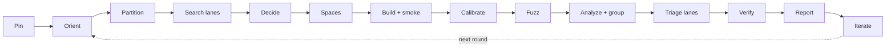

# Runbook: fuzz an engine

Each stage ends in a **Gate:**; do not start the next stage until it holds. Move from gate to gate without waiting for the user
(SKILL.md *Rules*). `ledger.py` stands for `python "$SKILL/scripts/ledger.py"`, where `$SKILL` is this skill's directory; it prints
`missing: ...` lines and exits 1 when a gate fails. Lane variables and rules: [lanes/common.md](lanes/common.md). Formats:
[findings.md](findings.md).



Round directory `R = <run-dir>/pr<N>/r<k>/`:

```
R/PIN.md  dispatch-context.md  dispatch.tsv  ID-MAP.md  DECISIONS.md  CALIBRATION.md  groups.tsv  FINDINGS.md  NOTES.md  ISSUES.md
R/lanes/<LANE>.md   R/triage/<LANE>.md   R/verify/<ID>.md   R/report/ (collect_report.py output)   R/stage/ (scripts and TOMLs used)
<run-dir>/engines/<engine-slug>/BRIEF.md  LEDGER.md      (the engine record, across PRs)
```

## Pin

1. For a PR: read its description, changed files and base (`gh pr view <N> -R ROCm/rocm-libraries --json
   files,body,baseRefName,headRefOid`). `files` truncates at 100 (binary kernels): also read `git diff --stat` after the merge. Find
   the engine id (the `--test-engine` form), every arch, and the ops.
2. **Does the engine exist on base for that arch?** A port to a new arch has no baseline there: base declines every graph, so every
   WRONG or CRASH on the PR build is a finding, and a regression check needs the shipped engine on another arch (same graphs, joined
   on primary rows) or a shipped-arch base vs PR run of the shared code. Write this in `PIN.md`. The user may decline a baseline
   ("PR only"): then build no base tree, run no base jobs, skip `REGR`, and say in `PIN.md` and the report that regressions and
   pre-existing failures were not separated and lost coverage was not measured.
3. **Two worktrees**, both from the branch that holds the gauntlet (`gauntlet/` under `dnn-providers/integration-tests/`):
   - a base tree: that branch, plus the develop commits up to the PR's parent when the PR's parent is not on it;
   - a PR tree: the base tree plus the PR, so the two differ only by the change.
   If merging develop conflicts in harness files (stacked raw commits of PRs develop has squashed), `git cherry-pick -x` the needed
   commits instead, and say so. Git can align big test files badly and duplicate whole test blocks: take the PR's file, diff it
   against the gauntlet side by test and function **names**, re-add only what the gauntlet side has, and check for duplicate `TEST(`
   names. Push nothing: a branch is pushed only when the user asks for it.
4. **The grading TOML.** The engine's `config/<engine>.toml` goes to `--test-config`. Its per-class rows match bundle case ids only;
   fuzz ids (`s12`, `pw47`) carry no class token and the gauntlet writes `bfp16`, so only generic rows and rows matching `gauntlet_*`
   names apply. Check there is a row for every dtype the spaces draw; if you add one in a scratch copy, keep it in `R/stage/` and say
   in the report it is your choice.
5. **Plan the machines for every arch now** and get the plan approved once as a whole (*Fuzz* below).
6. Write `R/PIN.md`: PR, head SHA, base and PR branch names and SHAs, the branch to build ("fuzzer + PR"), engine id, arches and
   SKUs, ops, budget, approval text, the subagent limit, the grading TOML, and whether a baseline exists.

**Gate:** both worktrees are committed; `git diff --stat <base>..<pr>` touches only the PR's files and any space commit applied to
both; `PIN.md` has every field.

## Orient

1. Read what already exists for this engine: its coverage doc and rule ids, `projects/hipdnn/docs/KNOWN_DIVERGENCES.md`, earlier
   rounds under `<run-dir>`, and the engine `LEDGER.md` if there is one.
2. If `<run-dir>/engines/<engine-slug>/BRIEF.md` exists, run [lanes/orient.md](lanes/orient.md) in **update** mode with its
   `Describes:` commit and the new one; else in **write** mode. Use one subagent that can write files (a `task` agent) and wait for
   it. The brief ends with **code cards**: the few hundred lines of matcher, plan and kernel code every later lane needs, quoted with
   `path:line`. Lanes read the cards and open source only by range, so their context goes to finding ideas, not to re-reading files.

**Gate:** `BRIEF.md` exists, its `Describes:` line is the PR build's commit, it has the nine sections and the code cards of
`lanes/orient.md`, and every path it cites exists in the PR worktree.

## Partition

Choose the search lanes. Each lane brief opens with its **Trigger**; run every lane whose trigger matches:

| Lane | Brief | Trigger |
|---|---|---|
| `APPL` | [applicability](lanes/applicability.md) | always |
| `KMAP` | [kernel-map](lanes/kernel-map.md) | always |
| `KEDGE` | [kernel-edges](lanes/kernel-edges.md) | always; after `KMAP` (its only input dependency) |
| `FEAT<k>` | [features](lanes/features.md) | one per optional feature group the brief lists (bias, dropout, padding, ragged, extra outputs, ...) |
| `FRONT` | [frontend](lanes/frontend.md) | always |
| `BACK` | [backend](lanes/backend.md) | always |
| `MEM` | [memory](lanes/memory.md) | the op takes strided tensors, or the engine sizes a workspace |
| `NUM` | [numerics](lanes/numerics.md) | always |
| `DIFF` | [pr-diff](lanes/pr-diff.md) | the target is a PR |

Write `R/dispatch.tsv` (header `lane file kind`; `kind` = `search`, `triage` or `verify`; `file` = the path inside the round directory
where that lane's REPORT goes, not the brief) with one row per lane, for example:

```
lane	file	kind
KMAP	lanes/KMAP.md	search
GROUP1	triage/GROUP1.md	triage
```

**Gate:** every always-lane and every triggered lane has a row; a skipped triggered lane has a `# skipped <LANE>: <reason>` line.

## Search

Write `R/dispatch-context.md` once per round: the block every lane's first message holds.

```markdown
Engine:    <engine id>   Op: <op>   Arches: <arch (SKU), ...>   PR: <N> | none   Round: r<k>
Paths:     R=<abs round dir>  WT=<abs PR worktree>  WT_BASE=<abs base worktree>  SKILL=<abs skill dir>
Brief:     <abs path of BRIEF.md>
Ledger:    <abs path of LEDGER.md> (already known: do not re-report a row; cite its ID)
Approved:  <the GPU plan, or "none: read-only">
```

Run each search lane as its own subagent with this block, the lane's brief path and its output path `R/lanes/<LANE>.md`, at most the
subagent limit at once. `KEDGE` starts when `KMAP` returns. Without subagents, work through the lanes yourself in turn, one report each.

**Context budget.** A lane that overflows its context returns partial reads and `[INFERENCE]` claims. Keep each lane small:
- Pick the agent kind by size. A narrow lane (one source area, a few files) can be a read-only `scout` (about 100K tokens of context).
  A lane that must read a whole plan, matcher and kernel (kernel-map, kernel-edges, memory) is a `task` agent (about ten times the
  context); it can also write each idea to `R/lanes/<LANE>.md` as it finds it, so an overflow loses nothing.
- Prefer more, narrower lanes over one broad lane: split by source area (matcher, plan, kernel, frontend, backend) when the engine is
  large, and give each lane its file list in the task.
- Every task states: read the brief and its code cards first; open source by `path:line` range, `grep` before reading, never read a
  file over 300 lines whole; the report format (the Idea block is in [lanes/common.md](lanes/common.md)); a tool-call budget (about 25),
  after which the lane reports what it has and lists what it did not read under `## Handoffs`.
- Extract the knowledge-base rows a lane needs into the brief once; lanes do not open knowledge-base articles.

**Gate:** `ledger.py gate lanes R` exits 0: every `search` row of `dispatch.tsv` has a report in the [findings.md](findings.md)
format, with parseable idea blocks or a `None:` line.

## Decide

Do this yourself, never in a subagent, and do not wait for the user.

1. `ledger.py ids R <ledger>` assigns final IDs and adds `PROPOSED` ledger rows.
2. **Interrogate.** For every idea you might act on, read its cited `path:line` yourself. When a claim is thin, ask the lane that
   made it. Ideas that repeat a ledger row are `known`.
3. **Verify the decisive ideas** (`Expect` in the decisive set, [findings.md](findings.md) *Idea*): run
   [lanes/verify.md](lanes/verify.md) in **idea** mode, with an agent that did not report it, in batches of at most 10. Add a
   `verify` row to `dispatch.tsv` per batch.
4. **Check cheaply.** Generate-only on the changed space (*Spaces* step 2: one quick check, no proof loop). For frontend and backend
   ideas, build the graph by hand and see which layer rejects it.
5. **Place** each idea; do not filter out graphs for being invalid or unjudgeable ([policy.md](policy.md) *Judgeability* applies
   only to graded spaces). Placement: an axis value, a probe family (its `expect` from the matcher rule, never copied from another
   engine; `declined_or_pass` when unsure), kernel-coverage rows or forced `engine_variant` rows, a hand-built probe, or `dropped`
   with the reason (a verifier found the graph stopped earlier, or it duplicates a row). `unreachable` only when no space or
   harness can express the graph at all.
6. Write `R/DECISIONS.md`.

**Gate:** `ledger.py gate decide R` exits 0: every idea has a decision row; every decisive idea that was not dropped has a verifier
verdict.

## Spaces

**Time box: about 5 minutes per space.** A space is cheap: axes plus a template. Write it, check that it renders, go. The GPU run
is the validation, and hipDNN is the judge of what a graph means. Invalid or nonsensical graphs are welcome: passing a graph the
frontend should reject, a contradictory attribute mix or an impossible shape to hipDNN shows what it actually does (declines,
rejects, crashes, accepts and computes). Do not drop an idea because the graph "makes no sense" or has no oracle; put it in a probe
space and let the outcome (DECLINED, UNEXERCISED, CRASH, WRONG) speak. Only a *graded* space needs an oracle ([policy.md](policy.md)
*Judgeability*). The space format and how to write one are in `dnn-providers/integration-tests/docs/running-tests.md`.

1. Update the generator (`gauntlet/generators/`) or the space files on the PR worktree.
2. **Render check, once per changed space:** `run_gauntlet_fuzz.py --pairwise --generate-only --pairwise-budget 120 --filter
   '^<Op>/<Space>$'` (`--generate-only` needs `--pairwise`; it refuses `--samples`). It must render without error. Glance at one
   or two rows. Unproven or budget-cut pairs go to `NOTES.md`; never chase them.
3. Go: build, and let the smoke (`--samples 16` per space, *Build and smoke*) catch spaces the harness cannot build or grade
   (`UNEXERCISED`, a driver exit 2). That is the validation.
4. **After the run**, for the spaces worth keeping only: update the pins (`gauntlet/pairwise_pins.json`) and the per-space lists in
   `gauntlet/test_gauntlet.py`, run `python -m pytest gauntlet/test_gauntlet.py -q -p no:cacheprovider` once (it takes minutes; a
   `-k` filter missed an ordering test once), and commit. Commit messages are public text. A baseline worktree, if one exists, gets
   the same commit by cherry-pick. Delete scratch test files.

**Gate:** every changed space renders; the smoke ran on each arch. The full pytest, pins and commit are a post-run step, not a gate.

A space-builder subagent gets the 5-minute box in its brief. It writes the space, renders once, and does **not** run
`test_gauntlet.py`, repeat `--pairwise` proofs to chase unproven pairs, polish constraints or leave scratch test files in the
worktree. One builder per 2 or 3 spaces is enough. Do not have it read the reference sources to "prove" a space is gradeable: if
unsure, make it a probe space and let the run say.

### Invalid-graph space (`<Op>/<Engine>Invalid`, every round)

Besides the spaces the ideas place, build one **invalid-graph space** per engine and run it. It holds graphs that are nonsensical,
contradictory or out of contract, so that hipDNN shows which layer stops each one (frontend, descriptor, schema guard, matcher) or
what the engine does when none does. A `family` axis plus a few companion axes; `expect: declined_or_pass`, no oracle, so an accept
that nothing can verify comes back `UNEXERCISED`, which is the signal. Typical families (pick what fits the op): index or length
tables that are not from zero, decreasing, empty, huge or total beyond the allocation, or whose uid names no tensor; offsets past
the allocation, negative or decreasing; lengths above the capacity; strides of 2^30-1 elements; absurd batch counts;
NaN, inf, negative or zero scales; mask bounds that are negative, crossed or beyond the sequence; head counts that do not divide;
mixed dtypes; wrong ranks; a feature that needs a companion tensor that is absent; features that must not combine. Time box 5
minutes, one builder. Run it after the main drivers: in the same job when it exists before submission, otherwise in one short
follow-up job (never change a worktree while a job is running from it: the driver reads its spaces lazily). Triage reads its
outcomes by what the matcher could see. A CRASH, a hang or a wrong answer is a finding. An accept is an `applicability` finding
(`MEDIUM`) only when the graph is invalid in a **host-visible** property (shape, stride, dtype, rank, attribute): the engine could
have declined it. An accept of an invalid **device-data** value (index, length or offset table contents, which the matcher cannot
read) is the caller's obligation, not a bug: record it in the report's table of which layer rejected what, and flag it only if the
kernel then crashes, hangs or corrupts memory beyond what a bad table explains. A clean decline is fine.

## Build and smoke

1. Both branches, same flags, own build tree each. Follow `projects/hipdnn/tools/ai/skills/hipdnn-superbuild/SKILL.md` (it covers
   Windows and Linux presets and the flags below). Cross-building an arch whose GPU you lack works.
2. Preset `hip-kernel-provider` plus `-DHIPDNN_ENABLE_SDPA=ON -DENABLE_CLANG_TIDY=OFF -DGPU_TARGETS=<arch;arch>`. FlyDSL and rocKE
   engines: fetch every descriptor first (see `dnn-providers/hip-kernel-provider/README.md`), then
   `-DHIPKERNELPROVIDER_ENABLE_FLYDSL=ON -DHIPKERNELPROVIDER_REQUIRE_DVC_DESCRIPTORS=ON`. ASM SDPA, HIP_MLOPS, hipBLASLt and MIOpen
   need no extra flags.
3. Build the **targets**: `hipdnn_integration_tests`, `hip_kernel_provider`, and the engine's kernel-pack target (`asm_kernel_kpack`;
   for FlyDSL `hkp_packaging_product`). Find them with `ninja -C <build> -t targets all > targets.txt`, grep for `kpack|hkp_`, and
   exclude `external-integration-check`.
4. Smoke: `--samples 16` per space on a GPU. Every accepted case CRASHing at stage `build` with `kpack_open failed` is packaging.

**Gate:** both builds exist for every arch; the smoke ran on each with no packaging CRASH.

## Calibrate

The oracle is checked before the engine.

1. `python $SKILL/scripts/calibration_rows.py --filter '^<Op>/<Engine>' --out R/cal_rows` (from the fuzz checkout's
   `dnn-providers/integration-tests`): the fewest executing pairwise rows that show every axis value once.
2. Run each row on a GPU with tensor dumps: the driver's `--row <row.json> --dump-dir <dir>` (see "Reports and offline grading" in
   `running-tests.md`). Dumps are several MB a case: delete them when the grading is done.
3. SDPA backward: grade with `gauntlet/tools/sdpa_bwd_aotriton_check.py --dumps <dump>/<Space> --run <Space>`, then
   `calibration_report.py --rows <cal_rows>/<Space> --graded <json>`. Other ops: compare the CPU and GPU references on the same
   rows. For bundle runs the reference is chosen with `HIPDNN_TEST_VERIFICATION_MODE=cpu|gpu` (the outcome records say
   `"verifier":"cpu_ref"` or `"gpu_ref"`; `HIPDNN_TEST_REFERENCE_EXECUTOR` is for C++ graph tests only and changes nothing here). The
   grader needs torch on the CPU: `python3 -m venv <venv> && <venv>/bin/pip install numpy torch --index-url
   https://download.pytorch.org/whl/cpu`.
4. ORACLE flags concentrated on an axis value: bound it or move it to a probe, back to *Spaces*. ORACLE across a whole feature: the
   grader's rebuild is wrong, fix the grader. Mostly VACUOUS limits for a dtype and domain: note it for the report.
5. Write `R/CALIBRATION.md`: per space, rows, ORACLE, VACUOUS and FAIL counts, and what changed.

**Gate:** every graded space has a calibration line; no ORACLE group remains unexplained; delete the calibration dumps.

## Fuzz

**Machines.** For each arch, a GPU of that arch and a way to run commands on it (SKILL.md *Entry contract*). Name the SKU:
`gfx942` can mean MI300X, MI325X or MI308X. Prefer one-shot commands that free the GPU on exit over held machines. Ask for the
time the run needs: several short jobs often start sooner than one long job. Run base and PR as separate jobs. One driver per GPU.

**Runs.** One driver per space: `--filter '^<Op>/<Space>$'`, its own `--work-dir`, its own GPU, a fresh directory per run
(`<tag>_base`, `<tag>_pr`). With several GPUs on one machine, select one per driver with `HIP_VISIBLE_DEVICES=<n>` only (do not
also set `ROCR_VISIBLE_DEVICES`). Probe, stride and invalid spaces run together
(`'^<Op>/<Engine>(Probe|Stride|Invalid)$'`) and never with `--dump-dir` (overflow probes dump gigabytes). The standard set, identical
on base and PR:

```
--pairwise --pairwise-repair 2 --seed 1 --data-seed 12345 --time-budget <budget>   # every value pair meets
--samples 512 --seed 1 --data-seed 12345 --time-budget <budget>                    # random: identical graphs on both builds
```

A full command looks like this, where `<plugin>` is the provider plugin library (`libhip_kernel_provider.so`,
`libmiopen_plugin.so` or `libhipblaslt_plugin.so`):

```bash
cd dnn-providers/integration-tests
python3 gauntlet/run_gauntlet_fuzz.py --binary <build>/bin/hipdnn_integration_tests \
  --test-article <build>/lib/hipdnn_plugins/engines/<plugin> --test-engine <engine id> --test-config <engine toml> \
  --filter '^<Op>/<Space>$' --pairwise --pairwise-repair 2 --seed 1 --data-seed 12345 --time-budget <budget> \
  --work-dir <work>/<tag>_pr
```

No `--shrink` inside a budgeted run (it starves coverage); shrink failures afterwards, on the PR build only. Graded SDPA backward
spaces run with `--dump-dir <work>_dump`. Driver exit 1 means WRONG or CRASH exist, not a failed job. Do not change a worktree
that a running driver reads from.

**Gate:** every planned run has `summary.json` with its `stopped_because`; coverage (`complete`, `unproven`, `budget_exceeded`) is in
`NOTES.md`.

## Analyze and group

1. `analyze_runs.py --root <work> --base <dir> --pr <dir> --findings R/analysis_<run>.md` per run. Pairwise: compare **primary rows
   only** (ids below the space's `rows`); repair rows are different graphs per run. Random with the same seed is the like-for-like
   comparison.
2. SDPA backward: grade every dump with `tools/sdpa_bwd_aotriton_check.py`, then delete the dumps.
3. `class_check.py` on every WRONG set; `triage_wrong.py --class-tol` for the class-tolerance replay.
4. `collect_report.py --root <work> --run <dir> ... --out R/report --title "<PR>: <engine>, <arch>" [--aot-rule <dir>] [--class-check
   cc.json] [--base <dir>]`. It keys problem folders by the last part of the space id, so give each space its own work dir and `--run`
   when several spaces share a name (for example several `<Op>.MlopsProbe` spaces), or their cases overwrite each other.
5. **Kernel hits.** Compare `summary.json` `kernels` and each record's `kernels` with the brief's kernel dispatch map; list kernels
   no case ran. An engine with `kernel_unreported` for every case is covered only by construction: say so.
6. Write `R/groups.tsv` ([findings.md](findings.md) *Groups*): start from the report's categories and rule groups, then split or
   merge so each group has one likely cause and shares an axis signature.

**Gate:** every WRONG, CRASH, UNEXERCISED and probe-violation row of every run is in `groups.tsv`; `R/report/` exists.

## Triage

Run [lanes/group.md](lanes/group.md) once per group (`GROUP<k>`, an agent that replays on the GPU under the approved plan),
[lanes/regression.md](lanes/regression.md) (`REGR`) when a baseline exists, and [lanes/probes.md](lanes/probes.md) (`PROBE`) when a
probe was violated. Add their rows to `dispatch.tsv` (`kind` = `triage`). Groups with one cause may share an agent.

**Gate:** `ledger.py gate triage R` exits 0: every triage lane reported, every group in `groups.tsv` is named by a finding's
`Groups:` field. Then `ledger.py ids R <ledger>`.

## Verify

Run [lanes/verify.md](lanes/verify.md) in **finding** mode, with an agent that did not report the finding (one that can replay
when needed), in batches of at most 10. Send a second verifier for each `HIGH` or `MEDIUM` finding that was `REFUTED` or
`UNVERIFIED`.

**Gate:** `ledger.py gate verify R <ledger>` exits 0: every finding has `verify/<ID>.md` (and `<ID>-2.md` where required); the ledger
rows carry the verdicts.

## Report

Write `R/FINDINGS.md` ([report.md](report.md)), fill the verdict and evidence columns of `R/report/ISSUES.md`, update the ledger's
`Status` column, and give the chat summary. Delete dumps.

**Gate:** `ledger.py gate report R <ledger>` exits 0: every finding ID appears in `FINDINGS.md`; no ledger row of this round is
`PROPOSED` or without a verdict.

## Iterate

Round `r<k+1>` (new PR head, widened spaces, a fix for a finding):
1. Orient in update mode (only the brief's changed sections).
2. Partition: `DIFF` over the delta since the last round; other lanes only if the brief changed their inputs.
3. Rerun only the spaces whose generator, rows or build changed, plus every space holding an `OPEN` ledger row.
4. Each `OPEN` row is re-checked: `FIXED` with the round that shows it gone, or still `OPEN` with the new evidence.
