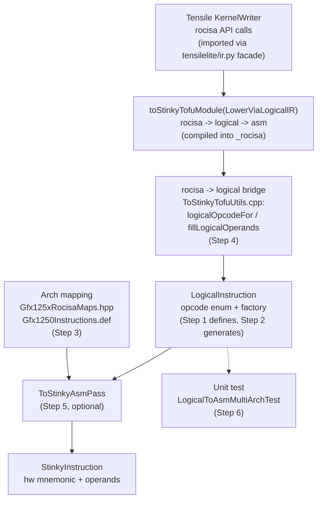

# Adding a New Instruction to the Logical IR Path

This guide explains how to fully integrate a new instruction into the stinkytofu logical IR path. Use this when:

- A new ISA introduces a hardware instruction that needs logical IR representation
- An existing rocisa instruction has no matching logical opcode yet, so the rocisa->logical bridge throws `no logical opcode for rocisa::XXX`

## Architecture Overview

KernelWriter builds **rocisa** instructions (imported through the `tensilelite/ir.py` facade).
`toStinkyTofuModule` — compiled into `_rocisa` — walks that rocisa tree and converts each
instruction into a `LogicalInstruction` in C++ (the **rocisa->logical bridge**), then the logical
module is lowered to asm IR. There is **no Python adaptor**: the former
`rocisa_stinkytofu_adaptor` shim and the `ROCISA_BACKEND` env switch were removed.



> **Direct logical build (future):** `tensilelite/ir.py` is the import facade through which
> KernelWriter will eventually build logical instructions directly (via the Step 2 Python
> binding) instead of rocisa. Until that migration flips for an instruction, the rocisa->logical
> bridge (Step 4) is the live path.

## Files at a Glance

| Step | File | Action |
|------|------|--------|
| 1 | `stinkytofu/src/ir/logical/LogicalInstructionDefs.inc` | Add IRInstDef entry |
| 2 | (build-time auto-generated, no manual edit) | Verify build succeeds |
| 3a | `stinkytofu/hardware/src/gfx/common/Gfx125xRocisaMaps.hpp` | Add logical-to-mnemonic mapping |
| 3b | `stinkytofu/hardware/src/gfx/Gfx1250/Gfx1250Instructions.def` | Add `.logical` reverse mapping |
| 3b' | `stinkytofu/hardware/src/gfx/Gfx1250v0/Gfx1250v0Instructions.def` | Same as 3b (if this arch variant also supports it) |
| 4 | `stinkytofu/src/conversion/rocisa/ToStinkyTofuUtils.cpp` | Bridge rocisa->logical: usually automatic by name; add a `logicalOpcodeFor` case / operand handling only if needed |
| 5 | `stinkytofu/src/transforms/logical/ToStinkyAsmPass.cpp` | (Optional) Special lowering logic |
| 6 | `stinkytofu/tests/unit/logical/LogicalToAsmMultiArchTest.cpp` | Add test case |

---

## Step 1: Define the Logical IR Instruction

**File**: `stinkytofu/src/ir/logical/LogicalInstructionDefs.inc`

Add a new `IRInstDef` entry. The nine fields in order are:

```
1. className    — C++ class name / opcode name (e.g. "VAdd3U32")
2. comment      — Instruction description (usually same as className)
3. numSrcs      — Number of source operands
4. hasDest      — Whether it has a destination register (bool)
5. category     — Instruction category string
6. supportsDPP  — Whether it supports DPP modifiers (bool)
7. supportsSDWA — Whether it supports SDWA modifiers (bool)
8. hasDS        — Whether it has DS (LDS) modifiers (bool)
9. flags        — Instruction flags, joined with "|"
```

### Example: Ternary vector ALU instruction

```cpp
{"VAdd3U32",
 "VAdd3U32",
 3,          // numSrcs: src0, src1, src2
 true,       // hasDest
 "Vector Arithmetic",
 true,       // supportsDPP
 true,       // supportsSDWA
 false,      // hasDS
 "IF_Commutative|IF_VALU"},
```

### Example: DS load instruction

```cpp
{"DSLoadB64",
 "DSLoadB64",
 1,          // numSrcs: address only
 true,       // hasDest
 "Memory LDS",
 false,      // no DPP
 false,      // no SDWA
 false,      // hasDS (DS offset set via set_ds())
 "IF_DSRead"},
```

### Common Flags Reference

| Flag | Meaning |
|------|---------|
| `IF_VALU` | Vector ALU |
| `IF_SALU` | Scalar ALU |
| `IF_Commutative` | Operands are commutative |
| `IF_DSRead` | DS (LDS) read |
| `IF_DSWrite` | DS (LDS) write |
| `IF_BufferRead` | Buffer (MUBUF) read |
| `IF_BufferWrite` | Buffer (MUBUF) write |
| `IF_FlatRead` | Flat read |
| `IF_FlatWrite` | Flat write |
| `IF_GlobalRead` | Global read |
| `IF_GlobalWrite` | Global write |
| `IF_Branch` | Branch instruction |

### Important: numSrcs Must Be Correct

`numSrcs` determines how many source operand parameters the tablegen-generated factory function accepts, and how many sources the rocisa->logical bridge copies. If set incorrectly, operands are dropped or the factory is called with the wrong number of arguments and fails at runtime.

---

## Step 2: Verify Auto-Generated Artifacts (No Manual Edit)

When building stinkytofu, `tools/tablegen/GenLogicalIR.cpp` reads `LogicalInstructionDefs.inc` and auto-generates three files:

1. **`LogicalOpcodes_generated.inc`** — enum values (e.g. `VAdd3U32 = 10`)
2. **`LogicalInstructions_generated.hpp`** — C++ factory functions
3. **`PythonBindings_generated.inc`** — nanobind Python bindings (used by the direct-build path and tests)

The factory function signature is derived automatically from the `.inc` fields:

- `numSrcs` -> number of source parameters
- `hasDest` -> whether a dest parameter exists
- `supportsDPP` -> whether an `std::optional<DPPModifiers> dpp` parameter is included
- `supportsSDWA` -> whether an `std::optional<SDWAModifiers> sdwa` parameter is included

For example, `VAdd3U32` (numSrcs=3, hasDest=true, DPP=true, SDWA=true) generates:

```cpp
inline LogicalInstruction* VAdd3U32(
    const StinkyRegister& dst,
    const StinkyRegister& src0,
    const StinkyRegister& src1,
    const StinkyRegister& src2,
    std::optional<DPPModifiers> dpp = std::nullopt,
    std::optional<SDWAModifiers> sdwa = std::nullopt,
    const std::string& comment = "");
```

The corresponding Python binding:

```python
stinkytofu.VAdd3U32(dest, src0, src1, src2, dpp=None, sdwa=None, comment="")
```

> **Verification**: After build completes, confirm the three `_generated` files exist under `build/` with no tablegen errors.

---

## Step 3: Architecture Mapping

You need to tell stinkytofu which hardware mnemonic this logical opcode maps to on a specific architecture. This requires two places:

### 3a. Rocisa Mapping Table

**File**: `stinkytofu/hardware/src/gfx/common/Gfx125xRocisaMaps.hpp`

Add a `{logical_name, hw_mnemonic}` pair in the map literal:

```cpp
{"VAdd3U32", "v_add3_u32"},
```

This table is used by `ToStinkyAsmPass` to look up the hardware mnemonic from the logical name.

### 3b. Hardware Instruction Definition

**File**: `stinkytofu/hardware/src/gfx/Gfx1250/Gfx1250Instructions.def`
(and `Gfx1250v0/Gfx1250v0Instructions.def` for variants)

Add a `.logical` reverse mapping in the appropriate `DEF_BATCH` block:

```cpp
DEF_BATCH(.format = VOP3_COMMUTATIVE,
    VAdd3U32Inst, "v_add3_u32", .logical = "VAdd3U32",
    // ... other instructions with the same format ...
```

`.def` files group instructions by encoding format using `DEF_BATCH` macros. Each instruction entry has three parts:
- **InstName** — C++ hardware instruction ID (convention: `<LogicalName>Inst`)
- **mnemonic** — assembly mnemonic (`"v_add3_u32"`)
- **.logical** — reverse pointer to the logical opcode name

At build time, `GenLogicalToAsmMapping.cpp` reads all `.def` files to generate `LogicalToAsmMappings_generated.inc`.

---

## Step 4: Bridge rocisa → Logical IR (C++)

**File**: `stinkytofu/src/conversion/rocisa/ToStinkyTofuUtils.cpp`

KernelWriter builds rocisa instructions; `toStinkyTofuModule` walks that tree and converts each
rocisa instruction into a `LogicalInstruction` via `createLogicalFromRocisa`. This bridge is
entirely in C++ — there is **no Python adaptor** anymore.

For most instructions, **nothing to do**. `logicalOpcodeFor()` falls through to
`logical::parseOpcode(className)`, which matches the rocisa class name to the logical opcode of
the same name. So if your rocisa class is `VAdd3U32` and you defined logical opcode `VAdd3U32` in
Step 1, it bridges automatically.

Add a special case in `logicalOpcodeFor()` **only** when:
- **Name differs** between rocisa class and logical opcode (e.g. rocisa `SSchedulingFence` -> logical `SchedulingFence`), or
- **Family dispatch by C++ type** (e.g. `MFMAInstruction` / `SMFMAInstruction` / `MXMFMAInstruction`, or the `SWaitCnt` family).

```cpp
// in logicalOpcodeFor(const rocisa::Instruction& inst, const std::string& className)
if (dynamic_cast<const rocisa::SSchedulingFence*>(&inst)) {
    return logical::SchedulingFence;
}
// ...
return logical::parseOpcode(className.c_str());   // default: match by name
```

Operands and modifiers are copied automatically by `fillLogicalOperands()` (dst / srcs) and
`applyLogicalPayload()` (VOP3P / SDWA / DPP / True16 / DS / FLAT / MUBUF / SMEM / memtoken,
dispatched by rocisa type). Add a branch there only if the instruction carries an unusual modifier
not already handled by its category.

---

## Step 5: Special Lowering (Optional)

**File**: `stinkytofu/src/transforms/logical/ToStinkyAsmPass.cpp`

Most instruction lowering (logical -> asm IR) follows the generic path: look up the arch mapping for the mnemonic, copy operands and modifiers. However, the following cases require special handling:

### When Special Handling Is Needed

1. **Instruction splitting** — e.g. `VCmpX` on architectures that don't support `v_cmpx` must be split into `v_cmp` + `s_mov_exec`
2. **Implicit operands** — e.g. automatically inserting VCC carry operands
3. **Special metadata** — e.g. MFMA's `MFMAData` (type, m, n, k, etc.) needs to be converted to asm IR modifiers
4. **Conditional mnemonic selection** — e.g. choosing different hw instructions based on data type

### When Special Handling Is NOT Needed

Most ALU, compare, and branch instructions only need to exist in the arch mapping table. The generic path in `ToStinkyAsmPass` handles them automatically.

---

## Step 6: Testing

**File**: `stinkytofu/tests/unit/logical/LogicalToAsmMultiArchTest.cpp`

### 6a. Add a Factory Switch Case

In the `createInstruction` function, add a case:

```cpp
case logical::VAdd3U32:
    return VAdd3U32(vgpr(0), vgpr(1), vgpr(2), vgpr(3));
```

The number of arguments = hasDest(1) + numSrcs. Choose vgpr/sgpr based on instruction category.

### 6b. Add to SKIP_LOWERING (if Step 3 was skipped)

If the instruction has **no arch mapping** (Step 3 was skipped — no entry in `Gfx125xRocisaMaps.hpp` or `Gfx1250Instructions.def`), you **must** add its opcode to the `SKIP_LOWERING` set inside `AllInstructionsAllArchitectures`:

```cpp
std::set<logical::Opcode> SKIP_LOWERING = {
    // ...existing entries...
    logical::VAdd3U32,  // no gfx1250 arch mapping yet
};
```

Without this, the comprehensive test attempts to lower every opcode on every architecture. An opcode with no arch mapping will hit an `UNREACHABLE` in `ToStinkyAsmPass` and **abort the entire test binary** (not just fail one case).

### 6c. (Optional) Add Exact Mnemonic Verification

Add an entry in `EXPECTED_LOWERING_GFX1250` (or the corresponding architecture map):

```cpp
{logical::VAdd3U32, "v_add3_u32"},
```

Instructions not listed in this table are still tested (lowering success counts as a pass), but the generated mnemonic is not verified. Adding entries here is recommended for important instructions.

---

## Full Checklist

When adding instruction `XXX`, verify each item:

- [ ] Added `{"XXX", ...}` entry in `LogicalInstructionDefs.inc` with correct numSrcs
- [ ] Built stinkytofu with no tablegen errors
- [ ] Added `{"XXX", "hw_mnemonic"}` in `Gfx125xRocisaMaps.hpp`
- [ ] Added `.logical = "XXX"` entry in `Gfx1250Instructions.def`
- [ ] Same for `Gfx1250v0Instructions.def` (if the variant also supports it)
- [ ] rocisa->logical bridge resolves: either the rocisa class name matches `XXX` (automatic via `parseOpcode`), or a `logicalOpcodeFor` case was added in `ToStinkyTofuUtils.cpp`
- [ ] (If unusual modifiers) handled in `fillLogicalOperands` / `applyLogicalPayload`
- [ ] (If Step 3 skipped) Added opcode to `SKIP_LOWERING` in `LogicalToAsmMultiArchTest.cpp`
- [ ] (If needed) Added special lowering logic in `ToStinkyAsmPass.cpp`
- [ ] Added switch case in `LogicalToAsmMultiArchTest.cpp`
- [ ] Full build + `ctest --test-dir build -R LogicalToAsm`
- [ ] End-to-end verification with a YAML test (KernelWriter -> toStinkyTofuModule(LowerViaLogicalIR) -> logical IR -> asm)

## Common Errors

| Symptom | Cause |
|---------|-------|
| `no logical opcode for rocisa::XXX` | rocisa class name has no matching logical opcode: define it in `.inc` (Step 1) with the same name, or add a `logicalOpcodeFor` case (Step 4) |
| `too few operands for instruction` | `numSrcs` set too low; factory/bridge receives insufficient arguments |
| `no mapping for arch` | Missing entry in `Gfx125xRocisaMaps.hpp` or `.def` file |
| `AttributeError: module 'stinkytofu' has no attribute 'XXX'` | stinkytofu Python binding not reinstalled after build (direct-build / test path) |
| `AllInstructionsAllArchitectures` aborts (Subprocess aborted) | Opcode has no arch mapping but is not in `SKIP_LOWERING`; lowering hits UNREACHABLE |
