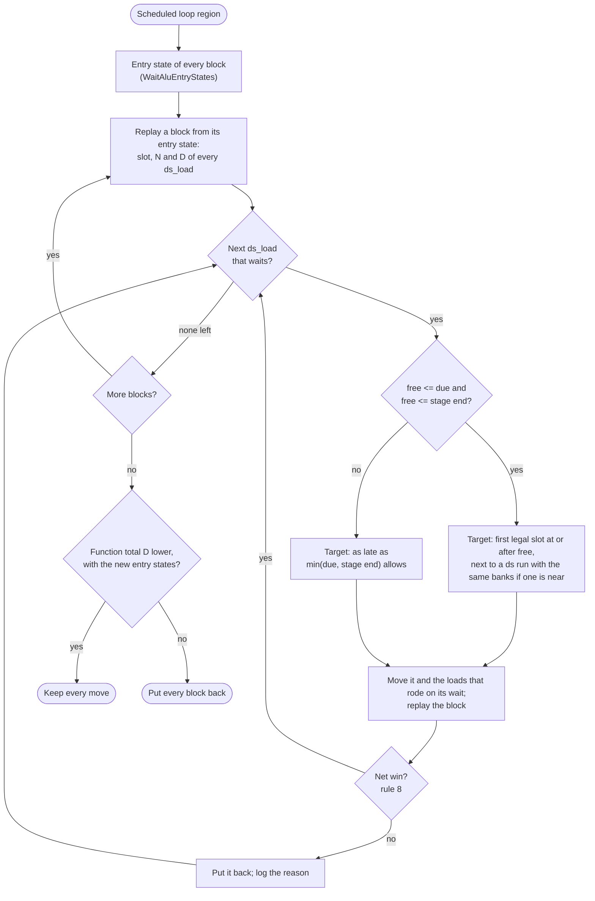
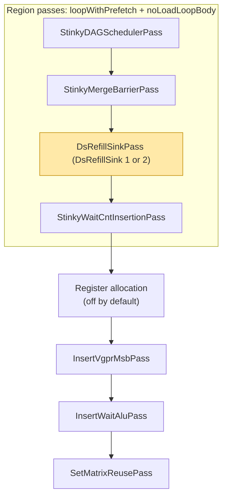

# Refill placement: `va_vdst` waits in front of ds_loads (gfx1250)

Status: implemented, opt-in. Two module options, both off by default: `DsRefillSink` (the region
pass) and `DsRefillGate` (the DAG's WAR gate). Builds on
[Scoreboard-driven filler placement](waitalu-placement.md) and
[DAG placement of prefetches and wait-prone fillers](dag-wait-and-prefetch-placement.md).

## Summary

In the gfx1250 main loop many `s_wait_alu depctr_va_vdst(N)` sit in front of a `ds_load` that
refills a WMMA operand register too soon after the last WMMA that read it. Each refill has a
window. It needs no wait once H WMMAs have issued after that read, and its data is on time if it
issues L WMMAs before the WMMA that reads the new value. This design puts every refill inside its
window by moving the ds_load later. WMMAs never move.

Two mechanisms do it. With `DsRefillGate`, the DAG scheduler's WAR gate holds each refill until its
window opens. `DsRefillSinkPass`, a region pass right after the DAG scheduler, moves the refills
that still wait and reports the rest (`DsRefillSink`: 1 reports, 2 moves). On the f8 TN kernel of
`f8_tn_maf_finetune.yaml` the main loop has 6 refill waits; the pass removes all 6, and the gate
removes the 4 it can see. The WMMA order is the same in every build. Neither option has been timed
yet.

## The wait

`s_wait_alu depctr_va_vdst(N)` holds the next instruction until at most N VALU or WMMA ops are
still in flight. `InsertWaitAluPass` puts one in front of a non-VALU instruction C that touches a
VGPR that a recent VALU or WMMA op P also touched:

| Pair | P | C | Typical case |
| --- | --- | --- | --- |
| RAW | writes v | reads v | A VALU computes a ds or prefetch address. |
| WAW | writes v | writes v | Rare. |
| WAR | reads v | writes v | A ds_load refills a WMMA operand. It is tracked because `EnableESM2TrackValuVsrc` is on for every kernel. |

N is the number of VA ops issued after P. The wait goes away once H WMMAs have issued after P,
where H is P's hide distance. `HWModel::WaitHide` (`src/hardware/HWModel.cpp`) gives H per WMMA
form: 12 for `v_wmma_f32_16x16x128_fp8_fp8` (latency 8, 8 destination VGPRs), and 11 or 13 for
other forms. The deficit D is how many more WMMAs must issue before C may go. N also counts VALU
ops, which do not hide the wait, so D = H - N only when nothing but WMMAs issued in between. The
wave issues nothing while it waits. The WMMAs already queued keep the matrix pipe busy, so D is an
upper bound on lost WMMA slots, not a cycle count.

An example from the kernel below. Wn is the n-th WMMA of the loop iteration, counting from 0.
Register numbers are physical. The assembly prints them with the bank bias, so
`v[vgprValuB_X1_I0-768]` is v838 in VGPR bank 3.

```text
W120   v_wmma ... B = v[838:853]          last read of B buffer 1, unit 0
W121-W127
       s_cbranch_scc1 label_LoopEndL       mid-loop exit: a block boundary
W128
       s_wait_alu depctr_va_vdst(8)        8 WMMAs since W120; 12 hide it, so D = 4
       ds_load_b128 v[838:841] offset:128  refills B buffer 1, unit 0
```

## What the main loop has

These counts cover one iteration of the main loop (384 WMMAs, three blocks of 128 split by two
mid-loop exits) of the 256x256x256 f8 TN kernel from `f8_tn_maf_finetune.yaml`
(`ScheduleIterAlg: 4`), counted from its assembly:

| | |
| --- | --- |
| `s_wait_alu depctr_va_vdst` waits | 9 |
| A ds_load refilling a WMMA operand (WAR), first after a mid-loop exit | 4 |
| A ds_load refilling a WMMA operand, at the top of the loop, waiting on the previous iteration | 2 |
| A GL2 prefetch whose address a VALU computes (RAW) | 3 |
| N | 8 and 10 for the refills, 3 of each; 14 for the prefetches |
| Total D of the refills | 18 WMMA slots |
| Refill windows (L = 5) | All 6 open; each spans 54 WMMAs from free to due |

The pass's report (`DsRefillSink: 1`) gives the same 9 waits and finds all 6 refills movable. It
counts each prefetch wait as 1 WMMA short too, 21 in total, because a VALU producer has its own
hide distance.

## Why the scheduler leaves them

The DAG already holds back a ds_load that overwrites a register a WMMA read. The hazard rule
`WmmaVgprSrcToDsWrite` is kept in `pipeOpGates_` of `CDNA5ReadyQueue`
(`src/transforms/asm/dag/CDNA5.hpp`), and the gate opens after `pipeOpDistance_` WMMAs. Four things
let refills through early:

1. **Two distances.** The gate's distance is `deriveWarGateWmmas`, WMMA latency / issue cycles =
   8 / 1 = 8. `InsertWaitAluPass` only hides the pair at 12. A refill released the moment the gate
   opens lands at N = 8 and waits for 4 more WMMAs. The kernel above has no refill in its reader's
   block, so this cause does not show there; `dag_mode2_war_gate.stir` shows it.
2. **The gate forgets at a block boundary.** `pipeOpGates_` and `carriedWar_` are cleared when a
   block starts. When the DAG runs, the two mid-loop exits (`s_cbranch_scc1 label_LoopEndL`) split
   the loop body into three blocks; the cluster-barrier branches come later. A refill after an exit
   never sees a reader before it. That is 4 of the 6 refills here, one of them the example.
3. **The gate is lifted without weighing the cost.** `warGateRelieved` releases a gated load whenever
   DsSpread is behind its even line, and once the region's last WMMA has issued. It does not
   compare the wait this creates with the LDS time it saves. With the gate carried across the exits
   but this relief unchanged, 2 of those 4 refills still go early, at N = 11.
4. **The scoreboard starts each block empty.** The DAG's `WaitAluTracker` does not see producers
   from the previous block or iteration, which covers the 2 refills at the top of the loop. A
   tracker built from `WaitAluEntryStates` starts from `InsertWaitAluPass`'s entry state of the
   block; the pass uses one, the DAG does not.

Each of these is a disagreement with `InsertWaitAluPass`, which counts VA ops across blocks and
back edges. Rule 1 of [waitalu-placement.md](waitalu-placement.md) already makes the scoreboard
the only source of truth for waits; the WAR gate derived its distance from cycles. `DsRefillGate`
fixes the first three in the DAG (see [Fixing it in the DAG](#fixing-it-in-the-dag)).

## The refill window

For a ds_load d that overwrites registers a VA op read or wrote:

- **slot(x)** is the number of WMMAs issued before x. The examples count from the start of the
  loop iteration; the pass counts from the start of each block, and the DAG from the start of its
  region.
- **free(d) = slot(P) + 1 + H** is the first slot at which d needs no wait. P is the youngest VA
  op that touches d's registers, and H is its hide distance. The scoreboard gives it directly as
  slot(d) + `WaitAluTracker::untilFree(d, Wmma)`.
- **due(d) = slot(U) - L** is the last slot at which d's data is back in time. U is the first WMMA
  that reads d's destination. L is the LDS return time in WMMAs, computed the way the DAG's barrier
  thresholds compute it: `latencyBudgetWmmas(drain latency, WMMA latency)` in `dag/WmmaBudget.hpp`.
  The yaml above sets `DsReadDrainLatency` to 32 cycles, so L = 32 / 8 + 1 = 5. If no WMMA of the
  block reads d's destination, due is open (`-` in the report) and only the stage end bounds d.
- **stage end(d)** is the next pinned line or barrier after d (rule 4). In front of a barrier it is
  the last other ds_load before that barrier.
- **D(d) = max(0, free(d) - slot(d))** is the deficit.

```text
             free = P + 1 + H                              due = U - L
                    |<--------------- window --------------->|
   ... P ...... d ..|.........................................|...... U ...
       last read    now: N = 8, D = 4                             first read of the new data
```

d belongs anywhere in [free, due]. If it issues before free, it waits on `va_vdst`. If it issues
after due, its WMMA waits on `s_wait_dscnt`.

## Rules

1. **One model.** free comes from `InsertWaitAluPass`'s scoreboard: `WaitAluTracker::untilFree`,
   seeded by `WaitAluEntryStates`. The DAG's gate distance comes from the hide table that scoreboard
   reads, through `HWModel::WaitHide::formFor`. due comes from the same LDS numbers as the barrier
   thresholds (`latencyBudgetWmmas`). There is no new cycle formula and no second hide table.
2. **WMMAs are the clock.** WMMAs never move. Operand reuse within each group of WMMAs that share a
   source, VGPR banks, accumulator chains and barrier thresholds are all planned on the WMMA order.
   A wait is fixed by moving the ds_load to a different slot on that clock.
3. **Later, and only as far as needed.** A refill only moves later: to the first slot of its
   window, or a little further inside the window when rule 6 asks for it. Moving it earlier can
   only lower N.
4. **Stay in the stage.** A refill never crosses a pinned line or a barrier: a barrier signal or
   wait, even one the dependency export does not pin, a branch or label, an `s_wait_*`, an LDS
   write, a side effect, or an EXEC write. A refill never moves past the last other ds_load before
   a barrier, because that barrier's threshold is counted from it, and a refill that is that last
   ds_load stays.
5. **Move the whole refill.** The ds_loads that ride on a refill's wait move with it and keep their
   order; left behind, they would need a wait of their own. The pass finds them by trying the move:
   a load whose wait the move uncovers joins the group, and the group is planned again.
6. **Join a run.** Inside the window, prefer a slot next to an existing ds_load with the same
   register banks, within DsSpread's batch (`DsBatchWmmas`) of free, so `InsertVgprMsbPass` needs no
   new `s_set_vgpr_msb`. Never put more ds_loads between two WMMAs than the fullest such gap the DAG
   left in the block.
7. **Data on time beats no wait.** If the window is empty, or the stage ends before free, place
   the refill as late as min(due, stage end) allows and report it. Its wait gets weaker but does
   not go away. A late ds_load stops the WMMA that needs its data. A short `va_vdst` wait only stops
   issue while the queued WMMAs keep running.
8. **Net win or no move.** Keep a move only if replaying the block shows a lower total D, no new
   wait that no WMMA count hides, and no stricter `vm_vsrc` wait anywhere. Once every block is
   done, the pass replays the function with the new entry states and puts every block back unless
   the total D dropped.

A move is legal under the same dependency model the IR checkpoint editor uses
(`renderCheckpointRegion` and `exportRegionDependencies`): register RAW, WAR and WAW, SCC, VCC
and EXEC, and LDS tokens. Any move the pass makes is one the editor would accept, and any move the
pass refuses is a drag the editor would refuse.

## ds_load or WMMA

| Lever | What it changes | Cost | Who does it |
| --- | --- | --- | --- |
| Sink the refill ds_load | slot(d) moves up to free | The LDS lead shrinks by D, bounded by due | The pass, and the DAG with `DsRefillGate` |
| Hoist the WMMA that reads last | free moves earlier | The WMMA leaves its reuse group and its accumulator update moves | Not done; the WMMA order knobs `WmmaInnerOrder` and `WmmaOuterOrder` cover it |
| One more register buffer | The next refill of that buffer comes a whole buffer later | VGPRs | `VgprAllocA` / `VgprAllocB` |

In the example, B unit 0 is read by W120, the first of the eight WMMAs (W120 to W127) that share
their A operand. Releasing it earlier means taking W120 out of that group, which gives up the
group's operand reuse. Sinking the refill only uses LDS lead the load has to spare: 59 WMMAs here.

## The pass

`DsRefillSinkPass` runs on each block of the loop region:



- **Seed.** `WaitAluEntryStates` runs `InsertWaitAluPass`'s fixed point over the CFG, merging each
  block's predecessors and the loop back edge, and `WaitAluTracker(states, bb)` starts from the
  result.
- **Scan every ds_load,** not only the ones with an `s_wait_alu` in front. A refill's second and
  later loads are free of waits only because they ride on the first one's wait.
- **One line per waiting ds_load** under `StinkyTofuDebugPass: "DsRefillSinkPass"`: the slot, N, D,
  the window, the stage end, the target and why, and what came of the move. For the example (the
  block `label_LoopBeginL_1` starts at W128):

  ```text
  [DsRefillSink] bb="label_LoopBeginL_1" slot 1 ds_load_b128 v[838:841] N=8 D=4 window=[5,59] stage-end=44 -> slot 5 (wait hidden), moved 4 loads
  ```

  A load that stays gives the reason instead, for example `stays (its stage ends)`, or
  `kept: a stricter vm_vsrc wait before v_xor_b32 (none -> 6)`. Each block ends with its waits and
  D before and after, and the function with its totals and whether the moves were kept. In report
  mode the lines stop at the plan, and each block ends with
  `va_vdst waits=.. deficit=.. unhideable=.. ds_load waits=.. movable=..`.

Each kept move lowers the block's total D, a non-negative integer, and a group is planned again at
most 8 times, so the pass always ends.

## Where it runs



The pass is in the region pass list of `loopWithPrefetch + noLoadLoopBody`, at the end of the
scheduler block of `addGfx1250RegionPasses` (right after `StinkyMergeBarrierPass`), before
`StinkyWaitCntInsertionPass`. It is added only with `EnableESM2`. Without ESM2, `InsertWaitAluPass`
does not run, so there is no `va_vdst` wait to avoid.

- **After the DAG:** the DAG's decisions (WMMA order, barriers, ds pacing) are inputs. The pass
  only adjusts refills.
- **Before `StinkyWaitCntInsertionPass`:** `s_wait_dscnt` and `s_wait_tensorcnt` are computed on
  the new order, and they are not yet in the way as pinned lines.
- **Before `InsertVgprMsbPass`, `InsertWaitAluPass` and `SetMatrixReusePass`:** all three run on the
  final order, so nothing has to be patched afterwards.
- **Same region and CFG as the DAG,** including the back edge that seeding the top of the loop
  needs.

It does not go after `InsertWaitAluPass`, because the pass would then have to remove and redo the
`s_wait_alu`, `s_wait_dscnt` and `s_set_vgpr_msb` that three other passes placed. It does not go
before the DAG, because the DAG would place the loads again.

Caveats:

- **Register allocation.** `StinkyTofuRegisterAllocation` 2 or 3 renames VGPRs after the region
  passes, and that can change WAR pairs. The default is 0. When allocation is applied, the pass
  would have to run after it instead, where rule 4 also keeps it off the `s_wait_dscnt` already
  inserted.
- **IR checkpoints.** The pass runs after `StinkyMergeBarrierPass`, so a bundle dumped there shows
  the order before the pass, and an edit loaded there goes through the pass too. To hand-edit the
  order the hardware runs, set the checkpoint after the pass
  (`loopWithPrefetch+noLoadLoopBody:DsRefillSinkPass`), or turn the pass off.
- **Switches.** The module option `DsRefillSink` (0 off, 1 report, 2 sink) in
  `StinkyTofuParameters`; `--DsRefillSinkPass` or `--DsRefillSinkPass=report` in `stinkytofu-opt`;
  the log under `StinkyTofuDebugPass: "DsRefillSinkPass"`.

## Fixing it in the DAG

The pass repairs what the DAG leaves behind. `DsRefillGate` (`--ds-refill-gate` in
`stinkytofu-opt`) puts the same window into the DAG's WAR gate, so that refills are placed right
the first time. It takes the first three causes above in turn:

1. **Gate distance from the hide table.** When `WarGateWmmas` is left to be derived, the distance of
   `WmmaVgprSrcToDsWrite` is the WMMA's `xdlVaVdst` from `HWModel::WaitHide::formFor` (12 for the f8
   WMMA), not latency / issue (8). `InsertWaitAluPass` looks up the same row. The barrier
   thresholds count from this distance (`wmmaToDsWarGate`), so barriers can move with it.
   `WarGateWmmas: 12` in the yaml sets the same distance by hand.
2. **Carry the gate across blocks.** When a block is done, `onFinishBB` records how many WMMAs each
   open gate still needs (`BBScheduleState::pipeOpGatesLeft`), and a successor scheduled after it
   starts with those gates. Only forward edges carry it: the top of the loop still starts empty,
   which leaves the refills that wait on the previous iteration to the pass.
3. **Lift the gate only when the data is due.** When DsSpread is behind its even line, a gated
   refill goes early only if holding it until its gate opens would issue it less than L WMMAs
   before the first WMMA of the region that reads its data. A refill that no WMMA of the region
   reads waits for its gate, or for the region's last WMMA.

With all three, the pass finds only the 2 refills at the top of the loop, and moving 7 loads
removes their waits.

## Results

The main loop of the same kernel, one build per row, counted from the assembly. The partial
`DsRefillGate` row is its second commit. Total D counts the refill waits.

| Build | Loop `va_vdst` waits | N | Total D |
| --- | --- | --- | --- |
| Baseline | 9: 6 refills, 3 prefetches | 8, 10, 14; 3 of each | 18 |
| `WarGateWmmas: 12`, no code change | 9, the baseline's kernel | 8, 10, 14 | 18 |
| `DsRefillSink: 1` (report; the assembly is the baseline's) | 9 | 8, 10, 14 | 18 |
| `DsRefillSink: 2` | 3, the prefetches | 14 | 0 |
| `DsRefillGate`, distance and carry | 7: 2 refills at the loop top, 2 after an exit, 3 prefetches | 8, 10, 11, 11, 14 | 8 |
| `DsRefillGate` | 5: 2 refills at the loop top, 3 prefetches | 8, 10, 14 | 6 |
| `DsRefillGate` and `DsRefillSink: 2` | 3, the prefetches | 14 | 0 |

- **WMMA order and barriers.** The same in every build. This kernel has no refill in its reader's
  block, so the gate's distance never decides a barrier threshold here.
- **The pass alone** moves all 6 refills (21 loads), each to the first slot of its window.
- **LDS waits.** The loop has 42 `s_wait_dscnt` in every build, the same 3 at count 4 or below, with
  a mean count from 44 to 47. Holding refills later does not show up as stricter LDS waits.
- **Time.** Not measured yet. Both options stay off by default until an A/B on the gfx1250 perf
  yamls shows a gain.

## Worked example

The refill of B buffer 1, unit 0, is four `ds_load_b128` (offsets 128 to 224, v[838:853]):

| | |
| --- | --- |
| Last reader P | W120 |
| Now | Four loads at slot 129 (N = 8, D = 4); the first carries the wait and the other three ride on it |
| free | 120 + 1 + 12 = 133 |
| First reader of the new data U | W192 |
| due | 192 - 5 = 187 |
| Pinned lines between slot 129 and 133 | None; the `s_cbranch_scc1` is at slot 128, before the refill |
| Target | Slot 133, the first slot of the window (rule 3) |

The pass with `DsRefillSink: 2`, fillers and `s_set_vgpr_msb` left out; `s_wait_dscnt` is inserted
after the pass:

```text
before                                        after
W120  v_wmma ... reads v[838:853]             W120  v_wmma ... reads v[838:853]
W121-W127                                     W121-W127
s_cbranch_scc1 label_LoopEndL                 s_cbranch_scc1 label_LoopEndL
W128                                          W128
s_wait_alu depctr_va_vdst(8)
ds_load_b128 v[838:841] offset:128
ds_load_b128 v[842:845] offset:160
ds_load_b128 v[846:849] offset:192
ds_load_b128 v[850:853] offset:224
ds_load_b128 x2 (A)                           ds_load_b128 x2 (A)
W129-W131                                     W129-W131
ds_load_b128 x2 (A)                           ds_load_b128 x2 (A)
s_wait_alu depctr_va_vdst(10)
ds_load_b128 x3 (B, unit 1)
W132                                          W132
                                              ds_load_b128 v[838:841] offset:128
                                              ds_load_b128 v[842:845] offset:160
                                              ds_load_b128 v[846:849] offset:192
                                              ds_load_b128 v[850:853] offset:224
W133                                          W133
                                              ds_load_b128 x3 (B, unit 1)
W134                                          W134
```

After the move, 12 WMMAs separate the unit's last read from its first refill load, so it needs no
`s_wait_alu`, and the load still has a lead of 59 WMMAs to W192. Unit 1, last read by W121, moves
the same way one WMMA later.

## Tests

In `tests/filecheck/` unless noted:

- `ds_refill_sink_report.stir` (report mode): a wait hidden at the first slot of the window, a
  weaker wait when the data is due first, the last ds_load before a barrier, and a reader in the
  block before a loop exit.
- `ds_refill_sink.stir` (sink mode, checked through the waits `InsertWaitAluPass` then emits): the
  wait disappears, the loads that ride on it move with it in order, the refill joins a ds run, it
  stops at the last ds_load before a barrier, that last ds_load stays, the refill takes a weaker
  wait when its data is due, and a read in the previous block is seen.
- `dag_mode2_war_gate_hide_table.stir`, `dag_mode2_war_gate_carry.stir` and
  `dag_mode2_war_gate_relief_due.stir` (`--ds-refill-gate`): the hide-table distance, the gate
  carried into the next block, and the relief that waits until the data is due.
- `WaitAluTrackerTest.SeededTrackerSeesTheBackEdge` (unit test): a tracker built from
  `WaitAluEntryStates` sees a producer across the back edge and agrees with the wait
  `InsertWaitAluPass` emits.

## Open

- **Time.** Both options need an A/B on the gfx1250 perf yamls before they can be on by default.
- **L.** L follows `DsReadDrainLatency`: 5 WMMAs for the 32 cycles of the yaml above, and 17 for
  128. The load's own latency (56 cycles) would give 8. Every window above is open under any of
  them.
- **The WAR hide.** The WAR stamp waits for the reading WMMA to complete, not for its sources to
  be read; the comment on `deriveWarGateWmmas` says so. If the hardware reads sources earlier, H for
  WAR pairs could be smaller than 12. That would be a change to `HWModel::WaitHide`, and rule 1
  makes this policy follow it.
- **The back edge in the DAG.** The gate carries across forward edges only, so the refills at the
  top of the loop are left to the pass.
- **The LDS address flip.** A refill whose move would make the `v_xor_b32` that flips the LDS read
  address wait on `vm_vsrc` stays where it is (rule 8). Moving the flip with it would free it.
- **Other consumers.** VMEM loads, prefetches and tensor_loads have the same window with a
  different due (the prefetch lead or the tensor_load window). A RAW pair with a VALU producer is
  fixed by moving the producer earlier, which the DAG already does (`needByWindow_`). The 3
  prefetch waits left in the kernel above are of this kind.
