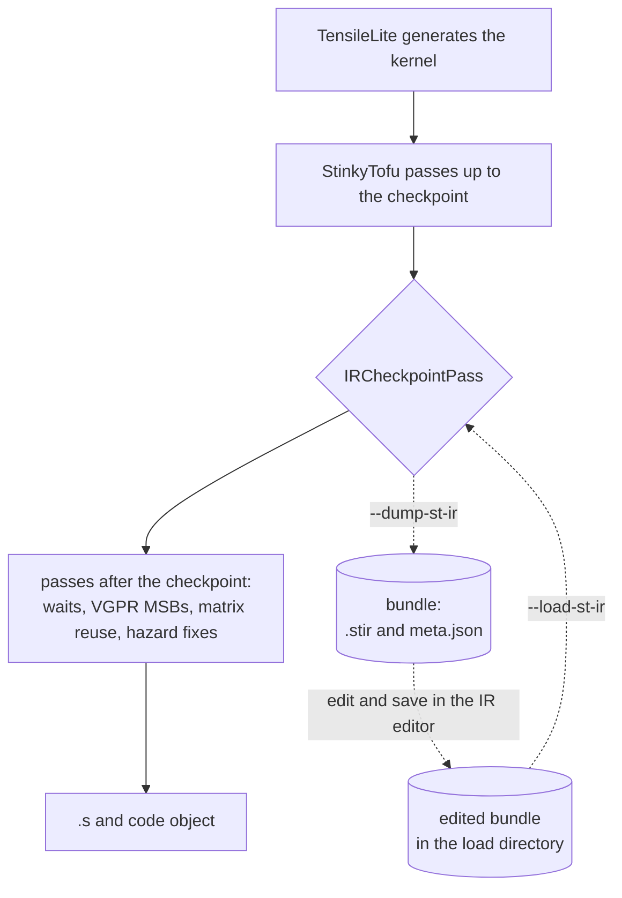
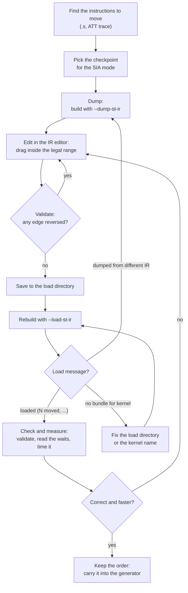

# IR checkpoints: dump, edit and reload a kernel region

An IR checkpoint stops a kernel's StinkyTofu pipeline after a named pass, writes the region's IR
to a bundle, and lets a later build put an edited copy back at the same point. The passes after
the checkpoint then run on the edited IR as if they had produced it, so the waits, VGPR MSB
instructions, matrix reuse and hazard fixes an edit invalidates are all derived again.

The typical use is hand-scheduling: dump the main loop after the dependency passes, reorder
instructions in the [IR editor](../../tools/stinkytofu-ir-editor/README.md), and rebuild
the kernel with the new order.



Both builds run the same passes. In a dump build the checkpoint writes the bundle and leaves the
IR alone. In a load build it replaces the region with the edited bundle, and the passes after it
derive everything else from the new order.

## Quick start (TensileLite)

```bash
# 1. Dump: one bundle per kernel, after the DAG scheduler of a ScheduleIterAlg: 4 kernel.
Tensile.sh config.yaml out.dump --build-only --dump-st-ir /tmp/ir/bundles \
    --st-ir-checkpoint loopWithPrefetch+noLoadLoopBody:StinkyMergeBarrierPass

# 2. Edit in the browser; Save writes to the load directory.
python -m stinkytofu_ir_editor --bundles /tmp/ir/bundles --load-dir /tmp/ir/load \
    --stinkytofu-path <tensilelite build>/tensilelite/rocisa

# 3. Rebuild (and benchmark, validate) with the edit, at the same checkpoint.
Tensile.sh config.yaml out.edit --load-st-ir /tmp/ir/load \
    --st-ir-checkpoint loopWithPrefetch+noLoadLoopBody:StinkyMergeBarrierPass
```

Each kernel that finds its bundle prints

```text
IRCheckpoint: loaded <bundle>/<file>.stir (6 moved, 0 new or changed, 0 removed)
```

A build with an unedited bundle in the load directory produces byte-identical assembly.

## Hand-editing with a checkpoint

A hand edit is a loop: find what to move, dump, edit, rebuild, measure, and go round again until
the kernel is correct and faster.



1. **Find the instructions to move.** The editor shows dependencies, not timing. Start from the
   `.s` or an ATT trace: find the stall, then the IR lines that cause it, such as an
   `s_wait_alu` before a prefetch and the VALU ops it waits for.
2. **Pick the checkpoint.** At `ScheduleIterAlg: 4`, cut after `StinkyMergeBarrierPass`; at
   `ScheduleIterAlg: 0` with StinkyTofu wait insertion, after `StinkyBuildImplicitDependencyPass`
   (see [Where to cut](#where-to-cut)). The passes before the checkpoint fix what you start from;
   the passes after it derive the rest from your order.
3. **Dump.** A `--build-only` build with `--dump-st-ir` writes one bundle per kernel (see
   [The bundle](#the-bundle)).
4. **Edit.** Select rows to see what must stay before them and after them. A drag can land only
   in the shaded legal range, and a refused drop names the edge that blocks it. Operand changes
   and new lines go in the editor's Raw text tab.
5. **Validate and save.** Validate lists every reversed edge and every move the loader would
   refuse. Save writes only a valid edit, together with `meta.json`, into the load directory. Keep that directory outside any output directory that is cleaned
   between runs.
6. **Rebuild.** Build with `--load-st-ir` on the load directory itself, not on one bundle inside
   it. The log line says what happened (see [Messages](#messages)):
   - `loaded ... (N moved, ...)`: the edit applied.
   - `no bundle for kernel ...`: no directory in the load directory carries this kernel's name,
     so the kernel was built unedited.
   - `the bundle ... was dumped from different IR`: the config, the build options or the
     compiler changed since the dump. Dump again and redo the edit.
7. **Check and measure.** Validate the kernel, look at the waits the later passes derived for the
   new order, and time it. If it is wrong or slower, go back to the editor; **Open saved edit**
   resumes from what you saved.

A bundle applies only to the IR it was dumped from, so an edit does not survive a change to the
generator or the config. Once an edit pays off, make the generator emit that order.

## Options

The same three settings exist in every entry point.

| TensileLite CLI | GlobalParameters | Module option (Python API) | `stinkytofu-opt` |
| --- | --- | --- | --- |
| `--st-ir-checkpoint SPEC` | `StinkyTofuIRCheckpointAfterPass` | `IRCheckpointAfterPass` | `--checkpoint-after=SPEC` |
| `--dump-st-ir DIR` | `StinkyTofuIRDumpPath` | `IRCheckpointDumpDir` | `--checkpoint-dump-dir=DIR` |
| `--load-st-ir DIR` | `StinkyTofuIRLoadPath` | `IRCheckpointLoadDir` | `--checkpoint-load-dir=DIR` |

- The dump and load directories are mutually exclusive.
- In TensileLite, the spec defaults to
  `loopWithPrefetch+noLoadLoopBody:StinkyBuildImplicitDependencyPass` when a directory is set.
  Relative directories are made absolute. Both directories turn off the kernel cache, because
  a cached kernel skips the pipeline and with it the dump or the load.
- At the module level and in `stinkytofu-opt` there is no default: a directory without a spec is
  an error.

In `stinkytofu-opt` running named passes, the pass manager label is `opt`:

```bash
stinkytofu-opt --arch gfx1250 region.stir --StinkyBuildImplicitDependencyPass \
    --StinkyWaitCntInsertionPass --print-output \
    --checkpoint-after=opt:StinkyBuildImplicitDependencyPass --checkpoint-dump-dir=/tmp/ir
```

## The checkpoint spec

```text
<pass manager label>:<pass name>[#n]
```

| Part | Meaning |
| --- | --- |
| Label | The pass manager the checkpoint is in: `module`, a region label such as `loopWithPrefetch+noLoadLoopBody`, `globalWriteEpilogue`, or `opt` in `stinkytofu-opt`. These are the labels `StinkyTofuDebugLevel` names its files after (see [GlobalParameters](global-parameters.md#debuglevel-2-file-naming)). |
| Pass name | The pass's `getName()`, as `StinkyTofuPrintAfterPass` takes it: `StinkyBuildImplicitDependencyPass`, `StinkyMergeBarrierPass`, `CFG Builder`. |
| `#n` | The n-th run of that pass, counted over all pass managers with the label in one kernel. Default 1. |

The checkpoint runs right after the matching pass, and every analysis is invalidated after a
load, so nothing cached on the old IR survives.

### Where to cut

The region pipeline of a gfx1250 kernel (`loopWithPrefetch+noLoadLoopBody`) runs at
`ScheduleIterAlg: 4`, or at `ScheduleIterAlg: 0` with StinkyTofu wait insertion on
(`DisableSTWaitCnt: False`). Otherwise there is no such pass manager, and the checkpoint never
matches. It runs:

1. the verifier and the CFG builder, then wait and nop removal when wait insertion is on;
2. `StinkyBuildImplicitDependencyPass`, which attaches the LDS tokens;
3. at `ScheduleIterAlg: 4` only: `StinkyDAGSchedulerPass` and `StinkyMergeBarrierPass`, then
   `DsRefillSinkPass` when `DsRefillSink` is set;
4. `StinkyWaitCntInsertionPass` when wait insertion is on;
5. later, at the module level: `InsertVgprMsb`, wait-alu, delay-alu, `SetMatrixReuse`, xnack.

| SIA mode | Recommended spec | Why |
| --- | --- | --- |
| `ScheduleIterAlg: 4` | `loopWithPrefetch+noLoadLoopBody:StinkyMergeBarrierPass` | Edits the DAG scheduler's order, not one the scheduler would then redo. |
| `ScheduleIterAlg: 0`, wait insertion on | `loopWithPrefetch+noLoadLoopBody:StinkyBuildImplicitDependencyPass` | The order is the generator's. Waits are not placed yet, and the tokens are attached. |

The TensileLite default, after `StinkyBuildImplicitDependencyPass`, comes before the DAG
scheduler, so at `ScheduleIterAlg: 4` the scheduler reorders whatever is loaded there.

With `DsRefillSink` set, an edit loaded after `StinkyMergeBarrierPass` still goes through
`DsRefillSinkPass`, which can move its refill ds_loads. Cut at
`loopWithPrefetch+noLoadLoopBody:DsRefillSinkPass` to edit the order the pass leaves.

A checkpoint after wait insertion works, but the waits in the bundle are then part of the
edit, and nothing re-derives them.

## The bundle

```text
<dump dir>/<kernel>__<sha16>/
    <label>.<pass>#<n>.stir     the region, one IR node per line, each with its id
    meta.json                   what the bundle was dumped from
```

- `<kernel>` is the kernel's output name made file-safe and cut to 200 characters; `<sha16>`
  is the start of the fingerprint.
- Every IR line carries `mod.ckpt = { id = N }`, its position at dump time. The ids live only in
  the file; they never enter the IR. A `LABEL` prints nothing (its block header names it), so it
  has no id.
- `meta.json` holds `format_version`, `kernel`, `arch`, `label`, `pass`, `occurrence`, `spec`,
  `stir`, `instructions`, and `fingerprint`: the SHA-256 of the `.stir` without ids.

The load directory has the same layout. The editor writes the edited `.stir` and a copy of
`meta.json` there.

## What a load accepts

The loader first renders the current region, and checks its fingerprint against `meta.json`:
an edit applies only to the IR it was made on. It then matches the edited lines by id.

| Edit | Result |
| --- | --- |
| A line moved inside its block | The original node is moved; it keeps every attribute. |
| A line's text changed, its id kept | The line is parsed and replaces the node. |
| A new line without an id | It is parsed and inserted where it is. |
| A line deleted | The node is removed. |
| A line moved to another block | Refused. |
| A branch or label changed or deleted, or a branch added | Refused. |
| A node that bounds an instruction group deleted | Refused. |

After the edit the IR verifier runs. The passes that follow are not told about the edit, so an
order that reverses a dependency builds a wrong kernel. The editor checks the order before it
saves (see [The dependency model](#the-dependency-model)).

## The dependency model

The editor gets its constraints from `stinkytofu.ir.analyze` and `stinkytofu.ir.check_order` in
the Python module, a typed export of the edges `StinkyDAGSchedulerPass` builds. Every edge is
inside one block and says that `src` stays before `dst`.

| Kind | Class | From |
| --- | --- | --- |
| `raw`, `war`, `waw` | `vgpr`, `agpr`, `sgpr`, `mgpr`, `scc`, `vcc`, `exec`, `lds` | Register operands, the walk of `buildRegisterDependencyDAG`. `lds` is an LDS token from `StinkyBuildImplicitDependencyPass` (`LDS0 = "st.tensor_load_to_lds"`). The halves of VCC and EXEC alias the whole. |

Some lines are pinned: nothing moves them, and nothing moves across them. These are where the
scheduler cuts its regions: directives, branches and `s_endpgm`, instructions with side effects
(`hasSideEffect`: global stores, waits, barriers and LDS operations without tokens), and
instructions that write EXEC, because VALU reads of EXEC are not operands. `GFX::PHI` takes part
in no edge.

`check_order(base, edited)` returns the base edges the edited order reverses,
and the problems the loader would refuse: an unknown or repeated id, a move across blocks or
across a pinned line, a removed terminator, and the IR verifier's findings on the edited text.

```python
import stinkytofu

deps = stinkytofu.ir.analyze(stir_text, [12, 5, 0])
check = stinkytofu.ir.check_order(base_text, edited_text)
assert check["ok"], check["reversed"] + check["problems"]
```

The parser does not read back the symbolic constants the printer writes for some operands, such
as `BufferOOB` in a kernel's SRD set-up. A region that holds one does not analyze; the loader
parses only the lines an edit changes, so loading is not affected.

## Messages

All errors are fatal and start with `IRCheckpoint:`; warnings start with
`Warning: IRCheckpoint:`.

| Message | Meaning |
| --- | --- |
| `a dump or load directory needs IRCheckpointAfterPass (--checkpoint-after)` | A directory without a spec (module level, `stinkytofu-opt`). |
| `IRCheckpointDumpDir and IRCheckpointLoadDir are mutually exclusive` | Both directories are set. |
| Warning: `IRCheckpointAfterPass '...' has neither a dump nor a load directory` | A spec alone does nothing. |
| `no pass manager is labelled '<label>' ...; the labels are: ...` | The label matched no pass manager. Fatal for a load, a warning for a dump. |
| `pass '<name>' ran N time(s) in '<label>', fewer than #n ... The passes that ran: ...` | The pass name or `#n` matched nothing. Fatal for a load, a warning for a dump. |
| Warning: `the pass manager '<label>' did not run for kernel <k> (no such region)` | The kernel has no such region, so it builds unedited. |
| Warning: `no bundle for kernel <k> (<file>) in <dir>; the kernel is built unedited` | The load directory has no bundle for this kernel. |
| `several bundles for kernel <k> in <dir> and none matches the current IR` | Bundles from several dumps of one kernel, none from this IR. |
| `the bundle <file> was dumped from different IR.` | The fingerprint differs: the kernel, the build options or the compiler changed since the dump. Dump again, or restore them. |
| `<file>: N blocks, the IR has M; blocks cannot be added or removed` / `block b is ^x, the IR has ^y` | Block headers were changed. |
| `<file>:<line>: unknown id N` / `id N appears twice` | An id that is not in the dump, or a duplicated line. |
| `<file>:<line>: id N moved from ^a to ^b; moves across blocks are not supported` | A cross-block move. |
| `<file>: id N (...) is a branch or label; it cannot be changed or removed` | Control flow is fixed. |
| `<file>: id N bounds an instruction group; it cannot be changed or removed` | A group endpoint must stay. |
| `<file>: the edited lines do not parse: ...` | A changed or new line is not valid Stinky IR; the message names the file line. |
| `<file>: N edited lines became M IR nodes; ...` | A changed or new line is an unknown mnemonic or a label. |
| `<file>:<line>: adding a branch or label is not supported` | New control flow. |
| `<file>: the edited IR does not verify: ...` | The verifier rejected the result. |

## Limitations

- Moves stay inside a block, and blocks cannot be added or removed.
- A pass wrapped in an adaptor (such as `InsertVgprMsbPass` inside a
  `createFunctionToModuleAdaptor`) is matched by the adaptor's name, the name
  `StinkyTofuDebugLevel: 1` prints.
- The editor shows dependencies, not timing; measure the result with the Tensile benchmark or an
  ATT trace.
